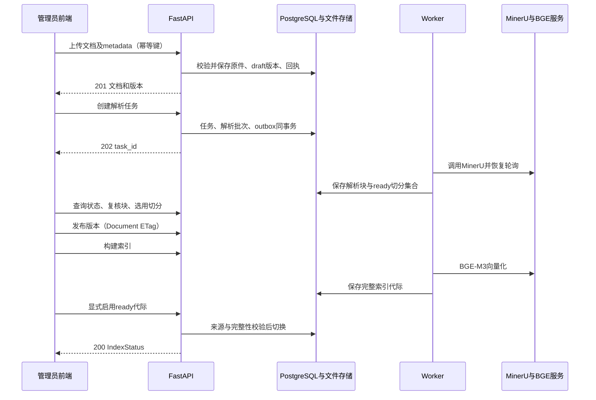

# 前后端 API 接口设计

设计日期：2026-11-15。本文维护目标 API 契约，代码映射为 `src/server/app.py`；接口实现、联调和回归的实际结果统一见 [项目状态](../planning/STATUS.md)，服务层测试不能替代端点或浏览器验收。

2026-11-19实现映射：PDF受理/页/块/纠正/切分及候选来源启用在`app.py`和`governance_api.py`；完整索引构建/显式启用与回滚统一在`index_api.py`，强ETag同时绑定KB修订、活动指针及切换历史。员工图片/原页只读入口在`evidence_api.py`，与JSON结果共用指定回答快照和当前资料读取门禁；新检索/外发/交付仍要求查询资格和活动完整代际。`execution.py`消费精确child、覆盖与`answer-plan/1`，内部候选、模型原始回执、辅助产物不从员工artifact列表暴露。下文带日期的旧“尚未实现/同步/自动选用”属于历史观察；本轮实际覆盖与未验收范围只查STATUS/tasks，接口存在不代表真实服务或企业验收通过。

2026-11-17本地实现历史快照：当时已增加审批证据核查、业务确认、核验集及发布预检、参考开放，以及API18的持久模型关口和查询Worker。下表保留当时范围，其“尚未覆盖”不是2026-11-18完整现状；后续局部实现见19.4、20–22及STATUS/tasks当前证据。目标契约和完整验收要求继续有效，实际运行说明见[本地执行说明](../development/本地查询执行与验证.md)。

| 主题 | 当前本地入口与约束 | 尚未覆盖 |
| --- | --- | --- |
| 审批与确认 | `governance_api.py`提供审批/确认登记、证据附件、核查及撤销；登记与真实批准分离。核查必须匹配受控信任根、精确主体/版本/来源及范围，上传附件或管理员点击不能自证批准。旧approve继续409；当前授权批准仅支持user受益人，role受益人明确拒绝 | 真实企业根/任命和核查材料、完整角色任命与系统治理界面 |
| 核验与发布 | 原块核验端点使用修订/hash，review-set绑定确切解析、切分、全体块及专业确认；publication-preview冻结依赖，发布/撤回消费有效预检，返回操作回执及独立索引状态。hold立即阻断；解除不自动恢复资格。新草稿不替换旧版或使其正式索引失效 | 复杂PDF结构和真实专业确认、PostgreSQL并发、完整K00–K10界面 |
| 仅供参考 | reference-access显式开放精确草稿；原件读取仍要求当前DR与版本分类匹配，仅供人阅读，不能进入正式检索/模型投影。修改参考开放只改变可见性，不改变正式语料 | 真实三角色参考阅读及全部历史原件策略验收 |
| 查询受理与补充 | `/knowledge/queries`持久受理/outbox；GET状态/结果不执行查询。`/tasks/{task_id}/input-requests`及其`/{request_id}/responses`保存真实员工响应，以CSRF、ETag、幂等及CAS恢复原任务；`/conversations/{id}/conditions`仅本人显式条件写入/移除 | 多工作项通用补充、办公变更确认及完整持续对话界面 |
| 私有模型出口 | `/private/runtime/runs/{run_id}/context-project`、`model-authorizations`、`models/chat/completions`及`model-calls/{id}`使用回环地址与run token；先从当前业务权威投影，再封闭转换/正文hash许可/一次派发。正文仅临时传输，持久投影保存摘要与依赖；预算与未知结果跨run保留 | 真实provider、准确token/费用、OS级出口限制、留存/恢复演练 |
| 单条回答 | 新分享绑定确切answer_snapshot_id；共享读取不返回原任务input/effective_input/conversation_id，当前资料权限与分享期限/撤销均复核，后续回答不沿用旧分享 | 正式对话页面及完整T19/T20协作验收 |

本地参考端点保留无前缀路径，应用兼容 `/api/v1/` 前缀；成功响应仍沿现有形状，目标2.1的统一包裹和分页尚未全面迁移。当前别名遵循Pi方案固定映射，T14为`dc_artifacts_validate`、T16为`dc_artifacts_deliver`，Python与Node白名单通过同一映射检查。当前只启用8项查询工具子集，不等于20项完整实现；其他工具不向模型声明可执行。已受理后台任务不因原浏览器正常退出而失效，但执行、投影和结果始终复核当前账号、权限、范围、来源和租约。主/摘要/压缩采用同一许可协议；本地烟囱只真实执行查询主路径，完整辅助流程与业务验收继续按PI-AC执行。

当前治理ETag变更统一在同一事务用目标行revision条件更新持锁后执行，过期写入412；同key重放先查回执，不因原If-Match过期重复执行。审批管理投影补原登记evidence_locator，避免来源已登记却显示未登记；仍按当前职责/范围过滤。

当前 FastAPI 同源服务 Vite 产物，提供 `/workspace/query`、`/workspace/manage`、`/workspace/access-review`、`/workspace/services`。服务配置限19.4的本地合成子集，受保护的 API 按当前权限鉴权。`GET /documents/{d}/versions/{v}/source-metadata` 返回精确版本source_metadata/revision/etag及ETag头，完整DM/当前权限/no-store；对应已有PATCH仍使确认依赖重新核对，来源登记不自证适用或批准。实际Chrome结果统一见STATUS。[Web 入口](../../src/web/README.md)

本轮增量实现：`/manage`与`/access-review`是本地参考页面；管理读取新增精确版本parse-runs、run下chunk-sets。授权审批的`GET /admin/business-approvals/{id}/verification-options`只给当前可管理记录的匹配职责依据及owned材料；`PATCH .../evidence-refs`以CSRF/If-Match/幂等及原子revision CAS关联pending记录材料，不attest、不批准、不写grant。上传材料仍须受控核实，真实根的建立是企业准入条件；当前页不能替代业务批准。业务确认另提供精确版本`confirmation-options`、确认记录的`verification-options`及pending `evidence-refs`关联，仍不attest或自动确认；CSRF/If-Match/幂等/CAS与owned材料约束同样适用。文档管理按完整knowledge.manage范围核验；全库索引构建须具备全部文档管理范围，员工索引状态不暴露管理版本ID。发布/撤回返回实际操作回执，索引重放返回实际代际状态、stale与真实IndexSource投影，以当前实现及本轮检查为准。

依据：[数据库设计](../database/数据库设计.md)、[前后端技术方案](../architecture/前后端技术方案.md)、[模型与解析方案](../architecture/模型与解析方案.md)及 [角色需求](../README.md#角色需求)。数据库文档定义存储关系，本文件定义前端可调用的契约；二者不能以直接暴露 ORM 对象代替。

## 1. 范围与设计选择

本轮覆盖身份与授权管理、文档上传和版本管理、解析校验与选用切分、索引构建与启用、知识检索、任务状态与结果获取。业务接口采用 HTTP JSON，上传使用 multipart，下载返回文件流，长任务采用提交后轮询。

- 相比把所有动作塞进通用聊天接口，资源接口让权限、版本和任务状态明确可查。
- 首版采用轮询，不把 WebSocket 或 SSE 设为必需条件；后续事件推送可以补充，不能改变任务状态的持久依据。
- 首期使用平台内账号和服务端会话引用，通过受保护 Cookie 建立会话；不开放自助注册和企业 SSO。认证适配器负责获得可信当前用户，业务 API 不信任客户端提交的 user_id/role/permission；会话失效、CSRF 和登录入口契约见 [首期登录与会话](../planning/first-release-device-query/contracts/auth-session.md)。
- 文件上传先进入本系统，再由 Worker 按授权调用 MinerU；前端不持有供应商凭据、不直接上传企业原件给第三方。
- 计算公式与计算明细数据模型尚未完成，因此本轮不定义可执行任意公式的接口，也不宣称 calculate/export 全部业务能力已经可调用。

2026-11-11 范围澄清：先从角色的资料获取与办公障碍确定任务优先级。公式计算与 Excel 保留为 [候选场景](../requirements/SPEC.md#11-候选场景公式计算与-excel)，实施该场景前仍需补齐计算与导出契约；现有接口仅为设计草案，不定义产品只能解决哪类办公问题。

## 2. 通用契约

### 2.1 URL、字段与响应

| 项目 | 约定 |
| --- | --- |
| 路径前缀 | `/api/v1`；下文端点均省略前缀；路径参数为 UUID |
| 字段 | JSON 使用 snake_case；未知请求字段拒绝，响应新增可选字段保持向后兼容 |
| 身份 | 由认证适配层提供 users.id；浏览器提交的 user_id/role/permission 不能作为调用者身份；首期浏览器使用服务端会话 Cookie，其他调用方须使用等价的可信认证适配器 |
| 时间与数值 | 时间为 ISO 8601 UTC 字符串；计数是整数；未来正式精确计算采用十进制字符串加单位，不把 JS 浮点值当作精确计算契约 |
| 成功 JSON | `{"data": T, "meta": {"request_id": string}}`；204 和文件流无此包裹 |
| 列表 | data 为 `{"items": T[], "next_cursor": string\|null}`；默认 limit=20、上限100，cursor 不透明并绑定筛选条件；只返回授权对象，不提供全库总数 |
| 默认排序 | 普通实体列表 created_at、id 降序；版本按 version_no 降序；块和步骤按 ordinal/position 升序 |
| 无敏感缓存 | 含业务内容的响应使用 `Cache-Control: private, no-store`；服务端缓存仍受当前权限修订校验 |
| 响应白名单 | 分离管理视图、用户视图和运维视图，禁止直接序列化全部数据库列 |

本轮列表上限、查询长度等为工程默认值，可通过验证调整，不是模型供应商限制。FastAPI 支持文件表单与响应模型；具体实现须显式定义请求、响应模型和过滤字段。[上传文档](https://fastapi.tiangolo.com/tutorial/request-files/)、[响应模型](https://fastapi.tiangolo.com/tutorial/response-model/)

### 2.2 幂等与并发更新

- 所有 POST、PUT、PATCH、DELETE 写接口要求 `Idempotency-Key`（客户端生成 UUID，一次用户操作固定一个）。同一用户所有写接口共用键空间；重发相同方法、路径、规范化请求内容及 If-Match 条件返回同一操作结果；相同键配不同内容返回 `409 IDEMPOTENCY_CONFLICT`。修正参数或刷新并发条件后重新发起操作使用新键。
- 服务端用 `api_idempotency_records` 保存 HTTP 请求回执，结构见 [数据库设计第 8.4 节](../database/数据库设计.md#84-接口设计增补http-请求回执)。任务创建同时写 tasks、步骤、outbox 和回执结果；上传使用文件状态与回执恢复流程，不能只用进程内字典去重。
- multipart 的请求指纹包括规范化 metadata 及实际文件 SHA-256，不包括随机 boundary 或上传进度。处理未完成时重复请求返回 `409 REQUEST_IN_PROGRESS` 及 Retry-After；状态不明时返回 `409 REQUEST_RECONCILIATION_REQUIRED`，由服务端核对，不让前端换键盲目重传。
- 任何幂等重放都先检查当前身份与资源权限。回执仅保存状态码、资源标识和原请求指纹；不缓存可绕过撤权的响应正文或下载地址。
- PATCH、PUT、DELETE，以及发布、撤销、块复核、选用切分、索引启用和任务取消，必须携带 `If-Match`。GET 单资源返回强 ETag，列表项必要时携带该资源的 etag；缺少条件返回428，不匹配返回412。新增资源和创建长任务不要求 If-Match，除非端点表另注。
- ETag 来自当前资源可变字段及相关修订（授权集合包括 acl_revision/authz_revision），比较和写入在同一锁定事务中完成，防止先检查后被并发覆盖。已成功请求的幂等重放在当前权限通过后返回同一结果，不因原 ETag 已变化重复执行。
- 201 表示资源已创建；202 表示任务及派发记录已持久化，不代表 Worker 或外部服务已开始；DELETE 默认为逻辑删除或撤销授权，不永久清除原件。

HTTP 条件请求和状态码遵循 HTTP 语义；上述 Idempotency-Key 的持久化与重放规则是本项目约定。[HTTP 语义](https://www.rfc-editor.org/rfc/rfc9110.html)

### 2.3 错误结构

错误采用 `application/problem+json`，按照 Problem Details 结构补充业务 code、request_id 和字段错误，不回显完整输入、原文、SQL 或供应商凭据。[RFC 9457](https://www.rfc-editor.org/rfc/rfc9457.html)

```json
{
  "type": "about:blank",
  "title": "Conflict",
  "status": 409,
  "detail": "当前版本已变化，请刷新后再发布。",
  "instance": "/api/v1/documents/11111111-1111-4111-8111-111111111111/versions/22222222-2222-4222-8222-222222222222/publish",
  "code": "VERSION_CONFLICT",
  "request_id": "req-example",
  "errors": []
}
```

errors 元素为 `{field: string, code: string, message: string}`，field 使用请求字段路径。状态与 code 对应：

| HTTP 状态 | 业务 code 示例 | 前端处理 |
| --- | --- | --- |
| 400 | `INVALID_CURSOR` | 重置分页或修正请求 |
| 401 | `UNAUTHENTICATED` | 重新认证，不能继续轮询或下载 |
| 403 | `OPERATION_FORBIDDEN`、`ACCESS_CONDITIONS_CHANGED` | 无操作能力，或已知本人/分享任务依赖权限变化；不列出无权资料名称 |
| 404 | `RESOURCE_NOT_FOUND` | 不存在、无资源读取范围或路径父子不匹配统一返回，不暴露存在性 |
| 409 | `VERSION_CONFLICT`、`INVALID_STATE`、`INDEX_NOT_READY`、`INDEX_STALE`、`CAPABILITY_NOT_CONFIGURED`、上述幂等冲突 | 按 code 刷新、补充条件或等待，不能统一自动重试 |
| 412 / 428 | `PRECONDITION_FAILED` / `PRECONDITION_REQUIRED` | 刷新 ETag 后由用户重新判断操作，新的操作使用新幂等键 |
| 413 / 415 | `FILE_TOO_LARGE` / `UNSUPPORTED_MEDIA_TYPE` | 根据能力配置调整文件 |
| 422 | `VALIDATION_ERROR`、`FILE_HASH_MISMATCH` | 显示字段错误，不把缺失参数补成默认业务值 |
| 429 | `RATE_LIMITED` | 按 Retry-After 等待并保持同一幂等键 |
| 503 | `SERVICE_UNAVAILABLE` | 接受任务前拒绝的新请求可稍后重试；已接受任务仍以任务状态为准 |

已提交任务的解析失败通常表现为 GET 任务返回200且 status=failed，不把业务失败伪装成轮询 HTTP 500。未知异常使用500与脱敏 request_id。

## 3. 权限缩写与公共数据结构

### 3.1 权限缩写

| 缩写 | 含义 |
| --- | --- |
| `AUTH` | 当前用户 active 且身份已验证 |
| `DR` | document.read + 数据库设计中的文档有效访问范围 |
| `DM` | document.manage + 目标文档 manage 范围；新建文档使用目标知识库 manage 范围 |
| `KM` | document.manage + 知识库 manage 范围，并可管理该库全部未删除的现行文档，用于完整索引维护 |
| `TR` | task.read + 任务所有者或被分享者 + 当前可读取全部 task_documents，任务未删除 |
| `TO` | 任务所有者；执行取消、重新提交等动作时还校验原任务类型所需能力与范围 |
| `UM/AM/SC/OR` | user.manage / access.manage / system.configure / operations.read |

所有缩写隐含 AUTH。system_admin 不绕过 DR/DM/TR。普通用户默认只看到已有发布版本的文档及 effective/superseded/withdrawn 版本；2026-11-17用户确认增加“DM显式开放精确草稿原件仅供参考”的受控例外，见17.6。未开放草稿、解析块和维护界面仍要求DM；参考开放不授予DR，也不放宽正式查询门槛。

任务列表可向所有者/接收者返回极简的 `access_limited` 状态项，但无正文、文件名或无权文档名称；任务详情与结果仍执行 TR。身份能力满足但资源范围不满足时优先404，仅对已知任务的依赖变化使用403。

### 3.2 类型约定

以下采用说明性类型记法，不是可执行 TypeScript；`?` 表示字段可省略，`T|null` 表示字段存在但允许未知。所有服务端对象包含 id 和 created_at，明确另述的投影除外。状态枚举以数据库设计为唯一来源。

| 名称 | 数据结构 |
| --- | --- |
| `UserView` | id:UUID, display_name:string, status:active/disabled, created_at:Time, updated_at:Time |
| `CurrentUser` | UserView + role_codes:string[], permissions:string[], authz_revision:integer；不包含身份凭据 |
| `RoleView` | id:UUID, code:string, name:string, permission_codes:string[] |
| `RoleAssignment` | user_id:UUID, role_codes:string[], authz_revision:integer |
| `Grant` | user_id:UUID, access_level:read/manage；写入方 granted_by/granted_at 由后端填充 |
| `AccessPolicy` | resource_type:knowledge_base/document, resource_id:UUID, access_mode?:inherit/restricted, grants:Grant[], acl_revision:integer |
| `AccessTarget` | resource_type, resource_id, knowledge_base_id:UUID\|null, status:string；无标题、原文或内容摘要 |
| `KnowledgeBaseView` | id:UUID, name:string, status:active/archived, search_ready:boolean, created_at:Time；普通用户无全库数量及内部索引配置 |
| `Applicability` | schema_version:"1", scope_status:confirmed/unconfirmed, equipment_models:string[], conditions:string[]；空模型数组不自动等于适用所有设备 |
| `DocumentView` | id:UUID, knowledge_base_id:UUID, title:string, category:string\|null, current_version_id:UUID\|null, access_mode:inherit/restricted, allowed_actions:string[], created_at:Time, updated_at:Time |
| `VersionView` | id:UUID, document_id:UUID, version_no:integer, revision_label:string\|null, status:VersionStatus, applicability:Applicability, source_file:FileSummary, selected_chunk_set_id:UUID\|null, effective_at:Time\|null, published_at:Time\|null, created_at:Time |
| `FileSummary` | byte_size:integer, mime_type:string, sha256:string；不返回存储路径、bucket 或供应商下载地址 |
| `TaskAccepted` | task_id:UUID, status:TaskStatus（首次为pending，重放为当前状态）, resource_type:parse_run/index_generation/task, resource_id:UUID, status_url:string, poll_after_seconds:integer |
| `Locator` | schema_version:"1", kind:pdf/office/unknown, page_number:integer\|null, printed_page:string\|null, section:string\|null, table_id:string\|null, cell:string\|null, bbox:object\|null；bbox 有值时含坐标系和页面尺寸 |

allowed_actions、search_ready 仅帮助前端展示，后端每次操作仍重新校验。revision_label、页码、模型修订等未知信息必须为 null，不能生成看似确定的值。

## 4. 当前用户、用户管理与授权接口

| 方法与路径 | 权限 | 请求 | 成功响应 | 数据关联 |
| --- | --- | --- | --- | --- |
| `POST /auth/login` | PUBLIC | credential adapter payload | 200 CurrentUser；设置受保护会话 Cookie | auth_sessions、audit_events；失败不透露账号是否存在 |
| `GET /me` | AUTH | 无 | 200 CurrentUser | users、user_roles、role_permissions |
| `GET /capabilities` | AUTH | 无 | 200 CapabilityView，见下文 | 已验证部署配置的投影 |
| `POST /auth/logout` | AUTH | CSRF header | 204 | auth_sessions、audit_events；重复登出幂等 |
| `GET /admin/users` | UM | cursor, limit, status? | 200 Page<UserView> | users |
| `POST /admin/users` | UM | display_name:string | 201 UserView，默认 disabled | users；只建业务用户，不直接建立登录身份 |
| `GET /admin/users/{user_id}` | UM | 无 | 200 UserView + ETag | users |
| `PATCH /admin/users/{user_id}` | UM | display_name?:string, status?:active/disabled | 200 UserView；至少一个字段 | users、audit_events；停用更新权限修订 |
| `POST /admin/users/{user_id}/credential-activation` | UM | out_of_band:true | 202 ActivationIssued；不返回口令或长期 token | user_identities、audit_events；一次性激活并绑定本地凭据 |
| `POST /admin/users/{user_id}/credential-reset` | UM | reason:string | 202 ActivationIssued；撤销旧会话 | user_identities、auth_sessions、audit_events |
| `GET /admin/roles` | AM | 无 | 200 Page<RoleView>，固定角色目录 | roles、permissions、role_permissions |
| `GET /admin/users/{user_id}/roles` | AM | 无 | 200 RoleAssignment + ETag | user_roles |
| `PUT /admin/users/{user_id}/roles` | AM | role_codes:string[] | 200 RoleAssignment；全量替换 | user_roles、users.authz_revision、审计 |
| `GET /admin/access-targets` | AM | resource_type, knowledge_base_id?, cursor, limit | 200 Page<AccessTarget> | 最小授权对象标识投影，不返回文档标题 |
| `GET /admin/knowledge-bases/{kb_id}/access` | AM | 无 | 200 AccessPolicy + ETag | knowledge_base_grants |
| `PUT /admin/knowledge-bases/{kb_id}/access` | AM | grants:Grant[] | 200 AccessPolicy；全量替换 | authorization_grants、business_approvals、acl_revision、审计，同事务 |
| `GET /admin/documents/{document_id}/access` | AM | 无 | 200 AccessPolicy + ETag | document_grants、documents.access_mode |
| `PUT /admin/documents/{document_id}/access` | AM | access_mode:inherit/restricted, grants:Grant[] | 200 AccessPolicy；原子替换 | authorization_grants、business_approvals、文档授权与模式、知识库 acl_revision、审计 |

CapabilityView：`{upload:{allowed_mime_types:string[],max_bytes:integer},query:{enabled:boolean,max_chars:integer,max_top_k:integer,answer_enabled:boolean},parsing:{enabled:boolean},indexing:{enabled:boolean}}`。能力字段按用户角色裁剪，限额来自服务端配置，不暴露密钥。未验证格式不列为支持；生成模型未配置时 answer_enabled=false。

`Grant` 必须包含完整授权组合：`subject_user_id` 或 `role_code`、目标知识库/文档、`operation`、可选文件等级/类别/需求分类、`valid_from`、`valid_until` 和 `business_approval_id`。服务端拒绝缺审批依据、过期、冲突或不能由同一授权元组解释的请求；全量替换在同一事务中写入撤销和审计记录。系统管理员不能用授权接口把自己加入未经批准的业务范围。

首期允许同一账号兼任多个角色，但每个角色、资料范围、操作和期限必须有明确授权并保持对应关系；不能以角色叠加突破文件规则，也不能自行授予权限。身份绑定不通过任意客户端 provider/subject 字段完成；首期不开放企业 SSO 和自助注册，后续发行方接入通过认证适配器完成。权限码首版由服务端种子管理，不提供修改角色内置能力的普通 CRUD。

2026-11-17系统管理员完整设计在第19节补齐角色任命依据/期限、真实外部审批登记核查、授权预检及PUT扩展字段；本节基础表不代表只传role_codes或grants就能跳过这些门禁，亦不代表现有原型已实现。

## 5. 知识库、上传与版本管理

### 5.1 接口

| 方法与路径 | 权限 | 请求 | 成功响应 | 数据关联 |
| --- | --- | --- | --- | --- |
| `GET /knowledge-bases` | AUTH + 至少一个业务读取/管理范围 | cursor, limit | 200 Page<KnowledgeBaseView>，无范围返回空列表 | knowledge_bases、授权表 |
| `POST /admin/knowledge-bases` | SC 或 KM登记能力；不产生DM | name:string | 201 KnowledgeBaseView，无隐式资料授权 | knowledge_bases |
| `GET /admin/knowledge-bases/{kb_id}` | SC | 无 | 200 基础配置 {id,name,status,created_at} + ETag | knowledge_bases，不含文档 |
| `PATCH /admin/knowledge-bases/{kb_id}` | SC | name?:string, status?:active/archived | 200 基础配置；归档使业务读取不可用 | knowledge_bases、修订、审计 |
| `GET /knowledge-bases/{kb_id}/documents` | DR，逐项过滤；DM可含草稿，员工只含17.6已开放参考的精确草稿或原有可读发布版本 | cursor, limit, q?, category? | 200 Page<DocumentView> | documents、versions、授权表；不泄露其他草稿 |
| `POST /knowledge-bases/{kb_id}/documents` | DM（知识库范围） | multipart: file + metadata=NewDocumentInput | 201 {document:DocumentView,version:VersionView} | 文件、文档、首版、请求回执 |
| `GET /documents/{document_id}` | DR 或 DM | 无 | 200 DocumentView + ETag | documents |
| `PATCH /documents/{document_id}` | DM | title?:string, category?:string\|null | 200 DocumentView；不接受 ACL、归属或当前版本字段 | documents、审计 |
| `DELETE /documents/{document_id}` | 当前精确DM；Document If-Match | 可选 {reason:string}，页面必填；旧无body兼容 | 204，逻辑删除，同键可重放 | deleted_at、内容/权限修订、审计、outbox、回执 |
| `GET /documents/{document_id}/versions` | DR；未开放参考的draft需DM，已开放参考按17.6逐版过滤 | cursor, limit | 200 Page<VersionView> | document_versions |
| `POST /documents/{document_id}/versions` | DM；If-Match 为 Document ETag | multipart: file + metadata=NewVersionInput | 201 VersionView，状态 draft | 文件、新版本、回执 |
| `GET /documents/{document_id}/versions/{version_id}` | DR；draft原件参考按17.6，维护投影仍需DM | 无 | 200 VersionView + ETag | document_versions |
| `POST /documents/{document_id}/versions/{version_id}/publish` | DM；If-Match 为 Document ETag | effective_at:Time\|null | 200 {document:DocumentView,version:VersionView} | 当前指针、版本状态、content_revision |
| `POST /documents/{document_id}/versions/{version_id}/withdraw` | DM；If-Match 为 Document ETag | reason:string | 200 {document,version} | 状态 withdrawn，必要时清空当前指针 |
| `GET /documents/{document_id}/versions/{version_id}/file` | DR；draft仅17.6已开放参考时可inline，未开放仍需DM；下载另验操作 | disposition=inline/attachment | 200/206 文件流 | source_file_id，复核精确版本/参考状态/当前权限 |

原NewVersionInput候选设计为`{revision_label:string|null,applicability:Applicability,expected_sha256:string}`，尚未按此multipart结构实现。当前新版本端点仍接收file及查询参数revision_label/model_scope，不宣称支持该候选metadata或客户端expected_sha256。当前新文档metadata按第20节实现：仅登记来源与草稿字段，哈希由服务器计算，不接收applicability/ACL/确认或发布状态。

metadata 是 multipart 中的 JSON 字符串字段，不是同时发送第二个 application/json 请求体；后端独立校验并拒绝额外字段。标题、分类及文件名不作为存储路径。

### 5.2 上传与发布语义

1. 先验证身份、目标知识库/文档的管理权限和上传限额；文件接收到隔离临时区，由服务器计算实际内容哈希并核对PDF类型。当前不接收候选expected_sha256声明字段，不把未实现的候选校验当作已执行。
2. 保存 file_objects 与文件状态，确认文件可用后在事务中创建文档/版本并完成请求回执。失败不产生可见的半个版本，文件已安装但数据库未提交时按稳定私有身份核对恢复；不自动清除不确定遗留文件。
3. 新文档默认 access_mode=inherit；草稿维护按当前管理范围，普通用户仅在第17.6节显式开放精确版本原文参考并满足当前DR时可读取，不进入正式问答。分类不完整时按第9节SPEC的保守默认隔离：首版上传者仍需当前KB管理元组，其他管理员需明确单文档DM；未知首版不推断身份。敏感文档应在发布前由授权管理员收紧范围，DM不能通过上传字段改变ACL。
4. 上传201只表示资料已保存，不代表已解析、已生效或已建索引。解析由后续接口显式发起。
5. 新版本不自动发布；publish 仅允许 draft。2026-11-17用户确认知识管理员发布门禁收敛为原件可用、业务依据核实、精确批次内容核验及关键专业确认齐全、等级/访问条件满足，详见第17节；这是已确认要求，不代表旧接口已满足。effective_at 未知可为 null，不能把 published_at 当成手册生效日。未来定时生效不在首版范围。
6. 发布锁文档行并更新旧版与新版状态；用户必须持有最新 Document ETag，防止两名管理员互相覆盖。发布不自动启用未完成的索引。
7. 首版不开放原件/适用条件原位改写接口；需要改动时创建新版本。withdraw 只撤销该版本，不自动恢复历史版；版本回退须重新经过发布设计，不默认开放。

版本撤销、逻辑删除及并发冲突必须保留审计；不可删除版本的接口字段不能靠前端隐藏替代后端拒绝。

## 6. 解析、校验与切分选择

### 6.1 接口

| 方法与路径 | 权限 | 请求 | 成功响应 | 数据关联 |
| --- | --- | --- | --- | --- |
| `POST /documents/{document_id}/versions/{version_id}/parse-runs` | DM | ParseRequest | 202 TaskAccepted，resource_type=parse_run | tasks、steps、parse_runs、task_documents、outbox |
| `GET /documents/{document_id}/versions/{version_id}/parse-runs` | DM | cursor, limit | 200 Page<ParseRunView> | parse_runs |
| `GET /parse-runs/{parse_run_id}` | DM（按所属版本解析） | 无 | 200 ParseRunView + ETag | parse_runs、步骤 |
| `GET /parse-runs/{parse_run_id}/blocks` | DM | cursor, limit, kind?, review_status? | 200 Page<BlockView>，按 ordinal | content_blocks |
| `GET /parse-runs/{parse_run_id}/blocks/{block_id}` | DM | 无 | 200 BlockView + ETag | content_blocks，父子归属校验 |
| `POST /parse-runs/{parse_run_id}/blocks/{block_id}/review` | DM | {review_status:approved/rejected,reason:string} | 200 BlockView | review 字段、审计，拒绝内容递增 content_revision |
| `POST /parse-runs/{parse_run_id}/corrections` | DM | CorrectionRequest | 202 TaskAccepted，新 manual 解析批次 | 新 parse_runs、原文块副本、task_documents、outbox |
| `GET /parse-runs/{parse_run_id}/chunk-sets` | DM | cursor, limit | 200 Page<ChunkSetView> | chunk_sets |
| `GET /parse-runs/{parse_run_id}/artifacts/{artifact_id}/file` | DM | 无 | 200/206 文件流 | parse_artifacts、file_objects |
| `PUT /documents/{document_id}/versions/{version_id}/selected-chunk-set` | DM；If-Match 为 Version ETag | {chunk_set_id:UUID} | 200 VersionView | selected_chunk_set_id、content_revision |

ParseRequest：`{language_hint?:string}`，首版固定 MinerU VLM，启用表格与公式识别。language_hint 只能来自实际供应商支持的白名单；不允许前端指定任意 URL、模型端点或执行代码。

本地演练接口可用 `{mode:"local"}` 创建待核验批次，扫描页在已配置的离线环境触发 MinerU Basic。管理端块列表返回 `structured_content`、`locator.file_page`、`printed_page`、`bbox_normalized`、`extraction` 及可选 `parse_issue`。表格 `rows` 中每格包含 `text`、表头标记以及识别器提供的 `rowspan`/`colspan`，不返回供应商 HTML。校正副本保留未修改的结构，已有文本或类型被改写时清除旧结构，避免展示与新文字不符的表格。

扫描表格补识记录在 `structured_content.recovered_warnings` 和 `recovered_icons`，含零起始的 `row`、该行单元格数组内的 `column` 和原页 `bbox_normalized`。按键条目另含 `symbol`。补识内容随对应单元格和块文本核验。管理端可调用 `GET /parse-runs/{parse_run_id}/blocks/{block_id}/source-image`，依据同一原件、批次和表格定位即时获得 PNG。当前资料管理权限必须有效。预览响应设置 `Cache-Control: private, no-store`，无法访问或缺少可靠定位时返回 404。

操作表和按键图例中的待核验图形单元格按 `structured_content.pending_graphic_keys` 返回，位置采用零起始的 `row` 和该行单元格数组内的 `column`。待核验图例格的原始形态可从原表裁图查看，操作说明随块保留。尝试将含此标记的块设为 `approved` 返回 `409 GRAPHIC_KEYS_PENDING`，先依据原图提交校正，再走已有核验流程。未修改的校正副本继承待核验标记。

当前图形键校正复用 `POST /parse-runs/{parse_run_id}/corrections`，提交 `graphic_tables:[{block_id,source_content_hash,cells:[{row,column,text,keys:[{label,operation,bbox_normalized}]}]}]`。根据父批次块的当前 `content_hash` 验证校正依据，校正位置须是待核验或已校正单元格，每个按键裁区须位于原表内。结果保存为新的 `manual` 批次，网格和原页定位保留，校正后的块文本按网格重建，未处理的待核验位置继续阻断直接核验。新批次返回 `needs_review`，校正块结构记录父批次、原块和来源哈希。

2026-11-19正式KM页面接线：选定父Run及可编辑文字叶块后，可沿同一durable接口提交`blocks:[{block_id,text?,kind?,reason,basis:{file_page,description}}]`。kind只允许既有规则的保持/paragraph或ref_text升格step/warning等受控变更，禁止通过表单设置approved/发布。202只表示新批次已受理，Worker执行、源QC、重新核验及实际专业依据分别显示；原批次、原件和引文不覆盖。图文表格未可靠识别表头时继续待核验，当前不提供通用表格结构编辑或自动猜表头。

按键原图复用 `GET .../source-image?row=&column=&key=`，三个参数由已存储的按键记录定位，`key` 为该格按键数组的零起始下标。省略参数返回整表裁图。出图仍基于版本原件与当前管理授权。

CorrectionRequest：`{reason:string,edits:[{block_id:UUID,text_content?:string,structured_content?:BlockContent}]}`，每项至少修改一种内容，不允许修改原文定位、所属版本或任意父块。表格/公式修改以结构内容为准，服务端重新生成对应文本；纯文本块才允许只修改 text_content。批次冻结后不能原位更改；校正复制到新 manual 批次，记录 parent_run_id，改动块重新置 unreviewed。新增/删除布局块与跨页人工重排留待专项交互设计。

### 6.2 数据与状态

| 名称 | 数据结构 |
| --- | --- |
| `ParseRunView` | id, document_version_id, task_id, origin:provider/manual, parent_run_id:UUID\|null, status:ParseStatus, model_option:string\|null, model_revision:string\|null, error:{code,message}\|null, created_at；无供应商 Token、原始请求地址 |
| `BlockView` | id, parse_run_id, parent_block_id:UUID\|null, ordinal:integer, kind:string, text_content:string\|null, structured_content:object, locator:Locator, review_status:unreviewed/approved/rejected, reviewed_at:Time\|null, etag:string |
| `ChunkSetView` | id, parse_run_id, splitter_version:string, status:building/ready/failed, chunk_count:integer, created_at；不默认发送全部向量 |

BlockContent 是带 schema_version="1" 和 type 的联合结构，以下为归一化契约，不表示任何解析器已通过这些内容的准确率验证：

| type | 内容字段 |
| --- | --- |
| text | text:string；标题、普通正文、警告等通过 BlockView.kind 区分 |
| table | row_count:integer, column_count:integer, cells:[{row:integer,column:integer,row_span:integer,column_span:integer,text:string,is_header:boolean}]；行列从1起，跨度至少1，检查越界和重叠 |
| formula | expression:string, notation:latex/plain, surrounding_definition:string\|null；仅保存识别表达式与上下文，不执行公式 |
| image | artifact_id:UUID, caption:string\|null；必须属于当前解析批次，预览走鉴权文件端点 |
| unknown | summary:string\|null；未支持的原始结构保存到解析原始结果文件，本轮不开放自由字段校正 |

Locator.bbox 有值时为 `{coordinate_space:pixel/normalized,left:number,top:number,right:number,bottom:number,page_width:number,page_height:number}`，检查坐标范围及右下边界；PDF 的 page_number 从1起。不能从缺失坐标推算并伪装成供应商返回值。

解析工作流包含远端提交/轮询、归一化与首版切分，因此不另设“任意切分代码”接口。成功结果与 ready 切分集合落库后供管理员选择；需要调整切分规则时先定义允许配置，再扩展端点。

ParseStatus 复用数据库的 pending/submitted/running/succeeded/failed/needs_review。`parse_run=succeeded` 表示解析产出成功，不等于块已人工 approved，也不等于当前检索索引已启用。等待远端时 task_steps=waiting_external，tasks 可仍为 running。

已有远端批次的归档下载403/404/410保留原批次与GET回执，返回waiting_external及`PARSE_RESULT_LINK_UNAVAILABLE`，管理页提示核对原批次下载链接；显式恢复仅GET原批次。调用限额耗尽则reconciliation_required及`PARSE_RESULT_RECOVERY_BUDGET_EXHAUSTED`，不得通过换创建键重交同源解析或重置预算。PDF页标签只作为管理元数据，印刷页码缺少实际依据时仍为null。

退回 rejected 块或换选用切分集合后，旧内容立即停止参与检索，不等待重建；确认块恢复 approved 也要遵循当前版本与选用切分规则。网络重试保持同一幂等键和远端任务标识；主动重新解析用新键创建新批次。

## 7. 索引构建与启用

| 方法与路径 | 权限 | 请求 | 成功响应 | 数据关联 |
| --- | --- | --- | --- | --- |
| `GET /knowledge-bases/{kb_id}/index-status` | KM | 无 | 200 IndexStatus + ETag | knowledge_bases、index_generations |
| `GET /knowledge-bases/{kb_id}/embedding-profiles` | KM | cursor, limit | 200 Page<EmbeddingProfileView>，仅可用配置 | embedding_profiles、后端可用性校验 |
| `POST /knowledge-bases/{kb_id}/index-generations` | KM | {embedding_profile_id:UUID} | 202 TaskAccepted，resource_type=index_generation | 索引清单、tasks、steps、依赖、outbox |
| `GET /knowledge-bases/{kb_id}/index-generations` | KM | cursor, limit | 200 Page<IndexGenerationView> | index_generations |
| `GET /knowledge-bases/{kb_id}/index-generations/{generation_id}` | KM | 无 | 200 IndexGenerationView | index_sources、build_report |
| `PUT /knowledge-bases/{kb_id}/active-index` | KM；If-Match 为 IndexStatus ETag | {generation_id:UUID} | 200 IndexStatus | 活动指针、来源与向量完整性校验 |

| 名称 | 数据结构 |
| --- | --- |
| `EmbeddingProfileView` | id, model_name, model_revision:string\|null, dimension:1024, distance_metric:cosine；无密钥与内部服务地址 |
| `IndexStatus` | knowledge_base_id, active_generation_id:UUID\|null, content_revision:integer, active_source_revision:integer\|null, status:missing/ready/stale；status 为派生值，不是新数据库状态 |
| `IndexGenerationView` | id, knowledge_base_id, embedding_profile_id, task_id, status:building/ready/failed/retired, source_revision, expected_chunk_count, actual_chunk_count, exclusions:[{document_version_id,code}], ready_at:Time\|null, created_at |

构建来源由服务端固定为当前已发布版本及选用切分，前端不能注入任意片段或知识库外版本。目标契约按[数据库7.2](../database/数据库设计.md#72-构建切换与查询)：POST仅独立构建，不改变活动指针；完整source/child集合、当前QC/审核/资格与向量均通过才ready。building/failed/retired/过期及历史ready_partial一律不能正式启用，缺成员不能通过exclusions或更小expected_count绕过。当前create_index自动激活ready_partial的实现须修正，本文不将其视为已符合目标。

PUT active-index显式启用/回滚均须CSRF、原幂等键和IndexStatus ETag，短事务重验完整性报告/精确manifest、current revision/selected/发布/核验/hold及KM范围，一次CAS切换generation指针与其不可变profile投影并记录前后回执。build_report增manifest_fingerprint、expected/actual来源与child集合差异、quality/review依赖及检查结果引用；IndexStatus返回同快照的active generation/profile/manifest身份。提交前失败旧指针不变，提交未知按原回执对账；旧来源/revision失效的回滚返回409并需重建，不自动回滚业务版本。该契约尚待实现与运行验证。

EmbeddingProfileView 只列已经配置并通过基本连通验证的服务配置；创建供应商配置与密钥管理不属于本轮公共 API。尚无可用配置时列表为空、构建被拒绝，不能假装有默认生产平台。

## 8. 知识检索与问答任务

### 8.1 提交与结果接口

| 方法与路径 | 权限 | 请求 | 成功响应 | 数据关联 |
| --- | --- | --- | --- | --- |
| `POST /knowledge/queries` | knowledge.query + task.create + 目标库内 DR | QueryInput | 202 TaskAccepted，resource_type=task | query 类型任务、执行快照、outbox |
| `GET /tasks/{task_id}/result` | TR | 无 | 200 QueryResult；未完成409 RESULT_NOT_READY，非query类型409 UNSUPPORTED_RESULT_KIND | 结构化结果文件、task_evidence、当前资料状态 |
| `GET /tasks/{task_id}/evidence` | TR | cursor, limit | 200 Page<EvidenceView> | task_evidence、task_documents、当前状态 |
| `GET /tasks/{task_id}/evidence/{evidence_id}` | TR | 无 | 200 EvidenceView | 同任务证据及所属原文块 |

QueryInput：

| 字段 | 类型与默认值 | 语义 |
| --- | --- | --- |
| query | string，1–4000字符 | 用户查询，不作为系统指令执行 |
| scope_mode | automatic/manual，未提供范围时automatic；候选新增字段，尚未实现 | automatic 由后端按当前查询授权确定范围；manual 仅缩小范围，不授予权限 |
| knowledge_base_ids | UUID[]，可省略；手动选择时1–20项且去重 | 不再要求先选库；省略 scope_mode 且有非空选项时按手动缩小兼容处理。无权限目标返回404，不回显其名称；显式选择上限不能截断默认授权范围 |
| document_ids | UUID[]，可省略，上限100 | 可选缩小到当前有权查询的文档；同时指定知识库时必须属于该范围，无需为单独选手册强迫先选库 |
| equipment_model | string，可省略 | 按已确认适用范围过滤，未确认范围不可推断为匹配 |
| top_k | integer，默认10，1–50 | 目标候选片段数；少于 top_k 不自动代表无相关资料 |
| mode | retrieve/answer，默认retrieve | retrieve 返回证据；answer 还需已配置生成模型，否则409 CAPABILITY_NOT_CONFIGURED |
| allow_partial_index | boolean，默认false | 默认任一库无可用或完整现行索引即409；true 时只查询仍适用且有权的片段，并明确部分覆盖警告 |

2026-11-17 用户已确认默认授权范围检索及手动缩小，上表取代“必须明确选库”的旧设计；新字段与对话衔接属于候选契约，不能据此宣称当前端点已兼容。明确 manual 却没有选择项时不得解释为全部；显式 automatic 同时携带缩小列表应拒绝矛盾输入。切换回全部必须明确提交 automatic。每轮保存实际范围与条件快照，授权仍实时复核，部分索引的默认拒绝策略保持不变，具体用户恢复路径待讨论。端点衔接见第13节。

首版新检索只面向现行版本；指定历史版的业务问答尚未定义，不开放任意 generation_id 查询参数。不同知识库使用各自活动向量配置，不把一种模型的查询向量用于另一种配置。

检索例子（仅示例，不是真实业务输入）：

```json
{
  "query": "查找设备 A 的维护周期及适用条件",
  "knowledge_base_ids": ["11111111-1111-4111-8111-111111111111"],
  "equipment_model": "设备 A",
  "top_k": 10,
  "mode": "retrieve",
  "allow_partial_index": false
}
```

首次接受任务的响应例子：

```json
{
  "data": {
    "task_id": "33333333-3333-4333-8333-333333333333",
    "status": "pending",
    "resource_type": "task",
    "resource_id": "33333333-3333-4333-8333-333333333333",
    "status_url": "/api/v1/tasks/33333333-3333-4333-8333-333333333333",
    "poll_after_seconds": 2
  },
  "meta": {"request_id": "req-example"}
}
```

TaskAccepted 用于首次创建；幂等重放仍返回同一任务标识，但 status 使用当前 TaskStatus，不能在任务已完成时再次声称 pending。

### 8.2 结果结构与持久化

| 名称 | 数据结构 |
| --- | --- |
| `QueryResult` | task_id, result_status:complete/partial/insufficient_evidence, answer:string\|null, hits:SearchHit[], warnings:Warning[], generated_at:Time |
| `SearchHit` | chunk_id:UUID, document_id:UUID, document_version_id:UUID, title:string, revision_label:string\|null, excerpt:string, evidence_ids:UUID[], review_status:unreviewed/approved；不向普通用户输出向量或调试分数 |
| `EvidenceView` | id, task_id, document_id, document_version_id, block_id, quote_snapshot:string, locator:Locator, review_at_run:string, current_review_status:string, current_version_status:string, is_current_version:boolean |
| `Warning` | code:string, message:string, resource_id?:UUID；只允许包含当前有权资源标识 |

QueryResult 的固定部分保存为 `task_artifacts.kind=query_result_json` 的内部 JSON 文件；hits 顺序、answer 和警告有明确结构版本。检索及送入生成模型的实际证据登记 task_evidence 和 task_documents，结果字段映射由 artifact_sources 指向证据。任务结果读取时附加 EvidenceView 中的当前状态，不改历史快照。

历史结果读取与新检索的版本门禁分别处理：来源变为 superseded 时，在当前资料权限及分享仍有效、适用性和内容核验仍通过的条件下，允许读取已保存结果并显示历史版本状态；withdrawn/draft 不据此放行。新检索仍只使用 effective 版本。当前本地参考实现通过 `evidence_is_readable` 对结果、证据和产物列表统一复核，并在证据的 `version.publish_status` 返回当前状态；响应继续使用 `Cache-Control: private, no-store`，不允许旧结果绕过撤权。

2026-11-16 本地实现补充（CACHE-PERM-002）：资料读取对 restricted 仅接受文档直接授权，当前授权相关对象显式从数据库刷新；触发本地查询执行的任务详情/状态/结果在执行提交后再次校验会话。新答案保存前重核所选证据的当前权限、版本/核验/型号及活动索引来源；期间条件变化的候选不写入正文和证据，返回 `evidence_conditions_changed`，无剩余证据时返回 `insufficient_evidence`。这不修改已获准历史结果的正文，也不新增共享答案缓存。范围与实际验证见 [调查记录](../../specs/001-device-operation-maintenance-query/artifacts/acceptance/CACHE-PERM-002.md)。

候选命中多个块时分别建证据记录；一个 SearchHit 可引用多个 evidence_id。凡已进入生成上下文的资料都成为任务依赖，即使最终答案没直接引用，也不能漏掉撤权检查。

`result_status=insufficient_evidence` 是正常的业务结果，可对应 tasks=succeeded，表示系统如实完成了检索与缺项说明，不表示专业问题已解决。answer 模式不能在无证据时改用模型记忆补写专业事实。生成模型未选定前，首版 retrieve 仍可独立验证。

默认要求完整覆盖是对调用者可读、符合筛选条件的文档集合而言；不能用无权文档是否已索引来改变响应，泄露其存在性。普通用户看到的覆盖警告不包含全库 build_report。

## 9. 任务状态、分享与文件结果

### 9.1 接口

| 方法与路径 | 权限 | 请求 | 成功响应 | 数据关联 |
| --- | --- | --- | --- | --- |
| `GET /tasks` | task.read | scope=owned/shared，默认owned；kind?,status?,cursor,limit | 200 Page<TaskListItem> | tasks、task_shares、依赖权限 |
| `GET /tasks/{task_id}` | TR | 无 | 200 TaskView + ETag | tasks、步骤的业务投影 |
| `POST /tasks/{task_id}/retry` | 任务所有者 + task.read + knowledge.query；CSRF/幂等/任务If-Match | {reason?} | 202原task_id + ETag；不新增查询任务 | query_tasks.execution_revision、原task预算、step/outbox |
| `GET /tasks/{task_id}/status` | AUTH + 所有者/接收者 + task.read | 无 | 200 SafeTaskStatus；依赖变化仅返回access_limited，不返回正文 | tasks、分享、当前权限 |
| `POST /tasks/{task_id}/cancel` | TO + TR；If-Match 为 Task ETag | reason:string | 200 TaskView，status=cancelled | task/steps 取消、租约失效与审计 |
| `GET /tasks/{task_id}/shares` | TO + task.share + TR | cursor,limit | 200 Page<{user_id,display_name,granted_at,expires_at,revoked_at,status}> + ETag | task_shares |
| `PUT /tasks/{task_id}/shares` | TO + task.share + TR；If-Match 为分享集合 ETag | {entries:[{user_id,expires_at?}]}，去重且最多100项 | 200 同上，原子替换完整分享集合；缺失项写入 revoked_at | task_shares、审计 |
| `GET /tasks/{task_id}/artifacts` | TR | cursor,limit | 200 Page<ArtifactView> | task_artifacts |
| `GET /tasks/{task_id}/artifacts/{artifact_id}/sources` | TR | cursor,limit | 200 Page<{output_locator,evidence_id}> | artifact_sources，检查同任务 |
| `GET /tasks/{task_id}/artifacts/{artifact_id}/file` | TR | disposition=inline/attachment | 200/206 文件流 | file_objects，按任务授权 |
| `GET /tasks/{task_id}/inputs/{input_name}/file` | TR | 无 | 200/206 文件流 | task_input_files，input_name 按路径编码 |
| `GET /admin/operations/tasks` | OR | status?,kind?,cursor,limit | 200 Page<OperationTaskView> | 脱敏运维投影 |

2026-11-17 分享边界：上表 tasks 分享在普通使用者对话中只代表该轮的一条回答，连同该回答采用的设备条件、版本和出处；不包含其他消息、对话历史或整个对话的读取权。接收者通过该回答对应任务的受控结果视图读取，并复核当前资料及操作权限。既有任务分享实现需要按此边界联调，不据当前端点存在认定新对话分享映射已完成。

工具基线0.1补充：上述兼容只限可证明“一query任务、一回答、没有额外输入/成果可扩读”的情形；完整办公任务必须使用T19的answer快照/独立ACL。非此一对一情形的`/tasks/{id}/shares`拒绝，不将原TR扩展为整个办公任务读取权；候选回答级入口见14.3。

2026-11-19模拟A–F增量：`GET /tasks/{id}`只向当前所有者返回服务端计算的`retry_eligible:boolean`，接收分享者不据此获得恢复权。资格和POST共用当前权限/原范围、已知失败状态、未决调用、剩余原预算及原step检查；前端只在明确true时显示“重试原查询”。未知结果仍禁止重新派发；明确恢复递增execution_revision，原调用回执/预算保留。网页重试与响应丢失后的恢复使用原命令幂等key/If-Match，不能另建query冒充原任务恢复。

正式查询页的一query一回答分享固定`answer_snapshot_id`。GET分享集合返回当前快照标识、每项快照标识和任务ETag，排除旧执行快照收件人；PUT只替换该快照集合，旧收件人不能随新回答新增操作隐式迁移。时间统一为带时区UTC ISO，当前过期状态由服务端计算，不能由浏览器时钟决定保留哪些收件人。新增/到期/逐人撤回保全其他当前接收者；写入时接收者须已有当前资料权限，否则409 SHARE_RECIPIENT_UNAVAILABLE且整体回滚，分享不授予DR。撤回分享阻断任务/证据/任务原图；已有独立DR者仍可读取本来有权的版本原PDF，撤销DR后原PDF也被阻断。员工分享和服务恢复的实际运行证据只在验收记录维护。

为避免默认每秒轮询重复回放全部证据，`GET /tasks/{id}/status`对已认证本人、当前query在途且原KQ范围仍有效时只返回`id,status,revision`，不返回问题、模型正文、来源、警告或next_action。非本人、终态及所有详情/答案/证据仍走原完整读取权限；网页保持1秒轮询，终态另取完整详情与结果。该进度投影不构成正文读取或新授权。

首版查询任务不接收文件附件；task_input_files 下载接口为已有受控业务流程创建的附件服务，不开放“任意 file_id 绑定任务”的通用入口。后续计算/导出输入接口须在相应数据模型补齐后定义。

### 9.2 任务与产物数据

| 名称 | 数据结构 |
| --- | --- |
| `TaskView` | id, kind, status:TaskStatus, owner_user_id, created_at, started_at:Time\|null, finished_at:Time\|null, steps:StepView[], next_action:none/provide_input/review_source/resubmit, error:{code,message}\|null；query所有者另有只读retry_eligible:boolean；不包含供应商原始响应 |
| `StepView` | step_key:string, position:integer, kind:string, status:StepStatus, attempt_count:integer, next_run_at:Time\|null；无 lease_token、Worker 名称或凭据 |
| `TaskListItem` | id, kind, created_at, access:full/limited, status:TaskStatus\|null；limited 时 status=null，不展示标题与输入 |
| `SafeTaskStatus` | task_id, access:full/limited, status:TaskStatus\|null, code:string\|null, poll_after_seconds:integer\|null；limited 时 code=ACCESS_CONDITIONS_CHANGED 且停止轮询 |
| `ArtifactView` | id, task_id, kind, byte_size, mime_type, validation_status:pending/passed/failed/not_verified, available:boolean, created_at；无内部存储地址 |
| `OperationTaskView` | id, kind, status, created_at, started_at:Time\|null, finished_at:Time\|null, error_code:string\|null；无 owner 输入、证据、文件名或结果正文 |

TaskStatus 与 StepStatus 完全复用数据库枚举。前端展示状态不能反向作为写入字段；未获得总工作量时不虚构百分比，用步骤状态描述进度。

业务任务的最后成功状态与“专业依据已确认”分开：retrieve 返回候选证据可成功完成，但未复核内容必须标识；parse 成功不代表可以据此执行正式公式计算。首期独立query不提供随意改写输入的PATCH；完整办公任务的waiting_input按14.3的绑定请求补充、追加resolution后继续原任务，不重新创建同一业务任务。改变已执行输入仍创建明确关联的新任务，旧输入/交付保留。

自动重试记录 task_attempts，不创建新业务任务。首期query已知失败后的明确恢复沿本节`POST /tasks/{id}/retry`保留原任务/输入/预算；改变工作需求的主动重做才使用原创建端点新键。其他任务类型按其既定契约。对于外部提交结果未知的任务先完成服务端核对，不鼓励用户反复点击重做。

cancel 是本地业务取消：事务中取消未完成步骤并使租约失效，后续 Worker 不能提交产物；外部解析可能仍在运行或产生费用，不承诺调用第三方取消成功。succeeded/failed 等既有终态取消返回409；同一取消操作重放不重复执行。

分享接收者必须存在且 active，服务端验证其具备 task.read 和当前资料范围。分享记录包含可选 expires_at、revoked_at 和 status；没有公开匿名token。一query一回答兼容入口可按受限task_id读取；办公回答必须按answer_id读取独立快照，不能取得整任务访问权。分享不会授予document.read或补资料ACL；收件人角色与依赖权限后续变化时再次检查。首版采用受控平台账号标识输入及15.2的精确核对，用户模糊搜索/通讯录范围仍待企业身份方案确定。

### 9.3 文件获取

- 所有文件 URL 必须带业务上下文；不开放 `/files/{file_id}` 通用下载，也不返回永久公开地址。解析图片、原件、任务附件和结果分别走对应受控端点。
- 文件流之前检查父子资源关系、文件 available 状态和当前全部依赖；支持 PDF 预览所需 Range 时，每个请求同样鉴权。
- 产物 validation_status=pending/failed 时 available=false，下载返回409；not_verified 可作为明确标识的未验证产物下载，但前端与文件内容均提示未验证，不把任务标记为正式计算验收完成。
- inline 仅允许受支持且安全处理的格式。Markdown/HTML 解析内容按不可信数据处理；不将其脚本、外链或公式渲染指令当作可执行权限。
- 已发送的响应字节或已下载文件无法被后续撤权追回。后续请求必须被阻断；不以长期签名链接绕过当前权限复核。

## 10. 典型调用流程



普通用户流程：GET /me 和 /capabilities → 列出可访问知识库 → POST /knowledge/queries → 轮询任务 → GET result/evidence → 通过带版本的原文接口核对 → 获取获准产物。刷新页面后通过任务列表恢复，不能只依赖前端内存中的结果。

发布与解析不是强制固定顺序，但新版本尚未准备好时不得默默使用旧版回答；上图选择先完成解析复核再发布，以减少检索空窗。

## 11. 数据库对齐与必要增补

| 接口能力 | 持久化依据与增补 |
| --- | --- |
| 用户、角色、资料范围 | 使用既有 users、身份/角色映射、授权表及修订；无权限副本 |
| 上传与版本发布 | 使用 file_objects、documents、document_versions；新增 api_idempotency_records 防止同步写操作重放产生重复版本 |
| 解析与校正 | 使用 parse_runs、parse_artifacts、blocks、chunk_sets；新校正保留父运行，不原位改旧块 |
| 索引构建与切换 | 使用 profiles、generations、sources、embeddings 与知识库指针；接口状态为数据库状态的投影 |
| query 结果 | 使用 tasks、evidence、documents；固定 QueryResult 存为内部 JSON artifact，当前权限和版本状态实时计算 |
| 任务取消、重试与分享 | 使用 task_steps 租约、attempts、outbox、shares；取消不新增虚假的远端取消状态 |
| 访问限制 | 草稿正文仅 DM 可见；原有角色与资料授权规则继续有效，未新增角色 |

请求回执是本轮发现的必要持久化补充，已同步到数据库文档；不将它与 task_outbox 混为一表。返回404、脱敏运维、当前版本动态状态等属于 API 行为，不要求伪造额外业务表。

## 12. 联调验收与未决事项

实现时由 FastAPI 模型生成 OpenAPI，并从同一契约生成或校验 TypeScript 类型；禁止前端手工维护一份与后端不一致的状态枚举。角色响应白名单、下载鉴权和后台动作仍需要集成测试，类型检查无法替代。

验收至少覆盖：

1. 登录失败不泄露账号存在性；会话失效返回401；无操作能力返回403；不可见资源返回404；错误不泄露名称、原文或外部响应。
2. 同键重放上传只产生一个版本；不同内容同键409；过程中断能核对恢复。
3. 过期 ETag 拒绝发布、授权和索引切换，原状态不被部分修改。
4. 普通用户看不到 draft；知识管理员不能修改 ACL；系统管理员不能凭运维角色读正文。
5. 上传201、解析202、解析成功、切分就绪、版本发布和索引启用各自可区分。
6. 错父子资源、跨文档切分或索引代际被拒绝；不向前端暴露向量和存储地址。
7. 无索引、部分索引、无证据和生成模型未配置有明确不同响应。
8. 分享与下载再次校验依赖；分享过期/撤销、用户被撤权或会话失效后，幂等回执、历史结果和文件入口均不能成为旁路。
9. Worker 重试和本地取消不会重复提交产物；远端提交未知不能盲目重做。
10. 在实际 PostgreSQL、消息服务及获准样本上完成联调，离线前端资源和文件预览可用。

后续企业 SSO、共享通讯录、正式计算/导出契约按对应阶段定义；接口限额、供应商、生产浏览器等实际配置按任务依赖取得。当前端点和生产联调状态统一见 [项目状态](../planning/STATUS.md)，不从本文端点表推断服务已可用。

## 13. 普通使用者对话与资料查阅（候选设计）

更新日期：2026-11-17。产品要求已由用户确认，见 [SPEC 1.3.2](../requirements/SPEC.md#132-普通使用者交互确认2026-11-17)；以下端点及字段是衔接方案草案，尚未实现或联调，不是用户逐项批准的接口细节。完整交互/异常讨论和视觉确认仍未完成。本节沿用既有认证、CSRF、幂等、并发修订、分页及安全错误边界，不新建另一套权限系统。

### 13.1 操作与端点映射

| 操作 | 候选或复用端点 | 权限与数据边界 |
| --- | --- | --- |
| 新建对话 | 新增 `POST /conversations` | AUTH + task.create；只创建调用者自己的对话，不带入其他对话的资料/条件授权 |
| 对话目录与历史 | 新增 `GET /conversations`、`GET /conversations/{conversation_id}/messages` | AUTH + task.read + 所有者；目录标题/摘要及各消息仍检查资料依赖，回答分享不赋予此处权限 |
| 发送消息、补充条件或追问 | 新增 `POST /conversations/{conversation_id}/messages` | 所有者 + task.create；实际检索另需 knowledge.query 与相应资料授权；不以 message_id 指代他人消息 |
| 修改已确认条件或手动范围 | 新增 `PATCH /conversations/{conversation_id}/context` | 所有者 + task.create，If-Match 对话修订；明确变更只影响后续回合，不改既有任务输入/答案 |
| 查看处理状态、答案和证据 | 复用 `GET /tasks/{task_id}/status`、`/result`、`/evidence` | 关联消息与该轮任务；继续使用安全状态和 TR 门禁，不返回整段对话来读取一条答案 |
| 按型号/文件名查阅手册 | 新增 `GET /documents`，参数 q、equipment_model、cursor、limit | document.read + 对应资料范围；跨库搜索只返回可查看项，列表计数、版本状态和文件名同样受控；型号匹配采用已登记适用范围，不猜测 |
| 从目录或引用打开原文 | 复用 `GET /documents/{document_id}/versions` 与版本 `/file` | 仍执行 DR 和系统 draft 的 DM 门禁，校验版本归属；引用使用冻结的版本/定位，不静默换到最新版本 |
| 分享一条回答 | 一query一回答可受限复用旧task shares；其他使用14.3的`/answers/{answer_id}/shares` | 所有者 + task.share + 当前回答依赖权限；只读所选快照，不获得对话/办公任务容器权 |

对话消息输入建议包含 text、client_message_id、expected_context_revision；需要检索时从已有 QueryInput 解析范围与条件，不由前端提交“已获授权”的结论。消息回执提供 conversation_id、消息标识与修订、需要执行时的 task_id；澄清/补充记录没有实际查询时不虚构已完成查询任务。最终消息、任务状态及流式返回方式须在异常交互确定后细化。

范围说明：上述 `/knowledge/queries` 和 QueryResult 仅对接查询工具链，不能作为所有对话工作请求的统一处理能力。消息不等于查询，完整任务与工具衔接边界见 13.5。

### 13.2 上下文与证据

- 后端保存已确认型号/条件及确认来源；模型推断先作为待确认信息，不能无依据进入已确认状态。对话消息沿用当前上下文修订中的范围，不能因该消息未再次提供范围而误重置为 automatic；独立 QueryInput 未给范围时才按默认授权范围解析。默认范围每轮按当前授权重新解析，手动范围也仅用于收窄。
- 需要查询的回合固定上下文修订、实际条件/范围，并关联任务；历史答案保留其生成时的条件和证据。条件变更不改正在运行任务的冻结输入，是否停止旧任务由后续交互决定。
- 模型输入只使用仍有权的相关对话与证据；旧答案不是新问题的独立事实来源。撤权、撤回、内容核验变化沿用资料/任务门禁，不能通过摘要、标题或条件记忆绕过。
- 回答分享视图保存该轮设备条件、版本与出处，只传递必要的回答上下文，不隐式附带其他消息。整条回答的依赖失权时沿用保守阻断规则，不在本轮承诺逐段自动脱敏。
- 直接查阅待确认/待核验的原文沿用现有状态与访问规则；不能因可打开原件就作为正式说明依据。具体页级定位能力需依据解析实际结果验证。

### 13.3 实现与验收差距

当前代码仍按独立 QueryInput/QueryTask 组织，缺少完整对话/消息/条件修订持久化及上述跨库目录契约。T032/T033 跟踪新增能力，T011–T016 衔接现有任务、证据、分享和界面；原型接口与目标契约的既有差异不因本文更新而消失。实现前需核对第8/9节字段投影、数据库迁移、并发回合顺序和既有幂等问题，再执行 quickstart 中扩展的 A/B/D 场景。

### 13.4 资料问题反馈（候选设计）

2026-11-17 用户确认 FR-017：可从当前对话或手册页面提交，由知识管理员后续处理；反馈不等于业务确认或自动发布。员工在原对话/手册页查看进度和答复、资料更新后提示重新查询及保留旧回答亦已确认。本节保留目标契约，已接通的本地 HTTP 与网页子集见第23节，完整受理工作台及协调契约见第17节。

| 操作 | 候选端点 | 校验与边界 |
| --- | --- | --- |
| 员工提交 | `POST /document-feedback` | AUTH + 员工反馈能力；对话来源检查所有权与所选消息归属，手册来源检查当前 document.read 和版本归属；范围内幂等提交，不能凭任意资源 ID 挂接他人任务 |
| 提交回执与本人反馈 | `GET /document-feedback/{feedback_id}` | 提交者或获准受理人；返回原入口所需进度、答复和更新提示，附带资料及引用再次鉴权 |
| 原对话/手册页回访列表 | `GET /document-feedback`，按 conversation_id/message_id 或 document_version_id 过滤，分页 | 普通使用者仅自己的反馈；不因打开手册看到其他员工反馈；管理受理仍走其独立授权入口 |
| 知识管理员受理列表 | `GET /knowledge/feedback` | 资料管理能力、已配置受理范围与当前依赖资料权限；只返回可处理反馈，不因角色身份列出所有员工任务 |
| 受理及答复 | `PATCH /knowledge/feedback/{feedback_id}` | 获准受理人、范围与资料权限，If-Match 修订；候选记录处理状态/答复及审计，不调用业务确认或版本发布操作 |

候选输入：source_kind（conversation/manual）、conversation_id/message_id 或 document_id/document_version_id、可选实际 locator、issue_type、description。来源字段由服务端回查并固化必要定位，类型标签不作为事实判断。对话尚未产生成功答案、当前问题无可用文档时也可提交，不虚构 task_id、文件或引用。问题类型、限额及具体能力码在实施前核定。

建议最小附带内容为员工明确提交的问题说明、来源标识和必要定位；提交前可查看，不默认附带整段对话或完整任务正文。知识管理员通过反馈只能读取这个明确提交的反馈对象及有权资料，不能凭来源链接进入其他消息；涉及多份资料时不能将完整引用/正文送给只管理其中一份的接收者。受理关系不能替代资料或任务 ACL。

没有资料归属或没有合适接收者时，候选处理为受保护的待分派状态，回执不得谎称已分配；第17节提出按配置的受理关系及feedback.route协调范围分派，实际责任名单待确认，不能要求员工先选部门才能查询，也不能默认群发。未授权人员只可见必要安全状态，不可经反馈摘要泄露文件名称或正文。

处理进度候选为 submitted/processing/replied；replied 只代表已答复，不意味着已解决、已核验或已发布。原入口回访进度/答复及更新后提示重新查询已确认；员工补充、通知方式、处理终态和关闭规则仍待讨论。候选详情投影包括 processing_status、response_summary、responded_at、related_versions 和 update_notice，原入口按反馈标识读取。更新提示依据真实关联版本及当前资格派生，不能仅凭回复文字认定资料已发布；未通过门禁的新版本只能显示状态提示。重新查询使用当前对话确认条件/范围并重新鉴权，生成新的任务/消息；旧答案、条件和引用保持原快照，不自动重算或覆盖。

该接口沿用现有会话/CSRF、幂等和脱敏审计。反馈正文是不可信业务输入，不执行其中指令；处理反馈的写事务不能直接改变 applicability_status、content_review_status、publish_status 或活动索引。T034 跟踪实现/联调；目前仅文档设计，既有幂等问题须纳入执行前核对。

### 13.5 整体办公任务与工具衔接边界（设计更正）

2026-11-17 用户指出查询仅为一个工具链，并确认结果优先、附加证据链接跳转。整体需求以 [SPEC](../requirements/SPEC.md#普通使用者整体工作模型2026-11-17-范围更正) 为准；本节记录待细化的服务职责，不新增已实现端点或扩大首期查询实施范围。

后续用户要求先设计全套 Agent 工具；统一候选目录与调用/强制执行边界见 [架构6](../architecture/前后端技术方案.md#6-agent-工具体系总览候选设计)。这些调用名不是现有API路径，后续在本文件细化请求/响应与能力码，在数据库文档细化持久化，避免由每个页面另起一套工具协议。

| 职责 | 需要形成的真实处理能力 | 对前端的衔接要求与当前缺口 |
| --- | --- | --- |
| 对话与办公任务 | 将工作请求、文件和已确认条件关联到可持续执行的任务；一个任务可跨多条补充消息，按需组合工具步骤 | 复用任务生命周期思路，不把每条消息硬映射为查询；通用办公任务提交/恢复契约尚未形成 |
| 授权资料检索 | 提供可用依据及版本/原文定位，按当前权限过滤 | 复用查询子流程；不承担数值运算和工作簿修改，不强制每个任务先检索 |
| 确定性计算 | 核定公式版本、输入来源/单位、适用范围和舍入，受控计算并保存可复算记录 | 返回真实数值及校验状态；通用计算输入/结果契约与应用服务缺失，独立计算实验不能代替该能力 |
| 表格处理 | 读取员工输入文件，确认项目/工作表/区域与单元格映射，按授权修改或追加；保留原件、数据和格式，重算并验证后另存 | 需要输入文件、处理范围、已有结果差异确认、修改记录、预览/下载契约；当前查询服务没有完整 Excel 处理链路 |
| 结果与详情 | 汇总答案、数值或文件及局部完成情况，详情关联来源、计算记录与修改位置 | 主结果与详情/文件分别受控读取；第8节 QueryResult 不能直接冒充通用成果响应，未来契约须按成果类型细化 |

缺项与确认应能暂停受影响项目并在原任务中补充后继续，其他已完成项目保持可识别；重试不重复修改或自动覆盖已有结果。正式数值不得由生成文本冒充，不执行文档或模型提供的任意代码。不能仅凭任务 kind、数据库预留字段或下载链接认定工具已实现。后续依据获准 Excel/公式样本细化并验证实际读入、计算、修改、重算、文件交付和权限链路；具体持久化缺口集中见 [数据库 13.4](../database/数据库设计.md#134-整体办公任务的持久化边界设计更正)。

## 14. Agent工具统一契约（设计基线0.1）

日期：2026-11-17；任务 DESIGN-TOOLS-001。用户已授权完成20项工具设计，明确暂不编写代码。本节是可供实施拆分的接口设计基线，字段和权限码尚未实现；不代表工具、迁移或服务已可用。工具目录和依赖在 [架构6](../architecture/前后端技术方案.md#6-agent-工具体系总览候选设计)，持久化在 [数据库14](../database/数据库设计.md#14-agent工具持久化设计基线01)，逐项现状在 [STATUS](../planning/STATUS.md#20项工具实现对照2026-11-17)，组合验收在 [PLAN](../planning/PLAN.md#agent工具的组合验收与设计交付)。本节是工具请求/响应及逐项验收的唯一维护位置；不在页面或架构复制字段定义。

### 14.1 调用、结果与通用类型

工具是后端内部的受控函数，不向浏览器开放任意函数名/代码执行接口。Agent只获得当前身份允许的工具声明；每次真正执行仍由服务端鉴权。直接网页动作复用同一业务服务，不另建一套放宽规则的路径。

字段约定：未标`?`的输入必填，条件必填以各工具规则为准；缺值显式为null并说明原因，不省略成成功。输出集合可分页但必须带实际范围/后续cursor，不拆散公式定义、表头或修改前后关系。Revision为非负整数，ID为UUID，普通说明文本为字符串；所有数值单位和业务精度遵循下面的Quantity/公式规则。

| 公共结构 | 字段与约束 |
| --- | --- |
| ToolCall | contract_version 固定 `0.1`；call_id:UUID；tool:本节20个名称之一；args:对应工具结构；expected_revision?:integer；有业务写入时 idempotency_key:string 必填。actor/session、调用范围、task_id/work_item_id、deadline、预算及审计关联由服务端注入并校验，模型不能自报身份或“已获授权” |
| ToolResult | call_id、tool、contract_version；state=`accepted/running/waiting_input/waiting_external/reconcile_required/succeeded/failed/cancelled`；payload:本工具输出或null；warnings:Warning[]；pending_items:待补项[]；validation_status=`pending/passed/failed/not_verified`；error:下述安全错误或null。后台执行时先返回call_id及受控状态入口，不能用accepted冒充完成 |
| 安全错误 | code、可理解message、field_errors[]、recovery_action=`correct_input/respond/refresh/reconcile/retry_later/contact_owner/none`、retryable:boolean、request_id；沿用2.3的401/403/404边界，不回显无权文件名或全文；业务待补/证据不足不是网络错误 |
| FileRef | file_id:UUID、sha256:64位十六进制；哈希必须服务端回查一致；来自资料或旧产物时还须登记实际来源依赖。文件句柄不是授权，不接受本机路径、任意object_key或任意URL |
| ArtifactRef | artifact_id:UUID、revision:integer、sha256；同任务归属且文件不可变；每次读取按当前权限过滤 |
| SourceRef | document_id、document_version_id、block_id?:UUID、locator:既有Locator；语义引用须有真实块，直接原件查看可只定位实际页/章节；未知印刷页码为null，不能代造 |
| Origin | kind=`user_message/source/cell/input_section/calculation`；分别绑定 message_id、SourceRef、FileRef+sheet+cell、InputSectionRef、calculation_run_id+output_key；必须可回查，不允许只填“来自手册”等自由文字 |
| InputSectionRef | file:FileRef、document_snapshot_id、section_id?/paragraph_id?/table_id?及可知row/column；至少一个实际结构定位，节点须属该文件/快照。用于员工输入docx，不伪造知识库document_version或PDF页码；必要格式未支持时明确拒绝，不自动发布成资料 |
| Quantity | value:有限十进制字符串或明确null；unit:string或null；origin:Origin；原值/单位与换算值分开；不使用NaN/Infinity或浮点序列化误差代替输入，不把缺值转零 |
| FormulaSpec | expression_tree节点只允许decimal常量、已定义variable、unary(+/-)、binary(+/-/*/除法/幂)和已注册math_function(name,args)；变量项为key/含义/单位/required/有依据的范围；树深度、操作次数、函数/幂范围受已版本化白名单限制，拒绝属性访问、代码字符串和外部调用。适用条件区分机器可检验谓词与必须由人确认的物理/业务前提，保存实际依据 |
| PrecisionSpec | arithmetic_profile引用受控执行精度配置；display_rule为decimal_places或significant_figures二选一、rounding_mode和basis_refs；规则未知为null并阻断相关ready，程序精度不能替代业务舍入；中间计算不提前应用显示舍入 |
| WorkItemSpec | work_item_id、kind、required、已确认处理项目/输入与输出范围、前置工作项引用、适用条件及其确认来源；服务端根据员工任务与真实确认冻结，模型提出的候选不能直接变为已批准范围 |
| StructureSpec / ContentPlan | StructureSpec包含工作表名、区域/列/单元格类型、单位、格式/保留要求及确认来源；ContentPlan包含有稳定ID的章节/段落/表格、文本或字段值、对应SourceRef/InputSectionRef/计算输出、模板填写位置和单列的缺失/冲突；二者都带schema_version，不接受可执行代码/远端资源作为布局指令 |
| PrimaryResult | answer={text,claim_source_refs,conditions,warnings}；calculation={calculation_run_id,output_keys,quantities,conditions}；file={ArtifactRef,用途,完成情况}三种有标签结构；文字摘要不能替代实际计算或文件引用 |
| AcceptanceProfile | profile_id/revision、task_id、required_work_item_ids、required_check_codes、所需输出/源引用/单元格映射/格式保留约定、数值规则与容差依据（未知为null）、profile_hash；服务端从任务类型和已确认要求生成并冻结，Agent不能删检查、修改容差或把required改false；参考答案用于验证，不送进计算器 |
| RangeRef | FileRef、sheet_name、range:A1区域；单元格、合并范围和表头均回查结构；不能只凭行号在另一版本写入 |
| CellValue | type=`blank/text/decimal/bool/date/formula`及对应值；decimal为十进制字符串，date含日期系统/时区语义；formula须通过允许函数/引用检查。文本以`=`等开头时仍按文本保存，不自动升级为可执行公式 |
| ValidationReport | report_id、subject_hash、checks:[{code,status=`passed/failed/not_verified/not_applicable`,actual?,expected?,basis_refs[],message}]、blocking_codes[]、validator_version、checked_at；not_applicable须有理由，未执行不能算通过 |
| ResultManifest | task_id、revision、kind=`answer/calculation/workbook/report/mixed`、summary、primary_results:PrimaryResult[]、artifact_refs[]、required_work_item_ids[]、completed/pending/failed_work_item_ids[]、detail_links[]、validation_report_ids[]、business_review=`pending/confirmed`及依据；默认pending，Agent和技术验证器不能自改为confirmed |

公共检查适用于T01–T20：未知字段或不支持的动作拒绝；引用归属/版本/哈希核验；输入和返回都有可配置行数、页数、字节及上下文预算，超限分页/分块或拒绝，不静默截断关键关系；调用开始、外发前、写入提交及内容返回前复核身份和依赖权限。工具输出中的文档文字和链接都是不可信业务内容，不执行其中指令。

写入的幂等指纹包含调用者、工具/动作、任务/工作项、规范化参数、输入哈希、所需修订及确认绑定；同键同内容只返回已有资源的当前受控投影，异内容报冲突。副作用未知进入reconcile_required，只核对原执行，不换键重做。只读缓存同样带身份/资料版本依赖，撤权不重放旧正文。模型/工具版本、公式版本和实际支持能力可追溯，不在缺失时伪造版本号。

### 14.2 权限与运行前提

下列是设计中的最小能力组合，**不修改现有账号授权**。现有代码没有的能力码须先迁移/配置，未配置默认拒绝；不能因employee角色而自动开放所有工具。

| 标记 | 统一规则 |
| --- | --- |
| P-READ | AUTH；本人对话/任务的task.read；输入文件须属本人获准任务，不能凭file_id绑定他人文件；资源依赖有权且未删除。单条回答接收者仅有该answer_scope的受控正文/证据投影，不由此取得context、工作项、工具调用快照、输入/产物或办公任务详情权限 |
| P-WORK | P-READ + task.create；任务所有者执行，分享接收者不能借原任务写入或继续执行。工具实际执行所需能力仍须另外满足 |
| P-SOURCE | 原文/目录：document.read及对应资料范围；检索：另需knowledge.query。正式依据须业务confirmed、内容approved、发布effective；历史结果读取沿用既有superseded规则，不把历史许可用于新正式计算 |
| P-ANSWER | P-WORK + knowledge.query + 所用资料范围；以已知SourceRef生成正式回答也要检查，不能通过跳过检索工具仅凭document.read绕过；单条已存回答读取则按T19接收投影规则，不授新回答生成权 |
| P-CALC | P-WORK + calculation.execute；实际资料库/手册来源逐份校验`document.calculate`操作授权，不能把document.read当计算许可；本人上传输入另按文件归属与获准用途核验，不凭上传冒充正式手册 |
| P-SHEET | P-WORK + workbook.write；输入文件的获准处理范围；涉及数值计算同时要求P-CALC，引用资料仍检查对应使用操作 |
| P-REPORT | P-WORK + report.generate；实际资料库来源逐份校验`document.report`，不是有权检索就可生成报告；本人输入docx/模板按input文件归属和获准用途，不要求先创建虚构文档授权记录 |
| P-OUTPUT | 预览要求artifact.preview，下载/文件导出要求artifact.download；来源逐份满足相应用途及`document.export`（下载时）。只读详情按其内容用途重新鉴权；工具间内部存储不等于对员工开放导出 |
| P-FEEDBACK | 提交要求feedback.create，回访要求feedback.read_own，并校验本人来源与当前资料权限；受理/答复继续走13.4管理契约 |

`file.upload/calculation.execute/workbook.write/report.generate/artifact.preview/artifact.download/feedback.create/feedback.read_own`为新增平台能力；`document.calculate/document.report/document.export`为新增资料操作，不与业务批准混同。授权仍由有权人员批准、管理员登记，完整操作/范围/期限按同一授权记录匹配，不拼接未批准组合；持久化和授权映射见数据库14。system_admin默认不获得P-SOURCE或办公工具正文。

格式设计基线为PDF原文、`.xlsx`工作簿和`.docx`报告/模板；是本轮可验证的处理基线，不声称覆盖Excel/Word全部格式。实际支持矩阵须由已配置并验过样本的读取/重算/渲染器提供。加密文件、旧格式、宏、外部连接和不支持对象返回明确限制；不执行宏、外链刷新或文档内命令，不悄悄转换损坏格式。原始文件始终保留。模型、解析、向量外发分别受既有逐服务许可控制。

### T01 context.read

- **输入**：conversation_id必填；task_id?；scope=`current_task/related_messages`；cursor?/limit?。已知的task_id还须属于此对话；scope不允许扩展至其他对话。
- **输出**：context_revision、confirmed_model/conditions及确认来源、pending_items、检索范围约束、相关消息引用、任务/工作项状态、成果引用；按预算分页。来源失权的内容只返回安全受限状态，不把派生摘要带入模型。

四层补充：T01按第16节增补work_item_id?/subject_key?及MemoryBundle投影；purpose由实际调用任务/页面服务确定并校验，不允许模型以browse/history冒充计算/正式回答用途。多subject时不任取一个confirmed_model；该工具仍只读，不新增memory.write。
- **权限/副作用**：P-READ、本人对话；只读，不把模型推断写入confirmed。当前授权每轮解析，不能把上轮范围当永久授权。
- **依赖**：对话/消息/上下文存储及安全投影；T18的状态来自同一任务存储，不要求先调用T18。
- **验收 AC-T01**：同一对话补充后能读取新修订及来源，旧回答条件不变；新对话不继承旧条件/手动范围；失权原文及其摘要不进入上下文；跨人/跨对话ID拒绝，不重复询问已确认且仍有效条件。

### T02 files.inspect

- **输入**：file:FileRef；purpose=`source/workbook_input/template`。只能指向已通过受控上传接收的文件，不接收文件路径或远端地址。
- **输出**：inspection_id、实际mime/格式、byte_size、sha256、available状态、supported_operations[]、格式/加密/宏/外链/损坏限制、检查器版本；未读完整或无法判断的项明确not_verified。
- **权限/副作用**：P-READ，输入文件归属及用途授权；检查记录可写，业务原件不变，不自动入知识库。
- **依赖**：受控输入上传、文件存储、格式能力配置；不依赖任何业务工具先调用。
- **验收 AC-T02**：真实格式与扩展名不符、空/超限/损坏/加密文件可区分；哈希不符拒绝；他人file_id拒绝；宏/外链不执行；重复检查同一哈希可复用且原件哈希不变。

### T03 sources.search

- **输入**：q?、equipment_model?（至少一项）；scope?（仅收窄）；cursor?/limit?；purpose=`browse`。
- **输出**：Page<目录项>：document_id、title、已登记model_scope、可见版本及状态、SourceRef/原文入口；只对有权项计数，不推测资料存在性。
- **权限/副作用**：P-SOURCE中的目录读取；只读。浏览待确认/历史原件与正式检索资格分开，不开放系统draft。
- **依赖**：资料/型号登记与当前授权；T01的范围可复用但不是必需前置调用。
- **验收 AC-T03**：按型号/文件名跨授权库可找到对应资料，无需先选库；缩小范围只减少结果；无权项不影响计数或提示；型号不从文件名自动确认为适用；撤权后目录立即受限。

### T04 evidence.search

- **输入**：query、context_revision、purpose=`answer/calculate/report`；scope?、model?、requested_locators?、cursor?/limit?；条件由服务端核对，不接收approved布尔值。
- **输出**：候选证据列表（SourceRef、quote、review/有效状态、适用条件、实际检索范围与索引代际）；coverage、conflicts、missing_evidence、相关警告；不输出调试分数。
- **权限/副作用**：P-WORK + P-SOURCE+knowledge.query；purpose要求对应P-ANSWER/P-CALC/P-REPORT及资料操作。正式使用的候选写入任务证据/依赖后才进入模型，未被最终引用但已送入模型的来源也登记。
- **依赖**：可用解析/索引及适用版本门禁；T03仅用于可选定位，不是必经步骤。
- **验收 AC-T04**：人工标注样本核对命中、版本/型号、警告与定位；缺型号/冲突/覆盖不足如实返回，不补模型知识；并发撤权或索引切换后不保存旧候选；文档提示注入不能改变权限/工具选择。质量阈值由真实黄金样本确定，未定前不记通过。

### T05 sources.read

- **输入**：source:SourceRef；view=`text/page/table/figure`；purpose=`browse/answer/calculate/report`；必要时相邻定义/脚注范围，仍受预算限制。
- **输出**：实际版本/定位、相应内容或受控页面链接、关联警告/图注/表头、解析核验状态和缺失项；版本不可用明确失败，不换成新版。
- **权限/副作用**：browse按P-SOURCE；answer/calculate/report分别另须P-ANSWER/P-CALC/P-REPORT；只读；原文可参考不等于内容已核验。
- **依赖**：原件/可定位解析结构；SourceRef可来自T03/T04或已知有权引用，不强制重新检索。
- **验收 AC-T05**：人工逐页核对页序号/可知印刷页码、表头和脚注；失效定位不伪造高亮；历史/待核验显状态；错误父子ID和越权链接拒绝；链接可返回原工作位置。

### T06 workbooks.read

- **输入**：file:FileRef、inspection_id；sheets?/ranges?；include=`values/formulas/styles/structure`的显式集合；cursor?/limit?。
- **输出**：workbook_snapshot_id、文件哈希、工作表目录、RangeRef及CellValue、公式/缓存值分列、单位及来源、合并/表格/样式/日期系统/受保护区域与不支持对象；缓存新鲜度未知时不冒充已重算。
- **权限/副作用**：P-READ及获准输入用途；若用于计算/修改还须对应P-CALC/P-SHEET；只读，禁止执行宏/外部连接。
- **依赖**：T02的同哈希合格检查或其有效缓存；工作簿结构读取器。
- **验收 AC-T06**：获准样本覆盖多表和同表多区域、合并表头、数值/公式/空值/日期；读取值与人工单元格定位一致，原件不变；不混用公式缓存和输入；无法映射就标待确认，跨文件同地址不可混用。

### T07 documents.read

- **输入**：file:FileRef、inspection_id；purpose=`template/report_input`；section_ids?/table_ids?；cursor?/limit?。
- **输出**：document_snapshot_id、章节/段落/表格稳定标识、内容、样式/占位符、可填写位置、InputSectionRef及结构/格式限制；保留源文件与实际位置，不要求员工输入先发布为知识资料。
- **权限/副作用**：P-READ及输入用途；后续报告生成需P-REPORT；只读，不修改模板，不刷新外链或执行嵌入对象。
- **依赖**：T02；文档结构读取器。
- **验收 AC-T07**：真实模板的章节、表格、样式和占位符可逐项核对；重复占位符/损坏结构明确提示；无模板可走明确的新建结构，不能虚构模板；原件哈希稳定，越权拒绝。

### T08 calculations.prepare

- **输入**：work_item_id；formula_version_id或候选公式（表达式树、变量定义及证据/用户消息/InputSectionRef来源）；inputs:Quantity[]；适用条件、结果单位、精度/舍入依据；输入映射使用T06快照或明确用户消息/输入章节定位。
- **输出**：definition_id/revision、normalized_input_refs、公式/来源及适用检查、单位换算计划、确认后的精度/舍入、definition_hash、ready:boolean或明确待补/冲突；ready不等于业务复核通过。
- **权限/副作用**：P-CALC；保存不可变结构化定义；公式解析限定允许表达式。手册要求必须有合格来源；用户给定公式须明确标为用户输入，不能冒充已确认企业规程。影响适用性的歧义未解决不得ready。
- **依赖**：已确认输入及可靠Origin；手册依据可经T04/T05，表格值经T06；缺项调用T17并等待人的补充。
- **验收 AC-T08**：变量缺失、单位不兼容、公式歧义、适用范围不符、舍入缺失/冲突均阻止相关项目ready；有依据换算保留原值；模型/文档任意代码被拒；已有确认可复用且来源失权后失效；不把待确认型号推断为适用。

### T09 calculations.run

- **输入**：definition_id、expected_revision、definition_hash；允许执行的work_item_id；不允许临时替换公式或数值。
- **输出**：calculation_run_id、实际公式版本、原始/标准化输入、换算记录、未提前舍入的计算结果、按规则显示结果及单位、执行器版本/精度和ValidationReport引用。
- **权限/副作用**：P-CALC，执行前再次核验定义/来源；写计算记录，不修改工作簿。相同冻结定义的重放不重复生成业务结果。
- **依赖**：T08 ready且定义未变，已配置的受控计算器；不要求任务必须先检索。
- **验收 AC-T09**：人工参考结果/独立算法核对正常值与规则舍入；覆盖单位换算、零分母、非法/非有限值和边界条件；同定义可复算，未输入预期答案给计算器；缺少业务容差时暂停对应验收，不自设业务阈值。

### T10 workbooks.plan_changes

- **输入**：operation=`create/update/append`；base_file/snapshot?（update/append必填）；新建时structure_spec必填；work_item_ids、明确的项目/区域/单元格映射、拟写CellValue及Origin；preservation_requirements；计算值绑定T09结果。
- **输出**：plan_id/revision、base_hash/新建结构哈希、逐项before/after及位置、保护区域检查、预计公式/格式影响、requires_confirmation、待确认项及plan_hash。
- **权限/副作用**：P-SHEET，若含计算同时P-CALC；仅保存计划，不写工作簿。非空数值或公式更新必须要求员工确认；追加位置或映射不确定同样等待确认。
- **依赖**：已有文件来自T06；计算值来自T09；新建结构按任务已确认；不依赖T11，避免预检与执行互相依赖。
- **验收 AC-T10**：多项目/跨表映射不混用；越界、合并区域冲突、受保护/未授权区域、已有结果覆盖可识别；展示原内容与新结果；原件变化使旧计划失效；仅预检不会改变文件。

T10还须对照读写/重算能力的支持矩阵检查preservation_requirements；无法保证必要格式/对象保留时在写入前阻断，不能先丢失内容后让员工发现。

### T11 workbooks.apply_changes

- **输入**：plan_id/revision、plan_hash；所需resolution_ids；expected_base_hash。新建没有base文件但须匹配计划结构哈希；不接受执行时额外增添单元格。
- **输出**：候选ArtifactRef、新文件哈希、实际修改清单、应用计划版本、待重算/不支持项；验证仍为pending/not_verified，不能直接宣布完整任务成功。
- **权限/副作用**：P-SHEET及适用P-CALC；确认来自T17的可信用户响应并绑定同一员工/任务/计划/哈希；另存新文件，不改原件。临时写入失败不得对外暴露半个成果。
- **依赖**：T10通过；required确认已取得且未失效；文件和许可当前仍有效。
- **验收 AC-T11**：实际打开新文件核对填写/追加及原始数据、要求保留的格式；原件哈希不变；未确认覆盖拒绝；旧确认/旧基准哈希拒绝；相同重放返回同一候选，写入中断可核对且不重复追加。

### T12 workbooks.recalculate

- **输入**：artifact:ArtifactRef；recalc_scope=`affected/all`；所需依赖范围由服务端解析，不能排除受影响公式。
- **输出**：重算后新的ArtifactRef、recalc_run_id、计算覆盖范围、公式值/错误、引擎及能力版本、未支持公式/外部依赖、ValidationReport引用。新文件版本替代的是候选，不改原件或历史产物。
- **权限/副作用**：P-SHEET，含计算要求P-CALC；受控重算，不执行宏或刷新外部数据；不得因引擎可打开就标所有公式通过。
- **依赖**：T11或有权的既有候选；已配置并按目标公式样本验证的重算引擎。
- **验收 AC-T12**：跨表依赖改变后结果更新；旧缓存不能当新值；循环引用、错误值、不支持函数/外部依赖可见；未配置引擎返回能力不可用而非成功；核对引擎结果与独立参考，并校验重算未意外改动要求保留的格式。

### T13 documents.compose

- **输入**：work_item_id；template_snapshot_id?；content_plan（章节/段落/表格及证据映射）；无模板时明确structure_spec；calculation_run_refs?；preservation_requirements。
- **输出**：可编辑docx候选ArtifactRef、结构/来源映射、采用模板/内容计划版本、缺失/冲突/待确认清单；不同时自动发布为正式知识。
- **权限/副作用**：P-REPORT；实际使用计算结果另核验其用途和来源；只生成新候选，不改原模板。
- **依赖**：有模板经T07；证据经T04/T05或已登记可靠引用；需要数值时使用T09；模型负责措辞但不能补造事实。
- **验收 AC-T13**：获准模板结构/格式、各型号独立适用范围和真实引用保留；无模板按任务约定生成；冲突/缺失显式列出；输出可编辑、模板不变、原文提示注入不能触发外部操作。

### T14 artifacts.validate

- **输入**：artifact或主结果快照及hash；task_acceptance_profile_id/revision；输入/来源/计算/修改/重算记录引用。检查项由任务类型和约定生成，模型不能自行删除阻断项。
- **输出**：ValidationReport；逐项actual/expected及依据、问题定位、blocking_codes；技术验证与business_review分开。任何必检项not_verified或failed均不满足完整交付。
- **权限/副作用**：P-READ + 实际成果用途对应的P-ANSWER/P-CALC/P-SHEET/P-REPORT；purpose从冻结任务/profile推导，不能由模型换成browse。读取所有依赖，报告继承同等权限；只写核验记录，不自动修复文件或回写用户批准。
- **依赖**：数值为T09，工作簿为T11及所需T12，报告为T13；校验器能独立读取实际输出字节，不能只信工具声称成功。
- **验收 AC-T14**：人为构造错误结果/错格/丢格式/断引用可被发现；正例与独立参考相符；缺重算、缺检查、未知容差显示not_verified；报告subject_hash与实际成果一致；模型自评或文件能打开不能替代独立检查。语义支持程度/警告完整性需要人工黄金样本或必要业务复核，不能仅因存在引用自动记为通过。

### T15 artifacts.preview

- **输入**：artifact:ArtifactRef；view=`workbook/document/result`；sheet/range或page/section?；cursor?/limit?。
- **输出**：绑定源artifact/hash的预览版本、实际范围/页码、受控链接、格式限制及核验摘要；预览不是可执行宏/外链环境。
- **权限/副作用**：P-READ + artifact.preview及来源相应用途；写可重建预览派生文件；失败不改变源成果验证状态。
- **依赖**：候选文件或结果快照、已配置渲染器；可在T14前预览但必须带未验证状态，不参与互相等待。
- **验收 AC-T15**：实际渲染核对真实长内容、表格/页边/警告与源版本一致；清楚区分分页/隐藏范围和文件缺失；访问预览与下载均重验权限；渲染失败不返回旧版本预览，不宣称网页手动编辑已实现。

### T16 artifacts.deliver

- **输入**：ResultManifest候选、expected_task_revision、所交付artifact_refs/主结果hash、ValidationReport引用；mode=`complete/partial`，partial必须明确已完成和待处理工作项。
- **输出**：delivery_id/revision、不可变ResultManifest、主结果投影、预览/文件及详情入口、技术完成情况和人工复核状态；链接指向受控资源标识，不是永久公开URL。
- **权限/副作用**：P-READ及实际用途对应的P-ANSWER/P-CALC/P-SHEET/P-REPORT；返回预览/下载分别要求P-OUTPUT。请求文件交付却无导出资格时不能记complete，仅返回允许的状态。保存交付记录，不修改旧回答/成果；分享接收者仅可读取T19明确选定的回答投影，不通过本工具读取整项任务。
- **依赖**：T14覆盖所有所交付必检项；文件预览若承诺则T15对应版本可用。partial只交付已通过必要检查的部分，不把未知结果包装成完成。
- **验收 AC-T16**：数字/文件/原文/计算和修改明细链接指向同一版本；未通过或未验证必检项阻断complete；partial不改变顶层未完成事实；权限不足不发文件内容；旧成果不被重算覆盖，系统完成不冒充业务确认。

### T17 tasks.request_input

- **输入**：task_id、受影响work_item_ids、kind=`missing_input/formula_choice/mapping/rounding/overwrite`；结构化问题/所需字段与来源；overwrite包含plan_id/revision/plan_hash及差异引用。
- **输出**：request_id/revision、原对话可见的最小问题、等待范围、绑定的输入/计划hash、状态；员工答复后另有resolution_id及可信actor/时间/所确认内容；模型只能提出请求，不能代造resolution。
- **权限/副作用**：提出要求P-WORK；答复仅任务所有者，经认证的页面动作提交。答复不授资料权限、不修改业务适用/发布状态；重复同一有效请求返回原请求，不反复打断。
- **依赖**：原任务/对话及已知条件；请求来自具体工具缺项或预检。确认、补齐未执行项目形成追加修订，不改写已执行输入，规则见数据库14。
- **验收 AC-T17**：一项目缺项时仅其等待，其他项目继续；员工补充后从原检查点恢复；重复确认/伪造他人确认/旧计划确认均拒绝；更正已使用数据产生明确新任务修订关系；已确认有效信息不再次询问。

### T18 tasks.control

- **输入**：task_id；action=`status/cancel/resume/reconcile`；写动作expected_revision与reason必填；resume可引用resolution_ids，不能借此提交不同计算参数。
- **输出**：安全状态或有权详情、work_item/步骤进度、pending_requests、允许下一动作、取消/恢复/核对结果及修订；没有真实总量不造百分比。
- **权限/副作用**：status为P-READ（可受控单条分享安全状态）；其他动作P-WORK且所有者，按任务类型重核所需能力。允许失权所有者发出不读取正文的安全取消，以停止后续处理；恢复须重新取得全部当前许可。
- **依赖**：持久任务、工作项/步骤、租约、幂等与派发服务；是运行控制，不作为每个工具前必调的业务步骤。
- **验收 AC-T18**：刷新/离开后能恢复原任务；Worker中断、重复投递及在途结果未知不重复写入；取消阻止后续派发/旧Worker提交，不声称撤回已下载文件；同参数同故障无新信息时进入明确等待/终态，不无限循环。

### T19 answers.share

- **输入**：action=`list/replace/revoke`；answer_message_id、answer_revision；写动作expected_share_revision；replace的recipients:[{user_id,expires_at?}]原子完整替换，revoke为指定接收者；始终解析到该回答的稳定快照。
- **输出**：share_revision、受控单条回答分享记录、必要设备条件/版本/出处入口及状态；接收人视图没有对话目录、其他消息、任务输入文件或其他成果。
- **权限/副作用**：list/replace为所有者task.share+当前回答依赖读取权限；revoke允许所有者在失去来源读取资格后仅撤销本人已有分享而不读取正文。接收者当前有相应资料及操作权限，分享不补授权；不以拥有管理角色绕过资料限制。写分享关系，不发布公开文件；分享集合修订及锁以数据库14为准。
- **依赖**：已保存的一条answer及其完整依赖、对话关联、现有分享服务；不能把包含多个成果的办公task_id直接作为分享单位。
- **验收 AC-T19**：收件者只见选定回答和条件/版本/出处，猜其他message/task输入/文件ID不能扩读；过期、撤销、依赖撤权后正文及缓存都阻断；分享旧回答不会切到新版本；不开放整段对话或表格任务。

### T20 feedback.track

- **输入**：action=`submit/get/list`；submit按13.4的来源二选一、问题说明及所选最小附带内容；get为feedback_id；list为本人来源过滤及cursor/limit。禁止员工传processing_status、assignee或管理员答复。
- **输出**：回执/本人列表、处理进度、答复、可见关联版本及派生update_notice；原入口可回访。没有成功答案时也能从当前问题提交，不伪造来源任务。
- **权限/副作用**：P-FEEDBACK；附带资料再次鉴权。submit写独立反馈；get/list不开放他人反馈。管理受理严格按13.4，不复用此工具扩大调用者权限。
- **依赖**：反馈/来源存储、受控受理服务、真实版本变化记录；资料更新后的重新查询由员工主动发起新答案，不由此工具修改旧回答。
- **验收 AC-T20**：提交后能原位查看进度/答复；管理员无法由来源ID读取整段对话；反馈不改变confirmed/approved/effective；新版本未过门禁时不提示正式可用；失权和无人受理状态如实显示，保留原回答快照。

### 14.3 网页与工具执行层的连接

本节维护完整工具链路的候选连接契约。部分同名端点已有首期查询子集，当前实现以文首映射和STATUS为准。网页不直接调用工具函数；所有写入沿用认证/CSRF、幂等、修订和安全错误规则。

| 入口 | 请求与返回 | 边界 |
| --- | --- | --- |
| `POST /input-files` | multipart file、purpose、关联本人conversation_id；201 InputFileAccepted={file:FileRef,inspection_id,status_url}或202接收回执 | file.upload平台能力；只建任务输入，不自动入库/发布；类型和大小按已配置能力；可中断核对并清理孤立文件 |
| 复用 `POST /conversations/{id}/messages` | 增补attachment_refs:FileRef[]；沿用text、client_message_id、expected_context_revision；返回消息及实际需要时的task_id | 服务端核验输入归属/处理用途；仅补充文字不虚构执行。新增办公任务与后续补充通过T17/T18关联 |
| `POST /tasks/{id}/input-requests/{request_id}/responses` | expected_request_revision、answer_fields或明确decision=`approve/reject`、bound_hash；201 {resolution_id,task_revision,next_status} | 只接受任务所有者的真实会话动作，不接受Agent构造批准；请求/任务/项目/计划/哈希必须一致；拒绝无效确认不触发写入 |
| `GET /tasks/{id}/deliveries/{delivery_id}` | 返回有权ResultManifest投影及同版本详情链接 | 办公成果读取不强制顶层任务已succeeded，允许明确的partial；保留第8节查询结果契约，不把QueryResult直接改为所有成果结构 |
| `GET/PUT /answers/{answer_id}/shares`、`DELETE /answers/{answer_id}/shares/{recipient_id}` | GET为单条回答分享集合及ETag；PUT为recipients完整替换，DELETE为指定撤销；写动作使用集合If-Match及幂等键 | answer_id就是answer_snapshot_id；T19的answer_message_id+answer_revision解析为该固定快照。接收者从受控`GET /shared-answers/{answer_id}`读选定快照，不能读整个办公任务 |
| 复用第9节产物预览/文件入口 | 增加预览入口时绑定artifact/hash/视图；文件继续受控流式读取 | P-OUTPUT及所有当前依赖；接收者仅有T19的单条回答投影，不能由task_id读取整个办公任务 |

file.upload同其他新增平台能力在数据库14集中映射。工具声明的实际可用性由配置、注册版本、操作权限与依赖健康共同决定；未配置计算/重算/渲染/外部服务时返回明确能力不可用，不展示假成功。具体引擎/供应商、资源上限、真实公式/模板/容差和留存期限属于运行或业务配置，不能由契约文档代定；它们仅阻塞依赖这些值的实施或验收，不影响本轮完整结构设计交付。

T16创建交付与GET读取已存交付是不同操作；GET不重跑生成/写表/计算，仅按所有者task.read、当前依赖和所请求预览/下载资格返回允许的既有内容。单条分享走shared-answers独立投影，不借GET deliveries扩读。Agent整理的答案先保存为候选快照，经T14与所需权限/证据门禁后再交付；有引用不等于所有语义已自动核验。

## 15. 普通使用者完整工作区对接设计

日期2026-11-17。对应 [完整页面方案](../design/普通使用者界面与对接方案.md)，基于T01–T20，补齐网页的持久读取、恢复、预览、详情及确认关系。当前 React 查询页已接入持久受理、状态读取和结果恢复子集，旧原型的 GET 触发查询已替换，GET 状态读取只读。完整页面、连续对话和办公链路按本节目标契约继续推进；不新增第21项办公工具，前端不直接执行工具。实际证据见STATUS。

### 15.1 页面读取投影

以下结构仅返回当前有权内容；继承2.3/14节的错误、身份、资源、用途和预算边界。读取已存内容不自动要求重新执行工具的写入能力，新增处理仍须完整执行许可。状态/标题派生自失权资料时返回安全受限项，不能只隐藏操作按钮。除明示可空者外字段必填。

| 结构 | 网页所需字段与语义 |
| --- | --- |
| OfficeAvailability | operations:[{operation,state=`allowed/forbidden/unavailable`,reason_code?,user_message?}]；按当前账号/配置返回，实际选定文件/资料还要再次鉴权；不返回供应商URL/密钥或全库诊断 |
| ConversationWorkspace | conversation_id、title、context_revision、confirmed_summary:[{key,value,unit?,origin_ref}]、pending_condition_keys[]、retrieval_scope_summary、active_task_refs[]；正文消息独立分页，summary不包含失权来源派生内容 |
| ConversationMessage | id、role、created_at、client_message_id?、text或受控answer_ref、task_id?、input_request_ref?、resource_refs[]；同一工作请求关联一个父任务，混合成果通过其work_items组织。正文超权限时只给安全受限占位 |
| EmployeeTaskSummary | task_id、title?、kind、access=`full/limited`、status?、created_at、updated_at、completed/required_work_item_counts?、pending_request_count?、latest_delivery_ref?；limited时标题/文件名/计数/正文/状态为空，仅安全code和允许时间元数据 |
| EmployeeTaskWorkspace | 有权TaskView、revision、conversation_ref、work_items:[{id,label,state,required,pending_reason?}]、required/completed/pending/failed范围、input_refs[]、open_request_refs[]、delivery_refs[]、allowed_actions[]、poll_after_seconds?；详情按需分页，不返回Worker/租约/密钥/原始provider响应 |
| InputInspectionView | client_upload_id、file_ref?、inspection_id?、phase、status、限制/失败原因、allowed_actions[]、status_url；未接收完成不伪造FileRef或已处理状态。状态入口不再次上传/解析 |
| InputRequestView | request_id、task_id、affected_items、kind、revision、status、字段定义/已知值/单位/选项和必要说明、绑定的计划修订/hash、用于覆盖确认的before/after及范围、已有resolution_ref?、allowed_actions；前端只显示，不能改bound_hash或所需字段 |
| DeliveryListItem | delivery_id/revision、mode=`complete/partial`、kind、created_at、completed/pending摘要、实际artifact_refs及必要状态；顺序按服务端修订而非文件名猜测。详情复用ResultManifest，不把局部完成变全完成 |
| PreviewView | preview_id、source_artifact_id/revision/hash、state、view、真实页/工作表/区域、受控render_ref?、限制与验证摘要、poll_after_seconds?；失败不拿旧版本预览顶替，source hash必须与选定文件一致 |
| DetailPage | task_id、subject_type=`answer/calculation/artifact/delivery`、subject_id/revision/hash、kind=`sources/calculations/changes/validation`、Page<对应条目>；来源条目为SourceRef或InputSectionRef，计算条目来自实际run，修改来自实际change，验证来自ValidationReport；不返回其他任务/项目或任意文件路径 |
| RecipientCheck | 对所选answer输入exact_account（已有平台username），校验通过仅返回user_id、display_name及可供T19采用的接收人引用；不存在/停用/依赖权限不符统一不可分享，不返回具体原因、联系方式或其他账号列表 |

标识解析固定：answer对应answer_snapshot及其revision/hash，artifact对应ArtifactRef，delivery对应task_deliveries及manifest_hash；calculation对应已保存calculation_run，revision取其冻结definition_revision，hash为持久输入/输出/执行版本的规范化指纹，未完成结果不可伪造完整详情。workbook/document_snapshot_id对应私有结构artifact，节点不能跨快照拼接。artifact内容变化建立新对象，旧链接不重定向到新文件。

### 15.2 页面动作与HTTP连接

方法与路径是目标契约，不是已存在端点清单。列表、消息、请求、交付和详情复用cursor/limit；写入沿用幂等、CSRF和If-Match/明确expected_revision规则。下列GET均不执行或重新开始业务处理。

| 页面动作 | 目标接口与结果 | 关键约束/工具关系 |
| --- | --- | --- |
| 登录、恢复身份、退出；获知可用操作 | 复用`POST /auth/login`、`GET /me`、`POST /auth/logout`、`GET /capabilities`；后者增补OfficeAvailability | 基础服务；登录后仍重验原路由资源；不展示普通员工无权管理功能 |
| 新建/找回对话 | 复用13节`POST/GET /conversations`；新增`GET /conversations/{id}`返回ConversationWorkspace | 本人及task.read；新建条件独立，T01只读可信上下文 |
| 读取历史/核对提交回执 | `GET /conversations/{id}/messages`，允许精确client_message_id过滤；返回分页ConversationMessage | 同一会话归属；提交回执丢失先按此标识或原幂等键核对，不创建重复任务 |
| 发起/继续工作 | 扩展14.3消息提交：attachment_refs[]、resource_refs?、expected_context_revision；返回稳定message_id、task_id?及revision | resource_refs仅可为显式选择的本人delivery/artifact/answer快照，服务端回查版本和当前来源链；新处理建后续任务，绑定待补请求的响应走专门接口；不把随口追问都设为文件任务 |
| 提交/找回输入文件 | `POST /input-files`增补client_upload_id；`GET /input-uploads/{client_upload_id}`返回InputInspectionView | 作用域为当前owner+conversation；重复键核对同一接收，不重复入库。传输未知/失败保留原问题；T02检查，合格才供T06/T07 |
| 改后续条件/检索范围 | 复用13节context PATCH及If-Match | 只改后续上下文，旧/在途任务冻结输入不变；新版本不暗中改老答案 |
| 找回本人任务 | 复用`GET /tasks?scope=owned`，kind/status/cursor/limit；增加EmployeeTaskSummary投影 | 不把received answer转换成整任务shared访问；计数只基于当前可读本人项 |
| 打开任务/查看进度 | 扩展`GET /tasks/{id}`为EmployeeTaskWorkspace；`GET /tasks/{id}/status`为安全轻投影 | T18同一任务存储；poll_after_seconds由服务端给出，unknown/limited时停止盲目轮询；GET不派发Worker |
| 查输入与等待请求 | `GET /tasks/{id}/inputs`、`GET /tasks/{id}/input-requests`、`GET /tasks/{id}/input-requests/{request_id}` | 仅所有者读取本人项目的必要输入/请求；覆盖差异直接投影计划，不要求先打开证据详情；表格/文档读取T06/T07，缺项T08/T10/T17 |
| 提交补充/确认或拒绝 | 复用14.3`POST /tasks/{id}/input-requests/{request_id}/responses`；返回resolution_id、task_revision、next_status及原对话消息引用 | 保存真实用户响应并使满足前提的项目可调度，非整任务完成；改计划/hash后旧确认失效。重复相同响应返回原resolution，其他冲突需刷新判断；T11不能自己批准 |
| 继续/核对/取消 | 复用cancel；候选`POST /tasks/{id}/resume`、`/reconcile`，If-Match及幂等键 | T18；仅allowed_actions内动作，resume不接受新业务数值。终态失败的新执行通过新工作请求建关联任务；失权安全取消只返回最小状态 |
| 查看成果列表及选定版本 | `GET /tasks/{id}/deliveries`返回DeliveryListItem；复用14.3单delivery GET | T16的持久记录；首次进入可选最新，打开旧链接固定旧版本，有新成果只提示，不自动替换 |
| 预览真实文件 | `POST /tasks/{id}/artifacts/{artifact_id}/preview-requests`；202 {preview_id,status_url}或已有同版本预览；`GET /tasks/{id}/artifacts/{artifact_id}/previews/{preview_id}`返回PreviewView | T15；owner+artifact.preview和当前依赖，独立幂等派生；GET不重新生成。渲染失败如实说明，只有具备下载资格才提供文件备用动作 |
| 下载输入/成果 | 复用第9节受控inputs/artifacts文件流；原文沿第6节file读取 | 按实际读取/导出用途及来源链，输入文件也不能由猜ID扩读；不使用永久公开下载地址；T11/T13真实文件经T14后才按T16状态交付 |
| 打开核对详情 | `GET /tasks/{id}/details/{kind}?subject_type=...&subject_id=...&revision=...`返回DetailPage | 只读确切subject的已存来源/计算/修改/核验，不触发T09/T11/T14重跑；验证主体归属、hash和可见项目；不接受任意file_id换目标 |
| 找手册/看原文 | 复用13节目录GET、版本/file及授权定位；员工输入docx用输入文件/结构定位投影 | T03/T05；库文档SourceRef和员工文件InputSectionRef不混同；原文链接不静默换新版 |
| 单条回答分享 | 复用14.3 answer shares/shared-answers | T19；仅固定答案快照，接收者不能请求TaskWorkspace/DetailPage读取发送人的工作对象；来源链接仅包含该回答必要引用 |
| 精确核对分享接收者 | 候选`POST /answers/{answer_id}/recipient-checks`，输入exact_account，返回RecipientCheck | 所有者task.share及当前回答可读；受CSRF/限额保护，不作目录模糊搜索、不记录账号明文审计；核对不授权限，T19提交/读取仍实时复核 |
| 资料反馈/回访 | 复用13.4`POST/GET /document-feedback`和详情，按原conversation/message或版本过滤 | T20；本人、最小附带、受理不开放整对话；真实更新后主动重查而非改旧答复 |

查询最终答案、数值、写表和报告生成均由相应工具链完成，HTTP成功仅代表相应资源/回执状态。T08/T09/T10/T11/T12/T13/T14的专业处理不是浏览器自行计算或改文件。当前一对一query的/result可兼容展示，但办公页面以明确的delivery/ArtifactRef读取真实成果，不把旧QueryResult重命名为已完成四类任务。

### 15.3 一致性与页面恢复

- 接收消息、input/resource引用、新父任务和所需派发记录按同一业务事务建立；持久唯一client_message_id防止换幂等键制造同一提交的重复任务。纯澄清消息可以不创建执行任务，不接受前端自填owner、已确认或执行成功。
- 上传client_upload_id固定等于该请求Idempotency-Key，按当前actor与接收路径核对，异内容不得重用；确认响应依request/revision/hash核对；提交状态不明时先读取原回执，不反复重试。对话摘要、TaskWorkspace、delivery和预览都以服务端标识/修订为依据，浏览器不能自行合成succeeded。
- 缺项提交成功后原任务追加resolution并恢复受影响项目；worker执行前仍复核当前权限/定义。已完成项目和旧delivery不重写。更改已执行内容建supersedes关联新任务，同一对话保留来往关系。
- 详情/预览导航只保存资源标识、选定版本、视图/锚点等恢复线索，不把正文或输入值塞进URL/持久浏览器存储；返回目标限定同应用路由。权限变化或退出后清理业务内容，重新登录重新读取，no-store规则继续有效。
- 员工输入docx可作为明确的报告材料，其InputSectionRef沿原file/hash/结构定位追溯，按input文件归属、允许用途和平台生成/导出能力检查；不能据此冒充confirmed/approved/effective手册。需要正式手册依据的查询/计算仍执行P-SOURCE及实际用途门禁。
- InputSectionRef的页面默认从同一结构快照返回实际片段及受控原件入口；只有具备可靠定位预览能力时才承诺原文件位置跳转。无此能力可显示结构片段/定位说明和有权原件，不伪造Word页码或高亮，不能把结构重排视图标成原件。
- 前端确认表单中的字段值、下拉选项和差异来自InputRequestView。缺项字段提交是真实用户输入；覆盖操作必须显式确认本次差异，不把普通消息或模型解析的“应该同意”变成批准。不支持的格式/公式/必要保留对象在写入前给出限制，不能悄悄丢内容。
- 第9节通用artifact列表/预览/文件入口只投影允许员工查看的candidate/deliverable；调用输入输出、结构快照和内部核验文件属于internal，不能因知道artifact_id就下载。U08从这些记录提取必要的受控详情，不直接暴露内部快照。candidate可否预览由安全/格式检查及allowed_actions决定，下载成果仍须满足相应交付必检及导出资格，不能绕过T14/T16。

### 15.4 实现边界与验收

完整UI与后端对接尚未实现；20项工具现状仍为7项有应用基础、2项仅实验、11项需新增，全部未按统一契约验收。页面读取/预览/输入确认等新增端点亦未实现，现有轮询触发执行、任务分享与占位产物不等于这些目标已满足。

验收执行页面方案UI-01–08、API AC-T01–20和PLAN E2E-Q/C/R/S/F：必须观察真实浏览器、文件、API/数据库关联及权限恢复；文档链接/类型核对不能代替运行或视觉验收。网页手动编辑表格不在本轮默认方案内，新增在线保存/版本冲突能力须另行确认。

## 16. 四层记忆读写与上下文契约

2026-11-17 用户授权的完整设计，不是已实现接口。分层与20工具/四链路/失效以 [架构7](../architecture/前后端技术方案.md#7-四层产品记忆设计) 为准，结构在 [数据库16](../database/数据库设计.md#16-四层产品记忆数据设计)。个人偏好后置，既有T01–T20数量不变；更新由真实业务事件和执行服务完成，不向模型开放任意层读写或永久授权接口。

### 16.1 类型与层的数据边界

沿用API14的UUID、Ref、Origin、十进制数值、schema_version及权限/副作用规则。以下字段未标?者必填；不可见内容不通过null旁的摘要泄露，只有允许的安全标识/错误原因。

| 类型 | 定型字段与校验 |
| --- | --- |
| FactScope | conversation_id；scope_kind=`conversation/task/work_item/file`；task_id?/work_item_id?/file:FileRef?按kind精确对应；subject_key；fact_key；所有关联资源必须属于当前授权的对话/任务，subject是已明确绑定的设备/项目/材料，不是模型新造的企业实体 |
| ContextFact | fact_entry_id、context_revision、scope:FactScope、value_type、value_payload、unit?、decision_state=`proposed/confirmed/rejected/tombstone`、value_origin:Origin、confirmation_ref?、supersedes_fact_id?、dependency_refs[]；current_use_state及reasons为实时投影，非持久授权 |
| FactBinding | fact_entry_id、context_revision、scope_key、subject_key、fact_key及该条目的值/来源hash；任务接受或未执行项目合法补齐时冻结此绑定，与实际Origin并存。已冻结任务不能改为当前head同名值，新任务不能用已移除/被替代的旧条目作为自动输入 |
| CurrentUseState | `eligible/needs_revalidation/blocked/purged`；仅表明本次purpose下的资格，不能拿eligible作为下一次工具的授权token。旧值失权时不返回value/Origin正文；needs_revalidation只有在当前仍有权读取时才可展示原值并带状态 |
| MemorySelection | 选中的fact/message/输入与成果引用、执行/上下文修订、证据来源、各自hash/依赖范围、coverage与未覆盖/待确认项；只记录实际使用范围，不代表取得所有历史或全部来源资格 |
| MemoryBundle（L1） | bundle_id、contract_version、conversation_id、task/work_item/subject、purpose=`history_display/answer/calculate/workbook/report`、context_revision?、head_context_revision?、execution_revision?、facts[]、related_messages/derived_summaries[]、execution_summary?、source/artifact/result_refs[]、pending_items[]、allowed_actions[]、selection:MemorySelection、dependency_digest、environment_hash、budget/coverage、built_at/valid_until、use_state；context_revision是实际选用快照，head_context_revision仅提示当前对话最新修订，两者不能混用 |
| DerivedSummary（L1） | text、origin_message_ids、source_context_revision、resource_dependency_refs、coverage、summarizer_version；只读派生，不当正式依据或已确认条件。任一实际依赖不可读时整份摘要不使用，按当前可见材料重建，不只删除引文标签 |
| ContextUpdate（L2用户写入） | expected_context_revision、changes:[{op=`set/remove`,scope,fact_key,value_type?/value?/unit?,明确的来源/选择引用}]；set是用户明示值，remove创建tombstone。created_by、确认来源、known依赖、decision_state由服务端生成，客户端不能自填approved/confirmed或删已知来源 |
| RecoveryCheckpoint（L3） | task_id、work_item_id?/step_id、checkpoint_revision、execution_revision、frozen_input/definition/plan/profile_refs、last_committed_call_id?、verified_output_refs[]、unsettled_call_refs[]、pending_request_refs[]、progress_signature、failure_class?、tried_strategy_refs[]、observed_result_refs[]、needed_change?、next_action、budget_usage、created_at；引用必须同任务且符合当前实际记录，lease/token仅执行服务内部，不回模型/员工 |
| HistoryProjection（L4） | 确切answer/calculation/ArtifactRef/delivery及revision/hash、生成时条件/来源/执行/验证引用、current_version_states、current_use_state/reasons、允许的detail_links；正文随当前门禁投影，旧检查passed只表示当时检查，不自动变为当前正式可再用 |

L1内容选择由服务端构建，调用者不允许手填“all_layers/all_users”读取。后台工具直接消费引用的冻结数据，L1只承载必要说明和引用；模型不能自行把一条proposed改成confirmed。事实值来源、用户确认来源与企业适用性/内容核验/发布许可是三件事，不合并为一个状态。

### 16.2 读取和组装规则

1. T01接受已存在的conversation/task/item及subject范围。只看历史页面时按P-READ；用于新回答/计算/写表/报告时按P-ANSWER/P-CALC/P-SHEET/P-REPORT及真实来源用途选择输入，不能先按browse读入再更换用途。主体或task/item不归属则拒绝；多subject同键冲突且无明确覆盖关系时返回待确认，不按scope深度或最后消息自行选值。
2. 有execution_revision的任务优先读取其冻结L3输入，L2新修订只作为后续条件/冲突提示。尚未绑定的工作请求读取当前有效L2；移除/替代条目不因旧消息或摘要再次出现而自动填回，后台执行校验FactBinding。工作项缺项只能经绑定的T17响应补充，不通过T01改变执行输入。跨对话只读员工显式resource_refs选中的有权版本，不加载原对话其他消息/条件。
3. related_messages只限当前工作必要的原消息/引用。SourceRef/InputSectionRef、旧回答、摘要及派生值均纳入依赖，数据送入模型前及返回/落结果前再鉴权。无法解析完整依赖时失败关闭。单条分享接收者走shared-answers投影，不调用T01读取发送人的L2/L3。
4. budget明确总输入、证据、消息、工具结果及范围上限，实际值由已配置/验证的服务给出；达到上限则分页、分块或精简非必需消息，关键定义/单位/表头/警告不可截断。没有合格证据或关键条件时返回pending/限制，不用模型记忆补齐。
5. bundle/cache固定actor、用途、上下文/执行修订、subject、资源/版本/环境指纹，不在用户间共享。valid_until到期、源状态/身份变化、环境不匹配即不复用；未到期仍须检查当前资格。记忆命中只节省重新组装，不提供独立授权。

### 16.3 写入、更新与恢复连接

| 事件/入口 | 谁可以写哪层 | 原子性、更新及失效效果 |
| --- | --- | --- |
| 用户明确条件变更；复用13节context PATCH | 本人有效交互身份+task.create；服务端据ContextUpdate写L2 | 以If-Match/expected_context_revision比较当前head，追加条目/依赖/修订同事务；冲突不覆盖。移除条件不删除历史文件。响应返回新context_revision、changed_fact_ids和对后续/在途任务影响说明 |
| 工作请求解析/条件候选 | 可信解析服务可保存proposed或生成T17请求 | 模型输出只作候选数据；服务端验证来源/作用域/字段，不能仅凭“模型认为明确”提升confirmed。明示且唯一可校验的用户陈述记录原消息及源片段，含糊/冲突/重要推断必须待确认 |
| T17真实用户响应 | 只认当前任务所有者的受控交互事件；写L3 resolution，需形成条件时写L2 | 响应涉及L2时附expected_context_revision，InputRequestView返回该修订及相关事实绑定；request/计划/基准/差异及当前资格同时校验。resolution、响应消息、L2新修订和未执行item的execution_revision同事务提交，无半个批准。并发冲突刷新后判断，不盲换键重放 |
| 工具/Worker提交实际结果 | 受理任务范围内、当前owner及用途权限有效、租约有效的执行服务写L3/L4 | 工具不能自由修改L2或别的项目。输入/定义/计划/环境指纹匹配后记录回执/产物/检查点；未知结果保存原回执并reconcile；旧租约/取消后不提交。新结果不覆盖旧交付 |
| T18恢复 | 所有者按allowed_actions请求，执行服务从当前真实记录重建 | 先核对已提交步骤/文件hash/外部回执/有效确认，重新鉴权再选择下一动作；不从旧bundle的next_action直接执行，不把waiting_input或partial改成功 |
| 来源/权限/配置变化 | 权威服务发布/写入实际状态；读取和执行层响应失效 | 旧快照不改成新事实，read/use_state立即受当前门禁约束；涉及正式依据/计划hash变化时阻断或重验；历史是否可读与是否可再用分别判断 |
| 企业获准永久清理 | 既有生命周期服务；不提供模型“删除审计”工具 | 先阻断读取，再清理相关正文/派生副本及索引，按政策留最小元数据/墓碑；恢复备份先应用删除/撤权；个人“清除当前条件”不能触发永久销毁 |

可信交互由真实认证通道、CSRF、资源和绑定请求验证，不能接受调用者自报`source=human`或模型服务冒用浏览器cookie。后台运行不依赖浏览器保持打开：使用已接受任务的固定范围、owner当前资格及执行租约；会话失效停止该交互的L1/页面读取，不能用旧会话读取后台结果。账号停用/撤权/取消仍阻断后续，无法证明任务授权则停止而非猜测继续。

异步抽取保留原消息sequence及其context_revision作为base，不得读取最新head后把早到消息的旧条件迟写成当前确认；相关条件已有更新时保持候选或仅供原任务快照核对，重新确认后才更新当前head。显式remove可在不返回原值的前提下移除本人当前条目，不能借此读取已失权Origin；此前tombstone不能被旧摘要自动恢复。

### 16.4 失效响应与反复执行控制

| 情形 | 安全结果及下一步 |
| --- | --- |
| context/exec/文件/计划修订不符 | `MEMORY_REVISION_CHANGED`或既有版本冲突，返回允许的新修订/需要刷新动作，不附失权旧值；不自动把新条件写到旧执行 |
| scope/subject不明或冲突 | `MEMORY_SCOPE_REQUIRED/CONDITION_CONFLICT`，受影响项目等待T17；不把更具体scope或最近消息当自动裁定 |
| 来源仍可读但不再适合本次正式用途 | `MEMORY_REVALIDATION_REQUIRED`，显示必要限制；superseded历史按既有门禁展示，正式新任务重新核验，不自动换版 |
| 无权/已清除/父子对象错误 | 沿既有401/403/404边界，只给安全状态，正文/摘要/值/Origin不返回，不透露文件存在性 |
| 有效bundle超期或缓存环境不符 | 仅重建派生上下文，不重跑已完成计算/写入；重建仍按预算/当前权限 |
| 调用结果未知 | `reconcile_required`，核对原call/provider回执及候选；不能换幂等键重算/追加 |
| 相同失败签名、无有效新变化 | 记录原失败及已尝试策略，按允许动作等待补充/核对/停止或取得新依据再改变策略；不把同缓存/同错误当信息增益；没有配置自动重试预算则不自动重试 |

以上code是工具/业务返回语义，HTTP仍按既有Problem Details与任务状态区分，不能把正常待补一律变500。当前四层上下文的本地实现和检查限首期查询子集，范围见STATUS。完整设计仍需按PLAN MEM-01–12及既有AC/UI/E2E验证，包含真实业务权限、恢复和模型运行验收。

短暂故障的自动重试必须由已配置策略允许，满足Retry-After/服务状态、次数和总时限约束；次数只消耗原预算，不把等待或同错误当新进展清零。已提交但结果未知仍先核对原回执，不能借“短暂故障重试”重新提交可能已生效的写入/付费调用。

## 17. 知识管理员完整工作区对接设计

2026-11-17完整设计。当前管理子流程见文首本地实现映射及STATUS。页面与五条流程见 [知识管理员方案](../design/知识管理员界面与对接方案.md)，记录及事务约束见 [数据库17](../database/数据库设计.md#17-知识管理员维护记录与一致性设计)。本节补齐API5/6/7/13.4，不建立另一套上传或授权接口，也不新增T21。发布前业务/内容/所需关键专业确认齐全、索引就绪后正式查询的门槛已获用户确认；新增导航与分派细节待用户评审。

### 17.1 权限与管理读取投影

沿用AUTH、DM、KM；DM包含其管理资料的维护读取，不能扩大到其他员工任务。新增候选`FH=feedback.handle+已配置受理范围+反馈全部资料依赖权限`，`FR=feedback.route+已配置协调范围`；能力码不会因角色名称自动生效，默认无配置即拒绝。FR仅分派安全路由元数据；读反馈正文仍需FH。系统管理员配置关系仍需既有授权边界，不能给自己隐式增加业务正文读取权。

| 方法与路径（均省略/api/v1） | 权限/输入 | 输出与边界 |
| --- | --- | --- |
| `GET /knowledge/documents` | DM，cursor/limit、q?/model?/kb_id?/category?/action_needed? | Page<ManagementDocumentView>，只列当前管理范围，无全库计数 |
| `GET /knowledge/documents/{document_id}/versions/{version_id}` | DM，精确归属 | ManagementVersionView+ETag；状态、实际阻断原因、allowed_actions，不包含无关员工任务 |
| `GET /knowledge/tasks`、`GET /knowledge/tasks/{task_id}` | 维护任务及其所有资料DM，索引任务需KM；分页/任务类型筛选 | MaintenanceTaskView；无权返回404/受控安全项，不能靠task_id读取普通办公任务 |
| `GET /knowledge/documents/{document_id}/compare` | DM；left_version_id/right_version_id及可选同版本run对 | ComparisonView；两端必须同一文档且各run属于对应版本，只返回已实际计算的差异/无法对比原因 |
| `GET /knowledge/documents/{document_id}/versions/{version_id}/memory-view` | DM，显式run_id?/purpose固定maintenance | MaintenanceMemoryView；只读派生，非可写记忆接口，不接受任意conversation_id |

ManagementDocumentView：`document_id,title,knowledge_base_id,current_version_ref?,latest_managed_version_ref?,action_needed[],etag`。ManagementVersionView：`document_ref,version_ref,original_ref,source_metadata,applicability,confirmation_summary,review_summary,publication_state,index_readiness,access_summary,holds[],allowed_actions[],blocked_reasons[],revision_vector,etag`；原件/确认依据只返回有权Ref，不内嵌全部PDF或依据正文。index_readiness为本份资料的状态，不让DM反查全库索引清单。access_summary仅显示有权的范围摘要/等级来源/期限，不给出全体用户或授权编辑字段。

MaintenanceTaskView：`id,kind,resource_refs,state,stage,progress?,safe_error?,allowed_actions[],receipt_ref,updated_at,etag`；kind白名单为upload_reconciliation/parse/correction/index维护类型，具体上传回执不强造长任务。共享任务底座的取消/恢复入口须同样识别维护类型与原DM/KM授权；不以TO绕过资源或服务边界。未知远端结果标reconciliation_required，并提示核对原任务。

API5的NewDocumentInput/NewVersionInput候选增补`source_metadata:{channel,source_description,received_at?,source_party?,traceable_ref?}`，channel/description不足时保持来源待补，其他未知字段为null；不接受业务确认/核验/发布状态。已上传版本补来源使用`PATCH /documents/{d}/versions/{v}/source-metadata`（DM、If-Match Version、幂等、同结构），追加变更审计；与既有确认依赖有关的来源改变使其待复核，不能改原件/适用条件或实际确认记录。追溯链接只是记录，不自动访问。类别沿API5维护，等级按第17.2节真实依据登记；授权规则由既有授权服务匹配，登记端点不写grants。

等级确认按具体版本及其原件绑定，草稿等级登记只影响该草稿，不替换现行/历史版规则。版本详情返回本版classification_confirmation_ref及document级仍适用限制；文档列表的等级摘要仅代表现行版，不作历史版授权依据。读取各版本必须同时满足本版等级及既有文档/知识库授权约束，不能用新版较低等级开放旧版。等级冲突、范围不明或缺失保持阻断；降低限制需真实业务依据并走既有授权规则的适用/变更流程，登记不能写grants或移除文档约束。等级依据核实/替代须递增相关权限修订，提交和读取时重验，不等缓存刷新才生效。

### 17.2 确认依据、专业核验与保护性暂停

下列写入均沿用API2会话/CSRF、幂等和条件请求；新建无需If-Match除另注，修改既有记录必须If-Match。确认记录不是数据库business_approvals（授权审批），也不是T17员工输入确认。

| 方法与路径 | 权限、输入 | 输出/副作用 |
| --- | --- | --- |
| `GET /documents/{d}/versions/{v}/business-confirmations`、`GET /documents/{d}/versions/{v}/business-confirmations/{c}` | DM；列表cursor/limit、kind?/state?；精确归属 | Page<ConfirmationView>或详情+强ETag，含有权依据Ref、实际/登记/核查身份时间及替代链Ref，刷新后可继续核查 |
| `GET /documents/{d}/versions/{v}/review-sets`、`GET /documents/{d}/versions/{v}/review-sets/{r}` | DM；分页/精确归属 | Page<ReviewSetView>或详情+ETag，实际绑定/必检覆盖/缺项/专业确认Ref，当前资格实时派生 |
| `GET /knowledge/documents/{d}/versions/{v}/history` | DM；cursor/limit、kind?白名单 | Page<MaintenanceEventView>，来源登记/确认核查/校正核验/hold/发布撤回事件及有权详情Ref，含actor/time/action/reason及安全前后差异，不暴露员工任务 |
| `POST /documents/{d}/versions/{v}/confirmation-evidence` | DM；multipart file+metadata={purpose,source_description} | 201 EvidenceRef；复用隔离文件检查及回执，附件只绑定此版本，不增加员工文档读取资格 |
| `GET /documents/{d}/versions/{v}/confirmation-evidence/{e}/file` | DM，验证证据归属及当前权限 | 200/206受控文件；不走普通引用或通用file_id公开下载 |
| `POST /documents/{d}/versions/{v}/business-confirmations` | DM；BusinessConfirmationInput | 201 ConfirmationView，登记为pending；记录实际人/时间与登记人/时间，不自动核实通过 |
| `POST /documents/{d}/versions/{v}/business-confirmations/{c}/verification` | DM；If-Match确认记录；{decision:verified/rejected,reason,checked_proof_refs[],authority_basis_ref} | 200 ConfirmationView；核查者真实操作留痕；依据缺失/不可核实/范围不符不得verified，不代替原业务判断 |
| `POST /documents/{d}/versions/{v}/review-sets` | DM；If-Match Version；ReviewSetInput | 201 ReviewSetView或409覆盖/依据不足；形成绑定精确内容的核验集，不接受直接改approved总标记 |
| `POST /documents/{d}/versions/{v}/holds` | DM；If-Match Version；{reason,affected_refs[],kind:quality/conflict} | 201 HoldView；安全暂停受影响正式用途，保留真实业务结论，触发失效事件 |
| `POST /documents/{d}/versions/{v}/holds/{h}/release` | DM；If-Match Hold；{reason,resolution_refs[]} | 200 HoldView；质量问题需合格核验，业务冲突需真实业务消解依据；关闭暂停不自动发布/恢复正式资格 |

BusinessConfirmationInput：`kind=applicability/key_content/classification,actual_confirmer:{identity_label,user_ref?,responsibility,authority_basis_ref},confirmed_at,conclusion,scope,proof_refs[],supersedes_confirmation_id?`。scope包含version_id/source_sha256/scope_hash；key_content另含parse_run_id、块/关联定义/定位hash；classification包含等级及规则版本。conclusion按kind白名单校验（适用/不适用/冲突、关键内容认可/退回、等级登记），禁止自由文本结论驱动状态机。proof_refs为已绑定附件Ref或可追溯来源描述；外链不自动抓取执行，不能以URL存在当已核实。有效时间未知不能伪造确认时间，应保持pending补齐。

ConfirmationView额外返回`recorded_by,recorded_at,verification_state,verified_by?,verified_at?,rejection_reason?,dependency_fingerprint,etag`。更正结论/身份/范围新增替代记录，保留旧链；不能原位改“实际确认人”。业务授权资格通过已有真实职责/委派依据核查，不能只信客户端自称“负责人”；不强制额外两人审批。适用确认和专业确认各自生效，不互相替代。

ReviewSetInput：`parse_run_id,chunk_set_id,reviewed_block_refs[],professional_confirmation_refs[],reason`。服务端根据原件、章节/警告/表头/公式定义关系计算required_coverage，客户端不能删必检项；只接受同版本、同一明确解析批次及ready集合。关键项确认必须匹配实际内容/定位hash。输出`id,coverage_state,missing_refs[],binding_fingerprint,reviewer,reviewed_at`。逐块复核仍用API6；关键块的普通approved不足以让核验集通过。核验集追加留存，任何后续退回/更改均实时使其资格失效。

选用切分仍用API6；最终发布及正式使用必须检查其对应核验集，不能把“已选用”当作“已核验”。原件/适用范围更改走新版本；同版解析校正保留父批次，改动及受影响定义重置相关核验。确认依据附件与原件同受企业数据留存规则，但员工原文读取权不自动包含确认材料。

### 17.3 发布预检、执行和索引衔接

查询在当前数据范围内发现已发布的适用版本被冲突暂停，或发现当前有效的适用确认明确为冲突时，任务返回 `blocked`、`error_code=VERSION_CONFLICT` 及联系知识管理员的说明。适用型号、知识库范围、文档读/查权限和版本等级条件均核对后才可展示提示。正式结果入口返回 409，员工端只展示冲突类别和下一步。待确认草稿不触发此分支。

新增`POST /documents/{d}/versions/{v}/publication-preview`：DM，`{action:publish/withdraw,reason?}`，只做预检并返回`{preview_id,action,allowed,blocked_reasons[],bound_revisions,impact,expires_at,document_etag}`。preview不改变业务状态；仍要求通用幂等，存储不含受限正文。impact至少包含目标版本、旧现行版处置、affected_use_kinds、当前索引状态/等待期及安全可见的关联反馈数量；无权任务不显示名称/正文/所有者。过期由服务端配置，不能作为永久授权凭证。

API5的publish/withdraw请求扩展为必填`preview_id`；publish保留`effective_at`，withdraw保留`reason`，响应扩展`operation_receipt_ref,index_readiness,next_actions`。仅此候选新流程需要preview，实际旧端点尚未实现该扩展。最终请求使用Document ETag，在同一事务重查用户权限、version/run/chunk/review/confirmation/hold/ACL/content修订及指纹；预检失效返回409 `PUBLICATION_PREVIEW_STALE`，并发文档改变返回412，不能接受force字段。

publish仅允许草稿且满足：原件available；适用性确认及依据核实；选用批次与核验集一致、关键专业确认齐全、无rejected/必要待核验块；等级/类别/访问规则准备完成；无未消解冲突/暂停。门禁基于真实记录派生，禁止任意PATCH applicability_status/content_review_status/publication_state。此收敛已获2026-11-17用户确认，取代旧目标文档“可以未完成内容核验先发布”的宽泛理解；**索引启用仍独立**。

发布锁文档，旧现行转历史，新版设现行，写回执、内容修订及outbox；最多一个现行版。索引另经API7 build/activate及KM，预检须说明切换期间新查询可能无合格结果，不自动使用旧历史版。无整库管理权的DM只得到自己版本的待索引状态与配置的维护交接；没有接收人不能假装派发成功。外部模型/索引服务依旧逐服务门禁。

withdraw可作用于已发布或历史版本；只改publication_state并按需清当前指针，不把applicability改成业务停用。清除正式资格、使索引/缓存及在途步骤失效，保留原件和合法历史读取；不自动恢复旧版，也不自动删除离线文件。业务停用另记真实确认，保护性暂停另记Hold。重新采用旧内容创建可追踪新修订后重走确认/核验/发布；未设计无痕回滚。

### 17.4 反馈受理与四层维护投影

API13.4管理列表/写入补齐FH。`GET /knowledge/feedback`按route_state?/processing_status?/assignee=self筛选；FH仅返回可受理正文，FR可另取受保护routing_only投影。`GET /knowledge/feedback/{id}`返回FeedbackHandlingView：`id,submitted_payload,allowed_source_refs[],routing_state,processing_status,assignee_ref?,public_response?,related_maintenance_refs[],update_notice,allowed_actions[],etag`。submitted_payload仅员工明确提交内容；来源标识不是原对话读取许可。

新增`POST /knowledge/feedback/{id}/assignment`：If-Match Feedback；`{action:claim/transfer/route,target_user_id?}`，claim要求FH，transfer要求当前合格处理人或FR，route要求FR；目标必须当前满足范围/全部实际数据依赖条件。无目标保持awaiting_routing；只操作路由元数据者看不到正文。一次反馈依赖多份资料且无全量合格处理人时不自动拆分/群发。无来源时需明确配置的安全协调范围，未知不自动交给系统管理员。

原`PATCH /knowledge/feedback/{id}`：FH且为当前受理人，If-Match；`{processing_status?:submitted/processing/replied,public_response?:{text,source_refs[]},related_version_ids?:UUID[],related_maintenance_refs?:MaintenanceRef[],internal_note?:string}`。MaintenanceRef为`{kind:parse_run/correction_task/index_task,resource_id,version_id?}`，索引关联另需KM且不向员工公开全库详情；服务端核对真实维护任务类型、所属资源及当前DM/KM，不接受任意task_id。新增关联若包含原反馈之外的资料依赖，必须重查当前及后续受理者的全量依赖权限，不借关联扩大反馈接收范围。

所有关联版本检查实际归属/资料权限；提交public_response还检查员工当前资料依赖及正文是否引入未提交资料，不合格的答复不发布，原反馈保留处理中/受限状态。员工当前无权时返回安全状态，不返回受限答复正文；不能只删引用而留正文。internal_note追加为管理事件，不覆盖已发布答复、不发送给员工。新增`GET /knowledge/feedback/{id}/events`（FH，cursor/limit）返回Page<FeedbackHandlingEventView>：actor/time/action、内部说明、状态/分派变化、有权MaintenanceRef及关联版本；当前受理权限变化时重验全量依赖。FeedbackHandlingView补充latest_internal_event_ref，内外记录不混合；员工API13.4与T20不得序列化内部事件、协同人员或维护任务正文。replied必须有实际可发布答复，不等于solved。

更新提示由相关版本的真实确认/核验/发布/索引及员工当前用途资格派生，未就绪显示实际状态；反馈本身不能写这些状态。T20仍只负责员工提交/回访，不因该扩展获得FH/FR。员工补充/关闭/站外通知尚未确定。

MaintenanceMemoryView固定`{purpose:maintenance,actor_ref,resource_refs[],revision_vector,selected_run_ref?,pending_actions[],evidence_refs[],blocked_reasons[],expires_at}`；请求只绑定当前管理对象及必要相邻定义，不包含其他员工对话/条件/内部manifest。它与API16员工MemoryBundle是不同投影，共用当前身份、依赖、用途过滤及失效机制；不修改原MemoryBundle必填conversation_id。管理页面不创建L2条件；L3复用维护任务；L4使用原件/核验/确认/发布/反馈领域记录，无新增全局记忆库。

### 17.5 错误、恢复与实现边界

除API2既有错误外，候选code包括`BUSINESS_CONFIRMATION_PENDING`、`PROOF_UNVERIFIABLE`、`REVIEW_COVERAGE_INCOMPLETE`、`CRITICAL_CONFIRMATION_MISSING`、`VERSION_SCOPE_CONFLICT`、`PUBLICATION_PREVIEW_STALE`、`INDEX_NOT_READY`、`FEEDBACK_ROUTING_PENDING`、`FEEDBACK_DEPENDENCY_FORBIDDEN`。门禁阻断通常409，输入422、无权403/404、并发412/缺条件428沿用通用规则；正常任务等待仍返回状态，不当500。只给有权资源的具体阻断原因。

长任务复用持久派发、检查点和远端ID；取消/重试的范围取原任务和当前权限交集，关闭网页不等于取消。发布/撤回/反馈回复等已受理写入结果未知时核对幂等回执，禁止盲目换键重复。前端刷新后先重读当前投影，再提供合法下一动作。

设计时发现的直接改确认/核验标记、按latest_run发布和撤回混写业务适用状态等差距及后续本地修复证据见STATUS。确认登记、精确核验集及发布预检已有本地子集；完整管理投影和反馈流程依本节目标契约推进。验收按PLAN KM-01–12及首期T017–T022/T034、A–F执行。


### 17.6 待确认原文参考开放（2026-11-17用户确认）

管理草稿默认隔离。为履行SPEC中“有权员工可参考待确认原文”，增加精确版本的`reference_access_state=closed/open`，默认closed；它只控制draft原件的人工参考入口，不是第四种发布状态，不授予资料ACL，也不让待确认内容进入正式检索、回答、计算或模型上下文。已有发布/历史版本继续按原规则鉴权，不能借此重新开放已撤回或不可读的内容。

`PUT /documents/{d}/versions/{v}/reference-access`：DM、CSRF、Idempotency-Key、If-Match Version；输入`{state:open/closed,reason}`。最终事务检查精确归属、当前DM、版本仍为draft、原件available、文件等级/类别/当前访问规则明确及既有原文限制，更新参考状态/版本及相关可见性修订并写审计/失效事件。未知等级不默认开放，不接受修改grants、业务确认或核验状态。来源变更创建新版本，新版仍closed；发布、撤回、删除等流程使草稿参考入口失效，具体历史读取不由该字段放行。

VersionView/目录的员工安全投影增补`reference_access_state,read_mode=reference_only/formal_eligible/historical,reference_reasons[],allowed_actions`；仅返回当前可见版本。`formal_eligible`仍须当前用途及正式资格检查，不能由前端read_mode代替服务端授权。draft参考只开放原始PDF的inline查阅及必要受控渲染；下载/导出不因开放参考而增加权限。标题、原件、页图和预览均在响应前检查DR完整元组与参考状态；未开放/失权返回安全404，关闭或撤权不等待outbox清理后才阻断读取。

员工界面持续显示“仅供参考”、待确认/待核验原因、版本与出处；不显示“正式答案已完成”。T03/T05的人工目录/原文路径可投影此状态，T04、正式T05使用及L1模型上下文仍排除该内容。T19不新增原文分享或扩权；参考阅读、员工反馈及对话转述均不产生业务确认。当前已有精确草稿显式开放和原文读取门禁，本地证据以STATUS为准；完整功能按T018/T021/T033及quickstart B/D验收。

## 18. Pi宿主与执行桥接契约

2026-11-17 DESIGN-PI-001设计阶段确定Pi基底，当时授权限于设计。之后的本地接入及范围见文首映射和STATUS。整体职责见[Pi接入方案](../architecture/Pi-Agent接入与改造方案.md)，数据绑定在[数据库18](../database/数据库设计.md#18-pi会话与运行绑定设计)。API14的20工具/AC、API16的条件/记忆语义和API17的知识管理权限继续有效。

### 18.1 身份、会话和运行绑定

公共HTTP仍由FastAPI认证/CSRF/资源归属/用途控制，不开放浏览器直接控制Pi RPC、文件路径、模型地址或任意函数。Pi SDK Runner由Python Worker租约驱动，标准JSON-RPC 2.0经私有stdin/stdout逐行传递；stdout只承载协议，stderr只记脱敏诊断。双向读写/取消独立于某个工具回调，设有可配置消息/排队/字节预算和流控；超限明确失败/暂停，不静默丢失最终回执。

| 类型 | 定型内容及约束 |
| --- | --- |
| RuntimeProfile | profile_id/revision、锁定SDK源码/制品和Node版本、bridge/schema版本、tool_set_hash、resource/settings/model配置指纹、允许purpose、运行限制；服务端发布配置，模型不能修改 |
| AgentSessionBinding | binding_id、owner/conversation、scope=dialogue/work_item、task/item?、pi_session_id、transcript_file_ref?、runtime_profile_ref、binding_revision、use_state；不是网页会话cookie或供应商session许可 |
| AgentRunEnvelope | bridge_version=`0.1`、run_id、binding_ref/revision、input_message/response_ref、task/item/step/attempt?、execution_revision?、context_revision?、authorization_basis=interactive/accepted_task、交互会话或固定受理任务引用、runtime_profile_ref、deadline/budget、memory_manifest_ref；actor和租约/内部凭据由宿主注入，不传模型。interactive复核真实交互会话有效性；accepted_task按已受理范围及owner当前资格运行，不依赖浏览器保持打开 |
| PiToolRequest | run_id、pi_tool_call_id、固定tool_alias、args；仅接受同run登记的20工具别名。Python宿主生成/查回业务call_id、expected_revision和幂等身份，注入当前actor/task/item/purpose后执行API14 ToolCall |
| ModelInputProjection | projection_id、run_id、operation/business_purpose、projection_context_digest、MemorySelection/环境/工具配置引用及修订、到期；完整system/tools/messages投影只经本次私有通道交受控provider，不默认持久完整prompt。输入资格由后端从真实记录和当前来源重新组装，不接受Runner自报一份manifest当授权 |
| ModelCallAdmission | model_call_id、run_id、projection_id/context_digest、锁定adapter/runtime_profile引用、实际payload_digest、预算、到期及许可修订；绑定后端投影和受控转换的一次请求，转发前仍查当前权限/租约；hash只绑定内容，不证明内容有权 |
| AgentEvent | run_id、sequence、kind=run_status/tool_status/input_required/result_ready/resync_required、受控task/item/call/结果引用、安全状态；业务投影可持久，原始推理/prompt/tool结果和会话全文不作为公共事件 |

对话到Pi会话是一对多有范围的映射；同binding只允许当前租约写者。失权/配置不兼容/来源不可用的旧分支停止使用，实际任务仍走既有全任务/成果门禁；不能以新建Pi session绕开已冻结任务限制。

### 18.2 最小双向桥接

| JSON-RPC方法及方向 | 行为和结果 |
| --- | --- |
| session.open，Python→Node | 显式受控RuntimeProfile/会话绑定；目录/凭据配置仅宿主提供，核对实际SDK能力版本，失败不降级读取用户全局设置 |
| run.prompt，Python→Node | 以真实消息/响应和当前投影启动一段SDK处理；JSON-RPC响应在settled/受控停止后给运行状态，处理期间仍能接工具回调/取消；不冒充业务成功 |
| context.project，Node→Python | 第一阶段：以已登记会话条目/结果引用请求当前用途投影，后端核对完整依赖后返回ModelInputProjection及本次必要system/tools/messages；这一步不签最终请求许可 |
| model.authorize，Node→Python | 第二阶段：受控provider以已签发projection_id/context_digest、锁定adapter及最终payload_digest申请ModelCallAdmission；校验发生在受信任转换出口，不能从任意扩展/自由HTTP调用申请，不能以自报digest替代投影来源核对 |
| tool.invoke，Node→Python | PiToolRequest映射到唯一业务调用，结果为API14 ToolResult及必要受控模型投影；日志只传引用/最小片段，不能把details里的内部状态直接展示给员工 |
| run.abort，Python→Node | 业务租约/许可先失效，再停止SDK；abort完成仅说明本地运行结束，外部执行/写入未知仍按原ID核对 |
| run.event，Node→Python通知 | 顺序/关联校验后映射业务进度；重复序号去重，间隙触发状态重读，不据缺事件推断工具未执行 |

具体实现采用SDK中的自定义工具代理和受控provider；不假定CLI原生RPC能直接执行Python函数。tool callback中不能等待自己的session.abort；先落真实回执/返回，再由宿主结束边界停止本段。包装session.agent.finishTurn须保留Pi原hook，非终态时结束本轮；顺序工具批次每个调用仍查当前业务状态，不能仅依赖terminate或扩展continue标志。

T17/T18既有受控响应/控制HTTP路径继续使用；真实响应事务提交后由outbox恢复，Pi UI的confirm/input和queued消息都不能充当跨重启的业务批准。

### 18.3 私有模型转发与外发校验

私有转发与FastAPI同部署，路径/供应商协议模板由受信任配置生成，不是浏览器公开模型代理。Runner持一次run范围的私有调用凭据，不持供应商key；后端注入目标服务密钥并固定目标，禁用任意URL/重定向旁路。包装Pi原生provider/adapter，主回答和显式压缩/摘要均走同一真实HTTP关口；扩展hook异常不是授权拒绝机制。

授权信任链分两阶段：后端context.project从真实消息/结果/来源生成完整的ModelInputProjection并记录context_digest；受控provider收到后只向Pi原生adapter传入这份投影的不可变副本，忽略/拒绝SDK调用者另传的上下文。system/tools也来自已锁定配置，不能在转换后拼入会话全文、旧摘要或扩展内容。provider清除调用方可变onPayload/onHeaders、地址/密钥及未允许options，只保留受控允许项。投影资格不明时不做转换。

此provider及原生adapter是应用受信任计算边界：按runtime_profile锁定代码/制品和白名单，扩展不能替换/注册旁路provider或再改payload。宿主只接受自己启动并握手的该出口提出model.authorize，校验后端已发projection、context_digest、操作/配置与当前依赖，绑定转换出口生成的final_payload_digest。这个设计不声称digest能独立证明授权；授权来自后端安全投影，内容完整性依赖受控封闭转换及其运行验证，digest只将转发正文绑定到该转换结果。未来放开不可信provider/扩展必须重审此边界，不能沿用本许可。

最终转发重算正文摘要，回查run、当前租约/owner/用途、模型配置、完整MemorySelection与源状态、预算和有效期，锁定model_call_id从reserved变dispatching后才外发；许可一次消费。缺用途/摘要不符/旧许可/权限依赖不全/已挂起均拒绝。compaction/summary继承原业务用途，不能按history_display降低门槛。

同一model_call_id的重发先查原派发/回执：已派发且结果未知不静默再发。可查询的远端标识先核对；无核对能力则保留unknown，用已明确允许重复计费的预算/重试策略决定是否新建模型请求，否则等待处理。模型调用重试也不能重发已成功业务工具。初始关闭SDK会话/provider重试、自动压缩和cache warming；必要重试由宿主逐次决定，每次外发重新核验。不得把只检查一次的方法包装视作覆盖provider内部重试。

响应/实际用量与安全错误关联同一model_call_id；中途断流不虚构完整答案或零费用。返回进入下一模型请求/业务提交前复核当前资格，源失效则停止相关正式处理。已发给外部服务的数据不声称已追回，按既有外发/留存边界管理。

### 18.4 网页投影与完成

API15页面仍读取业务消息、任务、输入请求和成果投影，GET只读；旧参考实现“轮询推进执行”在新Worker链路中移除。首个接入版本复用既有受控状态查询，SDK事件驱动其后端更新，不要求另建消息平台。实时流若后续启用，只发AgentEvent的安全投影；断线重连从当前业务状态重建，原始token流不作为持久回执或完成证据。

原始Pi消息先作为内部候选，模型想省略的T14/T16由执行层强制完成。正式结果/完成标记只能引用真实AnswerSnapshot/ResultManifest及所需核验；缺项/partial/reconcile_required继续显示真实状态。单条分享不返回agent_session/run、转发许可、日志或其他对话条件。运行事件异常不要求用户重发业务写入，先读取原call状态。

### 18.5 Pi核查整改的输入、候选与正式出口契约

2026-11-18，用户批准六项规划整改并确认[首期组织答案口径](../requirements/SPEC.md#首期组织答案口径2026-11-18用户确认)。本节维护目标契约；2026-11-19已交付的代码及局部运行范围从[Pi子任务](../../specs/001-device-operation-maintenance-query/tasks.md#pi-agent-核查整改实施任务)和tasks顶部当前调度核对，不据此推导正式服务准入。数据身份唯一在数据库18.1。继续沿现有公共查询/任务与私有runtime接口，不另建公开模型或审核API。

| 责任 | 必须落实的契约／当前差距 |
| --- | --- |
| 精确证据投影 | `T012-PDF-01`产出受检支持组，Pi消费其精确文本区间/region、role、原页/资源及关系；不重读整Block冒充child，不由模型提供真实资格。投影绑定当前完整ready代际、profile、selected Run/IR/ChunkSet/child及源/集合QC/ReviewSet/发布资格；ready_partial一律拒用。原子必需组超预算则减少候选或返回证据不完整，不截断警告/单位/条件 |
| 来源和会话 | ModelInputProjection、内部日志/摘要的manifest包括实际使用但未最终引用的来源；schema与source_binding_hash可复核，缺绑定的旧日志不得按version_ids猜等价。每次投影/外发/候选使用/交付重新检查，权限不由历史snapshot授予；旧引文不换新run |
| 组织答案候选 | 候选由实际成功model_call_id及projection/任务执行修订产生，不接受Runner自由字符串自证模型或来源。可用内部TaskArtifact保存有版本JSON：candidate_ref、claims（claim_id/text/kind/support_group_refs/evidence_refs）、有序编排及覆盖/未决状态；无源连接词/标题只能做明确非事实组织标记，不得引入无依据因果、比较或适用性结论。候选不作为公共正式结果或下载链接 |
| 候选取得与门禁 | runtime-host与T16必须消费实际模型候选，settled或旧摘录不能替代组织答案。候选关联持久模型回执和实际投影，宿主强制T14/T16；模型先调deliver却无有效候选、只有“已完成”、坏schema或支持不足均不放行。T14/T16别名不变，候选引用由服务端绑定，客户端/模型不能填写通过/业务确认标记 |
| ValidationReport／正式快照 | 绑定candidate hash、任务/模型/投影/来源身份、逐声明支持结果、关键值/关系/必要组覆盖、仍需人工项及当前资格。检查支持不止引文存在，关键字段用已核验IR与确定性呈现比对；无法证明的自由改写不自评通过。T16只冻结通过的组织答案，partial/needs_review/rejected不标完整formal；旧摘录仍明确extractive，历史快照原样可复核 |
| summary／compaction | 业务宿主显式operation，后端分别提供该用途所需输入/指令与完整依赖，受控provider不导入SDK任意旧历史；辅助响应形成独立内部候选，经覆盖/关键条件检查后才供L1复用，不写L2 confirmed。仅purpose字符串变化、探针响应成功或私有路由存在不证明业务辅助能力；未具备继续关闭 |
| 正式provider profile | 私有Node→后端网关不变；正式profile引用已准入的service revision及固定adapter/API family、model/capabilities、context/output/tokenizer与请求响应/费用未知边界。最终出站payload与许可、固定转换及当前投影一致；不能只删synthetic断言或开放任意URL。TLS/凭据/允许出口/OS隔离在真实调用前验收，不以管理员选择替代逐资料/逐用途许可 |

数值、操作与警告采用受限结构化/原句呈现，不让可读组织文字改变原含义。自然语言语义无法用通用程序完全证明；需要人工核验的新增解释保持待核验，不靠第二个模型自动放行。实际网络结果未知沿原model_call_id和预算保留，不因为候选生成失败自动重发收费请求。

当前固定网关策略：原生单次请求总时限20000ms覆盖投影授权、最终权限核验及上游转发；上游自身时限仍5秒。两值同时绑定RuntimeProfile的`gateway_policy`与受控adapter修订，SDK原生abort与run取消信号贯穿authorize/fetch；不重试未知请求，不延长租约、投影有效期或调用预算。来源批量核验仅在单次使用边界共享计算及原件字节读取，跨投影、授权、转发和最终交付均重新核验，不建立跨边界资格缓存。

#### 首版组织答案的可执行放行契约

2026-11-18工程复审明确以下实现边界，细化已确认的“选择、分组和编排已核验事实”，不增加模型自由解释或新的业务审批功能。上表`claims.text`只保存候选诊断文字，**不作为首版formal正文**。首版模型输出采用固定`answer-plan/1`结构：`sections[]`仅含`heading_code`与有序`items[]`；item仅含`kind`、`evidence_refs`、`support_group_refs`及`renderer_key`。字段含义和允许值由服务端schema固定，额外字段拒绝，不接受模型提交资格、校验结果或自定义模板。

| 内容 | 首版允许的组织动作 | T14通过条件／不通过的处理 |
| --- | --- | --- |
| 标题 | 从`operation`、`maintenance`、`precautions`、`sources`四个非事实分类码选择；显示文案由服务器提供 | 未知标题码拒绝。标题不声称适用、推荐、因果、比较或安全结论 |
| `fact_group` | 选择和分组同一适用范围下已核验的完整事实证据组 | 正文取冻结源文本或已核验字段的固定renderer；全部条件、数值/单位、定义和警告闭合；不允许模型补值、替换措辞或插入事实性连接词 |
| `procedure_group` | 选择完整程序组，放入相应章节 | 组内步骤、分支、前提及局部/全局警告按源顺序原样受控呈现；模型不得拆组、删警告、重排或跨版本拼接程序；跨组存在先后依赖时按已核验关系排序，未知则needs_review |
| 原区/原句查看 | 引用受检文本区间或region作为证据链接 | 没有可受控渲染的结构时仍可原文查看，明确extractive，不能伪装成组织答案完成 |
| 自由文字、新解释或未闭合支持组 | 可留在私有候选供诊断 | 一律needs_review或rejected；本批**不新建答案人工签批API/工作流**。用户可以查看原文、提交已有资料反馈并重新查询；不能用一句“送人工”假设该候选已可正式发布 |

服务器从真实任务输入冻结本轮请求项和覆盖清单；模型输出不得自行缩小“已回答”的范围。T14校验schema、当前来源/权限/完整代际、renderer输出与源一致、完整支持组及请求项覆盖。无可验证的请求项对应关系、存在未知适用条件或任一必需项缺失时，结果保持partial/needs_review并显示缺项；不得删掉失败项后标全部成功。T16只在本轮所请求项目全部符合门禁时提交formal快照。模型负责选择与组织，正文由服务器生成，因此该模式区别于旧的无分组整Block拼接；实际可答覆盖和选择是否切题仍须T028人工参考及T029/T030逐项验证，静态schema通过不证明这些语义属性。

当前stdio为`run.prompt/tool.invoke`等私有JSON-lines子集；18.1/18.2的标准JSON-RPC及完整方法仍是目标。后续按锁定bridge版本验收实际启用方法，旧/新协议不能无版本混用；不因本节说明新建另一套RPC平台或声称run.abort/event已可用。

## 19. 系统管理员完整工作区对接设计

2026-11-17完整目标设计。当前本地审批和服务配置子集见文首映射、19.4与19.7，完整工作区仍待验收。界面见[系统管理员方案](../design/系统管理员界面与对接方案.md)，持久结构见[数据库19](../database/数据库设计.md#19-系统治理配置与恢复记录设计)。复用API4账号/授权、API17维护、API18 Pi私有出口，不扩宽20项工具。所有路径省略/api/v1；会话/CSRF、幂等、分页、强ETag、请求回执、白名单及错误沿API2，新增POST创建预检也遵循幂等。

### 19.1 能力、平台范围与读取投影

UM/AM/SC/OR继续分别为user.manage/access.manage/system.configure/operations.read。新增候选OC=operations.control、SM=secrets.manage、BM=backup.manage、RE=restore.execute、AX=audit.export；均需明确平台职责任命及deployment/service/backup_target等运维范围，不按system_admin角色名自动全开。业务访问仍按DR/DM/TR/FH及完整授权元组；平台范围不替代资料范围。目标方案的初始化只在受控部署流程完成并留痕，不提供公开的自任命bootstrap入口。当前本地兼容`POST /auth/bootstrap`受一次性初始化凭据及未初始化条件约束，见API4/operations；该技术初始化不建立企业真实任命或业务批准事实。

| 方法与路径 | 权限/输入 | 输出与限制 |
| --- | --- | --- |
| `GET /admin/operations/overview` | OR+平台范围 | OperationsOverview：服务健康/新鲜度、待核对/失败计数、容量、备份及恢复验证摘要；无正文/无权标题 |
| `GET /admin/operations/tasks`、`GET /admin/operations/tasks/{id}` | OR+目标平台范围；cursor/limit、kind?/state?/safe_error_code?/time? | Page<OperationsTaskView>或详情+ETag，GET不派发/执行任务 |
| `GET /admin/operations/jobs/{id}` | OR+具体维护/测试/备份/恢复范围 | OperationsJobView+ETag，真实阶段/回执/安全验证结果，不返回数据库包、原始payload或密钥 |
| `GET /admin/audit`、`GET /admin/audit/{id}` | OR+审计范围，时间/动作/安全资源ID/request_id筛选 | Page<AuditView>或详情，动作专用白名单而非原样reason/metadata |
| `GET /admin/operations/memory-view` | OR+explicit safe_resource_refs，purpose固定operations | OperationsMemoryView，非员工MemoryBundle，不接受任意对话ID |
| `GET /admin/runtime-profiles`、`GET /admin/runtime-profiles/{id}` | SC+部署范围 | 经部署审核的Pi/工具集/schema/镜像及能力限制的安全版本信息；无任意脚本/扩展上传或修改白名单接口 |

OperationsTaskView：`id,kind,state,stage,created_at,updated_at,finished_at?,elapsed?,safe_error:{code,message}?,runtime_profile_ref?,service_revision_refs[],agent_run_state?,call_receipt_states[],usage_summary?,allowed_actions[],revision,etag`。owner_ref仅作为受控安全ID，姓名需另有UM；source文件名、问题、设备条件、回答、原始SDK日志/工具参数均不返回。跨业务/维护/Pi运行使用typed refs验证真实归属，不凭相同ID通读别类资源。

OperationsOverview/OperationsJobView的计数和详情均裁剪到相同平台范围，无范围不返回全局总数。OperationsMemoryView=`{purpose:operations,platform_scope_ref,safe_resource_refs,revision_vector,status_items[],diagnostic_refs[],blocked_reasons[],expires_at}`，不含员工L2、私有manifest或企业片段。系统管理员兼有业务能力时，使用独立原业务接口及其原DR/DM/TR门禁，不在运维投影混入正文。

### 19.2 账号、角色与真实授权审批登记

API4账号创建/激活/重置沿用，默认disabled；激活渠道未落实返回`ACTIVATION_CHANNEL_UNAVAILABLE`，不得把一次性凭据放进响应、审计或普通管理员列表。新增`GET /admin/users/{u}/sessions`（UM，安全设备/时间/有效性摘要）与`POST /admin/users/{u}/sessions/revoke`（UM、If-Match用户会话集合、{reason,session_ids?}），撤销当前目标会话并留痕，不返回token。停用/重置不改任务归属，最后管理责任人缺接管方案返回409。

API4角色PUT扩展为`{role_codes[],assignment_basis_refs[],valid_from,valid_until?,membership_policy_ref?,preview_id}`；服务端为每项角色保留批准依据/期限并校验当前指派者范围。新增`POST /admin/users/{u}/role-preview`（AM、{role_codes[],assignment_basis_refs[],valid_from,valid_until?,membership_policy_ref?}）展示能力及受益范围变化，返回preview_id和当前ETag。角色业务受益人规则必须覆盖被加入者，未获准扩员不得自动继承role级业务grants。固定角色/permission种子不开放任意CRUD；若实际企业需要自定义角色另行设计。

授权审批仍用business_approvals，**不是**知识管理员document_business_confirmations：

| 方法与路径 | 输入与权限 | 输出/状态 |
| --- | --- | --- |
| `POST /admin/business-approvals` | AM；ExternalAccessApprovalInput | 201登记记录pending，实际审批与系统登记分别保存 |
| `GET /admin/business-approvals`、`GET /admin/business-approvals/{id}` | AM+登记范围；分页/精确ID | ApprovalView+详情ETag，含真实审批/登记/核查、范围和受控依据Ref |
| `POST /admin/business-approvals/{id}/verification` | AM、If-Match记录；{decision:verified/rejected,reason,checked_evidence_refs[],authority_basis_ref} | 200核查结果；只有真实批准决定、职责/依据/完整范围有效才派生approved，不生成业务决定 |
| `POST /admin/business-approvals/{id}/revocations` | AM、If-Match记录；{verified_revocation_evidence_ref,reason} | 201外部撤销登记事件+当前有效性；依据为已核实access_revocation记录，立即停止全部依赖授权，不能直接伪造业务撤销决定 |
| `POST /admin/approval-evidence`、`GET /admin/approval-evidence/{id}/file` | AM，上传multipart file+{approval_kind,source_description}；读取按关联登记范围 | 201 EvidenceRef或鉴权文件流；专门权限审批依据，不用DR公开附件，外链不自动抓取 |

ExternalAccessApprovalInput：`subject:{kind:user/role,id},actual_approver:{identity_label,user_ref?,responsibility,authority_basis_ref},approved_at,decision:approved/rejected,scope:{knowledge_base_id?/document_id?,operations[],file_levels?,categories?,need_classes?,membership_policy_ref?},valid_from,valid_until,proof_refs[],supersedes_id?`。范围、期限、实际人或依据缺失保持pending，不补造时间；外部审批人可以不是平台账号，但身份/职责须可核验。role主题须明确获批成员规则；旧applicant仅映射user主题，不用伪造user_id代表角色。更正实际决定新增替代记录，不覆盖旧依据。

历史原型使用 `POST /admin/business-approvals/{id}/approve`。当前兼容端点对已存在的审批记录拒绝自行批准，返回 `409 EXTERNAL_APPROVAL_REQUIRED`。证据核查与实际批准继续分别记录，UI/API须保留这一区别。自我授予资料权限同样需要真实外部批准，不能自登记自生成业务事实。

平台任命/业务规则/外发费用/恢复变更等非资料访问依据使用`POST/GET /admin/governance-evidence`及`GET /admin/governance-evidence/{id}`、`POST /{id}/verification`：按kind分别要求AM（任命/访问相关）或SC（服务/规则）或RE（恢复）及对应职责范围；创建pending、核查用If-Match。记录`kind,actual_decider,decided_at,decision,scope,validity,proof_refs,recorded_by/at,verification`，附件使用同样受控证据设施并按kind限制；不是新业务审批引擎。平台管理员的根任命依据由受控部署/企业有权主体核实，在线自填一份证据不能让自己获得新能力。

### 19.3 授权与规则变更

新增`POST /admin/access-preview`（AM）：`{target:{kind:knowledge_base/document,id},access_mode?,grants:Grant[]}`，返回`{preview_id,etag,allowed,blocked_reasons[],added[],removed[],safe_impact,revision_vector,expires_at}`。API4 PUT授权扩展必填preview_id；每个Grant精确绑定subject、完整操作/文件维度/期限及approved依据，授予期限不得超出审批，role成员范围必须受已批准规则覆盖。

API4 access-targets继续只返最小授权对象ID/可获准安全别名，不凭AM返回文档标题或正文。新增`POST /admin/access-evaluations`（AM+被评估范围）：`{subject_ref,target_ref,operation,need_class?,purpose}`，返回allow/deny、匹配的授权/规则Ref及安全原因，不暴露候选资料、正文或他人任务。它只评估所请求单一组合，不返回可拼接的“所有能做的事”，也不执行真实业务操作。

`GET/POST /admin/governance-rule-sets`、`GET /admin/governance-rule-sets/{id}`（SC）：版本化等级/类别/需求分类及操作可用性，创建草稿时`{schema_version,business_rule_evidence_ref,entries[],reason}`。entries为已支持类型白名单，拒绝脚本/SQL/任意表达式；未知维度按拒绝。`POST /admin/governance-rule-sets/{id}/change-preview`和`POST /{id}/activate`（SC、If-Match规则集合/活动指针；activate带preview_id）校验真实规则依据和影响，增权必须被相应业务授权覆盖，不能用改类别/规则扩大范围。

反馈受理关系配置候选`GET/PUT /admin/feedback-handling-scopes`（AM，PUT If-Match集合，{entries[],basis_refs[],preview_id}）；预检复用access-preview的typed target=feedback_scope，配置字段限定FH/FR主体、受理/协调范围、期限。配置不赋予资料读取、不忽略多来源依赖交集，系统管理员只有AM不获得FH；没有合格接收者保持安全待分派。

角色、授权和规则最终提交锁定相关资源并重查当前身份、全部批准/核查/成员/ACL/authz修订；预检过期409、并发412。授权/模式/范围投影、审计、幂等回执与失效outbox同事务；撤权当前读/用门禁即时生效，不等outbox消费。单份等级仍按API17版本确认，不能由规则接口给具体文件定级。预留计算/报告/导出不可因配置而启用未实现功能。

撤销已配置权限用API4授权PUT中的删除项或缩小范围，不要求再取得一份扩权审批，也不等于篡改原业务批准事实；到期当前门禁直接失效。若真实业务批准被撤销，通过上节revocations登记获准外部决定，写不可覆盖事件并使全部依赖grants停止。证据未核实但发现风险时可先撤销配置保护访问，不能因等待登记继续放行。最后管理责任人保护只约束计划性手工变更，无权阻止实际到期、停用或紧急撤权；此时保持安全关闭并走受控接管流程。

### 19.4 服务、凭据、测试与激活

2026-11-19本地实现包含固定百炼北京qwen3.8-flash及真实离线BGE-M3适配器。服务端持有目的地、协议、凭据引用与精确合成输入证明，HTTP不接受任意URL/模型出口或企业批准声明。BGE child持久批次与完整代际显式激活区别于旧embedding-jobs路径，不改写其语义。summary、compaction、云解析及真实企业资料准入独立判断，主回答选用不自动授予其他用途。实际参数由[operations](../../specs/001-device-operation-maintenance-query/operations.md)维护。

#### 本地合成实现映射（2026-11-18）

`service_api.py`已提供配置容器、修订、自检、变更预检及启停子集，页面为`/workspace/services`。当前实现只接受generation/embedding/parsing；Revision输入为`{endpoint_ref,adapter,model}`，Test输入仅`{fixture_id:"service-synthetic-v1"}`。其余企业许可/保留/计费/密钥服务字段、reranking及凭据写入/撤销接口仍是目标契约。保存和启用不自动切业务出口；逐用途选用与精确合成证明另行控制。响应保留`enterprise_admission_state=not_configured,business_dispatch_enabled=false`表示未全面放行，并明确`business_dispatch_scope=exact_attested_synthetic_only,purpose_selection_required=true`。

部署环境显式登记`DATACENTER_SYNTHETIC_SERVICE_ENDPOINTS`中的回环端点引用，API不接收URL/秘密/任意提示词、文件或外发批准标记。凭据取受限的`DATACENTER_SYNTHETIC_*`环境引用。仅127.0.0.1，HTTP或具显式可信CA且校验主机名的HTTPS；上传/下载也必须匹配同一scheme/IP/port，不转发API凭据，不跟随重定向。配置、代码制品、凭据/信任根变化均使既有自检/激活预检失效。

所有写接口沿用当前SC、CSRF、幂等回执；修订/预检/启停/恢复要求Profile的If-Match。自检执行意图先持久化，再派发固定合成fixture；当前Profile、会话/用户、测试attempt/租约共同围栏。断线/超时/短响应记unknown，保留预算/调用身份，不自动重发。`POST /admin/service-profiles/{id}/revisions/{r}/test-runs/{t}/resume {reason}`仅由原发起人核对；已知batch_id只轮询，不重POST/PUT；无远端ID保持unknown/需核对。仅已受理、从未claim的pending允许首次执行。

自检成功绑定精确修订且有效一小时，启用预检五分钟且一次消费；停用不要求可用凭据、成功自检或新外发批准。health仍unknown，用量仅供应商报告的数量；缺失/不一致用量、实际结算费用保持未知。测试通过不代表真实供应商兼容性、语义质量或真实A–F验收。运行证据以STATUS引用的当前候选为准，开发入口见[服务适配与本地准入](../development/服务适配与本地准入.md)。

首期范围及证据映射见 [开发基线](../../specs/001-device-operation-maintenance-query/baseline.md) 和 [需求、任务与验收追溯](../../specs/001-device-operation-maintenance-query/traceability.md)。

#### 本地逐用途业务衔接（0009）

| 路径 | 权限/输入 | 实际行为与边界 |
| --- | --- | --- |
| `GET /admin/service-selections` | SC | 五用途的当前revision、ETag与epoch，企业准入仍未配置 |
| `POST /admin/service-selections/{purpose}/previews` | SC+CSRF+Idempotency-Key、If-Match用途ETag；{action:select/disable,revision_id?,reason} | 五分钟一次预检，选用要求类型匹配、已启用活动修订和当前有效自检；无任意URL、秘密或企业批准标记 |
| `POST /admin/service-selections/{purpose}/select`、`/disable` | 同上，{preview_id,reason} | 最终当前配置/权限再核对，变更/审计/原回执同事务；停用不依赖有效凭据。普通切换影响新pin，停用后旧pin不复活 |
| `GET /admin/service-use-calls` | SC | 最近100条安全hash/HTTP/状态/实际用量与未知费用，不返正文或秘密 |
| 既有`POST /documents/{d}/versions/{v}/parse-runs` | 精确DM+CSRF+幂等；可选{mode:local/selected_service}，无body默认local | selected_service只受理既有原件，精确合成证明不足零发送；HTTP不执行远端网络。原key重放/同原件未决新key不得重复提交 |
| `GET /parse-runs/{id}/service-job` | 当前DM | 安全状态/attempt/原batch/pin；无公开强制重发或伪造batch接口；原始ZIP不公开 |
| `POST /document-versions/{v}/embedding-jobs`、`GET /embedding-jobs/{id}` | POST当前DM+CSRF+幂等；GET当前DM+原actor | 已正式发布、核验与切分完整，独立document.embed证明；向量原子落PG后不激活新检索模式 |
| 既有`POST /knowledge/queries` | 原查询权限/CSRF/幂等；可选service_mode:local/selected_service | 显式值优先，省略使用Settings.query_service_mode；通用环境默认local并保留旧幂等字节，持久试点显式配置selected_service；selected受理固定answer和已选辅助用途pin，逐操作核对当前来源/权限/租约、精确上下文证明/预算，失败不回退 |

证明只由私有合成夹具签发，没有网页/API签发入口。查询文本、资料与工具结果均包含在被证明的上下文hash中。Pi Runner不持供应商秘密；Python出口复核受审SDK载荷形状，按已证明的内容重建system/tools/messages并换为固定ServiceRevision.model。辅助用途有独立许可，门禁检查不等于完整压缩/摘要体验验收。解析/嵌入Worker入口见[本地操作说明](../development/服务适配与本地准入.md)。

#### 完整目标契约

| 方法与路径 | 权限/输入 | 输出与约束 |
| --- | --- | --- |
| `GET/POST /admin/service-profiles`、`GET /admin/service-profiles/{id}` | SC，POST {kind,label}，kind=generation/embedding/parsing/reranking | Page或ServiceProfileView+ETag；新建仅容器，无默认启用/供应商 |
| `POST /admin/service-profiles/{id}/revisions`、`GET /admin/service-profiles/{id}/revisions/{r}` | SC；ServiceRevisionInput；创建需If-Match Profile | 201只读修订/200详情；active配置不原位改写 |
| `POST /admin/service-profiles/{id}/credentials`、`POST /admin/service-profiles/{id}/credentials/{c}/revoke` | SC+SM；写入{secret_value,reason}或撤销{reason}，撤销If-Match凭据元数据 | 201 CredentialRef/200状态；写请求严格不记录正文，响应仅configured/revision/updated_at，无GET明文 |
| `POST /admin/service-profiles/{id}/revisions/{r}/test-runs`、`GET /.../test-runs/{t}` | SC+测试范围；{fixture_id,test_permission_ref,budget_ref} | 202/200 ServiceTestView，服务端固定合成fixture；企业样本测试另需显式数据准入，不接受任意prompt/URL/文件路径 |
| `POST /admin/service-profiles/{id}/change-preview` | SC；{action:activate/disable,revision_id?,reason} | ConfigChangePreview，精确指纹/影响/ETag/阻断项，不自动切索引或重跑任务 |
| `POST /admin/service-profiles/{id}/activate`、`POST /admin/service-profiles/{id}/disable` | SC；If-Match Profile；{preview_id,reason} | ServiceProfileView+回执，最终重查测试/凭据/准入/预算及修订 |

ServiceRevisionInput：`endpoint_ref,provider_adapter,model_or_parser_id,declared_revision?,capability_parameters,credential_ref,network_policy_ref,data_permission_refs[],retention_ref,budget_policy_ref,price_basis_ref?`。endpoint_ref引用部署允许的服务目的地，参数按kind白名单；embedding绑定维度/预处理/归一化，parsing绑定vlm及结构输出约束，generation含能力/上下文等已验证限制；未选择供应商保持草稿。schema/适配器版本纳入指纹，不以客户端“已测试”取代真实结果。

ServiceProfileView含`id,kind,label,active_revision_ref?,enabled,configuration_state,credential_state,test_summary,data_admission_state,health:{state,observed_at,stale},usage_and_budget,allowed_actions,revision,etag`。ServiceTestView含`id,revision_ref,fixture_ref,network/credential/policy_revision_refs,stage,state,capability_result,safe_error?,usage,completed_at,valid_until`。测试成功/准入/健康独立；任何绑定变化或过期不能继续用旧测试启用。

网络目的地需校验协议、认证位置、解析IP/内网允许范围、重定向及结果下载host，拒绝未批准目的地/关闭TLS校验/含密钥URL。私有网段仅在明确批准时开放。服务测试是受限合成作业，以固定fixture和服务测试许可运行，不松绑API18的业务owner/L1/payload签名校验，也不借测试读取企业文件。

凭据仅保存受控密钥服务引用，Worker/私有出口按最小身份使用；Runner、运维列表/日志、普通数据库备份不持明文。换密钥递增credential_revision，使旧测试及未消费许可待重验；不能通过配置输入获取其他服务密钥。配置禁用/准入撤销即时阻断未发送请求，已外发按原model_call_id/远端回执核对，返回与交付再次鉴权。

服务切换只改变新请求的选用指针，已接受请求固定修订且仍受当前策略约束；回退到旧修订也需当前准入/测试，不自动换供应商重发。embedding变化产生新embedding_profile/索引代际，API7由KM构建启用；系统配置不直接变业务索引。Pi运行制品/扩展发布使用部署审批流程，本接口只能引用受审runtime_profile，不上传任意代码。费用使用十进制数量、实际供应商单位及币种，估算/供应商报告/实际结算/未知分别表示，不以人工cost_units认定账单或健康。

上述测试/准入/预算通过是启用和回退启用的条件；有权操作者在范围内停用或撤销凭据不要求先修复坏服务、补成功测试或取得新的外发许可。停用仍核对当前身份、目标、理由/ETag及安全影响回执，不能因服务已故障反而阻止安全停止。

### 19.5 受控任务操作与审计

`POST /admin/operations/tasks/{id}/controls`：OC+平台任务范围、If-Match任务控制修订，`{action:cancel/reconcile/resume,reason,execution_revision,operations_basis_ref}`；202返回ControlReceipt `{id,task_ref,action,state:accepted/running/succeeded/failed/reconciliation_required,safe_effect_summary,etag}`，并复用`GET /admin/operations/jobs/{id}`或任务详情查进展。只能发起白名单控制命令，拒绝任意输入/owner/预算/完成状态修改。

cancel只表示申请直到执行层确认；reconcile核对原持久回执与远端ID；resume须原owner当前能力/来源/用途/确认、冻结计划和服务许可仍有效且状态可恢复，不重新签发扩权凭据、不替员工应答waiting_input。结果不明禁止直接resume重做副作用；已完成工具/付费调用不能因恢复而重复。无执行资格仍可按运维范围安全停止，不能借停止后重跑绕过授权。

AuditView仅`id,actor_safe_ref,action,resource_safe_ref,request_id,task_safe_ref?,revision_refs,basis_refs?,result,occurred_at,safe_changes,safe_reason_code`；每种action有固定字段，不序列化自由metadata/reason或SDK原日志。审计写由可信领域事务/运行服务产生，不允许浏览器上传一条“测试成功/恢复通过”作为实际证据。失败/拒绝也留安全记录，日志缺口会阻断依赖完整审计的高影响操作，不伪造成功。

新增`POST /admin/audit-exports`（AX+允许审计范围，{filter,export_basis_ref}）返回202受控脱敏产物，`GET /admin/audit-exports/{id}`及`GET /{id}/file`按AX/期限/当前范围校验，严格同AuditView字段，不复用员工T16放行任意备份或业务正文。原始诊断包若需要另行专门审批，不提供默认全部数据库/日志下载。

### 19.6 备份策略、任务与恢复切换

2026-11-19的`src.server.backup`、`backup_schedule`是本机可信CLI子集，不代表本节管理备份/RestorePlan HTTP接口已实现。完整库与引用文件可一致封存，恢复副本始终隔离；在线源身份和完整表数据必须与备份cutoff一致，变化则要求新备份。不实现独立治理账本追平或生产切换。实际命令及限制见[本地执行说明](../development/本地查询执行与验证.md#持久隔离试点入口)。

| 方法与路径 | 权限/输入 | 输出与约束 |
| --- | --- | --- |
| `GET /admin/storage-profiles` | SC或BM/RE的获准安全目录 | 只返回已部署允许的存储/隔离目标Ref与数据范围元数据，无凭据/任意路径输入 |
| `GET/POST /admin/backup-policies`、`GET /admin/backup-policies/{id}` | BM；POST BackupPolicyInput，创建草稿 | PolicyView+ETag；无必需企业参数则不可启用 |
| `POST /admin/backup-policies/{id}/revisions`、`POST /{id}/activate` | BM、If-Match；新修订或{revision_id,policy_basis_ref} | 不可变策略修订、活动指针/回执；只启用已批准范围和定时策略 |
| `POST /admin/backup-runs`、`GET /admin/backup-runs`、`GET /admin/backup-runs/{id}` | BM创建；OR+目标范围读取；创建{policy_revision_id,reason} | 202或Page/BackupRunView，Worker实际状态，不接受浏览器提交result=passed |
| `GET /admin/backup-runs/{id}/manifest` | BM/RE+目标范围 | 安全ManifestView；对象以opaque refs/计数/完整性结果呈现，不返回业务文件名、可下载原包或任意object_key |
| `POST /admin/restore-plans`、`GET /admin/restore-plans/{id}` | RE+源备份/目标环境范围；RestorePlanInput | 201/200 RestorePlanView+ETag，无直接覆盖生产副作用 |
| `POST /admin/restore-plans/{id}/validations`、`GET /.../validations/{run_id}` | RE、If-Match Plan；{reason} | 202/200隔离RestoreRunView，关闭出站/Worker/分享并验证数据及治理追平 |
| `POST /admin/restore-plans/{id}/business-checks`、`GET /.../business-checks` | RE+该恢复计划范围；登记外部获准人员校验结果及证据 | 201/分页真实核对记录，不能替代运行验证或由管理员虚构业务认可；原件核对仍需相应业务权限 |
| `POST /admin/restore-plans/{id}/cutover-preview` | RE；当前If-Match Plan | 当前窗口、目标/冻结截止点、数据丢失/停机影响、审批/验证/治理水位及阻断项 |
| `POST /admin/restore-plans/{id}/cutover` | RE、If-Match Plan；{preview_id,change_authorization_ref,reason} | 202持久切换任务；最终重查授权和全部水位/环境指纹，失败保持安全隔离 |

BackupPolicyInput：`scope_ref,target_storage_profile_ref,schedule?,rpo_target,rto_target,retention_policy_ref,encryption_profile_ref,key_custody_ref,recovery_authority_ref,policy_basis_ref`；未知可存草稿，启用必须补齐。具体RPO/RTO/频率/期限由企业确定，不内置虚构值。BackupRunView区分保存/manifest完整性/隔离恢复验证/业务校验，不因上传完成而标可恢复。

RestorePlanInput：`backup_run_id,target_environment_profile_ref,mode:isolated_drill/production_recovery,recovery_point_ref,change_authorization_ref`；只能选合格受控备份及预登记目标，不接受DB连接串、文件路径、shell或任意下载URL。RestoreRunView含`stage,state,manifest_check,reference_integrity,governance_checkpoint_ref,revocation/deletion_reconciliation,effect_ledger_checkpoint_ref,effect_reconciliation,budget_reconciliation,fenced_action_scope_refs[],egress_and_dispatch_disabled,business_check_state,safe_errors,receipt_ref,etag`。验证/业务记录GET均可刷新恢复，详情不回显业务正文；计划变更新修订会使旧验证失效。BusinessCheckInput为`{validation_run_id,verified_governance_evidence_ref,bound_manifest_ref,target_environment_ref,governance_checkpoint_ref,effect_ledger_checkpoint_ref}`，必须对应当前验证及真实获准核对人员/时间/范围；仅RE手填passed无效。

用户同日已确认“先隔离验证、追平当前撤权/删除/停用、验证通过并由获准人员确认后再切生产”的设计流程。其候选细化门禁：已完成隔离恢复与对象/hash/引用/schema兼容验证；已取得独立现行治理记录完整截止点并应用撤权/删除/停用/许可撤销；副作用/去重/用量账本已核对；旧会话、share/download许可、Worker租约、缓存epoch已失效；outbox/Pi不直接回放；真实业务核对及目标窗口的切换授权有效。保持停写/停派发直到最终治理与执行账本追平及截止点锁定，期间变化重新验证，不以旧preview放行。治理记录缺失/不完整返回`RECOVERY_GOVERNANCE_UNPROVEN`，不能仅依赖旧备份内ACL。

effect_reconciliation必须覆盖快照之后的client_submission_id/logical_action_id、HTTP/工具/model/provider调用回执、写入产物及远端ID；budget_reconciliation按调用身份核对预留/已消耗用量及失败/attempt，不能回到快照旧余额或重复累计。独立账本需执行前持久登记身份/许可，执行后登记结果，缺可靠写入则不产生新副作用。没有可信对账证据的动作标reconciliation_required，并在task/work_item/目标文件版本和逻辑动作范围设恢复fence；重新提交、换幂等键/owner不能绕过。未知影响范围返回`RECOVERY_EFFECT_LEDGER_UNPROVEN`并阻断执行开放；已证明范围但未决的动作持续封锁，计划不得把未决状态伪装成全部业务恢复。审计说明或“没有直接回放”不是账本对账证据。

企业需落实独立治理记录与密钥托管的恢复路径；若当前平台不可用，使用受控部署恢复渠道承接同一RestorePlan/Run与证据，不引入公开救援API或绕过授权的万能账号。切换后新写入存在时，回退必须评估新写入/权限/删除并产生新计划，不简单指回旧库。恢复业务状态及审计历史需合并当前治理事件，不覆盖最新撤权/审计。

本节不提供永久删除备份或原件的一键接口，清理按数据库11及企业批准策略；加密包由受控服务处理，应用管理员不获得通用正文下载权。宿主root/数据库超级权限另受企业运维制度控制，应用边界不声称消除其物理访问能力。

### 19.7 错误、现状与验证

新增候选错误：`APPROVAL_EVIDENCE_PENDING/UNVERIFIABLE`、`ROLE_MEMBERSHIP_NOT_APPROVED`、`LAST_OPERATOR_HANDOVER_REQUIRED`、`CONFIG_TEST_STALE`、`DATA_ADMISSION_DENIED`、`ENDPOINT_NOT_ALLOWED`、`BUDGET_UNCONFIRMED`、`OPERATION_RECONCILIATION_REQUIRED`、`BACKUP_POLICY_INCOMPLETE`、`RESTORE_VALIDATION_INCOMPLETE`、`RECOVERY_GOVERNANCE_UNPROVEN`、`CUTOVER_PREVIEW_STALE`。422输入不合法、409门禁阻断/冲突、412并发、428缺条件、403/404权限沿API2，外部等待返回真实任务状态而非500；安全原因不含受限正文或凭据。

本地审批已支持登记、受控证据核查及撤销，登记人与实际批准人分离，覆盖 user 受益人。企业信任根、真实审批与核查材料仍待落实，角色PUT尚未保存完整任命依据。服务配置已接入19.4的固定合成子集；合成逐用途业务选用按19.4执行；企业逐服务准入/密钥/结算、审计白名单、运维读写分离和真实一致备份/恢复门禁仍待落实。完整验收按PLAN SA-01–14及既有FR/T、Pi与权限/恢复场景执行。运行证据见STATUS。


## 20. 本地创建与资料生命周期实现映射（2026-11-18）

以下为已实现路径，具体运行结果统一见[STATUS](../planning/STATUS.md)与[开发说明](../development/资料创建与生命周期验证.md)；不把第17/19节完整候选设计标为完成。

| 方法与路径 | 当前门禁及响应 |
| --- | --- |
| GET /admin/knowledge-bases/registrations | KM/SC只列本人已完成创建回执对应基础元数据；不列他人登记、不自授；access_state=awaiting_authorization/manageable |
| GET /knowledge-bases/{kb}/document-creation-options | 当前知识库级DM完整元组输出management_scopes；仅单文档DM的can_create=false；无范围404 |
| POST /knowledge-bases/{kb}/documents | multipart file+metadata；NewDocumentInput仅title/category/model_scope/revision_label/source_metadata；额外状态/ACL字段422，类别不匹配403；201仅草稿 |
| GET /knowledge-bases/{kb}/document-lifecycle | state=active/deleted/all、cursor、limit1..100；逐文档当前DM过滤，独立墓碑元数据投影，不附正文 |
| GET /documents/{d}/lifecycle | 当前精确DM（含墓碑的专用元数据用途）；document/versions/holds/eligible_resolution_refs、白名单history、retention/purge状态及Document ETag；no-store |
| GET /documents/{d}/deletion-impact | 同门禁，当前Document ETag、version_count及逻辑阻断/保留意图，不返回其他员工任务或正文 |
| DELETE /documents/{d} | CSRF/当前DM、Document If-Match、Idempotency-Key，可选reason；页面必填理由与确认；204同键回执，不进行物理清理 |

新文档来源字段未知可空；不接收业务确认/等级/ACL字段，不自动开放参考。上传前、受理后、提交前重新匹配请求类别的当前管理范围；最终会话复核不提交业务；创建旧回执重放另验当前文档/版本归属及普通DM，删除或移出范围404，不作为墓碑读取入口。文件已安装但数据库未提交时同键核对原内容恢复，冲突不覆盖。版本上传在文档锁内分配version_no，删除先赢拒绝新版本。统一版本治理写/确认材料写按Doc→子记录CAS锁序重验墓碑和管理范围；不因此宣称全部在途撤权窗口已验证。

原文file/read投影显式标识historical、reference_only或published_original与formal_use_requires_current_validation=true。superseded/withdrawn原文需要当前DR及精确版本分类；正式任务仍走当前发布/确认/核验/索引门禁。墓碑只对生命周期元数据用途放行，原文/正式任务不放行。保留状态不证明物理完整性，physical_integrity_verified=false；保留政策未配置，purge_allowed=false，无恢复/永久清理API。分类未知草稿按[SPEC9](../requirements/SPEC.md#9-未分类资料的保守隔离默认2026-11-18)保守隔离：首版上传者仍需当前KB管理元组/审批；其他管理员需要明确单文档DM，首版缺失不推断。该默认为Agent在自主推进授权下的可逆选择。


## 21. 本地事务护栏增量（2026-11-18）

旧版本身份PATCH、解析、人工纠错、逐块核验与发布/撤回，均在幂等受理后锁活动Document父行，重读当前DM和子行，再核对ETag/执行领域操作；重放不能绕过墓碑。删除先提交则拒绝后续写；同一原ETag的两项修改只一项成功，另一项412。该护栏防墓碑/子修订丢写，不声称旧维护端点全过程都持有授权事实锁。

正式答案交付在当前任务CAS后，按文档ID、KB ID、User、相关grant的固定顺序取事务读锁，取得Binding→Step租约写围栏后再复核当前证据/许可与原文快照，最后同事务写答案快照、succeeded、工具回执及审计，并再次检查租约。生命周期/审批撤回/账号停用先提交则无新答案或成功回执；交付先提交则只保存一次，之后当前结果读取仍拒绝已失效依据。实际审批核查/替换/撤回以同事务User修订配合；无独立grant撤回HTTP路由，不把合成直接行更新用例描述为真实UI撤权。

规则与实现不等于真实业务验收。分类未知默认见SPEC9；相关锁图、修前失败范围、真实PG等待及最终候选由[STATUS](../planning/STATUS.md)引用，不将静态源码、旧跑次或合成签认升级为A–F验收。


## 22. 文档维护提交时授权围栏（2026-11-18）

版本/资料创建、旧维护入口、文档范围治理写及逻辑删除，除活动Doc和子记录修订锁外，还在业务flush后按KB→当前请求AuthSession→User→相关knowledge.manage grant取得共享行锁，重新以无心跳提交模式检查当前会话与完整管理范围，然后才完成回执/提交。新文档另复核原登记类别的KB创建范围；删除仅在专用墓碑元数据管理语义下核对，不因deleted阻断自身合法删除。HTTP删除显式启用最终会话检查，可信域内直接调用仍检查当前角色/范围，不伪造HTTP会话。

顺序配合现有真实UOW：停用先写AuthSession再User，授权创建先KB再User，审批核查/撤回更新受益人User；不在取得User共享锁后再首次升级KB写锁。旧管理重放也复核当前会话/权限，不因原201/204记录继续泄露失权资料。该围栏不提交心跳，不自授或修改真实授权。

验证区分停用已提交、停用持事务锁及维护先持权三种次序；拒绝时无新业务/成功回执/维护审计，维护先赢时仅提交一次、停用随后生效。实际新增判别场景以旧版本PATCH与统一source-metadata为代表；不宣称所有管理命令与所有撤权方式的全笛卡尔积均实测。查询受理后的正常登出存续规则和答案交付围栏不变。当前候选与真实验收前提统一见STATUS。

## 23. 首期资料反馈本地实现

员工用当前自有查询任务或有权读取的精确手册版本提交反馈，服务端校验查询来源消息的作者和对话归属，从当前执行的证据保存精确版本依赖。POST /document-feedback 接受 task_id 或 document_version_id 及 text，同一操作凭现有幂等回执恢复。GET /document-feedback 按原入口分页，详情仅本人可见，失权时只返回安全状态。系统不附带对话或任务全文。

GET /knowledge/feedback 对每个关联版本检查当前资料管理与独立审批的 feedback.handle 授权；允许的投影含最小正文与关联原文版本入口。PATCH 限领取与公开答复，领取要求未分配，答复要求当前处理人及员工仍有相关资料权限，使用 CSRF、If-Match 与幂等回执。无关联资料保持待受理，最小实现沿用现有审批登记/授权入口，跨范围分派、移交、内部记录和生产职责仍按 17.4 跟踪。

更新提示由现行版本资格、匹配活动索引及员工当前查询权限派生。POST /document-feedback/{id}/requery 再次核对资格，按当前对话范围和可确认型号或从手册入口填写的新问题受理新任务。旧回答保持快照。反馈内容不会改变资料确认、核验、发布与索引。反馈和答复正文仅作业务记录，网页保存原请求标识用于恢复，正文需从原输入重试。

## 24. PDF 处理与 IR 衔接（候选）

2026-11-19 P1已实现本地持久受理、只读ParseRun状态和取消。POST版本parse-runs默认local只创建pending/复用未结束同模式任务，受控Worker执行固定4.2.3 Standard SDK并归档，不在HTTP内运行Basic/模型。GET `/parse-runs/{id}`及版本parse-runs返回实际stage/计数/错误/manifest引用（DM，无工作副作用）；POST `/parse-runs/{id}/cancel`需当前DM、CSRF、幂等、版本If-Match及reason，晚结果仅保留私有证据，不能提交正式数据。`python -m src.server.parse_worker --run-id <id>`复用既有job/lease；Standard未就绪显示等待，绝不降档/上云。真实推理未验证；下面P2以后的目标仍待对应实施证据。

2026-11-18，仅待审核设计，不是新增已实现端点。处理边界、切分及QC见[SPEC10](../requirements/SPEC.md#10-pdf-文档处理架构-spec2026-11-18待审核)，IR字段唯一来源为[数据库22](../database/数据库设计.md#22-document-ir-数据契约候选01)。第6节“解析工作流含首版切分”仅描述对外编排，不能据此把归一化、结构恢复、切分与QC写成同一职责；当前只生成Block与ChunkSet标记，未实现真实Chunk。

| 接口/投影 | 候选增补与现状区分 |
| --- | --- |
| 现有POST版本parse-runs | 保留服务器选择允许profile、CSRF/幂等/当前DM；本地路径需从请求内同步改为受理后由持久Worker运行。候选`parse_profile_revision_id?`仅选已准入固定修订，不接受任意tier/URL/代码/企业外发声明；不自动将selected_service扩为真实企业准入 |
| 现有ParseRunView | 增`processing_stage,stage_state,processed_page_count,total_page_count,quality_state,issue_summary,actual_profile,ir_schema_version,artifact_manifest_ref,parent_run_id?`；计数由实际页处置派生，不把有块页数/完成百分比当语义准确率。兼容当前pending/running/waiting_external/needs_review/succeeded/failed/reconciliation_required，阶段成功不代替整批核验 |
| 状态/审核投影 | 里程碑`Parsed/Normalized/Structured/QC Passed/Verified/Published`按[SPEC10.4.1](../requirements/SPEC.md#1041-处理技术质量与人工审核状态)由服务端派生；返回精确subject及其proof/fingerprint/checked_at、当前有效或stale原因，source与ChunkSet的QC/Verified分开。客户端不得提交通过标记、业务人员签认不得由模型/平台技术通过生成；已失效历史结论不投影成当前通过 |
| 候选GET `/parse-runs/{id}/pages` | DM，分页返回原页序、印刷页码及依据、页状态/风险/未解释区域和受控预览入口；只读、不派发、不生成副作用；所有空白/未请求/失败页可见，禁止仅返回有文本页 |
| 现有GET blocks | 继续DM，投影Block/Structure/relations及schema标识；保留provider类型与原始节点引用，不执行供应商HTML，不返回内部路径/base64或签名下载链接。未知/无法读取字段显式状态，不能压成普通paragraph |
| 原件/原图/资源 | 沿当前鉴权原件及source-image边界按需扩展通用受控区域/asset读取；精确校验version/run/block/asset及当前用途，失权安全拒绝、private/no-store。不在本候选承诺通用asset URL已可用；解析HTML内外链不得自动取回 |
| 候选POST `/parse-runs/{id}/chunk-sets` | DM+CSRF+幂等，body只允许已登记`splitter_profile_revision_id`，从该run不可变IR新建building集合，不重调MinerU；ready/failed和QC可查询。不接受任意正文、源块删选或自由切分代码；同输入/配置可安全复用已完成集合 |
| 现有corrections/块review/review-set/选用/发布 | 内容及关系修正创建同版本新批次并保留父来源；重新核验受影响Page/Block/relations/mapping/QC及实际专业依据。选用集合必须同Version/run，ready不等于approved；用现有If-Match/预检与最终围栏，不通过删除问题成员缩小必检覆盖 |
| 候选核验及同版来源启用 | review-set只保存精确(Run,ChunkSet)候选，包括effective当前Run新切分；新集合QC失败不改源Run/旧集合资格。预检增`action=source_rebind,mode=refresh/quality_repair,chunk_set_id,review_set_id,quality_hold_refs?`。refresh重验旧资格；quality_repair只在原业务发布身份/适用/分类有效的同版上，以新完整核验来源原子处理有据质量hold/已失效旧技术资格，仍拒业务冲突/撤回等。服务端固定完整hold清单及修复依据，最终显式消费预检/ETag/幂等键，详数据库22.7。旧仅chunk_set_id不能更新effective，不改effective为draft重发 |
| Query EvidenceView | 增chunk/set及源范围、原页区域和必要关系。父级/警告/表头/定义扩展同样复核权限/适用性/选用代际，包含实际引用的每个源Block；一般员工不借此读取DM专属原始包/未选用候选。历史证据仍指原批次，不能跳转替换为最新解析 |

候选错误码沿现有错误结构：`PDF_PREFLIGHT_FAILED/PARSE_CONTRACT_UNSUPPORTED/SOURCE_LOCATOR_MISSING/STRUCTURE_REVIEW_REQUIRED/CRITICAL_CONTENT_UNVERIFIED/CHUNK_TOO_LARGE/PROCESSING_SOURCE_CHANGED`等表示具体失败或等待，不混用HTTP成功与内容可信。名称仍待实现接口评审锁定；不修改当前错误响应。网络未知结果继续保留原远端ID及对账状态，不新建任务反复POST。

状态投影区分“原件已接收/解析完成/IR就绪/切分就绪/待核验/具备发布资格/索引可用”。缺页或关键问题时管理端显示问题和原页复核入口；员工仅按当前可用范围显示证据不足、待核验或服务异常，不暴露内部原因正文。无需新建用户界面或独立QC系统即可先实现受检数据/Worker；三角色体验仍须后续真实浏览器验收。

第6节旧目标BlockContent使用1起始行列，现有本地rows/graphic_tables和新IR均用0起始；必须按schema区分。新接口投影携带`dc.document-ir/1.0`及SourceLocator版本，若保留旧`BlockContent schema_version=1`端点则显式转换行列，不就地改变旧schema含义。技术完成、业务关键核验和候选ReviewSet的无环次序按数据库22.7/上述里程碑；不能拿旧“succeeded仅解析完成”的描述跳过needs_review或新正式门禁。新代际构建前暂按整库index_stale拒绝正式查询，parent/oversized/navigation_only/asset_only不混入向量完整成员数，亦不能借此排除未覆盖的关键业务内容。
