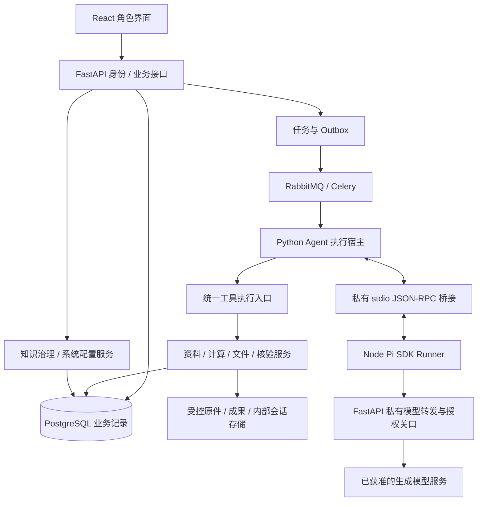

# Pi Agent 接入与改造方案

日期：2026-11-17；任务：DESIGN-PI-001及BASELINE-FIRST-001。用户已确定采用Pi，后续批准本地领域修正、模型关口和PI-01–03推进，使用合成或明确获准样本。当前[受控宿主](../../src/agent_runtime/README.md)已连接本地FastAPI、持久账本及查询工具，真实SDK/回环HTTP/浏览器路径已有合成证据；本稿继续定义目标架构，完整PI批次与真实首期验收仍未通过。状态和证据以[STATUS](../planning/STATUS.md)为准。

## 1. 接入决定与当前基础

主路线采用 `pi-coding-agent` 的可嵌入 TypeScript SDK，复用其会话、上下文压缩、工具循环、事件和扩展；通过受控工具代理连接 Python 业务服务。`pi-ai` 负责模型协议/流式适配，`agent-core` 随 SDK 复用，不另写模型循环。SDK 的编码默认工具和资源发现按本项目范围显式配置。

与只用 core 自建会话/压缩相比，SDK 更符合完整办公 Agent 的复用目标；与直接使用编码 CLI/RPC 相比，嵌入 SDK 更便于控制工具集合、上下文、模型出口和结束语义。`pi-durable` 是另一套实验性持久运行时，本阶段不接入其存储/调度，也不叠加 LangGraph；未来只有实际缺口证据才重评，不能把三条 Pi 路线的接口混用。

既定 React + FastAPI、SQLAlchemy、PostgreSQL + pgvector、Celery/RabbitMQ、BGE-M3、MinerU 路线继续适用。生成模型及具体供应商仍未选择；采用 Pi 不等于选择某个模型或批准资料外发。[目标栈](前后端技术方案.md)、[模型与解析](模型与解析方案.md)

当前本地查询以Python、显式隔离SQLite或本任务PostgreSQL、本地PDF/关键词为基础，已增加React/Vite三角色已实现子流程；旧静态页保留回归。事故默认SQLite隔离，启动只校验结构，不隐式迁移。查询受理持久化后，由显式outbox Worker持双租约启动Node SDK，GET仅查询状态；已启用8项查询工具和有限L1/L2/L3/L4映射，20项目录保持，其他12项不启用。本轮已增加独立本地PostgreSQL/pgvector与Celery/RabbitMQ查询接入及管理参考页，实际范围见[项目状态](../planning/STATUS.md)；向量尚未替换默认关键词检索。React已实现子流程以STATUS中的实际Chrome证据为准，完整角色界面、真实解析/模型及生命周期仍未验收。具体代码/命令及剩余边界见[本地执行说明](../development/本地查询执行与验证.md)；以下目标契约不因局部实现而自动验收。

## 2. 整体组件与事实归属

- **FastAPI**：唯一员工/管理角色公共入口；认证、CSRF、资源归属和用途授权在服务端执行，现有页面契约继续使用。
- **Python 执行宿主**：消费已持久受理的任务，持有执行租约，驱动 SDK 子进程、执行工具回调、记录实际回执并向页面投影。任务/步骤/outbox/调用账本是业务执行权威。
- **Pi Runner**：同一 Worker 部署单元内的受信任 Node 子进程，加载 SDK、已登记扩展和代理工具；每个活跃会话同一时刻只有一个写者。初期按租约段启动/退出，不部署第二套通用 Agent 平台。
- **模型转发**：复用 FastAPI 部署，作为私有运行接口；复用 Pi 原生供应商适配的请求/响应协议，后端仅校验并转发获准目标、注入服务端密钥和记录用量。它不重新实现模型循环、RAG 或模型 SDK。
- **管理服务**：资料上传、核验、真实业务确认登记、发布/撤回、授权和配置保留既有角色门禁。20项员工工具不会因此获得管理写入能力。[知识治理边界](前后端技术方案.md#8-知识管理员治理服务与办公链路衔接)

Pi 会话日志是内部执行资料，不是业务条件、权限、成果或任务成功的第二份权威。新的会话/运行绑定结构只在 [数据库18](../database/数据库设计.md#18-pi会话与运行绑定设计) 定义；桥接与模型转发类型只在 [API18](../api/接口设计.md#18-pi宿主与执行桥接契约) 定义。

## 3. 直接复用、适配与新增

| 能力 | 处理方式 | 本项目仍需承担 |
| --- | --- | --- |
| 模型/工具循环、参数 schema、流式事件、steering/follow-up、会话取消 | 直接复用 SDK/core | 服务端工具可用集合、真实完成/取消判定、事件安全投影 |
| 模型协议与响应流解析 | 复用 pi-ai 原生适配器，经受控 provider/转发路径调用 | 当前授权、逐服务外发、用途/预算/超时、供应商配置与密钥 |
| SessionManager、会话分支、持久历史 | 直接复用，显式绑定受控会话目录或内存管理器 | owner/scope绑定、单写租约、内部文件登记、失效/删除/备份 |
| 上下文压缩、会话扩展与资源加载接口 | 复用机制，使用项目控制的 resourceLoader/settings | 关键条件/警告保护、来源依赖、压缩权限、固定版本扩展白名单 |
| 对话条件、冻结计算/变更计划、执行回执、成果核验 | 保留并补齐既有业务设计 | 真实确认、修订/幂等、确定性数值、实际文件和独立核验 |
| Python ↔ Node 连接、业务工具代理、模型转发 | 新增薄适配 | 只转换协议、投影与身份范围，不重造会话/模型循环 |
| 查询/计算/表格/报告和管理页面 | 沿用既有产品设计 | API结果/进度/错误的真实接入；导航与完整视觉仍待确认 |

首个接入版本使用显式 `tools/noTools/excludeTools/customTools`、`SettingsManager.inMemory`、指定的 `sessionManager` 和项目 `resourceLoader`。不继承操作者的 `~/.pi`、工作区 AGENTS、凭据、第三方扩展和任意 skills。子进程环境按白名单构造，去掉Worker的数据库、解析/向量和生成供应商密钥，只注入本次桥接/私有转发所需的最小运行配置。仅加载随应用发布、经审核并锁版本的业务扩展/skills；业务手册始终是数据。文件标识由业务工具解释，Runner 的私有工作目录不挂载全部企业原件。

原生 read/write/edit/bash、外网搜索、任意 URL fetch 和未审查 MCP 不进入员工工具集合。需要的文件处理通过 T02/T05–T07/T11–T15 获得受控能力。管理角色若以后增加自然语言辅助，必须另经管理权限与工具评审，不能继承员工任务后静默开放发布/授权操作。

## 4. 会话、任务与一轮执行

一个业务对话可以关联多个 Pi 会话：交互协调分支承载当前对话；带冻结输入的工作项可用隔离执行分支。两者通过真实 conversation/task/item 关系和 L2/L3 引用关联，不默认复制另一分支全部历史，不创建多个自主 Agent 或团队。Pi session ID、网页 conversation ID、业务 task/item ID 和模型 provider session ID 分别映射，不能当成同一个权限标识。

1. 网页 POST 由 FastAPI 认证，保存真实消息/条件事件；需要后台处理时同事务保存业务受理、AgentRun绑定与outbox。纯澄清不强造办公任务。
2. Worker 从当前记录取得 owner、用途、执行修订和租约，创建受控 SDK 会话；已经完成/取消的重复派发只读取回执。公共 GET/轮询只投影，不再触发执行。
3. 宿主调用 T01/上下文服务组装 L1。涉及冻结项目时采用 L3 的 FactBinding/execution_revision，不能让新 L2 head 悄悄替换旧输入。
4. SDK 提出工具名和业务参数；代理经标准 JSON-RPC 发给宿主。宿主注入 actor、task/item、用途、截止时间、预算和真实调用标识，按 API14 鉴权并调用业务服务。
5. 只有规范的 ToolResult 进入 SDK。accepted/running/waiting_external 不是完成，waiting_input 不是网络失败，reconcile_required 不自动换键重做。异步工具交回真实回执后释放本轮运行段，后续由 outbox/真实响应恢复。
6. SDK 自然结束只产生运行候选。T14检查和T16交付由执行层根据任务类型及冻结必检强制安排，即使模型省略工具或文字声称完成，也不能绕过；满足条件才提交答案/文件的正式交付和页面完成状态。

T17 的响应只经认证网页入口：请求、员工、任务/item、计划修订、基准/差异hash及相关条件修订校验后，resolution/响应消息/L2必要新修订/未执行item执行修订同事务提交，再由outbox唤醒。模型不能响应自己的确认。已执行输入变化建立后续任务，保留旧结果。

办公项目继续按数据库14.2的稳定顺序执行；某item等待时选择下一个依赖已满足的item。只在没有可执行item且仍有缺项时整任务waiting_input。20工具不对应20个进程或图节点，也不增加任意用户编程工作流。

## 5. 模型出口与上下文的强制边界

SDK 的 `context/context_with_system/before_provider_request` 等扩展用于内容投影和事件处理。已核源码中的部分扩展异常会记录后继续，且主回答payload hook不覆盖所有压缩/摘要路径，**不能把“hook里抛异常”设计成最终授权门禁**。

设计采用真实 `ModelRuntime` 实例及其公开 provider 注册机制包装 Pi 原生适配器，所有实际 HTTP 请求只能发至受控私有模型转发。Runner 不持供应商密钥；供应商/baseURL/模型/能力由服务端配置，不接受文档或模型自选地址。转发收到有效运行凭据后仍回查当前owner、租约、用途、配置、L1选择清单及全部来源资格；字段缺失、依赖不明或请求正文与许可摘要不符即拒绝，不转发。主回答、显式压缩、摘要及任何辅助请求都走此路径。

模型出口分两阶段：`context.project`先由后端生成完整获准system/tools/messages及ModelInputProjection；锁定的受控provider仅将该投影不可变副本交Pi原生adapter，拒绝/忽略另传SDK上下文并清除可变payload/header回调和未允许options，转换后不再拼入旧会话/摘要。转换出口再经 `model.authorize` 绑定projection/context_digest、adapter/profile和最终payload_digest取得一次许可；签Runner自报hash本身不证明内容有权。授权来自后端投影，封闭转换代码属于锁定受信任应用边界，扩展不能替换它；模型转发核对的是该转换的最终内容及当前资格。具体两阶段契约和验证在API18/PI-AC02。到达转发时再次核验；HTTP已发出后不能声称追回数据，返回落入后续上下文/结果前还须复核。供应商内部持久会话只在可证明不会隐式带入旧失权内容时启用；默认请求使用显式投影，不把 provider session ID 当作访问许可。

候选SDK的受控初始设置为 `compaction.enabled=false`、`retry.enabled=false`、`retry.maxRetries=0`、`retry.provider.maxRetries=0`、`cacheWarming="off"`；由 `SettingsManager.inMemory` 注入，不继承全局配置，实际生效仍由PI-00验证。接近预算阈值时由宿主在工具回调结束后的空闲点显式执行 `session.compact`，复用 Pi 压缩能力，purpose=compaction，验证摘要的完整依赖与关键条件/警告。压缩失败保留原会话并返回实际限制；不会把缺失的公式/单位猜进摘要。重试由业务执行层按错误类别、预算和远端回执决定，每次实际外发重新核验。

SDK 持久上下文由 SessionManager 管理；不能通过直接赋值 `agent.state.messages` 假装清除了持久历史。正常请求使用经核对的上下文投影接口；SDK日志、分支及摘要都登记实际使用的来源依赖（包括进入模型但未在答案引用的来源）。依赖撤回/撤权/清理使分支受限，转发停止；当前任务先走业务门禁，再在允许时用安全投影建立新Pi分支。无法证明旧会话内容可用于当前用途时不继续原分支，不只删除引用标签后沿用旧摘要。

## 6. 20项工具接入映射

输入/输出、权限和AC-T01–20继续以API14为准。Pi工具仅暴露业务args；服务端可信上下文不放在模型可填写schema中。以下别名避免供应商工具名字符限制，映射固定且可逆，不改变业务工具名称或权限。

| ID / 业务工具 | Pi别名 | 直接复用 / 必须补齐 |
| --- | --- | --- |
| T01 context.read | dc_context_read | 复用SDK上下文处理；补受控MemoryBundle、条件与任务安全投影 |
| T02 files.inspect | dc_files_inspect | 复用现有PDF上传基础；补员工输入检查/文件归属及格式限制 |
| T03 sources.search | dc_sources_search | 包装现有目录基础；补跨范围目录投影/型号与计数防泄露 |
| T04 evidence.search | dc_evidence_search | 包装现有检索基础；补正式解析/向量、用途过滤、证据覆盖与现有失败修复 |
| T05 sources.read | dc_sources_read | 包装原件/定位基础；补实际页/图表/脚注与受控可读投影 |
| T06 workbooks.read | dc_workbooks_read | 新增真实Excel读取器，SDK不替代公式/缓存/范围识别 |
| T07 documents.read | dc_documents_read | 新增输入docx/模板读取与真实结构定位 |
| T08 calculations.prepare | dc_calculations_prepare | 将实验经验用于通用定义校验；补来源、单位、精度/适用及冻结 |
| T09 calculations.run | dc_calculations_run | 新增通用受控数值执行与计算账本；不把固定实验当正式引擎 |
| T10 workbooks.plan_changes | dc_workbooks_plan_changes | 新增真实区域映射、前后差异、版本及确认绑定 |
| T11 workbooks.apply_changes | dc_workbooks_apply_changes | 新增按计划写私有候选、保留原件、幂等/未知结果核对 |
| T12 workbooks.recalculate | dc_workbooks_recalculate | 接入获准重算引擎，形成已验证支持矩阵；不执行宏/外链 |
| T13 documents.compose | dc_documents_compose | 复用模型组织能力；补Word生成器、模板保留和来源映射 |
| T14 artifacts.validate | dc_artifacts_validate | 新增独立核验器/ValidationReport；SDK文字结束不替代核验 |
| T15 artifacts.preview | dc_artifacts_preview | 新增同版本渲染与受控预览；不隐含在线单元格编辑 |
| T16 artifacts.deliver | dc_artifacts_deliver | 包装结果基础，补ResultManifest、真实文件、必检和当前权限门禁 |
| T17 tasks.request_input | dc_tasks_request_input | 用SDK结束/继续机制衔接业务请求；补真实绑定响应和事务恢复 |
| T18 tasks.control | dc_tasks_control | 包装状态/取消基础；补Worker租约、原item恢复、回执核对 |
| T19 answers.share | dc_answers_share | 包装局部分享基础；补单条答案快照ACL，不分享Pi会话/输入/整任务 |
| T20 feedback.track | dc_feedback_track | 接资料反馈/回访服务，不开放管理员内部记录/发布/确认能力 |

同一个统一调用入口执行schema、前置结果、哈希/修订、当前权限、确认、幂等和结果检查。写入幂等键来自持久逻辑步骤/动作及执行修订；不能只使用模型tool_call_id、尝试号或随机重试ID。框架tool_call_id与业务call_id分开登记；新模型调用命中同一逻辑动作先查原回执，明确的新计划/动作另建身份，不能仅凭参数相同合并真实业务请求。

首个版本的工具执行采用顺序模式；同一模型批次中某调用使本轮等待/核对时，宿主立刻设置停止后续动作的业务状态。同批后续调用也要重新通过该状态门禁，不能假定框架会自动停止它们。使用宿主结束钩子时保留SDK原有完成处理；模型出口另有独立拒绝门禁。`terminate`或`turn_end continue=false`不能单独承担暂停保证。工具回调先落回执并返回，由外部控制/回调后的结束边界处理停止；不在回调内等待自己的abort完成。

## 7. 四层记忆与Pi的映射

| 层 | 复用Pi机制 | 保留/调整的业务设计 |
| --- | --- | --- |
| L1 本轮工作上下文 | 请求前投影、消息预算、显式压缩 | MemoryBundle是本次派生投影；重验scope/subject/purpose、实际选择和依赖，不默认存完整prompt/推理 |
| L2 对话内工作条件 | 会话延续与结构化扩展引用 | ContextFact/CAS/来源/真实确认/tombstone仍在业务库；仅投影当前有效或冻结绑定，不用摘要自动写confirmed |
| L3 任务执行记忆 | Pi会话分支与工具调用轨迹供恢复参考 | 任务/步骤/attempt/outbox/调用回执/计划/执行修订仍权威；新增AgentSession/Run映射，SDK日志不是可直接回放命令 |
| L4 成果与证据历史 | 将实际结果引用带回模型和会话 | 答案/公式/计算/文件/验证/交付照原账本保存确切版本，当前可读/可再用另行判断；原会话不开放给分享接收者 |

L2的“型号已确认”、L3的“允许覆盖该计划”和企业资料的“已确认适用/已发布”仍是不同事实。资料更新/撤权/核验变化按架构7与8失效，员工补充只作用于对应未执行item，知识管理员查看或发布不会写员工L2。

Pi会话文件登记为internal file object，包含的消息/工具结果/摘要按企业数据治理；可只记录引用/必要有权片段，旧全文不因压缩仍在文件中就可再次外发。永久清理覆盖Pi JSONL/分支/摘要、派生快照、模型转发诊断和备份恢复规则，不只删网页消息。开发助手 `doc/memory` 仍与产品记忆分离。

## 8. 故障、取消与完成边界

| 断点 / 事件 | 恢复与输出规则 |
| --- | --- |
| 消息受理后尚未启动Runner | 由已提交outbox重派；同受理身份只建一次业务任务/运行段 |
| Node/Python在模型流中退出 | 标记本次运行中断，保留真实用量/错误；按当前范围重建L1，未批准的旧许可不复用 |
| 写文件已发生但回执/SDK事件不完整 | 先按业务call_id查候选、实际hash、原回执/远端ID，未知则reconcile_required；不重复追加 |
| T17待补 / 外部任务待回执 | 保存请求或provider标识后释放运行段；真实响应/outbox触发下一段，其他就绪item继续 |
| 取消 / 撤权 / 账号停用 | 先使对应业务租约/调用许可失效，再发送Runner abort；禁止后续外发/提交/交付，已发外部任务仍按ID核对 |
| 对话条件、公式/文件/计划变化 | 按执行修订和既有新任务规则处理；不能用Pi新消息自动更改已冻结任务 |
| agent_end / agent_settled / 进程退出 | 只表示SDK运行边界；正式完成取实际必检、任务/item状态与交付回执 |
| 版本/扩展/工具配置升级 | 新任务使用新runtime_profile；活跃/待补任务固定旧执行配置或明确迁移，不能静默套新规则 |

Worker输出事件先经业务投影。网页可以显示“处理中”和受控草稿，正式结果绑定真实AnswerSnapshot/ResultManifest；不能把Pi内部事件、推理、原始tool_result或会话文件直接流给浏览器。候选文字不当作已核验专业结论，失权后停止继续输出；已经被用户看见/下载的内容不声称可追回。

## 9. 哪些既有设计需要调整

| 既有设计 | 保留 | 本轮调整 |
| --- | --- | --- |
| 架构6三层 / 20工具 | 业务职责、工具编号/前置、权限与验收 | Agent协调明确由Pi SDK承接；补Node子进程与薄桥，去掉自行搭完整通用harness的默认前提 |
| 架构7四层 / API16 / 数据库16 | 条件确认、冻结/历史、依赖和失效规则 | 会话/压缩复用Pi；补运行日志归属、上下文投影和会话失效策略，不复制四套记忆 |
| API14工具统一契约 | args/payload、state、错误、幂等及当前鉴权 | 新增SDK别名/可信上下文注入/业务call映射；中间状态驱动释放与恢复，不转成SDK“完成” |
| 数据库任务/outbox/账本 | 业务执行唯一事实来源 | 新增会话/运行绑定及引用，不以Pi JSONL取代关系和外键 |
| 模型接入 | 生成/解析/向量配置分离、逐服务外发审批 | 生成协议交Pi适配；实际请求统一过私有转发，辅助请求也受控 |
| 知识管理员与系统管理员 | 发布/撤回、真实确认、授权/配置门禁及维护事件 | 管理变更同时影响Pi分支/上下文资格；不新增第21项员工工具 |
| 普通使用者页面 / 首期查询 | 结果优先、证据链接、单条分享、首期查询优先 | 进度来自业务事件，GET只读；真实模型文字是候选，完成仍由成果门禁决定 |
| 本地轮询参考执行 | 旧结果/证据及既有失败记录 | 新链路改由Worker推进；旧历史继续按当前权限读，不自动批量迁移为“已验证Pi结果” |

## 10. 实施顺序、迁移与回退

完整批次/验收唯一维护在 [PLAN的Pi接入顺序](../planning/PLAN.md#pi接入实施顺序与验收)。顺序为：PI-00锁定候选/能力证据 → PI-01受理/Worker/SDK/模型出口最小接入 → PI-02统一工具与L1/L2 → PI-03首期查询及原位补充/恢复验收 → PI-04确定性计算 → PI-05表格/重算/交付 → PI-06报告及关联分享反馈 → PI-07治理、升级和内网运行验收。PI-07的权限/日志/生命周期基础贯穿前面批次，不留到最后补安全。

早期建议的模块拆分现已部分实现：Node宿主在`src/agent_runtime/`，Python宿主/桥接/模型关口实际在`src/server/worker.py`、`execution.py`、`runtime_gate.py/runtime_api.py`等现有模块。后续复用这些路径，不为追随旧建议新建`src/server/agent/`或搬目录，也不按20项拆20服务。本轮仅修订文档，不安装或改运行入口。

新入口先对受控候选账号/非敏感合成样本开放，旧查询历史保持原ID/来源/状态。切换必须证明真实Worker推进、当前权限/来源、等待恢复和无重复写入；不得把旧参考链路当失败时的静默降级答复。回退关闭新任务受理、使活跃租约停止或完成核对、保留原结果和运行证据；启用旧流程只能以其实际能力/状态明示，不回退权限/删除修订或重新暴露旧摘要。

Pi会话schema、工具集、SDK/API、模型配置和执行环境均进入runtime_profile指纹；活跃/待补任务升级前验证旧日志读取、工具结果与幂等恢复。SDK调用和供应商失败次数不自动等同业务attempt/修复周期，不重置既有任务预算。

## 11. 设计验收与未决边界

本设计交付要求：整体组件/副作用和权威归属明确；20工具及四层逐项覆盖；模型出口包含主/辅助调用；非终态、确认/撤权、未知写入与恢复没有绕过；API/数据库/PLAN/状态和任务一致；独立设计复核及相称文档检查通过，产品代码和历史证据保持原状。

生成模型、具体供应商、获准资料/费用/留存、真实公式/Excel/模板、业务确认和引擎支持仍按既有门槛取得；这些不妨碍完成本轮设计，但阻止相应真实外发或正式业务验收。SDK候选版本/构建与受控provider适配的运行证据必须在PI-00取得，不把文档中的API存在当作已完成接入。

## 12. 上游依据与版本资格

本方案基于同日官方SDK、会话、扩展、模型运行时和设置源码核查。官方主分支可先于发布版本，package.json同号不证明API一致。设计候选固定为官方发布 `v1.5.2`、源码 `b4afdddf44e059c67ccf5097e5317d913521b470`；所需SDK/ModelRuntime/finishTurn/settings接口已针对该修订核查。后续PI-00探针已取得配套npm制品、Node22.20.0、许可/依赖/锁文件及本地运行证据；源码与制品分别绑定，未证明源码重构建字节相同或生产兼容。未可靠取得main实时HEAD，不使用缓存main快照替代固定来源；完整业务出口/门禁与部署隔离仍待实施验证。

- [Pi仓库与包职责](https://github.com/earendil-works/pi)
- [可嵌入SDK](https://github.com/earendil-works/pi/blob/b4afdddf44e059c67ccf5097e5317d913521b470/packages/coding-agent/docs/sdk.md)
- [SDK源码](https://github.com/earendil-works/pi/blob/b4afdddf44e059c67ccf5097e5317d913521b470/packages/coding-agent/src/core/sdk.ts)
- [扩展接口与执行器](https://github.com/earendil-works/pi/tree/b4afdddf44e059c67ccf5097e5317d913521b470/packages/coding-agent/src/core/extensions)
- [会话与完成边界](https://github.com/earendil-works/pi/blob/b4afdddf44e059c67ccf5097e5317d913521b470/packages/coding-agent/src/core/agent-session.ts)
- [设置与自动行为](https://github.com/earendil-works/pi/blob/b4afdddf44e059c67ccf5097e5317d913521b470/packages/coding-agent/src/core/settings-manager.ts)

上述官方事实只支持接口与机制判断；自定义工具桥接、模型转发、业务恢复及本项目完整链路仍需实施和实际验收。

## 13. 系统管理员配置与恢复衔接

系统管理员完整功能及API统一见[管理方案](../design/系统管理员界面与对接方案.md)和[API19](../api/接口设计.md#19-系统管理员完整工作区对接设计)。本节仅补治理连接，不改变本文件既定SDK/Runner/私有出口路线和PI批次。服务修订、凭据及逐服务许可/预算由后端当前配置绑定，Runner不新增供应商密钥、管理工具或任意扩展；网页不提供修改受审工具/skills白名单的开关。

运维只看安全AgentRun/调用/错误与用量状态，不读原SDK日志或员工条件/输入；控制另需明确operations.control，仍以原owner、确认/冻结计划和副作用回执恢复。用户已确认先隔离验证并追平现行撤权/删除/停用、由获准人员确认后再切生产；恢复SDK记录不直接回放工具/模型请求，不复活旧会话/许可/租约或让Pi历史成为第二份授权来源。备份/清理覆盖内部日志和私有payload派生副本，受控存储不等于系统管理员正文读取权。本轮仅设计，未运行Pi或恢复演练。

### 本地用途选用增量（2026-11-18）

沿用既定SDK1.5.2/Node/private gateway路线。显式selected_service查询受理保存ServiceTaskSelection及各query用途的精确ServiceUsePin；默认旧本地路径保持。answer必需，已配置的summary/compaction分别绑定，不继承主回答输入证明。私有夹具按完整当前上下文签发精确合成hash，网页不能签发或扩大资料外发。出口逐次核对来源/权限、租约、用途、预算、服务修订/测试及secret/CA/代码身份，并持久记录ModelCallAdmission与ServiceUseCall。

实际Pi适配器的原始请求形状经真实SDK观察后固定；Python出口比较受审形状，只用被证明的上下文重建system/tools/messages并替换为pin的模型。Runner不取得供应商凭据。服务切换不重绑已受理任务，停用epoch永不复活；未配置/失效拒绝且无回退，未知不重发。真实SDK回答路径已做本地合成验证，辅助用途私有门禁有独立许可/证明检查，SDK自动摘要及压缩完整流程仍未验证，不升级PI整批或真实A–F。

当前证据统一见[STATUS](../planning/STATUS.md)与[服务用途证据](../../outputs/service-use/2026-11-18/README.md)，数据/接口字段分别以数据库19.2/API19.4维护。

## 14. 六项核查后的实施收敛（2026-11-18）

用户批准PI-R01–06补入既有Plan/tasks，并选择首期增加有证据约束的组织答案；本轮仍仅文档，不实施。既有SDK/Worker/八工具/私有许可与持久账本可复用；当前摘录、合成正式服务接口及独立探针，不得冒充组织答案/真实provider或完整压缩能力。

具体技术Plan在[feature Pi Plan](../../specs/001-device-operation-maintenance-query/plan.md#pi-agent-剩余实施-plan2026-11-18六项核查整改待审核)，14项父T子任务/直接依赖/PI-AC覆盖及状态唯一在[tasks](../../specs/001-device-operation-maintenance-query/tasks.md#pi-agent-核查整改实施任务)。接口/候选投影唯一在[API18.5](../api/接口设计.md#185-pi核查整改的输入候选与正式出口契约)，来源及私有正文身份在[数据库18.1](../database/数据库设计.md#181-pi核查整改的来源与生命周期契约)，不在此复制字段/任务状态。

六项边界落实为：剩余任务可验收；PDF完整child/region/关系/QC来源进入Pi门禁并拒ready_partial；summary/compaction有独立业务输入/产物且验证前关闭；正式provider同时完成受控适配与真实准入；日志/摘要/原模型响应覆盖精确来源、留存与恢复；组织答案先候选、逐声明支持及关键内容核对，再T14/T16交付，不能改原文或依模型自评放行。

组织答案可对已核验事实/程序分组、编排和呈现；新增解释或改写语义无法确认则待核验/拒答，设备用途业务复核仍独立。前述“模型自由文字不直接交付”继续成立，新增目标是独立候选与支持验证，不是开放自由文字旁路。PDF处理不由Pi解析/QC裁决；两套工程在受检Evidence与来源manifest处衔接，正式模型、岗位、样本/人工参考与保留窗口依对应任务落实。旧局部证据保留，不能用文档整改升级完整PI批次或真实A–F。
