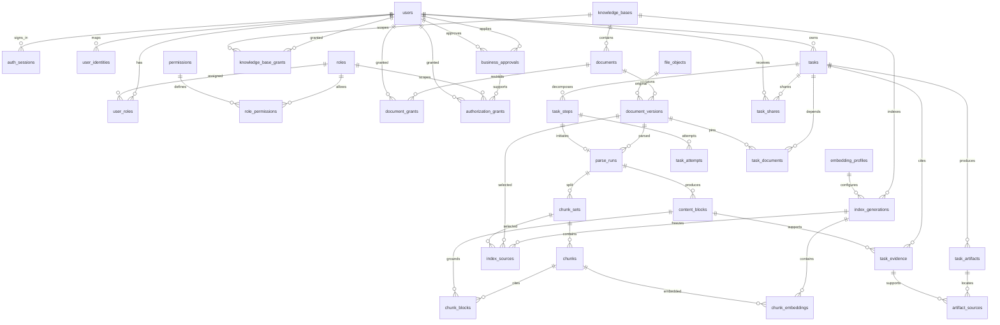

# 数据库设计

设计日期：2026-11-15。本文维护首期逻辑结构与约束，代码映射为 `src/server/models.py` 和 `src/server/migrations/`；实际实现差距、迁移及运行证据统一见 [项目状态](../planning/STATUS.md)。

Document IR 的字段、来源坐标、结构关系及切分映射集中在[第22节](#22-document-ir-数据契约候选01)，细化第6节而非新建另一套Document/Asset模型。2026-11-18仅完成候选设计；2026-11-19本地实施已增加下列增量迁移，运行与升级证据仍以STATUS/tasks为准，不表示已升级真实库。

| 增量迁移 | 物理所有权及边界 |
| --- | --- |
| 0011_pdf_artifacts | ParseRun固定配置/来源/检查点、持久本地任务、私有ParseArtifact/FileObject及同Run唯一关联；原包落盘与DB绑定分别核验 |
| 0012_document_ir / 0013_block_relations | 全原页、Block来源/结构/原始定位、同Run关系端点与part；冻结IR和检查器内容不由人工审批改写 |
| 0014_semantic_chunks | 真实一层parent/child、ChunkBlock精确Unicode范围或region映射、集合配置/IR/tokenizer/QC检查点 |
| 0015_child_index_vectors | 独立PG child向量/精确代际成员/持久嵌入批次，原ServiceUsePin/Call账本仍统一；SQLite不模拟PG向量能力 |
| 0016_exact_evidence | TaskEvidence可空兼容旧摘录；新chunk/set须成对且同set child，PG复合FK/层级护栏、SQLite对应触发器；私有来源上下文及真实范围不由读取时换绑 |
| 0017_private_journal_sources | 私有SDK日志完整来源manifest/hash、runtime兼容身份和恢复窗口；旧无绑定日志保持未知并安全隔离，不填造历史授权 |

各迁移支持的旧形状以冻结输入和实际约束检查为准；新增合法SQLite触发器必须精确登记，既有触发器/历史行仍保留。安全迁移入口继续拒绝事故默认SQLite，非空真实PG升级另需既有审批与备份流程。

2026-11-17本地迁移映射：0002/0003继续保留明确来源绑定和登记/批准身份分离；后续0004–0006已增加下表物理结构，代码分别见`governance_models.py`、`runtime_models.py`和`execution_models.py`。目标PostgreSQL约束/触发器及真实库升级仍未验证；上一阶段仅对隔离SQLite新库和冻结完整v1合成结构升级；本轮已对专用PostgreSQL0001–0007迁移与合成查询/管理子流程取证，保留旧审批原值及unverified、旧来源绑定空，不推断有效资格。

| 迁移 | 本地持久结构及不变量 | 证据边界 |
| --- | --- | --- |
| 0004_governance | 信任依据、证据、核查事件、精确版本业务确认、ReviewSet、hold、发布预检/事件及治理outbox；实际批准身份/决定/凭据引用/核查修订分别保存。selected_review_set与selected_chunk_set同源；发布资格可随依据撤销失效 | 证据附件登记不等于attested；测试信任根仅由隔离合成夹具建立，无公共自任命/自证API。既有文档分类限制不得被新草稿降低；首次未知分类只从获核实的精确版本事实建立并重验管理权 |
| 0005_runtime | 不变RuntimeProfile、按任务预算、会话单写租约、AgentRun、投影依赖及ModelCallAdmission；模型派发前提交意图、配额预留和正文摘要，CAS一次消费。双租约/epoch绑定任务步骤及SDK会话，未知调用跨新run继续fence，未报告用量不记零 | 投影context_json保持空，原文只在受控临时包中；通用依赖只存主键/完整行摘要，不复制正文/凭据/审批声明。内部SDK日志仍是敏感派生数据，不代表留存/删除治理完成 |
| 0006_execution | 对话/真实消息、作用域条件与tombstone、请求/真实响应、统一工具调用及Pi调用映射、不可变查询回答快照、私有SDK日志快照；原始受理输入冻结，补充产生effective_input和execution_revision，旧证据不被新回答混用。分享绑定单条回答 | 只实现首期查询子集；不是完整四层/20工具或通用办公账本。并发检查为SQLite本地证据，不能外推PostgreSQL/多机 |

治理语料修订与可见性修订分开：待确认草稿上传、参考开放及未选用新解析的逐块核验不使旧正式索引失效；发布、撤回、hold及已选用正式依据变化仍使资格/索引重新核对。原件、解析、索引、确认/发布历史和调用回执分别保留；幂等回执与对应业务同事务。实际检查及候选身份统一见STATUS和[本地执行说明](../development/本地查询执行与验证.md)，显式合成库之外的一次默认SQLite误迁移事件见STATUS，事前状态未知，不以事后空表判断影响为零。

后续安全迁移修正：默认事故SQLite及别名隔离，启动只检查head；迁移必须显式目标/前态/来源、受控事务与回执。SQLite先一致性备份，现有行数/trigger变化回滚；非空旧PG升级拒绝，另需停写备份评审；APPLIED_EVIDENCE_FAILED/COMMIT_UNKNOWN不能解释为未执行。实际证据见[安全迁移](../development/安全迁移与事故核查.md)及STATUS，不回滚事故默认库。

本轮本地0007_pgvector只在PostgreSQL创建vector扩展、独立VectorBase下的1024维表及HNSW cosine索引；不污染0001动态元数据或SQLite参考库。来源和provider/model修订绑定，查询先匹配向量空间、复核已选用解析/切分与当前索引/权限再返回；NaN/Inf/bool/零向量拒绝。专用容器0001–0007和向量权限路径已有实际证据，见STATUS。通用JSON字段尚未全部转换为目标JSONB，完整触发器/约束/容量和生命周期仍有差距，不把引擎可用等同数据库设计全落实。

依据：[SPEC](../requirements/SPEC.md)、[角色需求](../README.md#角色需求)、[模型与解析方案](../architecture/模型与解析方案.md)、[前后端技术方案](../architecture/前后端技术方案.md)。数据库采用 PostgreSQL + pgvector，BGE-M3 首版采用 1024 维稠密向量，应用通过 SQLAlchemy、Psycopg 3 访问，Alembic 管理迁移。

## 1. 范围与设计假设

本文件定义用户权限、文档版本、解析结果、向量索引、任务记录及必要的文件和审计关联。字段是迁移设计的输入，不是已执行的建表 SQL；物理性能参数和具体数据库版本尚未确定。

| 选择 | 原因与边界 |
| --- | --- |
| 关系表保存身份、权限、版本和引用；JSONB 保存可变解析结构 | 保留可校验关联，同时容纳 MinerU 表格、坐标等不同内容；不采用整本手册一个巨大 JSON 的建模方式 |
| 角色能力 + 资料范围授权 | 管理系统配置不自动获得业务正文权限；不采用“管理员全部可读”的隐式规则 |
| 原件版本、解析批次、切分批次、索引代际分别保存 | 重新解析和切换模型不覆盖历史依据；不在原有片段上直接改写内容 |
| 业务任务、步骤、执行尝试分别保存 | 一次用户任务可能含多个步骤，重试不是新业务任务；Celery 消息标识不是业务主键 |

以下是为形成可实施草案提出的默认假设，不等于用户已确定的业务政策：

- 首版面向一家企业，按知识库组织资料；不预设 SaaS 多租户、部门树或用户组。部门授权后续可增加组成员关系，不能把知识库误当成公司租户隔离。
- 数据结构允许一人多个角色；首期允许按明确授权配置角色兼任，角色、范围、操作和期限保持对应关系，不因叠加产生未批准的新权限。
- 资料权限按知识库继承，支持单份文档收紧或单独授权；同一文档的历史版本继承当前文档权限。
- 一份逻辑文档表示同一来源、同一适用范围的一条修订序列，最多一个现行版本。并行有效的不同设备或适用范围，分开登记文档，不能强行归为同一修订序列。
- 每个知识库有一个默认启用索引代际；查询多个知识库时分别使用其对应向量配置检索，再合并候选。历史索引用于审计与回退，不默认提供任意历史检索入口。
- 首期查询表不包含完整计算/办公模型；2026-11-17 的工具设计已在第14节补齐公式版本、计算明细和办公任务逻辑结构，尚未实施迁移。计费和通用系统配置表仍不在本轮展开，不能把设计等同于已建表。

2026-11-11 范围澄清：项目面向企业文档沉淀与实际办公任务，先按角色障碍确定优先级。公式计算与 Excel 是 [候选场景](../requirements/SPEC.md#11-候选场景公式计算与-excel)，尚未锁定首期；一旦实施该场景，必须先补齐公式版本与计算明细。现有表结构也需按其他选定场景验证，不因已经写成文档就视为需求完备。

## 2. 总体关系

图中仍省略文件附件、消息发件箱和审计等辅助边；完整外键以以下表格和第 9 节为准。

## 3. 全局字段与约束约定

- 普通实体表主键为 `id uuid`，由应用产生；连接表使用明确列出的联合主键。表格中的 `?` 表示允许 NULL，其余列必填；`FK → 表` 默认引用该表 `id`。
- 普通实体表统一包含 `created_at timestamptz`；可变记录另有 `updated_at timestamptz`。时间按 UTC 保存、展示时转换。连接表仅在明确列出时记录时间。
- 哈希使用 `text` 存储 SHA-256 十六进制值并校验格式；哈希辅助完整性判断，不充当全库唯一业务标识。外部版本未知时为 NULL，不写入伪造的版本字符串。
- 状态使用 `text + CHECK` 限定允许值。计数、序号和大小为非负或正值；JSONB 必须校验顶层类型和约定的结构版本。精确计算数值不能默认通过浮点 JSON 往返。
- 业务外键默认 `ON DELETE RESTRICT`，业务标识不原位修改。仅角色映射、授权等可再生连接允许按明确清理流程删除；不对文档→任务证据整条链使用级联删除。
- 外键不会自动为引用列建立适用的查询索引；按第 10 节显式创建。跨表规则使用复合外键或约束触发器，不能用只适合行内判断的 CHECK 假装完成跨表校验。[PostgreSQL 约束说明](https://www.postgresql.org/docs/current/ddl-constraints.html)

## 4. 用户、角色与资料权限

### 4.1 表结构

| 表 | 关键字段与类型 | 主键、外键及约束 |
| --- | --- | --- |
| `users` | `id`；`display_name text`；`status text`；`authz_revision bigint DEFAULT 0` | 状态 `active/disabled`；停用保留历史任务归属 |
| `user_identities` | `id`；`user_id uuid`；`provider text`；`subject text`；`credential_hash text?`；`credential_algorithm text?`；`credential_updated_at timestamptz?`；`credential_state text`；`credential_revision bigint` | FK → users；UNIQUE(provider, subject)；身份绑定与业务用户分开；只保存经批准口令 KDF 的摘要，不保存明文密码或会话令牌；状态 `pending/active/locked/revoked` |
| `auth_sessions` | `id`；`user_id uuid`；`token_hash text`；`issued_at timestamptz`；`expires_at timestamptz`；`revoked_at timestamptz?`；`authz_revision bigint` | FK → users；只保存不可逆会话令牌摘要；过期、撤销、用户停用或 authz_revision 变化后失效；不向 API 响应会话令牌 |
| `roles` | `id`；`code text`；`name text` | code 唯一；初始角色 `user/knowledge_admin/system_admin` |
| `permissions` | `id`；`code text`；`description text` | code 唯一；权限码由迁移种子维护，首版不提供任意脚本式权限规则 |
| `user_roles` | `user_id uuid`；`role_id uuid`；`granted_by uuid?`；`granted_at timestamptz` | PK(user_id, role_id)；FK → users、roles；granted_by → users，NULL 仅用于初始化并记录审计 |
| `business_approvals` | `id`；`applicant uuid`；`approver uuid`；`approved_at timestamptz`；`scope jsonb`；`operations jsonb`；`valid_from/valid_until`；`evidence_locator text`；`status text` | 业务审批与系统登记分开保存；状态 `approved/rejected/revoked/expired`；无 approved 依据不能启用授权 |
| `authorization_grants` | `id`；`subject_user_id uuid?`；`role_id uuid?`；`knowledge_base_id/document_id`；`operation text`；`file_level/category/need_class`；`valid_from/valid_until`；`approval_id`；`granted_by`；`revoked_at` | 必须引用 business_approvals；每条记录保存完整匹配元组；禁止跨授权记录拼接；冲突/过期/撤销不生效 |
| `role_permissions` | `role_id uuid`；`permission_id uuid` | PK(role_id, permission_id)；对应外键 |
| `knowledge_bases` | `id`；`name text`；`status text`；`content_revision bigint DEFAULT 0`；`acl_revision bigint DEFAULT 0`；`active_generation_id uuid?` | 状态 `active/archived`；活动索引必须属于本知识库，见第 9 节 |
| `knowledge_base_grants` | `knowledge_base_id uuid`；`user_id uuid`；`access_level text`；`granted_by uuid`；`granted_at timestamptz` | PK(knowledge_base_id, user_id)；外键到 knowledge_bases/users；等级 `read/manage` |
| `document_grants` | `document_id uuid`；`user_id uuid`；`access_level text`；`granted_by uuid`；`granted_at timestamptz` | PK(document_id, user_id)；外键到 documents/users；等级 `read/manage` |

`knowledge_base_grants` 和 `document_grants` 只表达资料范围投影；首期完整操作授权、文件维度、有效期和业务审批以 `authorization_grants` 为准。不能仅凭范围投影放行计算、报告、下载或其他独立操作。

首期采用平台账号和服务端会话引用；会话令牌只保存不可逆摘要，停用、显式登出或 `authz_revision` 变化后失效。认证适配器负责凭据校验和身份映射，数据库不接受客户端提交的角色或权限作为授权依据。企业 SSO 和生产口令轮换属于后续适配/部署配置；`user_identities` 仍只定义稳定身份映射。

### 4.2 权限的计算方式

角色决定操作能力，授权表决定资料范围，两项必须同时满足。范围等级 `manage` 包含该范围的 `read`，但不能补足角色本身缺少的操作权限。首期有效授权按完整组合匹配：角色、范围、操作、文件维度和有效期限必须由同一授权记录或明确配置规则共同满足；不能从不同角色/授权记录拼接出未批准的组合。缺失、冲突、过期或不明确时拒绝。

| 角色 | 初始能力建议 | 不自动授予 |
| --- | --- | --- |
| 普通使用者 | `knowledge.query`、`document.read`、`task.create`、`task.read`、`task.share` | 资料修改、权限分配、系统配置 |
| 知识管理员 | `document.read`、`document.manage`、`task.read`、`task.share`；创建维护任务通过 document.manage 校验 | 普通业务任务创建、未分配资料、全局权限管理 |
| 系统管理员 | `user.manage`、`access.manage`、`system.configure`、`operations.read` | 业务正文与用户任务内容；运维接口只返回必要状态与标识 |

资料读取规则：用户 active、具有 `document.read`、知识库 active、文档未删除，且符合以下范围判断：

- `documents.access_mode=inherit`：匹配知识库授权 **或** 文档直接授权即可，但仍须存在 `authorization_grants` 中覆盖当前操作和文件维度的完整元组；没有授权即拒绝。
- `access_mode=restricted`：仅文档直接授权生效，知识库授权不再继承；无文档授权则拒绝。
- 文档修改再要求 `document.manage` 以及同一规则计算出的 `manage` 范围。创建文档要求所在知识库的 manage 范围，并通过对应业务审批/登记记录。
- 授权与 `access_mode` 的变更仅由 `access.manage` 路径完成；资料编辑接口不能顺带扩大访问范围。系统管理员授权操作留痕；系统管理员不因管理身份获得业务正文权限，自我授权和扩权必须遵循同一审批/登记规则。
- 文档授予范围会作用于所有版本；首版不支持对同一文档各版本设置不同 ACL。文档不能跨知识库直接修改归属，迁移需显式流程重新评估权限与索引。

知识库列表只显示用户被授予或有可读文档的知识库；单文档授权不能使整个知识库的其他文档标题可见。

授权新增/删除、用户停用、角色变更分别更新相关 `acl_revision/authz_revision` 并记录审计。角色权限变化时递增所有受影响用户的 authz_revision。缓存按这些修订失效；不将构建索引时的权限快照作为当前授权依据。

首版以统一后端授权查询为强制路径，数据库外键不承担访问控制。RLS 可作为后续纵深防护，尚未实现；若启用，须测试连接池身份上下文及所有者、超级用户的绕过行为。[PostgreSQL RLS](https://www.postgresql.org/docs/current/ddl-rowsecurity.html)

## 5. 文件与文档版本

| 表 | 关键字段与类型 | 主键、外键及约束 |
| --- | --- | --- |
| `file_objects` | `id`；`storage_name text`；`object_key text`；`sha256 text`；`byte_size bigint`；`mime_type text`；`status text`；`created_by uuid?` | UNIQUE(storage_name, object_key)；created_by → users；状态 `pending/available/deletion_pending/deleted`；size ≥ 0 |
| `documents` | `id`；`knowledge_base_id uuid`；`title text`；`category text?`；`access_mode text`；`current_version_id uuid?`；`deleted_at timestamptz?`；`created_by uuid` | FK → knowledge_bases/users；模式 `inherit/restricted`；当前版本同文档约束见第 9 节 |
| `document_versions` | `id`；`document_id uuid`；`version_no integer`；`revision_label text?`；`source_file_id uuid`；`selected_chunk_set_id uuid?`；`status text`；`applicability jsonb`；`effective_at timestamptz?`；`published_by uuid?`；`published_at timestamptz?`；`created_by uuid` | FK → documents/file_objects/chunk_sets/users；UNIQUE(document_id, version_no)；UNIQUE(document_id, id)；版本序号 > 0；状态 `draft/effective/superseded/withdrawn` |

- `version_no` 是系统内部修订序号；`revision_label` 是手册原始版本号，可未知。上传时间不代表生效时间。
- 原件文件上传完成、校验通过后变为 available；只有 available 原件能用于解析或发布。2026-11-17用户已确认发布前完成精确批次内容核验及业务/关键专业依据检查，详见第17节；索引启用仍独立，业务现行版本可能暂时尚不可检索。该门禁收敛已确认，不代表已实现。
- 原件和版本适用信息冻结后不原位更改；替换原件或改变适用条件创建新版本。标题和分类可修改，但历史任务记录实际使用的文件及版本。
- 用部分唯一索引保证每份文档最多一条 `status=effective`。发布事务锁住 documents 行，旧版本设 superseded、新版本设 effective，更新 current_version_id 和知识库 content_revision；撤销现行版则清空指针并设 withdrawn。
- `current_version_id` 只用于解析“当前版本”；历史引用保存 version_id，不能在读取时偷偷跳到新版本。
- `selected_chunk_set_id` 指向该版本当前选用的 ready 切分集合，允许从空变为可检索或切换到新解析结果；这是派生知识选择，不改原件和适用条件，变更递增知识库 content_revision。历史任务仍使用原先片段。
- 文件内容不进入 PostgreSQL 大字段；完整解析包、原图和产物放文件存储。file_objects 没有独立的通用读取授权，必须通过文档、解析产物或任务上下文检查权限。相同哈希不自动合并不同权限范围的文件，也不向用户暴露全库重复检测结果。

## 6. 解析结果与检索片段

| 表 | 关键字段与类型 | 主键、外键及约束 |
| --- | --- | --- |
| `parse_runs` | `id`；`document_version_id uuid`；`task_step_id uuid`；`origin text`；`parent_run_id uuid?`；`provider text?`；`model_option text?`；`model_revision text?`；`remote_task_id text?`；`request_config jsonb`；`output_schema_version text`；`status text`；`error_code text?` | FK → document_versions/task_steps/parse_runs；UNIQUE(task_step_id)；origin 为 `provider/manual`；状态 `pending/submitted/running/succeeded/failed/needs_review` |
| `parse_artifacts` | `id`；`parse_run_id uuid`；`file_id uuid`；`kind text`；`logical_name text` | FK → parse_runs/file_objects；UNIQUE(parse_run_id, logical_name)；kind 为 `raw_response/structured/markdown/image` |
| `content_blocks` | `id`；`parse_run_id uuid`；`parent_block_id uuid?`；`ordinal integer`；`kind text`；`text_content text?`；`structured_content jsonb`；`locator jsonb`；`review_status text`；`reviewed_by uuid?`；`reviewed_at timestamptz?` | FK → parse_runs/content_blocks/users；UNIQUE(parse_run_id, ordinal)；UNIQUE(parse_run_id, id)；review 为 `unreviewed/approved/rejected`；父块同批次且无循环 |
| `chunk_sets` | `id`；`parse_run_id uuid`；`splitter_version text`；`splitter_config jsonb`；`config_hash text`；`status text` | FK → parse_runs；UNIQUE(parse_run_id, config_hash)；UNIQUE(id, parse_run_id)；状态 `building/ready/failed` |
| `chunks` | `id`；`chunk_set_id uuid`；`ordinal integer`；`content text`；`content_hash text`；`token_count integer?` | FK → chunk_sets；UNIQUE(chunk_set_id, ordinal)；UNIQUE(id, chunk_set_id)；ready 后内容不可变 |
| `chunk_blocks` | `chunk_id uuid`；`chunk_set_id uuid`；`parse_run_id uuid`；`block_id uuid`；`ordinal integer` | PK(chunk_id, block_id)；UNIQUE(chunk_id, ordinal)；复合外键保证片段和块来自同一解析批次，见第 9 节 |

`locator` 使用带 `schema_version` 的 JSON：PDF 文件页序号采用 1 起始整数，印刷页码另存字符串；坐标同时记录坐标系与页面尺寸；Word/Excel 使用实际章节、表格或单元格定位。缺失位置保持缺失，不伪造数值。表格数据保存行列、表头和合并关系，公式与变量定义及脚注通过块关系和 chunk_blocks 关联。

当前本地解析映射使用已有的 `content_blocks` JSON 字段，表格按 `structured_content.rows` 保存行和单元格。识别器提供时保留表头、合并跨度和版面注释。定位使用 `locator.file_page`、`printed_page`、`bbox_normalized`、`extraction` 与可选 `parse_issue`，坐标按原页宽高分别归一为 0–1。引用与核验继续绑定精确内容和原文位置。

人工图形键校正复用同一 JSON 字段。校正后的单元格附 `graphic_keys`，保存按键名称、对应操作及原页坐标。`graphic_key_correction` 记录父批次、来源块和精确内容哈希，同次校正事件另保留审计的父批次与修改数量。源图按原 PDF 即时渲染。

一次 parse_run 表示逻辑解析批次，网络重试复用远端任务标识；主动重新解析创建新批次。`origin=manual` 表示人工校正后的新批次，必须有同文档版本的 parent_run_id；复用原文定位，不将校正伪装成服务原始输出。

成功解析的内容与 ready 切分集合不可原位覆盖；复核状态变化单独审计。拒绝块不能进入正式证据。未复核块可以作为明确标识的候选依据，但关键公式、变量、单位有歧义时暂停正式计算；检索命中不等于业务复核通过。

本轮采用块级审批的保守默认：只要片段关联 rejected 块，该片段就不参与检索；状态变化后实时过滤，不能等重建索引才生效。ready 集合至少有一个片段，每个片段至少关联一个块。

## 7. 向量配置、索引代际与物理索引

### 7.1 表结构

| 表 | 关键字段与类型 | 主键、外键及约束 |
| --- | --- | --- |
| `embedding_profiles` | `id`；`provider text`；`model_name text`；`model_revision text?`；`dimension integer`；`distance_metric text`；`preprocess_config jsonb`；`config_hash text` | config_hash 唯一；首版 CHECK dimension = 1024、distance_metric = cosine；配置创建后不可改写；不保存 API 密钥 |
| `index_generations` | `id`；`knowledge_base_id uuid`；`embedding_profile_id uuid`；`build_step_id uuid`；`source_revision bigint`；`status text`；`expected_chunk_count bigint`；`build_report jsonb`；`ready_at timestamptz?` | FK → knowledge_bases/embedding_profiles/task_steps；UNIQUE(build_step_id)；UNIQUE(knowledge_base_id, id)；状态 `building/ready/failed/retired` |
| `index_sources` | `generation_id uuid`；`document_id uuid`；`document_version_id uuid`；`chunk_set_id uuid` | PK(generation_id, document_id)；UNIQUE(generation_id, chunk_set_id)；FK → index_generations/chunk_sets；复合 FK(document_id, document_version_id) → document_versions(document_id, id) |
| `chunk_embeddings` | `generation_id uuid`；`chunk_set_id uuid`；`chunk_id uuid`；`embedding vector(1024)`；`created_at timestamptz` | PK(generation_id, chunk_id)；复合外键限定代际成员，见第 9 节；向量非 NULL，拒绝非有限值及零范数向量 |

`index_generations` 是业务上可切换的一组索引数据；HNSW 是数据库加速查询的物理索引，两者不是同一个概念。索引代际固定模型配置和来源清单，不能混入另一模型的向量；新模型维度变化需新增表或调整分区设计及迁移，不直接写入首版 vector(1024)。

`index_sources`每个文档只选择当前版本及其selected_chunk_set_id指定的合格切分；所属知识库、解析批次和文档版本通过第9节约束保证。2026-11-18复审要求：冻结目标知识库全部未删除的当前已发布版本为expected_sources，缺解析/核验/Chunk/QC的已发布版本不得静默省略以凑完整代际；draft/history不属于该目标集合并须在报告注明。build_report及task_documents保存被检查版本、精确来源身份和不合格原因；不回退过期版本，缺目标成员则不能ready/正式启用。

首版完整知识库索引构建要求发起人有 document.manage 能力、知识库 manage 范围，并可管理该库所有未删除的现行文档（包括尚不可检索项）；范围不足时任务阻断，不能忽略受限文档后把不完整索引切为全库默认。这是待审阅的维护权限默认值，后续若需要专用服务身份构建，应另行设计其授权与审计。

### 7.2 构建、切换与查询

1. **独立构建。** 创建building代际，在一致快照中固定KB/content_revision、expected_sources及每项Version/Run/ChunkSet/IR与来源/集合QC/ReviewSet/发布资格指纹、embedding profile/预处理修订和expected_child_ids。该manifest由现有index_sources＋build_report持久化，冻结后不得删减目标或更改计数使失败变成功；构建不写active_generation_id或覆盖旧代际。
2. **持久成员。** 只为该清单生成/复用向量，复用须完整匹配Chunk内容/上下文/关系及模型配置；成员按generation_id隔离并可从已落库成员恢复，未知外部调用沿原账本对账，不重置预算或盲重发。原PDF/原包/IR/Chunk不得随索引失败或清理删除。
3. **完整性门禁。** 精确比较expected_sources/child与实际集合，要求双向差集为空、无重复、每个成员来源/资格/内容/维度及有限非零向量匹配；必需关系/警告/表头/单位等可补全，全部技术/业务门禁仍有效，无缺失/失败/未核验的目标。只比较数量或向量维度不够；期望child按22.7计算，原子关键内容不得靠oversized/navigation_only排除以绕过完整性。报告各排除项与依据，任一强制内容未覆盖则失败。
4. **ready不自动生效。** 完整性通过才置ready并保存检验报告/manifest身份；处于building、failed、retired、过期或历史ready_partial的代际均不能正式启用。ready只证明冻结候选通过该门禁，不代替G1真实业务验收或启用时重查；当前代码自动激活ready_partial是待修缺口，非本规范允许行为。
5. **正式启用/原子切换。** 沿现有知识库→目标代际及授权围栏锁序，在一个短DB事务内验证当前KM/全库范围、ETag/幂等回执、目标ready及完整性报告、当前selected/发布/审核/hold、source_revision与manifest/profile均未变化，CAS更新唯一active_generation_id并保存旧/新代际与profile/manifest的审计回执和失效outbox。模型/预处理只从该代际的不可变profile解引用，不单独切活动模型配置；查询读取同一快照的代际＋profile，不能混新旧向量空间。源资格写入须保持同事务KB修订协议，使构建/启用并发可判定。
6. **中断和失败。** 构建/完整性失败不动旧指针；启用事务提交前失败全部回滚，提交结果未知先按原幂等回执/当前指针对账。提交后中断由该事务记录恢复，outbox未消费不绕过实时门禁。旧活动代际仅在来源/权限仍有效时可用；业务发布/source_rebind与索引启用仍是不同事务，源已切换而索引未就绪时安全拒绝，不承诺无停机。
7. **查询。** 正式检索只使用匹配当前修订的活动ready代际、所属完整来源和profile；SQL/业务检查当前权限、型号、发布/选用、QC/审核与hold，父级/关系扩展、外发、交付再查。禁止直接查询在建新表、ready_partial或缓存的旧资格；单个已发布版本不允许只索引一部分未解决的关键内容。
8. **过期。** 发布/撤销、删除、选用切换、否定内容或必需QC/审核依赖变化递增KB修订；不匹配按现有**整库index_stale**拒绝，重建完整新代际再切换，不用历史版补缺。逐来源连续可用仍是未采纳优化。
9. **回滚。** 保留旧代际/报告和profile到获准回退窗口。显式回滚复用启用的完整检查及原子事务/回执，仅允许旧代际仍ready、全部来源及QC/审核当前有效、revision/profile/成员完整且未清理；不能仅因旧版本曾可用就恢复。source_revision不同、已撤权/撤回/hold/retired或内容已删均拒绝，按当前有效来源新建代际；不改旧revision假装兼容，也不自动回滚业务版本或selected来源。留存窗口尚待确认，确认前不执行自动旧代际清理。

初期可用精确向量查询作为正确性基线；需要近似检索时评估 HNSW + cosine。权限、知识库和代际过滤可能降低近似查询的返回数量，需测试迭代扫描、分区或精确回退，不能将少于 top-k 自动解释为“无相关资料”。[pgvector 索引与过滤说明](https://github.com/pgvector/pgvector#filtering)

## 8. 任务、重试、证据与产物

### 8.1 表结构

| 表 | 关键字段与类型 | 主键、外键及约束 |
| --- | --- | --- |
| `tasks` | `id`；`owner_user_id uuid`；`kind text`；`status text`；`idempotency_key text`；`input_snapshot jsonb`；`input_hash text`；`execution_snapshot jsonb`；`error_code text?`；`started_at timestamptz?`；`finished_at timestamptz?`；`deleted_at timestamptz?` | FK → users；UNIQUE(owner_user_id, idempotency_key)；kind 为 `query/parse/index_build/calculate/export`；状态见 8.2 |
| `task_input_files` | `task_id uuid`；`file_id uuid`；`input_name text` | PK(task_id, input_name)；FK → tasks/file_objects；仅绑定获准使用且 available 的输入文件，文件下载继承任务权限 |
| `task_shares` | `task_id uuid`；`user_id uuid`；`granted_by uuid`；`granted_at timestamptz`；`expires_at timestamptz?`；`revoked_at timestamptz?`；`status text` | PK(task_id, user_id)；FK → tasks/users；状态 `active/expired/revoked`；仅赋予查看该任务，不赋予资料访问权；只有具备 task.share 的任务所有者可分享 |
| `task_steps` | `id`；`task_id uuid`；`step_key text`；`position integer`；`kind text`；`status text`；`attempt_count integer DEFAULT 0`；`lease_token uuid?`；`lease_until timestamptz?`；`next_run_at timestamptz?`；`completed_at timestamptz?` | FK → tasks；UNIQUE(task_id, step_key)；UNIQUE(task_id, position)；UNIQUE(task_id, id)；position > 0；状态见 8.2；成功步骤不重复提交业务结果 |
| `task_attempts` | `id`；`step_id uuid`；`attempt_no integer`；`celery_message_id text?`；`worker_name text?`；`status text`；`started_at timestamptz`；`finished_at timestamptz?`；`error_code text?`；`diagnostic jsonb` | FK → task_steps；UNIQUE(step_id, attempt_no)；状态 `running/succeeded/failed/interrupted`；诊断字段脱敏，不存正文或密钥 |
| `task_documents` | `task_id uuid`；`document_version_id uuid`；`purpose text` | PK(task_id, document_version_id)；FK → tasks/document_versions；保存任务明确输入及实际使用的资料依赖，purpose 为 `input/evidence/both` |
| `task_evidence` | `id`；`task_id uuid`；`document_version_id uuid`；`block_id uuid`；`chunk_id uuid?`；`generation_id uuid?`；`quote_snapshot text`；`locator_snapshot jsonb`；`review_snapshot text`；`content_hash text` | FK → content_blocks/chunks/index_generations；复合 FK(task_id, document_version_id) → task_documents；chunk_id 与 generation_id 同时为空或同时有值 |
| `task_artifacts` | `id`；`task_id uuid`；`file_id uuid`；`kind text`；`validation_status text`；`validation_report jsonb` | FK → tasks/file_objects；UNIQUE(task_id, id)；状态 `pending/passed/failed/not_verified`；kind 为已约定格式标识 |
| `artifact_sources` | `artifact_id uuid`；`evidence_id uuid`；`output_locator text` | PK(artifact_id, evidence_id, output_locator)；FK → task_artifacts/task_evidence；同任务约束见第 9 节；定位如 sheet/cell、段落或字段路径 |
| `task_outbox` | `id`；`step_id uuid`；`dispatch_no integer`；`event_type text`；`status text`；`available_at timestamptz`；`published_at timestamptz?`；`publish_attempts integer DEFAULT 0` | FK → task_steps；UNIQUE(step_id, dispatch_no)；状态 `pending/published/failed`；event_type 为 `execute_step`；消息仅包含步骤及派发标识 |
| `api_idempotency_records` | `id`；`actor_user_id uuid`；`idempotency_key text`；`method text`；`request_path text`；`request_hash text?`；`status text`；`resource_refs jsonb`；`response_status integer?`；`error_code text?`；`lease_token uuid?`；`lease_until timestamptz?`；`completed_at timestamptz?` | FK → users；UNIQUE(actor_user_id, idempotency_key)；状态 `processing/completed/reconcile_required`；本轮接口设计增补，见 8.4；不保存业务响应正文 |
| `audit_events` | `id`；`actor_user_id uuid?`；`actor_kind text`；`action text`；`target_type text`；`target_id uuid`；`request_id text`；`summary jsonb`；`created_at timestamptz` | actor_user_id → users；actor_kind 为 `user/system`；系统事件才可无用户；target 为审计标识，不伪称可跨任意表建立外键；追加写入 |

任务的原始参数、单位和输出要求放入带结构版本的 input_snapshot；input_hash 对规范化后的任务种类、参数及输入文件哈希清单计算。execution_snapshot 保存实际模型配置标识、程序版本及必要设置，不保存密钥。用户上传的业务输入文件通过 task_input_files 建立外键；不得通过绑定他人 file_id 绕过原有资料授权，若附件来自已有文档，必须同时登记 task_documents 依赖。

任务证据至少锚定一个具体内容块；经过检索选出的证据还记录片段和索引代际，直接原文引用则二者均为空。证据不外键引用 chunk_embeddings，避免清理旧向量时破坏历史引用；插入时校验其曾属于对应代际及片段。

产物中的引用通过 artifact_sources 定位到结果字段或单元格，再到 task_evidence、原文块与文档版本。计算产物还需在正式计算设计中追加“输出位置→计算记录→公式版本”的关联；本轮没有虚构已完成的计算数据模型。

### 8.2 状态与可靠执行

- tasks 状态：`pending/running/waiting_input/succeeded/failed/cancelled`；task_steps 状态：`pending/running/waiting_external/waiting_input/retry_wait/succeeded/failed/cancelled`。
- pending 任务被接受执行后进入 running；关键缺项转 waiting_input；最终验证通过才进入 succeeded；失败与取消是终态。用户修改已冻结输入后创建新任务，不能复用旧幂等键提交不同参数；未执行项目的缺项补齐/计划确认按14.2追加解决记录，不改写已执行输入。
- 同一任务同一幂等键且 input_hash 一致时返回原任务；不同输入返回冲突，统一规范化与哈希算法。首期查询步骤按 position 顺序执行；完整办公任务按14.2在工作项内保持顺序并允许跳过等待的独立项目，暂不引入通用 DAG 或并行调度平台。
- 创建任务/步骤与 outbox 记录在一个数据库事务内完成。派发进程向 RabbitMQ 发布并取得确认后标记 published；发布成功但标记失败会重发，因此 Worker 必须幂等。
- Worker 原子领取步骤并获得新 lease_token，记录 task_attempts。提交结果时必须匹配当前 token，防止租约过期的旧 Worker 覆盖新结果；跨外部服务无法承诺事务级“恰好一次”。
- 等待 MinerU 时记录远端任务标识并进入 waiting_external，后续唤醒复用同一逻辑解析批次。提交是否成功未知时进入待核对流程，不盲目重传。
- 定时扫描 pending/retry_wait、过期租约和未发 outbox，有限重试并恢复；需要周期唤醒机制，但不因此自动决定使用 Celery Beat。自动重试不会修改冻结输入。
- outbox 的 published 只说明消息发布，task_attempts 的 succeeded 只说明一次执行成功，均不代替 tasks 和产物校验的业务完成状态。[Celery 确认与重试说明](https://docs.celeryq.dev/en/stable/userguide/tasks.html)

### 8.3 结果与分享的权限

读取任务正文、输入、证据或产物须同时满足：用户 active、具有 task.read、为所有者或 task_shares 接收者，并且当前仍可读取任务涉及的全部 task_documents。维护任务也不能让知识管理员读取其他人的业务任务。

Worker 以任务所有者的当前能力和数据范围执行：开始步骤、向外部服务提交数据及产物可见前都复核，不能沿用过期授权快照。禁用用户或撤权后停止相关业务内容输出，安全状态接口只返回“访问条件已变化”等必要信息。

首版采用保守的整份产物控制：任一依赖失去权限或被删除，整份产物禁止预览/下载；不承诺自动逐段脱敏。历史版本 superseded 不等于禁止阅读，仍可按当前文档权限查阅并标注历史状态。已下载到用户设备的文件无法通过数据库撤权追回。

### 8.4 接口设计增补：HTTP 请求回执

接口契约见 [接口设计](../api/接口设计.md)。本节是为上传、版本发布、授权修改等同步写操作增加的最小幂等持久化；task_outbox 仍只负责后台步骤派发，二者职责不同。

- api_idempotency_records 按调用者与幂等键唯一。request_hash 包含 HTTP 方法、规范化路径、请求内容及 If-Match 条件；multipart 包括实际文件 SHA-256。仅 processing 的接收阶段允许哈希未知，完成前必须填入并核对完整内容。
- 首次请求原子占用回执并获得租约；重复请求在 processing 返回进行中，不再次执行。正常数据库写入与 completed 回执同事务提交；长任务创建还与 tasks、步骤和 outbox 同事务。
- resource_refs 只存服务器生成的资源类型与标识，属于跨资源回执，不伪称有通用外键；类型限定为本轮端点使用的 user/knowledge_base/document/version/parse_run/block/task/index_generation/access_policy/share_set，并可记录内部 file 对象以恢复上传。该字段不提供下载授权。
- 文件操作在数据库事务之外：先记录可恢复的 pending 文件引用；崩溃后租约过期只允许核对已有文件和业务记录，不能直接重复创建。无法确认操作是否完成时置 reconcile_required，核对后完成原请求或安全恢复。
- 已完成回执保存原成功状态码及资源标识；重放时重新鉴权并读取当前投影，绝不重放旧正文、旧权限或供应商链接。验证失败的请求若已占用回执，可记录脱敏失败码与指纹；客户端修正请求必须用新键。
- 首版不自动清理回执后允许旧键重用；留存与失效策略在接口支持的重试窗口明确后制定。resource_refs 仅保留必要标识，日志与指纹不包含可恢复原文。
- API默认：普通使用者可读已有发布版本及符合当前规则的非draft历史版本；2026-11-17用户确认由DM显式开放精确draft原件仅供参考的例外，见17.6。未开放草稿、解析块和维护数据仍要求document.manage与管理范围；系统管理员仍无隐式正文权限。

这些规则需通过对应候选的服务层、数据库和恢复验证，实现证据见项目状态。首期会话采用认证适配器和服务端会话引用，令牌只保存不可逆摘要，停用、登出或授权修订变化后失效；请求回执不充当登录会话。企业 SSO 和生产口令轮换属于后续适配/部署配置。

## 9. 必须落实的跨表不变量

| 不变量 | 数据库实现要求 |
| --- | --- |
| 文档当前版本属于该文档 | documents 的 (id, current_version_id) 复合 FK → document_versions(document_id, id)，允许空指针；循环建表后追加可延迟约束 |
| 当前指针与 effective 状态一致 | 延迟约束触发器在事务提交检查：有 effective 行时指针指向它；无 effective 行时指针为空；发布同时锁文档行 |
| 选用切分集合属于该版本 | document_versions.selected_chunk_set_id 外键到 chunk_sets；触发器验证其 parse_run 属于该版本且集合 ready |
| 知识库活动索引属于该知识库 | knowledge_bases 的 (id, active_generation_id) 复合 FK → index_generations(knowledge_base_id, id)；触发器检查活动代际 ready |
| 块父子属于同一解析批次 | (parse_run_id, parent_block_id) 复合 FK → content_blocks(parse_run_id, id)；约束触发器阻止自引用与循环 |
| 片段和原文块来自同一批次 | chunk_blocks 的 (chunk_id, chunk_set_id) → chunks(id, chunk_set_id)，(chunk_set_id, parse_run_id) → chunk_sets(id, parse_run_id)，(parse_run_id, block_id) → content_blocks(parse_run_id, id) 三个复合 FK |
| 索引来源一致 | index_sources 的版本属于 document_id，由复合 FK 保证；切分批次归属该版本、文档属于代际知识库，由约束触发器校验 |
| 向量只写入本代际来源片段 | chunk_embeddings 的 (generation_id, chunk_set_id) → index_sources(generation_id, chunk_set_id)，(chunk_id, chunk_set_id) → chunks(id, chunk_set_id) |
| 人工修正不跨文档版本 | parse_runs.parent_run_id 指向的运行与当前运行 document_version_id 相同；manual 必须有父运行，父链无循环，由触发器校验 |
| 解析与构建步骤属于对应任务 | parse_runs 的步骤 kind 为 parse，且 task_documents 包含该版本；index_generations 的步骤 kind 为 index_build，其所有来源版本均记入所属任务的 task_documents，冻结清单时同事务登记 |
| 证据版本、块、片段和代际匹配 | task_evidence 插入时触发器检查块所在版本、chunk_blocks 归属及 chunk_embeddings 当时成员关系；插入后正文、引用和快照冻结 |
| 产物引用不跨任务 | artifact_sources 的证据和产物 task_id 相同，由约束触发器校验 |
| 元数据不会在后续更新中破坏关系 | ready/succeeded 解析与切分来源、索引清单和配置禁止原位变更；documents.knowledge_base_id 固定；受控状态变更与删除执行事务校验 |

上述约束是待实现要求，不是已经生效的数据库保护。触发器须覆盖引用端与被引用端的相关更新，不能只校验首次插入。普通外键之外的触发器须纳入 Alembic、迁移测试及批量导入验证；数据库触发器也不能替代接口权限检查。

## 10. 索引与查询路径

| 查询路径 | 首版索引设计 |
| --- | --- |
| 用户资料范围 | 授权表联合主键 + 反向 (user_id, knowledge_base_id)/(user_id, document_id) 索引；user_roles 增加 role_id 反向索引 |
| 知识库文档与版本 | documents(knowledge_base_id)；document_versions(document_id, version_no) 唯一索引；document_versions(document_id) WHERE status='effective' 唯一索引 |
| 解析与切分追溯 | parse_runs(document_version_id, created_at)；content_blocks(parse_run_id, ordinal)；chunk_sets(parse_run_id)；chunks(chunk_set_id, ordinal)；chunk_blocks(block_id) |
| 索引来源过滤 | index_generations(knowledge_base_id, status)；index_sources(document_version_id)、index_sources(chunk_set_id)；chunk_embeddings(chunk_id) |
| 向量查询 | 基线精确 cosine 查询；按实测增加 HNSW vector_cosine_ops，评估代际/知识库过滤和权限过滤的召回；不预定每代际一个物理索引 |
| 关键词与型号 | 型号、公式编号的结构化筛选优先；中文分词、全文索引和混合排序以样本确定，不默认英文分词适用 |
| 任务列表与恢复 | tasks(owner_user_id, created_at)；task_shares(user_id, task_id)；task_steps(status, next_run_at)、task_steps(status, lease_until)；task_outbox(status, available_at) |
| HTTP 写入重放与恢复 | api_idempotency_records(actor_user_id, idempotency_key) 唯一索引；api_idempotency_records(status, lease_until)；必要时按 request_path 辅助核对 |
| 依赖失效与审计 | task_documents(document_version_id, task_id)；task_evidence(block_id)；audit_events(target_type, target_id, created_at) |

所有实际使用的外键均按查询与删除校验负载补索引；不为每个 JSONB 字段预建 GIN。性能优化以真实规模和查询计划为依据。

## 11. 更新、删除与历史保留

| 事件 | 必须处理 |
| --- | --- |
| 新手册版本发布 | 更新当前指针及内容修订；创建新的解析、切分与索引成员，历史任务继续指向原版本 |
| 人工校正解析或改变切分规则 | 创建新 parse_run/chunk_set；新旧结果分别保留；选择新批次构建新代际，不改旧证据 |
| 权限撤销或用户停用 | 立即使用当前权限拒绝访问；失效缓存、停止后续外发；历史产物遵循 8.3，不等待向量清理 |
| 逻辑删除文档 | 标记 documents.deleted_at，隐藏标题、原件和派生内容，递增内容与权限修订，禁止相关任务产物下载 |
| 清理历史向量 | 按与激活相同顺序锁知识库及代际，确认非活动、非在建且不需回退后先提交 retired 状态，再批量删除 chunk_embeddings；中断可续清理，retired 不可再激活；保留代际元数据、片段、块与证据 |
| 最终内容清除 | 按已确认留存政策清理原件、解析文件、块/片段正文、证据快照及依赖产物；需保留审计时使用无正文的墓碑记录，不能保留可恢复正文的“审计副本” |
| 用户离职 | 停用身份与用户，保留稳定主键和必要归属；个人信息清理按政策处理，不级联删除全部业务依据 |

首版不设计自动永久删除定时任务；留存期、审批与备份删除窗口尚待企业确定。撤权无法删除已发送至第三方的资料，第三方留存另按服务条款处理。

数据库与文件存储没有共同事务：上传先建 pending 文件记录，确认文件完整后再发布引用；孤立文件通过可恢复清理流程处理。删除先标记 deletion_pending 并禁止读取，文件删除成功后置 deleted。备份必须同时覆盖数据库与其引用文件并验证恢复后哈希和引用完整性。

最终内容清除允许在专用清理路径中打破正文不可变规则，但保留不可复原内容的标识和必要关系；实体不默认物理删除。执行前依据依赖清单枚举所有块、片段、证据及产物，完成后验证不可经缓存或旧下载链接访问。

## 12. 实施与验收边界

迁移建议顺序：身份与角色 → 知识库与文件 → 文档/版本 → 任务/步骤 → 解析/切分 → 向量配置/索引 → 证据/产物/发件箱/审计 → 循环外键、触发器及索引。Alembic 的技术表 `alembic_version` 与业务表分开，不手工修改迁移版本冒充升级完成。

在正式计算功能实施前补齐计算公式与明细扩展的实际需求；生成模型调用配置不在本轮建表范围。具体身份认证、部门授权、共享审批、版本生效裁定、保留期和性能阈值仍需确认。

必须用真实 PostgreSQL + pgvector 验证以下情况，不能仅用 SQLite 或模型自评代替：

1. 系统管理员有配置权限但无业务范围时，读不到原文或任务正文；知识管理员不能扩大自己的资料范围。
2. restricted 文档不会因知识库授权而泄露；直接文档授权仅放开目标文档。
3. 发布新版本不会改变旧任务引用；跨文档当前指针和多个 effective 行被拒绝。
4. 跨解析批次块关系、跨版本切分来源、跨知识库索引来源均被拒绝。
5. 错维度、错代际片段被拒绝；新旧模型切换不会混用查询向量。
6. 构建期间发生发布、删除或拒绝内容时，过期代际不能直接启用；撤权对新旧索引均立即生效。
7. 重复派发、发布后崩溃和 Worker 租约过期不会重复提交业务结果；远端任务结果未知可明确处理。
8. 任务分享不扩大资料权限；依赖被撤权后的整份产物不可下载。
9. 旧向量可以清理而历史原文引用仍可定位；永久内容清除后没有证据快照旁路。
10. 升级、备份恢复与文件完整性检查通过，并记录未覆盖场景。

本节列出验收要求，不承担进度快照。哪些约束已验证、失败或尚未执行，以 [项目状态](../planning/STATUS.md) 及其候选证据为准；本地建表不等于生产数据库约束或故障恢复通过。

## 13. 对话、消息与条件快照（候选设计）

2026-11-17 依据 [SPEC 1.3.2](../requirements/SPEC.md#132-普通使用者交互确认2026-11-17) 补充持久化衔接方案；产品能力已确认，以下逻辑结构仍为候选，尚无对应迁移或应用验收。表结构集中在本文件，feature 数据模型只引用本节。

| 对象 | 候选字段 | 关系与不变量 |
| --- | --- | --- |
| conversations | id、owner_user_id、title、context_revision、created_at、updated_at | FK → users；默认只属本人；标题/摘要若来自资料也遵守当前依赖权限；单条回答分享不共享此容器 |
| conversation_contexts | conversation_id、revision、confirmed_model、confirmed_conditions、retrieval_scope、confirmation_sources、created_by、created_at | PK(conversation_id, revision)；存确认来源，模型推测与已确认条件分离；scope 区分 automatic/manual，记录范围约束而非永久权限 |
| conversation_messages | id、conversation_id、sequence_no、role、reply_to_message_id、task_id?、context_revision?、text、created_at | FK → conversation/context/task；同对话顺序唯一，回复必须指向同对话；任务归属必须与对话所有者一致；一个查询任务对应一条可分享的回答消息 |

### 13.1 与已有任务和分享的关系

- 需要检索的消息才关联 QueryTask；设备条件、实际检索范围及上下文修订进入该轮 input_snapshot。补充条件或澄清消息本身不能伪装成查询已执行。
- 上述对应关系只覆盖查询子流程，不表示所有办公任务均为 QueryTask。完整任务可跨多条补充消息并组合计算/表格工具，相关边界见 13.4。
- 用户更正条件产生后续上下文修订；不原位修改旧任务/回答。并发更新采用修订检查；一次执行使用确定的上下文修订，取消与恢复仍复用任务生命周期。
- task_evidence、task_documents、task_artifacts 继续承载版本、引文、原文定位和依赖，不复制一套对话证据。后续回合引用旧证据时重新鉴权与检查适用性，不因保存过就继续使用。
- 一份查询任务仅对应一条回答时，可受限复用task_shares；完整办公任务有多条消息或文件时使用第14节的answer_shares，不能通过task_shares开放整个任务。接收人只读选定回答及条件/版本/出处，不读其他消息、输入文件或产物；现有映射需迁移联调。
- 对话所有权与资料权限分别判断。受限回答、引用以及来源派生的摘要/条件不进入后续模型上下文；保留历史追溯标识不代表持续开放正文。原有整份回答依赖失权即阻断规则保持。
- 新对话的默认条件/手动范围不自动继承上一对话，是当前交互建议；若未来明确跨对话复用，需单独设计确认与权限检查，不能暗中实现全局记忆。

### 13.2 直接资料查阅

目录搜索使用既有 documents/document_versions/file_objects 与已登记型号/原文件名，不新建资料副本。document.read 与 knowledge.query 分别授权：可查看的原文未必有资格用于正式回答；系统草稿仍遵循既有 DM 限制。目录、计数、版本选择、引用定位和原件访问均走同一当前权限边界，不能用跨库目录泄露受限文件存在性。

首期不增加 conversation_shares，不把历史保留解释为永久保存或公开。新对话数据沿用企业留存/删除边界，具体保留期限仍未确认；新增结构需通过迁移、归属/外键、权限、消息顺序和刷新恢复验证后才能标为已实现。

### 13.3 资料问题反馈（候选设计）

本地物理子集见第21节。

2026-11-17 FR-017 的接收/处理能力已确认；本节只提供候选持久化方案，不表示表或迁移已存在，也不把处理状态/分派方式当作用户已逐项确认。

| 对象 | 候选字段 | 关系与边界 |
| --- | --- | --- |
| document_feedback | id、reporter_user_id、source_kind、conversation_id?、source_message_id?、document_version_id?、locator_snapshot?、issue_type?、description、processing_status、assignee_user_id?、response_summary?、responded_at?、related_document_version_id?、revision、created_at、updated_at | FK → user/conversation/message/version；来源字段与 source_kind 一致，消息属于关联对话，手册来自当前可查看版本；没有检索结果也可从本人问题提交 |
| document_feedback_dependencies | feedback_id、document_version_id | 关联该反馈实际附带资料的版本依赖；不复制原件或全对话，受理和回访时复核当前权限，反馈分派不授予资料读取权 |

反馈记录独立于 BusinessApproval、ApprovalRecord 和 TaskShare；提交/处理/答复不能通过触发器或共享状态字段自动把资料设为 confirmed/approved/effective，也不能发布索引或修改旧答案。反馈变化使用既有 audit_events 脱敏审计，不为此另建消息队列、审批引擎或全文缓存。

受理人只能看到明确提交且其权限允许的内容；拥有来源消息标识不代表有权读取原对话。若附带内容依赖多份资料，不能把完整正文给只获其中部分权限的人；来源失权后的内容读取遵循同样边界。没有具体资料归属时保留待分派与必要安全记录，具体接收范围按第17节候选受理/协调关系配置，实际责任名单待确认，不把“所有知识管理员”当默认收件人。

候选 submitted/processing/replied 与资料的三态门禁分别保存，“已答复”不等于已解决或已发布。员工原入口查看进度/答复及更新后提示重新查询、保留旧回答已确认；补充、关闭/重开、留存期限和状态标签尚未确定；实施前根据最终交互完善约束，不预建完整工单系统。

原入口回访按 reporter_user_id 与来源关联读取本人反馈。答复关联的新版本须校验真实归属和依赖权限，纳入反馈资料依赖；更新提示与是否可重新查询由当前版本/核验/权限派生，不存一个永久有效的“已更新可用”标记。重新查询建立新任务与回答，不覆盖原快照；无需为原位回访新建通知平台或全局工单工作台。

### 13.4 整体办公任务的持久化边界（设计更正）

2026-11-17 用户更正：RAG 查询只是工具链之一，完整产品还需真实计算数值和修改表格。第8节已预留 `tasks.kind`、`task_input_files`、步骤、快照、产物与单元格来源定位，但这些设计不等于已建表、已实现计算服务或已验证工作簿编辑。

后续设计优先复用任务/步骤/产物职责，不因本次讨论新增通用工作流平台。持久化必须能关联一个办公任务与多条补充消息、输入文件版本/哈希、已确认的处理项目与单元格映射、公式版本及原文定位、输入值/单位/换算/舍入、执行版本、修改前后内容、输出文件及实际验证结果。多项目暂停/继续、已有结果更新确认和原件保护须有一致的执行记录，不能只在对话文本中声称完成。

上述记录的具体表、约束和接口仍待真实样本细化，暂不把它们塞入查询证据表或已确认的单条回答分享模型。主结果、详情链接和产物读取继续复核当前资料及操作权限；输入/产物的留存、撤权和删除沿用企业数据边界。实现与范围见 [API 13.5](../api/接口设计.md#135-整体办公任务与工具衔接边界设计更正) 和 [SPEC 1.1](../requirements/SPEC.md#11-候选场景公式计算与-excel)。

2026-11-17 续：以上“待细化”已由第14节形成工具设计基线；真实样本、物理迁移和运行验收仍未完成。旧段保留范围演进，不作为跳过新设计的理由。

## 14. Agent工具持久化（设计基线0.1）

本节承接20项工具的逻辑持久化，尚无代码或迁移。类型、调用/结果字段及权限码以 [API14](../api/接口设计.md#14-agent工具统一契约设计基线01) 为准，工具依赖在架构6.5，现状只在STATUS维护。优先复用file_objects、tasks、steps、attempts、task_documents/evidence/artifacts、artifact_sources、outbox和审计，不为每个工具单建服务或数据库。

### 14.1 逻辑结构及约束

以下所有id均为uuid，hash为SHA-256，时间为timestamptz。JSON只承载API14明确定型且带schema_version的结构；公式、运行、输入输出、确认、变更及引用使用独立标识和外键，不用一份自由JSON代替整个计算账本。完整工具迁移与首期现有QueryTask适配分开验证。

| 逻辑表/扩展 | 关键字段 | 关系和必须约束 |
| --- | --- | --- |
| `tasks` 扩展 | kind增加workbook/report/office，沿用query/parse/index_build/calculate/export；supersedes_task_id? | FK→tasks自身，不能自指或成环；office为多成果/多项目父任务，不自动改变首期query；原输入/旧结果不覆盖 |
| `task_work_items`、`task_work_item_dependencies` 新增 | item：id、task_id、item_key、kind、status、revision、base_input_hash、execution_revision、required:boolean、supersedes_item_id?；dependency：task_id、consumer_item_id、producer_item_id | FK→tasks；UNIQUE(task_id,item_key)及(task_id,id)；边的两端用复合FK限定同task，PK(task_id,consumer_item_id,producer_item_id)，不得自依赖/成环（写入事务锁task并检查）；kind为query/calculate/workbook/report，required由已确认范围固定，Agent不能为过验收改false |
| `task_steps` 扩展 | work_item_id?、tool_contract_version、tool_name、tool_call_id?；沿用position/租约/attempt | work_item属于同task；共享准备步骤的work_item_id可空，项目步骤非空；复用task_attempts记录尝试，旧Worker提交须匹配当前lease_token；本地实现缺少字段需迁移 |
| `tool_invocations` 新增 | call_id、actor_user_id、conversation_id?、task_id?、work_item_id?、step_id?、tool_name、contract_version、idempotency_key?、input_hash、input_snapshot_file_id、output_snapshot_file_id?、state、expected_revision?、error_code?、started_at/finished_at | FK→user/conversation/task/item/step/file_objects；关联项同任务且owner与actor一致（只读单条分享另走受控投影）；写入UNIQUE(actor_user_id,tool_name,idempotency_key)，指纹不符冲突；同逻辑call跨尝试复用，状态枚举以API14.1为准 |
| `input_files` 新增 | file_id(PK)、owner_user_id、conversation_id、purpose、inspection_call_id?、inspection_state、created_at | FK→file_objects/user/conversation/tool_invocations；owner属此对话；允许purpose见T02；输入检查结果保存在调用输出的受控文件，非审计日志。created_by不是任意读取许可，既有知识资料文件仍走资料授权 |
| `task_input_files` 扩展 | 既有字段加binding_purpose、source_kind、source_input_file_id?、source_artifact_id?、source_document_version_id? | file_id始终FK→file_objects；source_kind为uploaded/artifact/document且三种source列恰有一个非空，各自FK→input_files/task_artifacts/document_versions，并回查实际file_id一致；输入owner/来源当前访问与task归属符合授权，复用旧成果登记完整依赖，不绑定任意他人file_id |
| `task_input_requests` 新增 | id、task_id、conversation_id、kind、item_scope、question_snapshot_file_id、bound_hash、bound_plan_id?、bound_plan_revision?、revision、status、created_at | FK→任务/对话/file_objects/变更计划；status为open/resolved/rejected/superseded；item_scope为已校验同任务item标识集合；overwrite必须绑定计划及差异hash；问题快照不可变 |
| `task_input_resolutions` 新增 | id、request_id、responded_by、expected_request_revision、decision、response_snapshot_file_id、response_hash、created_at | FK→request/user/file_objects；仅真实任务所有者答复；UNIQUE(request_id,expected_request_revision)保证同修订只落一次决定；修改决定须新请求修订，旧记录不覆盖；响应内容按API14.3定型 |
| `formula_versions` 新增 | id、formula_key、version、basis_kind、expression_tree、variable_specs、result_unit、applicability_spec、precision_spec、definition_hash、status、created_at | UNIQUE(formula_key,version)；公式内容/单位/条件改变产生新版本；AST与变量/精度为严格schema，不存可执行代码；status为candidate/usable/blocked，usable仅说明技术定义完整，不能替代业务适用/来源核验 |
| `formula_source_refs` 新增 | formula_version_id、ordinal、document_version_id?、block_id?、message_id?、locator_snapshot | FK→formula/version/block/message；来源二选一，手册来源必须匹配block所属版本；用户消息来源不得标为企业规程；文档状态变化实时影响公式可用性，无永久“已批准”快照绕过 |
| `calculation_definitions` 新增 | id、task_id、work_item_id、revision、formula_version_id、input_hash、definition_hash、rounding_spec、applicability_checks_file_id、ready、created_at | FK→同任务item/formula/file_objects；UNIQUE(work_item_id,revision)；ready由T08校验，非模型字段；变量集合与公式一致，关键缺项不ready；输入/规则修改产生新定义 |
| `calculation_input_values` 新增 | definition_id、variable_key、raw_value:numeric?、raw_text、raw_unit、normalized_value:numeric?、normalized_unit、conversion_factor?、origin_kind、origin_message_id?、origin_file_id?、origin_run_id?、origin_output_key?、source_version_id?、source_block_id?、sheet?/cell? | PK(definition_id,variable_key)；FK→定义及对应消息/文件/计算输出/文档块，kind决定必填列；源值/源单位保留；null仅表示缺失，不能填零；换算依据进入定义核验记录；numeric精度与范围受执行能力校验 |
| `calculation_runs` 新增 | id、definition_id、definition_revision、tool_call_id、engine_version、execution_precision、status、validation_report_id?、started_at/finished_at | FK→定义/调用/核验；定义修订和hash一致；UNIQUE(tool_call_id)；实际结果从本次受控执行产生，不读取人工参考答案 |
| `calculation_output_values` 新增 | run_id、output_key、numeric_value:numeric、display_value、unit、rounding_basis、variable_keys | PK(run_id,output_key)；FK→run；原始计算值和舍入显示分开，有限数值/单位必填；变量依赖集合受定义校验，不能声明不存在的输入 |
| `workbook_change_plans` 新增 | id、task_id、work_item_id、revision、operation、base_file_id?、base_hash?、structure_snapshot_file_id?、plan_hash、requires_confirmation、status、created_at | PK(id,revision)，id为稳定计划标识；FK→任务/item/file；request及change_items以(plan_id,plan_revision)复合FK引用确切修订；update/append必须有base，create必须有已确认结构；结构/映射/内容改变插入新修订，旧修订不覆盖；状态draft/ready/applied/superseded/rejected |
| `workbook_change_items` 新增 | id、plan_id、plan_revision、sheet_name、target_range、before_value、after_value、origin_kind、calculation_run_id?/output_key?、source_message_id?、source_file_id?/sheet?/cell?、source_version_id?/block_id?、preservation_spec | FK→同修订plan及对应真实来源；CellValue严格schema；同计划目标区域不得重叠且必须在获准范围；非空数值/公式更新需有效overwrite确认；计算来源必须属于对应work_item或明确同任务已确认依赖 |
| `artifact_validation_runs` 新增 | id、task_id、artifact_id?、subject_snapshot_file_id?、subject_hash、profile_id/revision、validator_version、report_file_id、status、checked_at | FK→任务/产物/file；artifact与主结果快照二选一，且属同task；report_file为API的ValidationReport定型结构；subject_hash必须匹配实际被检查字节；profile由任务要求固定，Agent不能删必检项 |
| `task_acceptance_profiles` 新增 | id、revision、task_id、profile_snapshot_file_id、profile_hash、created_at | PK(id,revision)，FK→task/file；快照为API AcceptanceProfile；ValidationRun以profile_id/revision复合FK引用；服务端依据已确认任务与规则生成，变更任务要求产生新任务/明确修订，不由模型删必检项或改业务容差 |
| `task_deliveries` 新增 | id、task_id、revision、manifest_file_id、manifest_hash、mode、created_by、created_at | FK→task/file/user；UNIQUE(task_id,revision)；manifest为定型ResultManifest，写后不可变；complete必须所有required项及必检项通过；人工复核后如需记录新结论追加修订，不篡改旧技术结果 |
| `task_delivery_artifacts` 新增 | delivery_id、artifact_id、ordinal | FK→delivery/artifact且同task，PK(delivery_id,artifact_id)；交付引用确切产物版本，不能静默指向最新文件 |
| `artifact_input_sources` 新增 | artifact_id、source_file_id、output_locator、source_sheet?/source_cell?、source_artifact_id? | FK→artifact/file/可选源artifact；文件来源不能循环；同任务输入或已授权绑定的来源，保留输入/派生/输出链。不能借输入文件来源避开源资料限制 |
| `artifact_calculation_sources` 新增 | artifact_id、output_locator、calculation_run_id、output_key | FK→artifact及calculation_output_values复合键；同任务；把单元格/文档字段关联实际计算，而非只关联一段公式文字 |
| `answer_snapshots`、`answer_source_refs`、`answer_shares` 新增 | snapshot：id、message_id、task_id、revision、body_file_id、conditions_file_id、hash；source：snapshot_id、document_version_id、evidence_id；share：snapshot_id、recipient_user_id、granted_by、expires_at/revoked_at、status、revision | FK→消息/任务/文件/版本/证据/用户；snapshot消息属同task/对话，写后不可变；证据属该回答实际使用的范围，不能漏掉已进入其生成上下文的依赖；UNIQUE(message_id,revision)、UNIQUE(snapshot_id,recipient_user_id)。接收者只读此snapshot，不授task/对话容器权限 |
| `answer_share_sets` 新增 | snapshot_id(PK)、revision、updated_at | FK→answer_snapshots；创建快照时建立revision=0集合行，即使无接收人也存在。list返回集合修订；replace/revoke事务锁此行并检查expected_share_revision，原子改接收人行后集合revision递增；幂等重放不重复递增；不能用每个接收人行revision冒充集合ETag |

读取/重算/报告结构清单及实际修改明细作为带schema版本的私有产物/调用快照复用file_objects，不再为每个读取或渲染工具建专用表。预览文件记录source_artifact/hash和renderer_version；重算新候选记录父artifact及recalc调用；文件版本不可原位覆盖。`artifact_sources`继续连接同任务task_evidence，新增两类来源链接补足数值和原始输入，不重复保存企业原件。

### 14.2 状态、补充、确认与恢复

1. 顶层tasks沿用8.2枚举；work_item同样使用pending/running/waiting_input/succeeded/failed/cancelled。共享准备步骤完成后，按稳定item顺序执行每个项目内部的有序步骤；某item等待时选择下一个前置已满足的项目。跨项目有已确认依赖则记录work_item_dependencies，不满足前置不得越过；这是办公项目的有限依赖规则，不新增通用DAG或并行工作流平台。某共享缺项只阻塞实际依赖它的项目。
2. 还有可执行项目时顶层running；没有可执行项目且有待补项时waiting_input；所有required项目完成且完整交付必检通过才succeeded。部分成果通过可生成partial交付，但不能把required改为false或把等待项目隐去；不可恢复的必需项目失败后顶层failed，已可用部分保留明确状态。
3. 原任务目标/原始输入快照不变；对尚未执行的缺项或覆盖确认，用户响应追加resolution与execution_revision，恢复该item时冻结新的有效执行快照。其他已完成项目不重算。改变已执行的输入、公式或范围则创建新任务并记录supersedes_task_id关系，旧交付/回答保留；不把新值写回旧幂等请求。
4. 员工确认必须来自认证页面动作，绑定request/actor/task/item、计划修订、基准文件hash和差异hash；其中任一变化即使旧确认失效。一次有效响应只应用一次；拒绝保持原件不动，后续改计划用新修订再确认。
5. 写文件先写私有临时候选，核对hash/实际变更后同事务提交产物和调用回执；不能公开半成品。崩溃后按call_id核对候选/hash/数据库记录，未知则reconcile_required，不再次追加。取消使租约失效、停止新步骤与可见交付，已存在的外部任务按远端标识核对，不能声称撤回已下载内容。
6. Tool调用的输入/输出快照属于企业业务数据，受同样权限及留存管理；audit_events只记标识、hash、状态和安全错误。api_idempotency_records保存HTTP接收回执，tool_invocations保存内部逻辑调用，task_attempts保存执行尝试，三者不相互充当业务完成证据。

### 14.3 权限、依赖与迁移边界

新增平台能力和资料操作的名称/组合以API14.2为唯一清单。目标roles/permissions与role_permissions登记能力，既有authorization_grants/knowledge_base_grants/document_grants登记完整资料操作、范围、条件和期限；当前本地JSON角色与AuthorizationGrant模型需适配，不能把字符串已列在文档当作授权已配置。用户新上传的input_files按本人对话/任务归属与平台允许用途读取/处理，上传不自动授予资料发布、外发或结果导出资格。

复用旧成果时先校验其当前完整依赖，再将实际使用的文档版本/证据纳入新任务依赖（必要时生成同任务证据引用），输入文件/公式/输出沿来源链校验；文档/输入/上游产物失权或删除时，阻断相关工具上下文、结果、公式定义、确认附带正文、预览和下载。索引、缓存、向量和预览清理沿用现有治理，不能仅删原件。技术定义usable、计算成功、核验passed都不能替代业务适用性/内容核验/发布门禁。

一般办公任务禁止复用task_shares赋予接收人整任务读取权；首期单查询单回答兼容适配须证明一对一且无其他消息/输入/产物外露，否则拒绝。answer_shares读取回答自身及全部实际依赖，不给接收者context.read、任务输入文件或控制权限；现有TR不能直接作为办公回答分享的宽权限检查。

迁移实施前必须补充正向/升级/约束验证，尤其是同任务复合外键、输入与结果来源、不循环、幂等竞争、确认失效、项目级暂停/恢复和取消后的旧Worker提交；本轮未执行这些验证。未确认的业务精度/容差、真实样本、来源适用性、引擎支持矩阵、企业留存/外发决定保持为实际前置条件，不由逻辑表设计代定。

## 15. 普通使用者页面关联与输入来源补充

2026-11-17 依据 [完整页面方案](../design/普通使用者界面与对接方案.md) 和 [API15](../api/接口设计.md#15-普通使用者完整工作区对接设计) 补充逻辑关系；尚无迁移或代码。复用第13/14节对象，不因新增页面另存一份任务、进度、成果状态或对话正文。

| 对象/扩展 | 关系与约束 |
| --- | --- |
| tasks / task_artifacts | tasks增补display_title及updated_at：标题继承任务内容权限，更新时间只随真实业务变更，不随GET轮询变化。artifact增补固定revision、source_artifact_id/hash、derived_kind、processor_version及visibility=internal/candidate/deliverable；内容变化插入新artifact_id，旧对象/文件不原位覆盖，sha256回查file_objects。delivery版本仍按task单调递增；内部调用/结构/核验快照不由通用artifact列表或文件入口对员工开放 |
| 读取结构快照 | T06的workbook_snapshot_id与T07的document_snapshot_id均指task_artifacts.id，kind分别为workbook.structure/document.structure；内容为带schema版本的私有结构文件，关联source_file_id/hash和读取器版本。分页节点属同一快照；InputSectionRef中的节点必须真实存在，不以临时页面序号当稳定文档位置 |
| conversation_messages | 增补client_message_id?、input_request_id?、resolution_id?；用户普通提交的client_message_id按(conversation_id,client_message_id)唯一，assistant记录可空；请求/响应必须属同task及conversation，resolution只绑定真实响应事件。消息、输入引用、新父任务与outbox事务提交；反复核对不重复建任务 |
| conversation_message_resource_refs 新增 | message_id、ordinal、resource_kind、artifact_id?/delivery_id?/answer_snapshot_id?、resource_revision、resource_hash；PK(message_id,ordinal)，三个资源FK恰有一个符合kind；对象须在当时明确获准的本人任务/成果范围内，revision/hash回查实际对象。它是显式引用，不授永久读取或跨对话条件继承 |
| task_input_resolutions | 增补response_message_id FK→conversation_messages并唯一；响应人/任务/对话一致；绑定计划与差异hash不变。真实页面响应记录与对话回显在同事务保存，自动调度只针对已解决前置的项目，不能由模型代造批准 |
| api_idempotency_records | 输入上传client_upload_id固定对应本次Idempotency-Key，GET input-uploads按当前actor+键+POST /input-files路径读取本人的接收回执；processing时file_ref可空，available后挂实际FileRef。资源类型白名单增补input_file/preview/input_resolution/delivery/answer_share_set；临时文件核对仍按8.4，不把回执标识当文件读取权 |
| tool_invocations / task_artifacts | 预览preview_id复用T15的call_id，绑定task/artifact/revision/hash及renderer_version；渲染结果为私有派生artifact，记录source_artifact_id/hash与derived_kind，FK同task；GET仅读取状态/已有版本，不重新渲染，不使顶层业务任务重复执行 |
| artifact_input_sources | source_locator增补API的InputSectionRef（源file/hash、文档结构快照与章节/段落/表格节点）；另存source_snapshot_artifact_id FK→task_artifacts，locator中snapshot_id必须与FK一致，源file/hash须匹配。与既有sheet/cell定位分类型校验，不能伪造document_version_id或印刷页码；上传输入不自动入知识库 |
| formula_source_refs / calculation_input_values | 来源kind可为input_section并记录source_file_id、source_snapshot_artifact_id(FK→task_artifacts)及上述定型source_locator；手册、用户消息、输入文件三类来源互斥，具体列按kind核验外键与文件归属。来源是员工输入时不得标成已发布企业规程，需要正式手册依据的任务仍遵循既有门禁 |

U01、U02、U03均读取同一task/work_item/delivery标识与修订；U04/详情读取所选产物或答案版本，不按文件名或上传时间猜“最新”。输入/成果的当前权限来自原有授权和来源链，资源引用自身不是ACL；共享回答只经answer_shares，不授TaskWorkspace/输入/一般详情的读取权。

上传接收、等待补充、预览失败和交付记录是不同状态：上传完成不等于处理完成，resolution已接收不等于执行成功，预览成功不等于数值核验通过，partial交付不等于顶层任务完成。来源状态变化的可见提示由当前真实依赖派生，不创建“永久已更新可用”标记或另一个通知平台。

页面返回位置、选中标签/版本和焦点是导航线索，可用受限应用内路由及短期本地状态保存，不持久缓存正文/敏感输入，不把它们混入业务数据库作为结果依据。退出/失权清理页面业务内容，重新进入再校验。需验证重复提交、响应回显一致、预览版本、显式引用的归属/来源撤权，以及错误父子资源ID隔离；本轮只有设计，全部运行验证未执行。

## 16. 四层产品记忆数据设计

2026-11-17 设计基线；未建表、未迁移、未实现。分层/失效策略以 [架构7](../architecture/前后端技术方案.md#7-四层产品记忆设计) 为准，类型与读写契约在 [API16](../api/接口设计.md#16-四层记忆读写与上下文契约)。个人偏好层后置，不新增全局用户画像、自动跨对话记忆库或另一套原件存储。

### 16.1 数据结构与层的对应

所有资源ID/修订/hash沿用既有类型。四层仅新增一组小型条件快照条目/依赖，其余复用现有对话、执行、结果与文件记录；可变扩展均为API定义的严格schema，不以无约束全文JSON代替外键或计算账本。

| 层/对象 | 结构 | 必须满足的关系 |
| --- | --- | --- |
| L1 MemoryBundle（运行时对象） | bundle_id、contract_version、actor/conversation/task/work_item/subject范围、purpose、context_revision?、execution_revision?、selected_fact_ids、message/SourceRef/InputSectionRef/成果引用、pending_items、验证/动作摘要、dependency_digest、budget/coverage、built_at/valid_until、use_state | 不新建业务表；值按本次当前权限投影；bundle本身不是许可。built_at/valid_until用于资源管理，不替代当前鉴权；摘要/裁剪仅派生，不是确认或来源 |
| L1 调用清单 | tool_invocations增补memory_manifest_file_id?、memory_context_revision?、memory_execution_revision?、environment_hash；manifest为不含正文的选择/依赖/预算/版本清单 | FK→file_objects，文件为internal；context_revision以conversation_id复合FK指context；exec修订与该work_item一致。未调用模型/工具的普通查看不必保存bundle；不默认持久保存完整prompt、模型推理或全部聊天摘要 |
| L2 conversation_contexts扩展 | 保留PK(conversation_id,revision)，新增subject_bindings定型集合及schema_version；confirmed_model/confirmed_conditions/retrieval_scope作为兼容投影 | conversations.context_revision为当前已提交修订；当前head与新快照条目同事务提交。单个confirmed_model仅在唯一适用subject时返回，多主体不可任取一个；原完整修订不改写 |
| L2 context_fact_entries新增 | id；conversation_id/context_revision；scope_kind；scope_key；task_id?/work_item_id?/file_id?；subject_key；fact_key；value_type/value_payload/unit?；decision_state；confirmation_message_id?/resolution_id?；value_origin及其类型FK；supersedes_fact_id?；created_by/created_at；content_state | PK(id)，UNIQUE(conversation_id,context_revision,scope_key,fact_key)；复合FK→context。scope_kind为conversation/task/work_item/file，资源列按kind精确填入，显式FK→tasks/items/file_objects并验证归属；scope_key由服务端按kind+资源ID+subject规范化，不用NULL唯一约束碰运气 |
| L2 条目类型与决定 | value_type为text/decimal/boolean/date/resource_ref/structured_condition；decimal为精确数值结构，资源使用已定义Ref；decision_state为proposed/confirmed/rejected/tombstone；content_state为present/purged | confirmed须有真实用户明示消息或可信resolution，保留依据/来源片段；value_origin使用API Origin并核验其message/source/file/snapshot/run对应FK，不能仅凭模型文字变confirmed。tombstone只移除当前使用，不代表抹去历史；purged不得返回原值 |
| L2 context_fact_dependencies新增 | fact_entry_id、ordinal、document_version_id?/file_id?/artifact_id?/calculation_run_id?；用途/适用关系 | PK(fact_entry_id,ordinal)，各资源列恰有一个非空并分别FK；来源经artifact/run时按已有来源链闭包核验，已知依赖不得因改标签删除。依赖不授读取或使用权，不允许事实→结果→同一事实修订自证循环 |
| L2 subject绑定 | subject_key、label、equipment_model?、source/resource绑定及用户明示来源；task_work_items.subject_bindings沿用同schema | subject限定在该对话/任务计划的明确实体，不新建企业设备主数据；同工作项比较多设备分别绑定；scope更具体不自动覆盖，需要明确同键supersedes关系或用户裁定。file作用域还必须匹配确切FileRef/hash |
| L3 执行检查点扩展 | task_steps增补checkpoint_revision、checkpoint_file_id?、last_committed_call_id?、progress_signature；task_attempts补failure_class/environment_hash；沿用状态/attempt_count/租约/outbox及tool_invocations | 检查点文件为API RecoveryCheckpoint，FK→file/call且同task/item/step；仅当前租约执行器提交，旧Worker无权盖新状态；实际任务/步骤/回执为权威，检查点是可验证恢复索引而非可任意回放的命令 |
| L3 冻结与确认 | task input_snapshot、work_item.execution_revision、calculation_definitions、workbook_change_plans、input_requests/resolutions、acceptance_profiles | 依14.2保存原输入及追加响应；上下文确认来源与写入批准分开：事实已确认不等于允许覆盖某单元格；批准必须绑定请求/员工/任务/计划/基准与差异hash |
| L4 现有历史对象 | answer_snapshots/source_refs、calculation_runs/values、task_artifacts及各来源链接、task_deliveries/ResultManifest、ValidationReport、file_objects | 不另建memory_results或原件副本。写后不变的业务版本与当前read/use_state分离；新交付、新计算/文件均新对象/修订；历史引用不因此成为当前正式依据 |

条目value_origin的FK规则复用API14 Origin：user_message→message；source→document_version/block；cell→file+sheet/cell；input_section→file+snapshot_artifact+结构locator；calculation→run/output复合键。确认来源与值来源是不同字段：即便员工确认采用某手册数值，仍保留手册/用途依赖；表格值、手册常量、计算派生值不自动变成对话全局参数。

### 16.2 读写与并发规则

1. L2每个修订是小规模条件快照，复制/引用的是结构化条目，不包含整段企业正文。写入时锁定conversation head并比较expected_context_revision，新context/条目/依赖与head更新同事务，任一不符返回冲突，不最后写入覆盖。旧修订仍供历史任务引用。supersedes_fact_id必须在同conversation、同scope/subject/fact_key，且不成环。异步解析以原消息sequence/context_revision为base，不能把迟到旧值合并覆盖较新确认。
2. scope解析先核验归属，再区分明确的覆盖关系；对conversation/task/item/file的同名变量冲突，除显式更正外返回pending。已冻结任务输入取其execution_revision，不从较新全局head取值替换。缺项响应在请求/执行修订事务内更新原item，若需形成L2确认同时追加context修订；不修改已完成item。
3. 旧值不会因后续上下文更新被物理改成“新值”。移除当前条件写tombstone并更新head，历史的confirmed值只表示当时事实；当前是否可用于某目的由依赖状态派生。模型候选可作为proposed保存，但不能通过状态字段自报确认/批准。
4. progress_signature按task/item/step、规范化输入hash、依赖hash/修订、工具/模型/引擎/索引/配置版本及错误类别生成；不含密钥/原文。重复同失败签名不算新进展，执行层按预算转等待/拒绝/核对或选有依据的新策略，不简单重发。发生超时但远端结果未知时保存原receipt/provider_task_id并reconcile。
5. 同一逻辑call跨attempt复用幂等回执；恢复先查实时状态、已提交文件hash/结果、未决外部回执、有效确认及当前权限，再重建L1和可执行步骤。旧检查点、聊天摘要或已过期租约都不能把任务置succeeded。终态/新任务规则沿14.2，不因“恢复记忆”绕过。
6. L1缓存key至少含actor、交互/后台范围、conversation/task/item/subject、purpose、context/exec修订、所选来源/成果hash和environment_hash；缓存body只在当前合法范围内短期保留，不跨用户/作用域复用。命中后仍查当前授权/源版本，未知完整依赖时失败关闭，不信存储的approved布尔值。

### 16.3 权限、失效和永久清理

当前read/use_state是投影，不永久写一个“仍有权/已正式有效”字段。读取条目、摘要、文件名、Origin及历史内容均沿当前身份/资料/用途/依赖门禁；受限对象可只保留允许的ID/安全状态，不把原值写入错误消息。单条分享接收者只有该answer快照及其必要出处，不开放L2、L3或内部manifest；知识管理员只读其受理反馈和获准资料，系统管理员默认仅脱敏元数据。

对资料superseded、withdrawn、核验变化、ACL/账号变更、文件/计划hash、配置版本和真实删除，按架构7.4分别失效；不得把历史可读等同新执行可用。涉及整任务/整成果的既有保守门禁保持，不能只从摘要删引用后继续返回正文。来源链及派生引用读取可按资源索引查找，必要索引为fact(conversation,revision,scope_key,key)、依赖各资源ID、step/call及artifact既有来源索引，不引入另一套图数据库。

交互session失效会清除交互L1/页面内容，后台步骤依据已受理任务的owner、冻结操作范围、当前授权和有效租约执行，不携带或复用旧浏览器cookie；logout不是cancel。账号停用、撤权、任务取消或有效任务授权无法证明时停止后续/提交，返回前再次鉴权。此规则支持离开后完成任务，并不让过期交互身份读取结果。

永久清理复用第11节数据生命周期：先阻断资源及全部实际派生依赖的读取，再按获准留存/清理计划清除文件/引文/摘要/条件值/计算值/调用快照等正文；需要清除的内容不能因“历史不可变”保留旁路副本。受影响字段/子行允许受控删除或墓碑化，必要FK引用可按清理计划一起删除/改为不含正文的最小历史元数据；不得保留可恢复原值的所谓摘要。审计/标识/hash仅在政策允许范围内保留，恢复备份先应用撤权/删除记录再开放读取。具体期限/销毁范围由企业明确，不自行定天数。

该节全部是待实施结构与约束，不代表权限、并发、缓存、检查点或清理机制已经运行验证。

## 17. 知识管理员维护记录与一致性设计

2026-11-17候选设计。页面见[知识管理员方案](../design/知识管理员界面与对接方案.md)，端点见[API17](../api/接口设计.md#17-知识管理员完整工作区对接设计)。复用文件、文档、解析、任务、授权及outbox，不按每个页面新建表；以下为逻辑结构，需迁移和运行验证，不能描述为已落库。

### 17.1 版本身份、状态与来源

第5节document_versions.status明确作为publication_state的旧名映射：draft/effective/superseded/withdrawn，仅一个可写发布状态列，不同时保留两个可独立改写的status。业务适用性、内容核验、发布、索引资格分开；不得沿用实际代码中“撤回同时写applicability=withdrawn”的混合语义。

| 归属 | 增补/定型字段 | 不变量 |
| --- | --- | --- |
| document_versions | source_metadata={channel,source_description,received_at?,source_party?,traceable_ref?}；scope_hash；适用确认/核验集当前引用及classification_confirmation_id?、revision | 原件sha256+版本适用范围冻结；未知来源字段保持未知；来源外链不自动抓取，任何正式资格均可回溯具体记录；等级依据属于本版本 |
| documents | category规则引用；现行版本指针及revision；current_classification_ref为现行版派生摘要 | 文件类别与等级分开；摘要不可单独写入，不用于替代各版本等级；登记不授予grants，未知等级不开放；类别变更不扩大ACL |
| 版本状态投影 | applicability_state、content_review_state、publication_state、index_readiness、current_access | 前两者由有效记录及依赖派生，若缓存列必须可重建且仅领域服务更新；索引/权限始终按当前用途计算，不让通用PATCH写入通过标记 |

actual_confirmer不一定是平台账号，可存业务身份说明与可核验职责/委派来源；可关联users但不能只因同名认定同一人。确认时间不能用登记时间补齐。原文版本号、系统version_no、生效日、上传/发布时间分别保留；未知生效日允许null。

当前current_version_id及唯一约束仍只支持单文档一个现行版。若业务确需并行有效条件，先确定无冲突的资料组织和适用性模型，不在本轮默增多现行指针或用重复发布掩盖能力缺口。

等级作用域以具体版本原件及确认范围为准。新草稿的等级依据核实/替代仅改变该版本的分类资格及权限修订，不替换现行版或历史版的等级事实；文档现行等级摘要随发布指针事务派生切换。读取任一版本必须同时满足本版等级和仍适用的文档/知识库授权约束，不以最新版本等级覆盖旧版，不假设不同规则必有可比较的高低顺序。冲突/未知保持限制；降低既有限制须真实业务依据和既有授权流程，不由登记移除文档约束或写grants。对受影响版本/派生内容递增acl/authz相关修订，当前门禁即时生效；实际单文档access_level字段不足以独立证明历史版隔离，实施需补映射验证。

### 17.2 确认、核验及保护性暂停

| 逻辑结构 | 关键字段与类型 | 关联和限制 |
| --- | --- | --- |
| document_confirmation_evidence | id uuid；document_version_id uuid；file_object_id uuid?；source_reference jsonb?；purpose text；created_by/created_at | 至少文件或可追溯来源其一，版本内绑定；附件通过DM上下文读取，无通用公开文件URL；保留企业数据边界 |
| document_business_confirmations | id；document_version_id；kind applicability/key_content/classification；actual_confirmer jsonb；confirmed_at timestamptz；scope jsonb；conclusion text；proof_refs jsonb；dependency_fingerprint；recorded_by/recorded_at；supersedes_id? | 原业务内容追加不可原位改；替代链同一版本/确认类型且不可成环；不是business_approvals授权审批，不写authorization_grants |
| confirmation_verification_events | id；confirmation_id；decision verified/rejected；reason；checked_proof_refs；authority_basis_ref；actor_id/created_at；revision | 核查依据真实可核验性与职责，不生成原业务决定；最新有效核查及替代关系派生pending/verified/rejected/superseded，依赖改变实时失效 |
| content_review_sets及成员关联 | id；version_id；parse_run_id；chunk_set_id；required_coverage_revision；block/definition/locator依赖hash；professional_confirmation_refs；reviewer_id/reviewed_at；fingerprint | run、chunk、块和确认均属于该版本及对应内容；必检覆盖由服务端规则计算；不可通过删成员跳过警告/关键定义；保留原核验集 |
| document_use_holds | id；version_id；kind quality/conflict；affected_refs；reason；created_by/created_at；resolution_refs?；released_by?/released_at?；revision | 设置保护性暂停不修改业务实际结论；释放需对应质量修复或真实业务冲突消解依据，仍重查其他门禁，不自动恢复有效状态 |

上述是必须保存的事实责任，不强制每行一个独立微服务。表关系须落实外键/版本归属和受控证据关联，不能只把不校验的任意JSON当作授权依据。file_objects已有文件身份复用；sha256用于内容及依赖身份，不代替业务核验。

适用确认绑定原件/范围；专业确认另绑定关键内容、变量定义、单位及定位；等级确认绑定分类规则与等级结论。旧确认对新原件/范围/相关内容不会自动生效。未改动且内容、定位、关系完全相同的核验引用才可保留；manual批次继承父ID不等于全部核验继承。

新登记初始pending；只有实际核查事件满足证据/职责/范围才成为可用确认。存在真实冲突不得“最后写入覆盖”，以hold等派生保护门禁阻断，交有职责人员消解。支持一人兼任真实角色，不设置未经用户确认的双人强制审批。

### 17.3 发布、撤回及失效事务

复用api_idempotency_records/outbox及审计。增补publication_previews（短期预检：id、actor、version、action、依赖指纹、document_etag、expires_at、安全影响摘要）与document_publication_events（不可覆盖事件：id、actor、version、action、reason、实际业务/核验引用、前后current_version_id、revision、receipt、created_at）。预检可过期清理，正式事件按企业留存规则保留；二者不是业务审批。

发布最终事务按固定锁顺序锁定文档及必要依赖，校验Document ETag、当前身份/DM、原件、实际确认、内容核验集、所选run/chunk、等级/类别/ACL、hold及全部修订；不得只检查先前preview.allowed。更新旧版superseded、新版effective及current_version_id，写事件/回执、content_revision与失效outbox，同一事务提交；唯一约束保证单现行版。权限修订变化与提交需使用现有授权一致性机制，不允许先检查后绕过撤权。

索引构建/启用仍是API7及第7节的独立KM事务。发布不承诺查询无缝切换；没有覆盖新现行版的合格活动索引时按实际门禁阻断，不用旧历史版顶替。选用批次变化、块退回或hold同样立即影响检索资格，向量尚未重建也不能继续使用不合格内容。

撤回只更新发布状态、当前指针及修订，不篡改实际适用确认，不自动启用旧版，不删除原件或旧成果；业务停用必须另有对应真实确认。发布/撤回/hold/核验退回/选用集合/ACL事件经outbox更新检索、缓存、反馈update_notice及四层依赖投影。安全门禁读当前状态及revision，不把“outbox尚未消费”作为继续正式使用旧内容的理由。不得只依赖最终一致缓存阻断撤权或失效。

普通员工历史结果/原文仍按现有read/use分离与当前权限处理；新正式任务和在途交付重验实际来源。永久清理沿第11节执行，与撤回发布分开。

### 17.4 反馈范围、分派与答复

第13.3节document_feedback沿用；增补受理关系和事件，不复制一套员工反馈。候选逻辑记录：feedback_handling_scopes（业务配置的kb/document/subject协调范围、handler/route主体、能力、期限与revision）、feedback_assignment_events（feedback_id、from/to、actor、action、reason/time）、feedback_handling_events（处理进度及内部安全记录）和feedback_public_responses（员工可见答复、source依赖、作者/时间、revision）。可用既有授权与事件设施承载，必须保持逻辑边界。

related_maintenance_refs保存类型明确的parse_run/correction_task/index_task引用及真实版本/范围映射，服务端拒绝普通员工任务ID；整库index关联须KM且不公开来源清单给无权受理者或员工。关联追加前重算反馈全部依赖与现行受理资格，不能通过后来追加一个敏感维护任务让原受理人自动读取。internal_note由管理PATCH追加feedback_handling_events，不覆盖public_response；管理事件列表须FH和当前全量依赖权限，员工读取投影不包含这些事件/协同人员/任务正文。确认与核验集的列表/详情及版本history按DM投影返回受控记录和ETag，不依赖页面临时内存恢复。

feedback对象增补routing_state=awaiting_routing/assigned、assignee_id?及revision；processing_status仍submitted/processing/replied，两个轴独立。“已分派”不等于已处理，“已答复”不等于已解决/发布。领取/移交与同一feedback行锁/ETag控制，不能并发覆盖；目标资格检查、事件与当前指派同事务提交。

受理资格是feedback.handle、配置受理关系与全部实际资料依赖权限的交集；只管理其中一份不能获得多来源正文。无来源/无接收人保留受保护待分派，由配置feedback.route范围的协调责任人处理安全路由元数据，具体实际名单后续确认；系统管理员仅有配置权不获正文。关联维护任务/版本不授予其读取权，不反向授予原员工对话/任务通读权。无依赖也不能默认开放任意用户描述，仍受明确提交/处理范围约束。

答复写入、附件/引文和后续员工读取都核验员工当前依赖权限，不能去掉来源却保留无权正文。内部记录不默认暴露给员工；员工可见记录也不自动包含确认附件。related_version只是实际关联，update_notice从其真实门禁派生，不存一个可由回复任意设置的“已发布”字段。路由、处理及答复事务均不得写业务确认/核验通过/发布/活动索引。

### 17.5 管理页面与四层记忆

MaintenanceMemoryView由当前DM/KM身份、资源Ref和修订向量实时组装，不新建全局管理员记忆表；不能挪用要求conversation_id的员工MemoryBundle。管理页选中版本/批次和表单状态属于页面或资源记录，不写L2员工事实；离开前未保存不能冒充已持久化。若另开本人获准办公任务才使用原L2作用域。

维护L3复用tasks/task_steps/attempts/checkpoints/outbox，明确maintenance任务类型及task_documents；索引任务额外KM。不能因一个DM关联维护任务而读取同文档所有员工任务。L4沿本节原件、核验、确认、发布/反馈及已有证据结构；具体敏感内容分权限投影，来源引用不赋予正文权限。失效传播及L1重组、来源派生L2待复核、L3提交门禁、L4历史保留按架构7/API16，不新建永久“仍有效”标记或第五层偏好。

### 17.6 草稿原件参考可见性

用户2026-11-17确认“知识管理员显式开放仅供参考，正式问答仍等待确认/核验及索引就绪”。document_versions增补`reference_access_state text NOT NULL DEFAULT 'closed' CHECK IN ('closed','open')`、`reference_access_revision integer NOT NULL DEFAULT 1`。只由API17.6领域动作修改；现有迁移没有这些字段，不能当作已实现。该状态不替代publication_state/applicability_state/content_review_state，不另建参考ACL或第二份现行版本指针。

状态只对draft原件人工参考有意义。open仍要求原件available、当前文档DR完整元组及等级/类别等既有规则；未开放草稿仍需DM。事务锁定精确版本、校验Version ETag和当前管理权，更新状态/修订以及受影响的目录可见性修订，写入现有audit_events与outbox；审计记录actor/time/reason、精确version/source_sha256及前后状态，不写原文。关闭和当前撤权在读取时立即生效，派生页图/预览/旧链接同样校验。

新版本默认closed；原件或适用条件更换按既有新版本流程处理。发布、撤回或删除后，draft参考通道不再适用，不能藉遗留open值绕过历史/撤回限制。正式索引、证据及模型上下文资格仍按当前正式门槛计算，不从reference_access_state派生可正式使用。API17.6是读写契约唯一位置，首期T018/T021/T033和quickstart B/D覆盖其迁移、隔离与关闭验收。

## 18. Pi会话与运行绑定设计

2026-11-17 DESIGN-PI-001，仅设计，未建表/迁移。Pi SDK会话是执行资料；tasks/work_items/steps/attempts/outbox、tool_invocations、条件/计算/计划/答案/交付仍是业务权威。类型在[API18](../api/接口设计.md#18-pi宿主与执行桥接契约)，流程在[Pi接入方案](../architecture/Pi-Agent接入与改造方案.md)。

| 表/扩展 | 定型字段 | 关系和约束 |
| --- | --- | --- |
| agent_runtime_profiles | id/revision、sdk_source_revision、artifact_manifest_hash、node/bridge/schema版本、tool/resource/settings/model配置引用与hash、limits、lifecycle | PK(id,revision)，版本不可原位改写；不保存供应商密钥；任务固定配置或明确迁移，不追随浮动main |
| agent_session_bindings | id、owner_user_id、conversation_id、scope_kind=dialogue/work_item、task_id?/work_item_id?、pi_session_id、transcript_file_id?、runtime_profile_id/revision、revision、state=ready/in_use/quarantined/closed/purged、lease_owner?/token?/expires_at? | FK→user/conversation/同任务item/profile/file；scope列精确一致；pi_session_id唯一；同binding仅有效租约写者。lease只给执行服务；分支新建新binding或确切generation，不默改日志指针 |
| agent_runs | id、session_binding_id、binding_revision、admission_key、input_message_id?/resolution_id?、task_id?/work_item_id?/step_id?/attempt_id?、execution_revision?、context_revision?、authorization_basis、interactive_session_id?/accepted_task_ref、runtime_profile_id/revision、memory_manifest_file_id?、state=admitted/active/waiting_host/settled/interrupted/cancelled、last_event_sequence、started/finished_at、安全错误 | UNIQUE(session_binding_id,admission_key)，复合FK限定同owner/conversation/task/item；输入指真实消息或绑定响应，引用不得跨scope。state只表示运行段，不给tasks写成功；新运行段关联同一业务item/逻辑call，不能靠换run重做写入 |
| tool_invocations增补 | logical_action_key?、admission_ref?、execution_revision?、runtime_profile_ref? | 写入身份由已受理动作/同任务step及冻结执行/计划修订生成，UNIQUE(actor_user_id,tool_name,logical_action_key)；不含run/attempt/Pi调用ID。业务层先查/持久原call_id及指纹，合法新请求由真实新受理事件/计划产生，不按相同参数随意合并 |
| agent_tool_call_bindings | agent_run_id、pi_tool_call_id、call_id、tool_alias | PK(agent_run_id,pi_tool_call_id)，FK→run/原tool_invocation；同owner/task/item范围。新运行段/新Pi调用ID可映射原逻辑动作已有call，保持多段回执关系，不重复原业务写入 |
| provider_calls增补 | model_call_id、agent_run_id、operation、business_purpose、model_config_revision、projection_id/context_digest、adapter_profile_ref、payload_digest、memory_manifest_file_id、lease_fence、dispatch_state=reserved/dispatching/streaming/received/failed/unknown、provider_request_id?、usage/cost_state | UNIQUE(model_call_id)；FK→run/配置/内部manifest；保存派发意图与实际回执。unknown不是未发生；原请求重发先查回执，不用attempt随机键绕过去。原解析/向量调用不强行绑定agent_run |
| file_objects内部会话用途 | kind=agent_transcript/agent_context_manifest，沿用owner/content_state/hash、来源依赖、留存/清理规则 | Pi JSONL按受控存储登记，路径服务端解析；不向员工或分享开放internal文件下载，不用对象key/拥有者等同读取许可 |

会话关联的来源依赖沿既有typed来源链接保存（来源包括实际进入上下文但未在最终答案引用的对象）；原先artifact/message/source依赖机制覆盖不到的内部transcript，扩展同构的file_source_dependencies(file_id, source_kind, source_ref, usage_scope)，各source列有实际FK/互斥和同scope约束，不用任意文本或循环来源自证。一个摘要覆盖多条来源时保存整个实际依赖集合；无法证明资格时整份摘要/分支停用。

SessionManager管理JSONL树/活动分支；业务表保存关联、范围、配置和实际状态，不重新实现消息树/压缩算法。SDK日志和业务DB不是自动原子事务：先持久受理/逻辑call/派发意图，执行后提交私有候选/业务回执，再推进SDK；中间崩溃按原call/文件hash/provider ID核对，不用聊天日志填造成功。日志损坏可隔离，再依据有效L2/L3投影建立新binding，业务状态和历史证据不丢弃。

同一binding的CAS租约与业务step租约须同时有效才允许新外发/写入；账号停用/撤权/取消使许可失效，旧Runner不得继续提交。进程重启不复用过期token，凭据只保存摘要/标识而非明文。后台任务使用已接受范围与owner当前资格，不把浏览器cookie交给模型或长期Worker。

永久清理覆盖JSONL全部分支、摘要、内部manifest和允许清理的模型记录；先阻断读取/恢复再处理物理副本，备份恢复先应用删除/撤权。任务/业务账本保留策略仍按第11节，不把Pi日志视作不受治理的旁路。删除用户当前条件仍只写L2 tombstone，不触发永久销毁。

### 18.1 Pi核查整改的来源与生命周期契约

2026-11-18目标设计增量，未改ORM/DDL。复用实际`runtime_models.py`的RuntimeProfile/ModelInputProjection/ModelCallAdmission、`execution_models.py`的RuntimeJournal/QueryAnswerSnapshot及既有FileObject/TaskArtifact；上表是逻辑目标，不能据其“仅设计”旧句否认当前局部实现。具体迁移仅在后续获准的相应工程任务中完成，不预建第二套会话或答案库。

| 归属／最小增量 | 类型与一致性约束 |
| --- | --- |
| RuntimeProfile | 沿PK(id,revision)不可变，配置须固定实际Node/SDK/adapter制品、bridge/schema/tool/resource/settings及model能力限制与允许purpose。正式配置引用既有service revision/许可，不保存key；synthetic/正式边界由受信配置区分，旧配置不原位改写或自动迁移活跃任务 |
| 受检source manifest | 复用内部FileObject/现有typed来源依赖设计；`schema_version text`、`source_binding_hash char(64)`与有序来源成员，含Version/原件hash、Run/IR身份、ChunkSet/child、Block/spans/region/Asset、必要关系及QC/ReviewSet/发布事件、generation/profile。精确实体及来源范围字段沿数据库22，带实际FK/同Version/run/set约束；不能把任意自由JSON ID或自报hash当授权。hash绑定完整清单，不替代读用时当前资格 |
| RuntimeJournal／会话分支 | 候选增`dependency_manifest_file_id uuid? FK`、`source_binding_hash char(64)?`、实际runtime profile引用/兼容身份；保留原工作文件/不可变快照和generation。version_ids只作兼容查询投影。缺完整绑定旧记录标legacy_incomplete/quarantined，不造证明；同Version新Run/切分、关系/审核/当前代际变化重判，不自动沿用旧正文 |
| 辅助派生产物 | summary/compaction沿internal FileObject保存候选JSON/必要正文，含来源manifest、覆盖范围、实际model_call_id/profile/规则、hash及candidate/usable/needs_review/stale/rejected读取状态。不单独建业务确认实体；validity来自当前依赖检查，摘要不能写confirmed，证明和源内容不被回写 |
| 答案候选和校验 | 复用TaskArtifact→FileObject存`kind=answer_candidate/answer_validation`的内部有版本JSON；复用任务/调用/投影精确身份、claims及支持组/证据/原区引用，逐声明校验和覆盖/未决理由。`internal`用途与正式可交付artifact分开检查，不能因owner持有task就下载内部候选/原始模型记录；现有公共投影/下载必须排除它们 |
| QueryAnswerSnapshot | 继续不可变，目标增`answer_kind extractive/organized`、`candidate_artifact_id uuid?`及精确ValidationReport引用/来源指纹；新organized必须有同task/执行修订的有效候选/报告。旧摘录保持原值/身份，兼容读取明确extractive/legacy，不补写虚构模型调用或新审核 |

首版候选正文采用[API18.5的answer-plan/1](../api/接口设计.md#首版组织答案的可执行放行契约)，schema/字段只在API维护。内部TaskArtifact保留模型原候选与实际调用身份，报告绑定受限编排、服务器renderer修订、精确支持组及覆盖清单；正式快照保存实际受控呈现内容。不得把私有自由文字候选复制成formal，也不据needs_review状态假定已有答案人工签批表或发布流程。本节仍为待实现映射，不执行DDL或改写旧快照。
| 私有正文清单 | working JSONL、内部快照/manifest、辅助正文、答案候选、`ModelCallAdmission.response_body`及恢复副本分别登记实际用途/来源/留存策略和处置依据。原模型响应继续关联原call/用量/未知状态；不因换FileObject而抹去调用回执。具体存储位置复用现实现，无需为每种正文建一张表 |

来源manifest是冻结身份快照，实际访问由当时任务主体/用途与当前资格共同决定。只有受检组装器可从现有表构建manifest及内部投影；DB与JSON的提交须核对同一清单，私有工作文件/快照不构成自动原子事务。归档/DB失败保留私有待对账状态，不能丢日志后靠SDK聊天猜成功或回放已执行工具。

审核/来源失效先隔离读取/复用；物理清理另需真实策略、法律保留/历史依据及完整引用检查。清理覆盖全部私有正文副本，保留必要不含正文的回执/指纹与审计；不得级联删原PDF/原解析包/IR/Chunk证据。未知留存期限不新增自动purge或永久保存承诺。恢复先追平撤权/删除/停用，再核对来源/profile与unknown派发预算；备份中的旧凭据/许可/租约不复活。

## 19. 系统治理配置与恢复记录设计

2026-11-17候选逻辑设计，未迁移/运行验证。页面见[系统管理员方案](../design/系统管理员界面与对接方案.md)，输入/输出见[API19](../api/接口设计.md#19-系统管理员完整工作区对接设计)。复用users/identities/sessions、授权、tasks/outbox、api_idempotency_records、audit_events及API18运行映射；不按每个页面建表，不建立第二套业务任务/条件/成果权威。

### 19.1 任命、审批与有效授权

| 结构 | 增补字段或逻辑关系 | 约束 |
| --- | --- | --- |
| user_roles/平台能力任命 | assignment_basis_ref、valid_from/valid_until、membership_policy_ref?、platform_scope、revision | 固定角色/permission目录；按批准的职责和成员规则任命，有效期到期即时失效；platform_scope不授予DR/DM/TR |
| business_approvals | subject_kind=user/role、subject_ref、actual_approver_snapshot（稳定身份/职责/authority_basis_ref）、actual_decision、approved_at、scope/operations、valid_from/until、proof_refs、recorded_by/at、verification_state/revision、supersedes_id? | 仅授权审批，不能复用为document_business_confirmations；旧applicant只映射user；更正实际审批追加替代记录；不得将登记人自动写成真实审批人 |
| approval_evidence及verification_events | typed owner(kind/id)、受控file_object或来源Ref、核查actor/time/decision/reason、checked_refs | 文件在专用管理范围读取，外链只记录；核查可追溯性/职责/范围，不生成外部批准事实，材料不足保持pending |
| governance_evidence | kind（platform_assignment/business_rule/service_data/recovery_change/recovery_business_validation等）、actual_decider、decided_at、scope、validity、proof_refs、recorded_by/at及核查/替代链 | 按kind执行AM/SC/RE及范围，不因在线自填产生新管理能力；平台根任命核查来自受控初始化/企业职责来源 |
| role_beneficiary_policy/规则集引用 | 已获业务批准的角色成员条件或具体受益人集合、范围/操作/期限、membership_revision | 加角色不自动突破业务批准的成员范围；扩员未在已批准规则内须重新审批，不跨记录拼接 |

business_approvals.status增加pending为兼容字段；有效approved仅由actual_decision=approved、证据核实、职责/完整组合/期限及未被撤销替代共同派生。若保留物化status须可重建且仅领域服务写入，不能有通用管理员approve或模型自动确认路径。审批有效性、登记与授权已配置状态分开。实际外部审批人可无平台账号，不能为了FK伪造users身份。

authorization_grants继续保存单一完整元组（受益人/角色、目标、操作、文件等级/类别/需求分类、期限、审批/规则依据），授权期限不得越过实际批准；knowledge_base_grants/document_grants仅范围投影。授权规则版本/主体成员修订纳入当前匹配，不将不同角色/记录各取一部分拼成新权利。API19预检引用同一权威结构，不复制永久allow缓存。

外部审批撤销以不可覆盖的revocation事件关联经核实governance_evidence kind=access_revocation（实际决定人/时间/职责/范围/依据），有效批准状态据此派生revoked并使全部依赖grants停止；身份/ACL修订及事件同事务。系统配置收回权限只撤销grants，不改写实际批准事实，不要求新扩权依据；自然到期直接门禁拒绝。平台最后责任人接管检查不能阻止真实到期/停用/撤权，应保持安全关闭并使用受控接管。

### 19.2 规则、服务与秘密

2026-11-19适配器已包含真实百炼北京出口及本机BGE-M3权重，当前合成范围指精确输入证明边界，不表示远端是模拟服务器。服务选用、调用意图、未知结果与预算复用现有持久结构，真实provider执行不授予企业数据准入。参数由[operations](../../specs/001-device-operation-maintenance-query/operations.md)维护。

2026-11-18本地物理映射：`service_models.py`与迁移`0008_service_admission`实现`service_profiles/service_revisions/service_test_runs/service_change_previews/service_request_calls`。修订保存endpoint_ref/adapter/model/configuration_hash，不存秘密；测试保存固定fixture、当前绑定指纹、attempt/lease、远端batch checkpoint及安全摘要；调用只存目的/载荷hash、序号、状态、HTTP状态及响应hash。调用意图提交先于网络，恢复CAS及最终写入按attempt/租约围栏，不覆盖较新尝试。Profile→会话→User→测试行锁序与配置停用兼容。默认SQLite隔离不变，只在新建合成PG/显式隔离SQLite验证；已有PG升级仍受停写备份评审门禁，不能直接启动旧库自动迁移。

0009_service_use增量接入合成业务用途，实际验证范围见STATUS。企业secret_bindings、真实逐服务数据准入/结算仍未实现。不可变修订由受控API与ORM更新拒绝维护，不宣称可抵御数据库管理员直接改表；原API18业务模型许可没有因此放宽。

| 0009本地结构 | 身份与状态 | 不变量 |
| --- | --- | --- |
| service_selections / service_selection_previews | purpose、选中revision/test/binding、ETag、enabled、epoch；预检绑定操作者与当前配置、有效期 | document.parse/document.embed/query.answer/query.summary/query.compaction独立；select影响新受理，disable递增epoch，重新启用不恢复旧pin |
| service_use_pins | actor/purpose/resource_key、固定ServiceRevision/test/binding、selection_epoch/profile_epoch、expiry、max_calls/calls_used | 普通指针切换不改旧任务；profile.use_epoch在停用时递增；许可过期、凭据或代码变化拒绝，无自动续期/换provider |
| synthetic_service_inputs | actor/purpose/resource_key/input_hash、私有合成来源、有效期/revoked | 只由私有夹具登记精确字节；HTTP无签发入口，用户填写synthetic/approved不构成许可，不是企业外发批准 |
| service_task_selections | task_id、required、各query用途pin_ids | selected_service任务缺marker或用途pin即拒绝；辅助用途不能借主回答许可 |
| service_use_calls | pin/request_key与ordinal唯一；输入/载荷/目标hash、HTTP/结果状态、reported usage、settled_cost未知 | 预算CAS与意图先于网络；发送前及返回时再核对；未知不重发，不清零预算或补造费用 |
| parse_service_jobs | ParseRun/唯一pin/actor/原件ID与hash、attempt/lease、raw_result_file_id | 同原件未决提交跨HTTP key复用或拒绝；batch提交后才PUT，恢复只GET原batch；块待核验，原始ZIP私有保存，畸形结果隔离 |
| embedding_service_jobs | version/run/chunk/唯一pin/actor、来源快照、attempt/lease、state/result | 同version/chunk仅一作业；未知不换key重派；整批向量原子写入并固定ServiceRevision，不切默认关键词索引 |

schema_source指纹覆盖上述实时表定义，预检后DDL来源变化即失效。Worker只检查当前schema，不自动迁移；默认SQLite继续隔离，非空旧PG仍需受控停写备份。解析文件写入后、DB关联前崩溃可能留下不可访问的internal孤儿文件，自动清理/留存政策仍待办。

下表继续描述完整目标，不能把目标字段当成本地全部实现。

| 结构 | 主要数据 | 不变量 |
| --- | --- | --- |
| governance_rule_sets/revisions | typed entries、业务规则依据、schema、不可变修订及活动指针 | 等级/类别/需求分类/操作分开；不执行脚本；不覆盖具体版本等级事实；增权需真实批准组合，首期未实现工具不可启用 |
| 平台管理范围与feedback_handling_scopes | 当前操作者的管理职责/期限及API17受理关系 | 配置者无隐式FH/DR；多来源依赖始终取权限交集，待分派不广播 |
| service_profiles/revisions | kind、active_revision_id、enabled、endpoint/network_profile、provider_adapter、model/parser_id、可知版本、能力参数、credential_ref、data_permission/retention/budget/price_basis_refs、schema/适配器版本 | 每修订不可变，Profile ETag管指针；服务/模型/端点/参数/准入精确绑定；embedding配置变化不与旧索引混用 |
| secret_bindings | profile_id、secret_store_ref、credential_revision、configured/revoked状态、actor/time | 不存可读明文到业务表或日志；secret写请求专门脱敏；密钥另受控恢复托管，不能靠备份下载得到凭据 |
| service_test_runs | profile/revision/fixture、网络/凭据/准入/预算修订、运行task_ref、stage/result/safe_error、usage、completed_at、valid_until | 固定合成fixture，不以任意文件/提示词作为测试输入；结论由真实作业产生，配置或策略改变则旧结论失效 |
| provider_call/usage记录 | call/model_call_id、配置修订、服务/用途许可、真实状态、数量/单位、币种/价格依据、estimate/reported/settled/unknown及时间 | 数值使用精确十进制；人工cost_units不等价真实账单；字段未知保持未知，原文/密钥不进入运维投影 |
| runtime_profile引用 | 经审核SDK/工具集/skill/schema/镜像版本及能力指纹 | 由受控部署制品管理，配置页不上传代码/任意扩展；Pi Runner继续不持供应商密钥 |

激活服务前真实测试与准入/凭据/预算指纹必须匹配当前修订，且有实际可用适配器；保存配置不是连通证据。服务请求固定配置修订并逐次核查当前enabled/准入/授权/预算，禁用/撤销阻止未发送请求。已外发保留原call与远端ID核对，后续返回/提交再鉴权；不自动换供应商或重置预算。网络实际目的地/重定向/下载来源均需明确允许，内网按配置范围而非全放或全禁。

本节重用API18模型许可、payload绑定及一次消费机制；合成服务测试采用独立严格fixture作业，不为了无conversation的测试放宽业务模型接口。embedding_profiles与service_revision的兼容映射需可追溯，API7的KM构建/启用仍独立。

### 19.3 变更、控制与审计

change_previews复用统一短期预检逻辑：typed target/action、actor、依赖修订/指纹、expires_at、安全影响及目标ETag。最终锁定真实目标及授权/依据/规则修订后复核，不把preview当授权凭证。权限/模式/角色/规则活动指针更新与审计、回执、失效outbox同事务；当前read/use与模型出口门禁即时查修订，异步缓存延迟不能形成放行窗口。

operations_control_receipts绑定task类型/ID、原owner、execution_revision、action、operations_basis、请求人、幂等键、状态及真实效果；OC与平台范围独立于OR。状态为控制命令回执，不覆盖业务task状态；cancel_requested可为命令阶段，不将未完成取消伪装成task.cancelled。恢复不改owner/冻结输入/确认/计划/预算，未知副作用先reconcile，不能重放已完成工具或付费调用。

audit_events沿用append-only事实记录，按action固定安全schema；自由reason/metadata不得原样对运维输出。增加request_id、typed safe resource_ref、依据/配置/授权修订、result及correlation refs，不含问题/文档标题/原文/参数/密钥/SDK消息。actual_approver与recorded_by分别记录。保留审计不等于保留本应清理的正文；生命周期清理可保留政策允许的无正文墓碑。

审计导出绑定AX、筛选/范围/期限及安全投影，使用受控文件记录，不提供原始日志/数据库包下载。浏览器手填provider/drill结果可标人工报告但不能冒充service_test/backup/restore验证事件，真实结论必须关联作业、清单、环境和复核证据。系统管理员业务排障读取仍按原DR/DM/TR，AM/OR/OC不绕过owner/share条件。

### 19.4 一致备份与密钥边界

2026-11-19本地CLI通过一致数据库快照、私有引用文件和固定SHA的manifest验证完整应用副本，不新增下文目标管理表的已实现声明。PostgreSQL恢复到`dc_local_restore_<随机hex>`，SQLite使用受限文件名并写入封存marker；普通运行入口拒绝恢复命名空间及携带marker的SQLite别名。恢复核对在线源身份、完整表逻辑状态、文件hash/引用，最终持有写入围栏；源不可用或cutoff后变化即拒绝，要求新备份。目标保持封存，未实现独立治理日志重放或生产切换；配置、密钥、模型和运行环境另行恢复。

| 结构 | 必须记录 | 约束 |
| --- | --- | --- |
| storage/environment_profiles | 已批准目标存储/地域/网络/隔离环境的安全Ref、数据准入、服务身份/secret refs、revision | 仅部署登记目标，前端不提供路径/URL/连接串或任意命令；应用API不提供原包通用下载 |
| backup_policies/revisions | 业务范围、schedule、RPO/RTO目标、retention、encryption/key_custody、恢复责任/授权依据、目标profile、活动指针 | 未定参数可存草稿，启用需完整获准配置；不捏造频率/期限/目标或已达指标 |
| backup_runs/manifest | job_ref、policy_revision、snapshot/cutoff、schema/runtime版本、数据库一致性依据、文件/派生/内部Pi对象清单及内容身份、加密/key依赖、索引备份或重建标记、阶段/状态/证据 | 数据库与对象存储无共同事务，须可证明引用与内容一致；缺件/不一致不标complete或可恢复 |
| restore_plans/revisions | backup_run、受控target、mode、recovery_point、授权Ref、plan_fingerprint | 演练与生产不同用途，变更新修订使旧验证失效，不接收任意SQL/shell |
| restore_runs/validation | plan_revision、isolated环境/版本、清单hash/引用/schema检查、治理watermark、出站/派发关闭证据、业务核对Ref、切换阶段及回执 | 保存、完整性、隔离恢复、安全追平、业务验证和生产切换独立，不让客户端写passed |

备份覆盖已提交数据库和其引用的原件、解析/图片包、成果/证据及需保留的内部Pi分支/依赖；临时文件和未完成上传显式排除或保持pending。可用维护停写窗口或可证明一致的快照机制，实施时依据真实存储选型验证，不假设跨存储天然原子。索引可重建但须保存模型/预处理和来源配置，重建前仍按当前来源门禁。

备份包是企业数据，由受控备份服务身份加密传输保管；BM/RE是操作能力而非正文读取/下载权。业务表/运维页面不保存可读供应商密钥，解密能力由受控恢复服务/独立密钥托管提供。实际宿主root和数据库超级权限另按企业制度管控，不声称应用权限阻止所有基础设施物理读取。

### 19.5 现行治理记录与恢复切换

需要独立于被恢复快照的治理日志/水位：授权撤销、删除/永久清理、账户停用、服务许可撤销、规则及相关修订，记录足以定位受影响资源的安全ID、事件序号、作用域及完整性截止点；不能含本应清理正文。应保存在独立可恢复的受控故障域，并有自身备份/完整性与恢复路径；当前未实现，缺失即阻断恢复上线，不假设旧备份内ACL仍有效。

同样需要恢复点外的执行/副作用账本，覆盖业务已受理client_submission_id与logical_action_id、API幂等指纹/结果资源Ref、tool/model/provider call_id、远端任务及产物身份、执行许可/执行修订、预算预留/实际用量和失败/attempt。它们不能随旧业务数据库回退；可用受控独立执行日志及可信外部回执对账，具体存储复用现有设施但须验证持久性和完整截止点，不以自由审计reason代替。执行身份/许可先可靠落账再产生副作用，结果写回账本；故障发生在二者之间时保持未知，不虚构exactly-once。

RestoreRun绑定effect_ledger_checkpoint、effect_reconciliation与budget_reconciliation结果及恢复fence清单；合并按稳定事件/call身份去重，保留真实预留/消耗/失败，不回旧余额、不重复计费。无法证明结果的task/work_item/逻辑动作及目标文件版本标reconciliation_required并封锁；新HTTP键或新的提交身份映射同一受影响目标也不得绕过恢复fence，解除需真实回执/人工获准核对证据。无法界定影响范围时执行保持全局关闭并阻断完整切换；范围明确但未决动作持续封锁并如实呈现，不能报全业务恢复。新写入/外发的开放必须证明不与这些未决范围冲突。

恢复环境先关闭全部出站、普通业务读取/下载、Worker/outbox/定时任务/Pi运行。对恢复数据应用当前治理限制并连接当前身份/授权权威；无法证明现有批准仍有效的旧授权不自动放行，不因缺最新记录回退旧权限。原auth_sessions、一次性激活、分享/下载许可、worker租约/运行凭据失效，重新分配governance_epoch和缓存命名空间，避免旧ETag/token碰撞。SDK日志、摘要、模型payload私有快照及派生值按原来源清理/失效，不回放其中命令。

恢复业务核对记录必须绑定当前restore validation、manifest、目标环境、治理截止点及实际获准核对人员/时间/范围/依据；通过受核实的governance_evidence kind=recovery_business_validation关联，不由RE直接填“业务通过”。原文核对者仍需对应业务权限。计划、数据或治理水位变更使验证和核对待复评，不能沿用别次演练结果。

生产切换冻结原生产写入/派发并取得可追平最终截止点，对验证期间新写入、撤权、删除和停用重新处理；目标/快照/完整性/治理/环境/授权均匹配才切换。记录原/新环境、安全回执及实际健康检查。隔离失败不污染现行生产；切换后产生新写入时回退须新计划，不能无视新写入简单指回旧库。审计及治理记录不能因还原旧数据库被覆盖，需按事件身份合并当前记录并验证完整性。

保留策略和获准清理沿第11节；撤权/永久清理的治理覆盖须持续到可能恢复的全部备份窗口结束。不能在旧备份仍可恢复时删除唯一删除水位，否则无法证明不复活已清内容。具体期限、密钥销毁及备份轮替须企业确认，不在本轮设置自动永久删除任务。

### 19.6 四层与后台投影

运维L1采用OperationsMemoryView，只有平台安全状态及最小诊断Ref；不调用T01读取员工上下文。纯管理页面不创建L2事实，表单不是真实业务确认。L3复用真实管理作业/控制回执与任务执行结构，Pi仅作执行映射，不能凭SDK日志升级业务DONE。L4保留配置/审批/审计/备份/恢复证据和受控历史，敏感备份/确认材料的存储不授予可读资格。

权限/服务/治理epoch改变经outbox更新员工四链路的依赖投影，安全门禁实时生效；L1重组、来源派生L2待复核、L3恢复/执行/提交重验、L4历史按当前read/use。恢复不清零预算/失败记录，不自动重新交付或分享旧成果。没有第五层全局管理记忆或memory.write任意入口；个人偏好仍后置。

## 20. 本地创建、墓碑与恢复的事务映射（2026-11-18）

复用现有knowledge_bases/documents/document_versions/file_objects/api_idempotency_records、治理outbox和审计表，本轮无新迁移。知识库登记不生成authorization_grants或business_approvals；本人登记投影由当前actor的完成回执关联，登记不等于管理授权。新文档access_mode=inherit、分类等级/需求维度未知，版本draft/pending/reference closed；source_metadata仅来源登记，不作确认。

上传文件以内容哈希和服务端actor+幂等键+请求指纹的私有身份安装，不覆盖已存在不同内容；业务行和完成回执同事务。最终会话检查不commit/改心跳。文件已安装而数据库回滚时保留待核对字节，同键同内容可复用；不自动清除不确定遗留文件，也不声称文件与DB跨资源天然原子。上传新版本先认领活动Document行再分配version_no及递增document.revision。

逻辑删除在Document revision CAS锁内设置deleted_at、递增文档/KB内容与权限修订，以原子SQL避免KB并发丢写；审计、document.deleted outbox及204回执同事务。当前门禁同步拒绝正文/检索/旧结果，outbox消费不是安全拒绝的前提。删除不改原件available为待物理删除，不删除历史确认/核验/索引记录；专用生命周期投影仍须当前精确DM，不能把include_deleted用于正文读取。重放先当前授权再原回执，同键不重复墓碑/修订/事件。

版本相关治理API按幂等认领→活动Doc行条件锁及刷新→当前管理检查→Version/confirmation/hold CAS锁序执行；覆盖来源、确认登记/核查/材料、核验集、预检、参考和暂停操作。删除先提交则后续写拒绝，不留下新的hold或完成回执。统一顺序避免与发布Doc→Version形成反向父子锁序；审批自身非文档流程保持原逻辑。

保留期/备份轮替仍未配置；生命周期retained仅为保护意图，physical_integrity_verified=false，不能当完整性/可恢复证明。无purge/restore写路径，不改事故默认SQLite；真实备份恢复、全部服务崩溃窗口、HA/容量及三角色A–F仍需实际验证。具体源码、修前红例及修后证据见[开发说明](../development/资料创建与生命周期验证.md)与[STATUS](../planning/STATUS.md)。

2026-11-18增量：未分类文档的KB继承管理路径还需首版document_versions(version_no=1).created_by等于当前actor；缺首版fail closed，后续版本不转移资格。当前已核实单文档grant仍须匹配所有已知维度、有效期、审批及角色，分类齐备后使用原元组规则；无新增表/迁移/真实授权。规则见[SPEC9](../requirements/SPEC.md#9-未分类资料的保守隔离默认2026-11-18)。

旧版本身份修改、解析、人工修正、块核验及发布/撤回重放，均在幂等受理后认领活动Document父行、刷新子行并重验当前DM，再做If-Match/领域操作；删除先赢拒绝、相同旧ETag一胜一412，成功回执与业务同事务。父行锁只保护现有本地短事务，不把当前局部检查提升为外部解析/全部恢复验收。

正式查询交付事务另持Task CAS，再对当前证据文档、KB、User及相关grant取固定顺序共享行锁；源锁后先取得Binding→Step租约CAS，再复核当前证据及版本/索引/完整审批元组，末尾重复当前时间租约检查。这样源/授权变更与答案提交有可观察次序：变更先赢零新答案/成功回执，交付先赢一次提交，后续读取按现行撤回/删除/权限拒绝。User共享锁依赖实际审批核查/替换/撤回会递增受益人修订的现有同事务协议；新信任入口必须保持该协议。SQLite只由写事务提供单库序列证据；新并发证明来自独立PostgreSQL会话。未覆盖OS文件被改、所有自然到期/时钟漂移或同运行关闭/续租的任意组合；不把已保存但当前不可读的历史快照自动物理删除。

文档写提交增量：fence_management_authority在既有业务flush后锁KB、当前HTTP AuthSession、User及相关DM grants，再由调用者复核当前DM/创建范围/删除元数据用途并完成原回执。共享权威锁与已持业务写锁保留到事务结束。实际停用更新顺序AuthSession→User已用真实HTTP/PG观测，不采用会反序的User→Session顺序；初始会话心跳在业务前完成，最终current_session(persist_heartbeat=False)不写/不commit。逻辑删除域调用保留可无HTTP上下文的受控路径，HTTP显式enforce_session=True。没有新增表或真实数据迁移。

## 21. 本地反馈持久化

0010 新增 document_feedback 和 document_feedback_dependencies，使用独立 metadata 保持历史 0001 定义不变。反馈记录仅择一关联查询任务或原件版本，依赖表固定实际版本且不复制原文。查询记录中的消息和对话关系仍由执行域拥有。领取和答复使用反馈行锁、修订与现有幂等回执，写入时重查当前会话、用户和关联范围。审计只写操作、主体和反馈引用。更新提示依当前版本与索引推导，发布和答复保留各自独立的状态。

## 22. Document IR 数据契约（候选0.1）

2026-11-18 `DESIGN-PDF-001`。本节唯一维护[PDF SPEC第10节](../requirements/SPEC.md#10-pdf-文档处理架构-spec2026-11-18待审核)的数据字段及一致性规则，细化第6/7/8/17节。2026-11-19起已获准本地实施：0011落实ParseArtifact/ParseRun执行身份与复用ParseServiceJob；其余仍逐项按任务证据区分目标和已实现，不能由本章存在推定全部表已上线。下述SQL类型是PostgreSQL目标，Python/SQLite过渡须通过实际迁移另验，不能由JSON形状推导外键已存在。

### 22.1 复用和最小增量

| IR概念 | 唯一持久归属 | 实现资格/取舍 |
| --- | --- | --- |
| Document | 复用documents + document_versions + file_objects | 【现有代码验证】有实际ORM；不另建PDFDocument，业务版本不与解析版本混淆 |
| Page | 候选新增document_pages，按parse_run_id/file_page归属 | 【需真实样本验证】目前没有页面实体，必须使空白/失败页也可对账；每批记录原页几何与处置 |
| Block | 扩展content_blocks；保留text_content/structured_content/locator/review_status | 【现有代码验证】基础字段已存在；父级、来源指针与内容身份是候选增量，不把JSON任意字段当强约束 |
| Structure | 用content_blocks中的容器节点和parent_block_id；非树关系用候选block_relations | 【需真实样本验证】不另建Structure表或知识图谱。章节/步骤组/续表组只组织源叶块，不生成新事实 |
| Asset | 复用第6节已设计的parse_artifacts + file_objects | 【现有代码验证】FileObject复用，parse_artifacts已在0011实现私有归档与确定安装身份；不再增加并行assets表。原件/原包/图片/表格裁图都用文件身份和受控引用 |
| Chunk | 实现第6节已有chunks/chunk_blocks/chunk_sets，再加同集合父关系与源范围 | 【现有代码验证】只有ChunkSet标记，当前无Chunk成员；不能把ContentBlock直接更名Chunk |
| Evidence/Source Locator | 复用task_evidence及回答快照的引用；新Locator作为类型契约 | 【现有代码验证】当前证据是Block级快照；候选增加Chunk和范围，原历史引用继续指向原批次 |

最小新增物理集合为document_pages、block_relations，以及**原已设计但未实现**的parse_artifacts、chunks、chunk_blocks；其余扩展现表。质量报告先用parse_artifacts中的版本化JSON和现有ReviewSet/hold，不建立独立QC平台。只有实际管理查询/数据量证明必要后才拆报告表。

### 22.2 IR封装、批次与资源

统一序列化标识为`schema="dc.document-ir"`、`schema_version="1.0"`（应用契约，独立于DocVortex 2.0）。IR包含document/version/run身份、处理身份、pages/blocks/relations、artifact_refs与诊断；ChunkSet单独产出，不能把切分版本塞入原始解析schema。IR文件保存为parse_artifact；数据库是可查询投影，两者提交时核对同一manifest身份，不能分别可写而漂移。

| 归属 | 关键字段、类型及约束 |
| --- | --- |
| Document/Version | 沿用`id uuid`、`document_id uuid FK`、`source_file_id uuid FK`、`version_no integer>0`、`revision_label text?`、`model_scope`、适用/核验/发布与选用引用。原件SHA-256从FileObject解引用；原件或适用范围变化创建新Version，未知版本/生效日保持null |
| ParseRun身份增补 | `parent_run_id uuid? FK`、`origin provider/local/manual/reprocess`；同Version、无环。`provider text`、`engine_version text?`、`model_revision text?`、`request_config jsonb`、`actual_profile jsonb`（实际tier/parse_mode/small_backend/vlm_engine/可知DocVortex及权重修订）、`raw_contract {schema?,schema_version?,api_family}`、`adapter_version text`、`recovery_version text`、`ir_schema_version text`、`input_fingerprint char(64)`、`ir_artifact_id uuid?`。已知与未知分开，不用请求的vlm选项补造实际模型版本 |
| ParseRun执行投影 | 复用status/error_code/provider_task_id与ParseServiceJob尝试/租约；候选增加`processing_stage ingestion/preflight/parsing/ir/recovery/chunking/qc/indexing`及`stage_checkpoint jsonb`（阶段输入/输出artifact、配置修订、attempt、页清单状态）。处理进度不是内容通过率；任务实体仍沿现有job/step所有权，不在IR复制第二套调度账本 |
| parse_artifacts | `id uuid PK`、`parse_run_id uuid FK`、`file_id uuid FK`、`kind text`、`logical_name text`、`producer jsonb`、`source_locator jsonb?`、`derived_from_artifact_id uuid? FK`；UNIQUE(run,logical_name)、UNIQUE(run,id)。kind允许raw_response/raw_archive/middle_json/model_json/structured/markdown/document_ir/preflight/image/page_preview/region_crop/qc_report；仅保存实际存在的产物。文件SHA/大小/MIME沿FileObject，不重复建内容存储 |
| Asset视图 | `{artifact_id, file_id, kind, mime_type, sha256, source_locator?, derived_from_artifact_id?}`；由上述关联生成。原生图、渲染裁区和解析器图片标明不同来源；需要时原ZIP成员路径记录为`raw_member_name`，规范化路径并校验实成员，禁止拼接猜测文件名或抓取外链 |

原解析包不可覆盖。选单个Middle JSON会省略图片载荷时须同批保存完整ZIP/图片；本地产物也必须在临时目录销毁前安全入库。被隔离原包依然保存实际字节及原因，不能以格式失败为由只留错误字符串。原件、原包与派生资源没有独立公开读权限，必须经精确版本/批次检查。

四层产物各自持久、分别冻结，不能用“以后可重新生成”代替现次证据：

| 层 | 持久归属及恢复边界 |
| --- | --- |
| 原始PDF | DocumentVersion→FileObject，固定原件字节/哈希，不被任何Run替换或因重切分而删除 |
| 每次Run原始输出 | Run/attempt→parse_artifacts→私有FileObject，包含实际收到的响应/原包、资源和失败/部分输出清单；无输出明确记none/原因，不伪造原包。每attempt保留独立身份和complete标记 |
| Normalized/Structured IR | 相同IR schema下以`ir/normalized.json`与`ir/structured.json`两个logical_name保存独立immutable artifact，phase写入IR封装及artifact.producer；stage_checkpoint.outputs各引用产物/输入/配置身份，ir_artifact_id指冻结结构IR。恢复不覆盖规范化IR，DB的Page/Block/Relation仅为同manifest的受检投影 |
| Chunk | ChunkSet/chunks/chunk_blocks独立事务持久化内容、成员、区间/region及IR/config/tokenizer身份；不只保留向量、不在查询时临时重建。不更改上游IR即可新建切分集合 |

本地实现映射：`parsing/artifacts.prepare_workspace`先封存/核对字节与安装收据，`bind_workspace`只绑定已准备的元数据；调用方在两阶段之间释放磁盘工作期间的源/租约锁，最终重验后短事务提交。0011从实际0010旧形状验证旧行/租约/ZIP及触发器保留；SQLite连接显式启用FK，新列不补造旧批次资格。真实数据升级仍按安全迁移门禁。

归档屏障：解析输出须先写入私有、可恢复的Run/attempt工作区，再完整写入正式FileObject，flush/fsync并校验实际大小/哈希/资源清单，最后短事务保存artifact引用与阶段检查点；只有成功回查这些引用及字节后，工作区才可按既有留存/清理规则释放。普通临时目录只缓存已有持久依据可再生的内容，不得作为唯一原始输出所在。进程中断、超时、取消、归档/DB失败时，未归档工作区保留待对账；有字节无引用作为私有孤立对象隔离恢复，有引用缺字节阻断并报完整性错误，均不标Parsed。恢复按run/attempt与清单认领实际产物，不重复解析覆盖原输出；对产生部分输出的失败也先归档可用证据，complete=false不得冒充完整结果。

幂等恢复沿原逻辑动作；主动重跑新Run、新切分新ChunkSet，复用物理字节也必须有各自关联及真实来源，详22.7。下游失败/废弃不能级联删除PDF/原包/两层IR/历史Chunk；备份及第11节获准最终清除必须逐层核对引用、原件/审核/历史证据/回退窗口。留存/法律保留/永久清除政策未确定，不新增自动清理或永久保留的承诺。

### 22.3 Page与Source Locator

| 实体/字段 | 类型 | 约束及含义 |
| --- | --- | --- |
| document_pages身份 | `parse_run_id uuid`、`file_page integer` | 复合PK(run,file_page)，FK至ParseRun，file_page从1起且不超过原件page_count；选页仍用原页序。每个批次登记原件全部页，未请求页为not_requested，不能静默消失或当成功 |
| 原始页框 | `media_box_pt number[4]`、`crop_box_pt number[4]`、`rotation integer`、`user_unit number`、`width_pt/height_pt number` | 数值有限、尺寸正，保存原PDF坐标及当前显示方向；rotation取0/90/180/270，其他异常不自动改正。pt与渲染像素不混用 |
| 页码/分类 | `printed_page text?`、`printed_page_basis jsonb?`、`page_class native/scan/mixed/unknown` | printed_page可为罗马数字/附录号；PDF PageLabels、页脚识别与人工确认分别记来源。未知保持null，不按文件序号推印刷页码 |
| 处置/覆盖 | `state not_requested/pending/processed/blank/needs_review/failed`、`coverage jsonb`、`issue_refs text[]` | coverage记录独立文字/图像/矢量候选、匹配区域及未解释项引用、空白/装饰判定依据；不得把“有一个整页扫描框”视为内部所有信息覆盖 |
| 页渲染/变换 | `preview_artifact_id uuid?`、`transforms jsonb` | transforms保存命名坐标系、渲染DPI/像素尺寸、裁剪与仿射矩阵；可复算provider→原页显示坐标的映射。渲染器及其版本入producer |
| SourceLocator身份 | `schema_version="dc.source-locator.v1"`、`document_version_id uuid`、`source_file_id uuid`、`source_sha256 char(64)`、`parse_run_id uuid`、`block_id uuid?` | 由关联生成完整定位，跨Version/run不合法。快照存实际值用于历史复核，不从当前选用批次替换旧ID；权限仍实时查当前资料 |
| SourceLocator区域 | `regions: [{file_page:integer,bbox_normalized:number[4]?,polygon?:number[][2],printed_page?:text,geometry_status:exact/table_region_only/page_only/missing,raw_geometry?:object,transform_ref?:string}]` | 原页框为左上原点、x向右/y向下、按**旋转后的CropBox显示尺寸**分别归一化0–1；x0<x1,y0<y1。raw_geometry保留原bbox、坐标空间、页面尺寸及是否可知；provider单位未知不能除1000猜测。table_region_only表示有表区和逻辑单元格、无精确cell框；polygon仅非轴对齐确有需要时使用 |
| SourceLocator原始节点 | `raw_ref?:{artifact_id:uuid,json_pointer:string}`、`section_path?:uuid[]`、`cell_ref?:{row:integer,column:integer}` | raw_ref能定位保存的原始节点；manual块改用父块/校正事件来源，不能冒充解析原输出。表格行列从0起；章节引用真实容器ID，不虚构页码 |

物理叶块使用`content_blocks.file_page integer?`与(run,file_page)外键关联Page；locator存本页区域/变换，完整SourceLocator由join生成，旧`locator.file_page`只作兼容投影而不成为第二个可写页号。结构容器没有虚假的源框，跨页来源为叶块regions的有序集合，不用跨页大框代替。

缺坐标时允许保存page_only候选，并创建定位issue；新正式内容须补齐可核对的原区，关键元素尤其不能用整页框冒充单元格/公式精确定位。旧历史page-only引用继续原样标明其证据等级，不在迁移时合成坐标。裁区OCR的页号、bbox必须乘回已保存的原页变换，不能把临时裁图第1页写作原PDF第1页。

### 22.4 Block、Structure与关系

| 实体/字段 | 类型与约束 |
| --- | --- |
| ContentBlock基础 | 沿用`id uuid PK`、`parse_run_id uuid FK`、`ordinal integer>=0`、`kind text`、`text_content text`、`structured_content jsonb`、`locator jsonb`、`review_status`、`revision`；新增UNIQUE(run,id)、UNIQUE(run,ordinal)。ordinal仅为批次稳定序列，不当作阅读正确性证据 |
| 内容来源 | `source_kind parser/native_inventory/manual/derived_structure`、`raw_ref jsonb?`、`source_block_ref uuid?`、`content_hash char(64)`；hash覆盖内容、结构、区域与来源，不包含可变review标记。parser叶块必须有原节点指针；manual必须有同Version父批次块/有据校正事件；源文字不原位改写 |
| 层级/顺序 | `parent_block_id uuid?`（同run外键，无环）、`reading_order integer?`、`heading_level integer?`、`structure_role leaf/container/observation`；层级不明可null。kind保留paragraph/title/list/step/warning/footnote/formula/table/image/chart等，未知用unknown并保留provider_type，不压为paragraph。container用section/procedure/table_group/paragraph_group等类型，只组织成员 |
| 表格结构 | 沿用`structured_content.rows`；单元格含`row integer`、`column integer`、`rowspan/colspan integer>=1`、`header boolean`、`header_refs`、`text string?`、`value_state extracted/empty_verified/unreadable/missing`、`locator?`、`parts?`；row/column为逻辑网格起点，跨度不得越界或重叠。caption/footnotes/单位源引用可为关联Block，原HTML仅留raw_ref，不向客户端执行 |
| 公式结构 | `structured_content={latex_raw?:string,mathml_raw?:string,equation_label?:string,definition_refs:uuid[],condition_refs:uuid[],asset_refs:uuid[]}`；仅保存实际提取/核验内容；原始符号、变量、单位和条件分别有来源；语法合法不写成公式已验证 |
| 图片/图表/步骤 | `asset_refs:uuid[]`指向同run资产；parts按原序可引用文字/图形/单元格。图例/数据系列/键位—动作等用有源parts或relation；视觉推断留suggestion及未核验状态，不替换源图或把估读值写成原文数字 |
| block_relations | 冻结字段：`id uuid PK`、`parse_run_id uuid`、`from_block_id/to_block_id uuid`、`from_part/to_part text default ''`、`relation_type caption_of/defines/unit_of/header_of/warns/requires/continues/refers_to/covered_by`、`basis jsonb`（生成规则/原始定位/作用域）；UNIQUE(run,from,from_part,type,to,to_part)，两端复合FK同run。part为空表示整块，否则为指向冻结structured_content子元素的JSON Pointer，须校验存在/类型/作用域。`state candidate/confirmed/rejected`及审核依据是独立证明的读取投影，不回写冻结关系 |

容器与源叶块分开计数，容器不复制正文或重复Embedding。章节树用parent_block_id；跨页continuation、非树的定义/图注/警告用relations。continues链不得成环，引用关系允许正常互引；同一续表组的各物理表块分别保留页、表体和表头。文档全局警告可作用于文档根容器；局部警告作用域必须有据，不能仅邻近绑定。

`native_inventory` observation只表达“原页存在待解释图形区域”，不是已识别语义或可正式Embedding文本。covered_by只解释区域对照，不能用覆盖框代替对子元素/数值的核验。structured_content按kind做有界、带版本验证；不能以一个未受检的自由JSON同时承担表格、权限、任务状态和模型推断。

关键内容识别须覆盖SPEC10.6已确认七类，不仅依据Block.kind：普通paragraph内的参数/单位/条件/步骤也进入必检集合。五类关键关系的人工判据唯一维护在该节；本节仅用现有关系/子元素引用承载，不另建变量/单位等实体。header_refs/definition_refs等便捷字段由同一受检关系投影，不能成为与关系表各自可写、相互矛盾的事实源。

审核落点复用现有BusinessConfirmation(kind=key_content)的scope，增`relation_bindings:{relation_id:immutable_relation_fingerprint}`，以原页/实际业务人员声明及既有VerificationEvent核查其职责/证据；ReviewSet固定采用的确认与核查事件/关系指纹。追加确认、拒绝、撤销或替代事件派生当前关系state，未获有效确认仍candidate，过期依据不能维持confirmed。不另建关系审核平台；本次只设计scope扩展，当前代码尚未实现关系级核验。冻结IR/DB内容投影只含关系端点/类型/作用域及生成basis，业务审核状态和checked proof均在上述独立记录/审核导出中；改变端点等内容需新派生Run，单独确认关系不改IR、不重新触发解析/QC循环。Block.review_status同样属于审核投影，不纳入冻结IR知识正文。

### 22.5 Chunk、来源范围与Evidence

| 实体/字段 | 类型与约束 |
| --- | --- |
| chunk_sets增补 | 沿第6节：`id/parse_run_id`、`splitter_version`、`splitter_config jsonb`、`config_hash char(64)`、`status building/ready/failed`；增`ir_content_hash char(64)`、`tokenizer_revision text`、`quality_artifact_id uuid?`、`stage_checkpoint jsonb`。UNIQUE(run,config_hash)，其中config_hash包含IR内容身份与tokenizer，实际生成完成后才ready；ready不表示可正式使用。独立重切分的进度/切分QC归本集合，不改已冻结源Run的质量 |
| chunks | 沿第6节：`id uuid PK`、`chunk_set_id uuid FK`、`ordinal integer`、`content text?`、`content_hash char(64)`、`token_count integer?`；增`level child/parent`、`parent_chunk_id uuid?`、`structure_root_id uuid?`、`kind text`、`eligibility candidate/oversized/navigation_only/asset_only`、`required_relation_ids uuid[]`。可向量化child必须有非空原文content及实际token计数；asset_only可无文字，仅持源区域/资源且不向量化；parent可仅引用Structure按需装配，不用模型摘要填充 |
| 父子约束 | UNIQUE(set,id)、UNIQUE(set,ordinal)；(set,parent_chunk_id)复合FK同set、非自身/无环，首版只一层；structure_root来自该set的run，container只用于导航/展开不独立向量化 |
| chunk_blocks | 复用第6节PK(chunk_id,block_id)，含`chunk_set_id uuid`、`parse_run_id uuid`、`ordinal integer`，增`segments jsonb`；一行可含同Block多个区间。text段含`kind=text`、`block_start/end`、`chunk_start/end`整数及role；region段含`kind=region`、`locator_ref`、`asset_ref`及role，不伪造字符offset。role为body/context/condition/warning/header/definition，可附cell_range及relation_id |
| 文本区间 | 全部offset为**Unicode码点、半开区间[start,end)**，索引不可用UTF-8字节或JS UTF-16代码单元冒充；0<=start<end<=对应原文长度。组装content只复制原范围，标点/换行分隔符单列assembly记录，无源分隔符不作知识声明。标题/表头等重复片段标context角色，去重按源区间而非文字相似 |
| TaskEvidence增补 | 复用task_id/document_version_id/block_id/quote_snapshot/locator/review_at_run/execution_revision；候选增`chunk_id uuid?`、`chunk_set_id uuid?`、`evidence_kind text/region`、`source_spans jsonb`、`asset_refs uuid[]`、`source_binding_hash char(64)`。region证据quote_snapshot可为空串并明确无文字，不编造引文；一次child命中可生成多条有序Evidence，不把child整体拼接文字错误归于一个块 |

复合外键确保Chunk→ChunkSet→ParseRun、chunk_blocks→同run的Block、Evidence→同Version来源；source_spans和quote需由受控组装器核对，不能只靠模型传ID。每个child至少一个body来源（文字或区域）；所有非分隔符字符均可解释为源范围，table序列化的行列分隔符须声明为渲染标记，数值与单位不允许新造。

表格/公式的规范文本由**固定版本确定性renderer**从实际提取的cell文本/公式原表达生成，随IR冻结`structured_content.text_map`：Block字符范围→原始artifact JSON指针或HTML单元格/parts位置及内部字符范围。Chunk只对这份Block文本取区间；原HTML/LaTeX/图像仍保留，renderer不能补词改值。表格cell_range是精确单元格选择，不能替代字符映射。无cell bbox时可引用已核验表区及明确行列，geometry_status必须标`table_region_only`，不得声称有精确单元格框；关键格位置仍须人工对原表网格核对，不可唯一对应则待核验。

纯图形键、示意图及表内图片用region段/Asset进入同一Chunk依赖，不因quote为空被丢弃。含图步骤可由真实动作文字/原图注召回，再补必须region；纯图无原文字时只作asset_only或原图导航，不拿“图片待核验”占位文本生成正式向量。非文字证据同样生成TaskEvidence、重验当前权限并受上下文/图像预算控制；所选生成出口不支持或不获准传图时，须展示原图供人工核对或返回内容不完整，不能由文字模型推断图中操作。

源Block本身大于chunk上限时，仅在允许的句子、步骤或完整行组边界拆区间。跨合并表格行等不可分的原子元素过大，保留完整IR及oversized状态；navigation_only保留有源标题与未覆盖原因，不能用于正式数值/操作答案。父级及必要关系扩展逐项复核当前版本/权限，不能通过parent读取未授权内容。

当前`document_embeddings.block_id UNIQUE`不兼容新设计。推荐落实第7节既有`chunk_embeddings(generation_id,chunk_id,chunk_set_id,vector(1024))`，代际固定embedding profile/config身份；旧Block向量表保留旧路径直到新检索验收，不能原位重绑block_id冒充child。向量输入包含context时须对实际embedding_text/预处理与Chunk范围身份一并绑定，改变标题或条件须重新计算，不复用旧向量。

### 22.6 必要索引、一致性与迁移边界

- Page：PK(run,file_page)即原页定位索引；Block：UNIQUE(run,ordinal)、(run,file_page,reading_order)、(run,parent_block_id)与必要review_status查询。Artifact：UNIQUE(run,logical_name)与file_id外键索引；禁止建立正文/全部JSON的无目的索引。
- Relation：(run,from,type,state)、(run,to,type,state)支持命中后补警告/定义/图注；树/续接环与作用域在事务内验证，不能声称FK能证明语义关系。未知关系不以UNIQUE覆盖现有已确认关系。
- Chunk：(set,ordinal)、(set,parent_chunk_id)、chunk_blocks(block_id,chunk_id)及集合/批次复合FK索引；关键词沿实际语言需求使用确定性词项或经评测的全文索引，不能默认PostgreSQL英语配置能处理中文。pgvector物理索引按第7节/目标规模评测，不新增向量数据库。
- 发布/核验指纹必须覆盖原件、Page处置、IR内容/关系/资源、ChunkSet配置与成员映射、QC报告及ReviewSet真实确认，不能只比较Block文本。缺页、遗漏关系或删除问题块会使指纹和必检覆盖不一致。
- 完整批次构建先暂存，验证artifact清单/页处置/内容映射后，以现有Document/KB与attempt围栏短事务提交；存储有无主文件的现有窗口须对账，不能把文件写入和DB提交假装成原子事务。原件及历史产物保留。
- 原件变化建新Version；解析器/权重/模式改变建新ParseRun；adapter/recovery/人工内容改变建同Version派生Run并引用父来源/原包（内容复制与结构重建均可复核），仅切分改变建新ChunkSet。不同run的叶块不混用；跨批次继承仅在来源、内容、坐标、关系全部等价且获核验规则允许时保留原核验依据，不自动批准新批次。
- 当前selected_chunk_set/selected_review_set必须同Version/run；新候选构建不影响旧有效批次。切换需当前身份/DM、ETag、完整核验/QC、实际业务确认及hold重查，并更新content_revision使旧活动索引按现有规则失效；索引另行构建/显式启用，不假装切分与索引已无缝原子切换。
- 旧证据不换新run/chunk ID；历史快照保留原文与当时定位，读取仍实时鉴权。撤权/撤回/删除立即影响新查询、父级扩展、资源、缓存和外发，不等后台清理；保留/永久删除/恢复按企业政策和既有第11/19节，不因本设计新增purge权限。

迁移须先在明确隔离库实现与核验：扩展元数据/不可变原包 → Page/Block/Relation及IR导入 → chunks/mapping →新向量代际。旧批次缺原始包/几何时标`legacy_incomplete`并列出影响，不补造字段、不默认为已核验；必要时对获准原件重新处理。默认SQLite和非空企业库的备份、停写、回退与升级授权沿既有安全迁移入口；本轮不操作这些资源。

### 22.7 冻结、核验及启用的确定时序

以下是实现必须补齐的状态契约，**当前create_review_set、publication_is_current和Block向量表不能直接满足**，不能通过重命名字段或调用旧发布函数假装已支持。

1. **尝试到有效原页。** stage_checkpoint保存`page_selection[file_page]`，每项指向`attempt_epoch,raw_artifact_id,json_pointer,profile_hash,source_page_map,transform_ref,region_overrides[]`；原包logical_name包含attempt/页身份。冻结前每页选定一个基础产物，裁区补识显式记录源框/被替代Block/候选artifact及采纳依据；冲突不自动拼接。相同固定profile下允许页/裁区/DPI等已声明预处理新attempt，改变引擎/权重/模式/tier创建新Run。Parsed聚合这份Run级清单，可从多个attempt或父关联采用完整页；失败attempt仍失败/partial，仅其通过独立完整页契约/资源归档检查的页可采纳，不能采用半写/不可读产物或把attempt整体改成功。失败证据原样保留。
2. **冻结及复用。** IR manifest固定每页选择及补识清单后不可改；晚到结果只留尝试记录，需新派生Run才能采纳。派生Run复用父产物时，为同一FileObject创建归属新Run的parse_artifact关联，并填derived_from_artifact_id保留真实producer；新raw_ref/asset_ref指向这些本Run关联，不伪造新字节。只复用同一Version/原件hash、几何、profile与页面处理身份一致的页；配置变化不能把其他模式的旧页假装本次输出。父链不授访问权，读取依新Run的真实Version及当前用途鉴权，同时检查来源链一致。需正式使用时N页全部有有效基础产物或有据空白/装饰处置，not_requested/failed/未解释关键区域不得放行。
3. **无环且分层的门禁。** Parsed/Normalized/Structured/QC Passed/Verified/Published唯一判据见[SPEC10.4.1](../requirements/SPEC.md#1041-处理技术质量与人工审核状态)。阶段产物与平台技术QC先独立保存，源级业务人工核验/非文字处置有效后才派生兼容Run.succeeded，不依赖ChunkSet或候选ReviewSet。另从固定IR生成ready集合、做集合级QC，再与有效源核验汇合创建精确(Run,ChunkSet)候选ReviewSet并判断Verified，之后显式发布/重绑。QC报告分源级/集合级，后者绑定源报告；新集合失败不影响同Run旧已选集合。真实源缺陷用hold阻断、新派生Run修复，不能原位改旧源或用ReviewSet存在自证QC。
4. **必检成员不等于所有物理Block行。** 所有源leaf均进入现有逐块核验范围；container以子叶覆盖、顺序/关系与结构核验纳入指纹，不伪造单独源框/approved。observation须有完整covered_by原页核对，或有职责者标明装饰/范围外及依据；只留待解释图像会继续needs_review。若业务批准原图即可，需记录`image_only_accepted`的实际政策/人工依据，不把未知设备操作当已解释。必检集合由服务端依据全页/风险规则计算，非客户端删成员；ReviewSet指纹必须含全部非文字处置及关系/mapping/QC，旧仅Block文本绑定须升级。
5. **候选不改当前选用。** 目标create_review_set允许给同Version未选用的**(Run,ChunkSet)组合**建候选（包括effective版、当前已选Run上的新ChunkSet），不得立即写两个selected指针。重切分可引用仍有效的同IR源级核验/专业依据，但须重验新集合映射/QC及新ReviewSet指纹；不得原位核验或改写已发布选用的源/集合。草稿显式选用后走原发布流程；effective版采用候选`source_rebind`预检及最终命令，不伪造新业务Version或把effective改回draft。
6. **同版派生来源启用。** source_rebind扩展现有PublicationPreview/Event，记录原publish/root、旧selected、新候选/完整qualification及`mode=refresh/quality_repair`。refresh要求旧正式资格仍有效且无hold；quality_repair允许旧解析/切分QC或内容审核已失效，但必须是仍effective的同一业务Version，原件/范围未变、原发布身份及适用/分类等业务依据当前有效，新候选全部技术/业务核验通过。后者预检逐项列出拟解除的quality hold、affected_refs/修订及新修复依据；任何conflict/未知hold或失效业务依据均拒绝，不能借修复复活withdrawn/superseded。

   最终沿现有Document/Version/KB/授权锁序、ETag/幂等围栏重验相应模式条件，在**同一事务**释放清单中有真实修复依据的质量hold（如有）、切换两selected指针、追加source_rebind/新资格/解除记录、递增KB修订/outbox；除质量修复已处理项外不得留其他活动hold。无活动hold但历史quality hold已单独释放、旧技术资格仍失效时也可显式quality_repair，仍须全量新候选门禁；单独释放从不恢复旧资格。失败保留旧指针及原阻断状态，不能让坏旧内容继续正式使用。publication_is_current须以新事件和新hold指纹判断新来源，不要求先恢复坏旧资格，也不改历史引文；索引仍另行完整构建后启用。该新恢复模式待用户审核，不是当前已实现或获执行授权的入口。
7. **读取与索引边界。** publication_is_current候选实现须验证以原publish为根的最新有效source_rebind链及其新资格，不能仍只取旧publish快照；历史回答保存当时Run/Chunk/Evidence及来源事件，不重绑原引文。新选用后沿现有**整库代际过期**语义返回index_stale，直到显式构建/启用匹配新revision的代际；不承诺其他来源无中断。可复用未变child的旧向量字节，但新成员及资格独立验证。

新代际的expected成员是已选source中**满足完整正式门禁、level=child、eligibility=candidate、有真实非空索引文本**的精确ID集合；parent/oversized/navigation_only/asset_only不在向量集合，导航另走带状态的原文目录；报告逐项列排除及未覆盖事实。成员差集与重复检查比总数相等更重要。必要region证据通过同一source的关系扩展进入答案，不要求它拥有虚构向量。旧Block检索路径与新child路径按整代际显式选择，不在同一结果混用评分/成员；回退同样要求当前revision/profile/成员/权限匹配，否则构建新代际，不能把旧source_revision强改成当前值。

上述排除只定义哪些对象无需单独向量；若某个已发布版本仍有强制可检索关键单元/关系未覆盖，不得把它或整个版本从expected集合删掉，须按[7.2完整性门禁](#72-构建切换与查询)拒绝ready/正式启用。原始包、IR、Chunk和审核的失效/保留按各自身份，不随索引切换原位覆盖。
