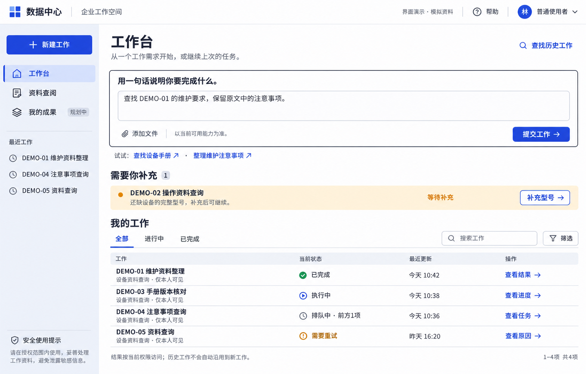
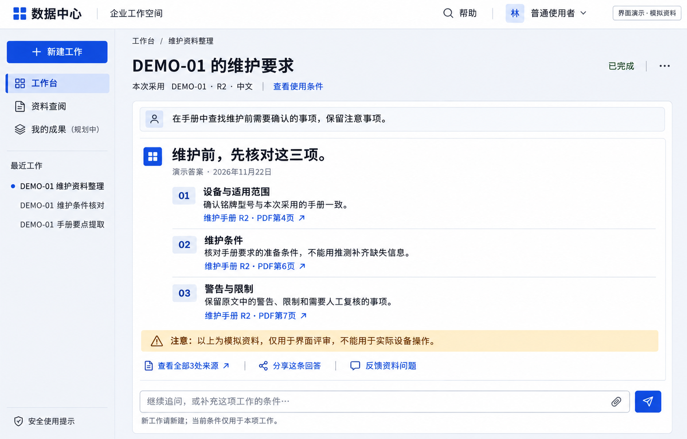
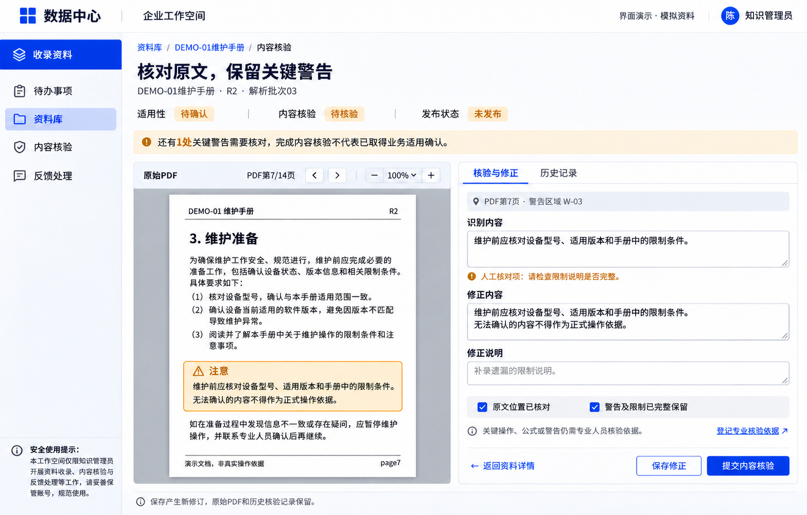
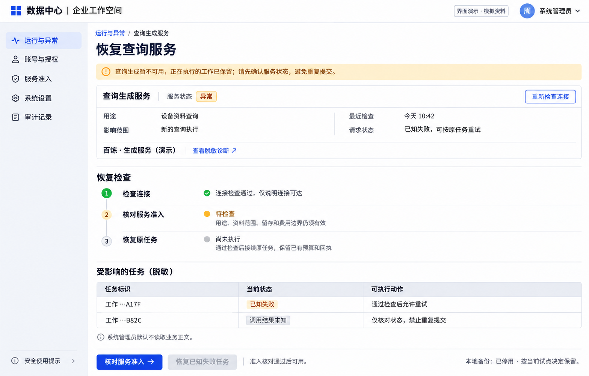

# 数据中心 · 任务工作台全新设计

日期：2026-11-22。初稿交付为四张桌面高保真静态效果图及本设计说明；用户随后明确批准按本版开始本地实施。以下效果图仍为设计阶段模拟视觉，实际代码、浏览器验证及差异以[项目状态](../planning/STATUS.md)和[工作区说明](../../src/web/README.md)为准，不用设计批准代替运行验收。

## 用户体验复核与三角色重构（2026-11-22）

用户已明确授权重构三角色并交其验收；实际交付状态和验证边界见tasks当前检查点。用户实际体验反馈：①普通员工不知道界面表达什么、能做什么及哪些信息多余；②各角色界面功能看起来相同；③整体更像草图/demo，缺少完整界面。本反馈否定当前体验达到交付要求，不撤销已有权限/证据测试的有限工程结果，后续用户已批准本节范围的本地重构；用户体验验收仍须用户实际确认。

依据：当前三角色实际截图位于outputs/pilot-runtime/2026-11-19/live/experience-check；同入口实际Chrome复现role-entry-review.json证实三账号从/workspace/query登录后标题与导航均相同。源码WorkspaceShell/session未做通用入口的角色落点。即便使用各自专页，视觉主骨架也都是大标题、大面板、说明/表单；业务优先级与工作密度没有按角色重组。独立审美评审未运行；本节是基于实际截图、代码及用户反馈的产品/设计诊断。

### 1. 员工应理解什么

产品长期价值是“使用企业已有资料完成工作，取得能核验的答复或办公成果”；当前已开放的首期能力应明确说成“查找适用手册、查询操作/维护要求、核对注意事项与原文”。目前“工作台/从一个工作需求开始/提交工作”过于抽象，输入框承担了全部说明职责，无法从首屏判断问题范围、结果形态及怎么开始。不能以完整产品为名展示尚未实现的计算、表格或报告按钮。

建议当前首屏用“查询设备资料”明确能力，副文案“查操作步骤、维护要求和注意事项，答案附手册版本及原文位置”；输入提示给可直接理解的真实业务问法，按需要再补型号。近期结果精简显示；结果页以可用答复、关键警告、适用条件为核心，版本/来源随查证可达。产品未来扩展为办公任务时仍以实际能力验收决定开放，不将设备查询永久替代平台定位。

应移出默认首屏：重复的角色/工作空间/安全口号；“新工作不默认沿用旧设备条件”等内部恢复规则；分享用用户UUID及任务标识；创建时间和“本人工作/已完成执行”等重复标签；技术恢复/账本文案。保留并在相关操作出现：来源与版本、适用条件、关键警告、缺什么及下一步、分享对象/范围/撤回后果。模拟资料须继续明确标识，但不让英文重复SYNTHETIC记录代替可理解的业务示例；改造模拟素材仍需更新严格输入准入，不能仅改标题伪装真实资料。

### 2. 三角色需要不同的工作结构

| 角色 | 首屏要回答的问题 | 主工作对象与提议结构 |
| --- | --- | --- |
| 员工 | 我能问什么、得到了什么、可以用吗 | 围绕问题与答复组织：清楚的能力说明/问题输入→答复与必要条件→原文核对/继续追问；最近结果与收到的分享服务于回访 |
| 知识管理员 | 哪些资料需要我处理、卡在哪一步 | 以资料列表/待办进入精确版本详情；待核验/待确认/待发布/员工反馈分清；进入核验后原PDF和内容块占主要空间，选择资料与批次控制不再把核验区域挤到首屏以下 |
| 系统管理员 | 当前哪些能力可用、哪里异常、我能处理什么 | 以实际可用状态和待处理异常为首屏；账号/审批/服务及费用限制进入专门管理页；故障关联真实状态和获准动作，恢复教程置于帮助，不占主工作区 |

统一品牌、基础控件和权限机制仍有价值；三角色不靠换颜色区分，首页、主要对象、操作节奏与信息密度应随职责变化。按角色默认落点修复属于既定角色分工的实现缺陷；整体页面按本节重构，具体实施与观察证据见tasks当前检查点。

### 3. 为什么像demo及完成边界

现有页面把接通API的表单和说明当作工作流：大量首屏空间用于标题、空输入及维护说明，核心核验/结果内容反而在后面；缺少从总览识别对象、进入处理、判断结果并继续工作的完整组织。模拟数据重复且陌生，强化了演示感；后续办公能力本身尚未完成，也无法由视觉补齐。不是增加卡片、图标或导航项就能成立。

建议重构范围：先完成上述三角色信息架构及各一条主流程的可审阅页面，再覆盖列表/详情、处理中、空态、失败/恢复、失权、分享撤回与反馈回访的连续体验；原有权限/证据机制继续复用。角色与来源门禁不变，运行实例和续验不重启，备份继续停用。当前可用能力做完整，缺失后端能力列为产品缺口，不包装成可点击的成品。

本次实施：员工以具体资料问答、结果与来源为主；KM以当前管理范围资料列表/筛选进入精确版本，再做原PDF对照；SA以逐用途有效选用与脱敏任务为主。列表计数只表示已载入记录，准入有效不表示实时服务健康；无对应后端的未来能力不启用。既有原件、签认、权限、未知及预算围栏保持。实际渲染与完整业务验证结果由tasks/验收记录维护，用户审美验收独立待定。

## 1. 设计依据与范围

本稿响应用户“抛开现有前端方案，重新设计”的要求。不读取旧界面设计正文、组件布局、样式或截图作为设计参考；从[产品目标](../requirements/SPEC.md#1-产品目标与范围)、[首期业务场景](../../specs/001-device-operation-maintenance-query/spec.md#user-scenarios--testing)及三角色职责重新推导。需求中历史的外观参考和候选导航不约束本稿。首期业务顺序、连续追问、结果优先、权限与证据规则继续有效。

面向电脑网页，目标视口1440×900与1366×900；四张效果图实际均为1568×1003的视觉候选，并非上述视口的浏览器实测。实现继续使用既有React/TypeScript及Python业务接口；初稿设计阶段未读取或修改产品前端代码，不新增框架或安装依赖。

目标是让员工清楚知道“我在做什么、现在缺什么、结果在哪里、能否使用”，让知识管理员处理资料成为可用依据之前的核验，让系统管理员恢复服务且不越过业务权限。完整产品要容纳查询、计算、表格与报告，但首期启用项仍受真实实现与验收约束。

本稿是新版整体视觉与交互候选的唯一所有者；既有三角色对接文档中的历史视觉、页面编排不作为本稿基线，也不自动迁入。接口事实仍归API，业务规则仍归SPEC/角色，执行状态仍归STATUS/tasks。批准并实施时才逐页替换相应旧契约，不将两套导航同时上线。

## 2. 已比较的方向

| 方向 | 适合的工作 | 代价与局限 |
| --- | --- | --- |
| 对话为中心 | 连续提问与即时补充 | 长工作、待办和成果容易埋在消息中，需要额外找回入口 |
| 资料目录为中心 | 已知型号/文件的直接查阅 | 容易要求员工先找资料再表达工作，难承接组合办公任务 |
| 任务工作台 | 发起需求，处理缺项，恢复长任务，获取答案/文件 | 需要明确“办公工作”和“一次后台执行”的区别，避免每条消息生成一个任务 |

用户选择第三种。工作台承接工作，具体工作内保留连续对话；目录查阅是独立辅助入口。首页不要求先选部门、资料库、模型或工具。

## 3. 总体空间与视觉语言

- 顶栏高64px：品牌、工作空间、帮助、当前身份。仅兼任且获准的角色可切换工作区；切换不授予资料权限，清空旧角色的受限显示。
- 左导航约208–224px：当前角色的工作入口，员工保留最近工作。不同角色不堆在同一菜单中。
- 主区：页面标题、当前状态、主要工作内容与下一步。任务列表用行与分隔线；结果用连续可读的内容页；核验用双栏原文对照。
- 以钴蓝#244CDD承担主动作、导航与链接；深墨#1B2438承担正文；画布#F3F5F9、白色工作面、边线#DFE4EC。琥珀用于待处理/待核验；绿色只标识已实际通过的具体步骤。
- 标题28–32px，分节20px，正文15–16px，辅助信息13–14px，正文行高1.6。8px间距体系；按钮至少36px高；圆角6px左右；弱化阴影，以层级、对齐和留白区分内容。
- 使用可本地部署的中文无衬线字体及系统回退，不从公网加载字体/脚本。效果图字体不是已打包字体承诺。图标统一线宽；图标须有可访问名称，操作不只依赖颜色或悬停。
- 键盘焦点、禁用理由、表单标签和错误文本须可见。后续实现检查文字对比度、200%缩放、键盘与焦点返回；本轮未做浏览器无障碍验收。

设计取舍：工作任务需要准确状态与持续阅读，采用稳定行列、紧凑列表和明确阅读面；不在员工首页安排模型指标、流水线或技术日志。

## 4. 普通员工：从需求到结果

### 工作台首页

首屏顺序为“新建工作 → 需要你补充 → 我的工作”。输入区支持自然语言，示例只帮助填写而不自动执行。提交明确创建工作/执行，按钮锁定至受理回执；请求不明时先核对已有任务，不盲目再发。

列表显示标题、业务状态、更新时间与唯一下一动作。待补充项直接写明缺哪个条件；排队显示真实位置，无法获得位置时只写“排队中”；不编造倒计时。历史可分页/搜索，只显示当前用户可见内容。最近工作为快捷定位，与主列表同一份数据。

“工作”是用户持续处理的一件事，映射既有对话/消息/执行记录，不要求重建后端任务模型。一条澄清消息不必执行；更改已经执行的条件产生后续执行，保留旧回答。新工作不默认继承旧型号、文件和条件。

首次提交以服务端持久化对话/工作回执为找回依据；已保存但还未执行的澄清工作显示“等待补充”。429明确表示本次执行未受理，不制造排队项；若工作容器已经保存，则保留工作并显示“执行未受理”，否则保留本地未提交草稿并明确不在服务端历史中。同一工作后续执行的状态作为列表主状态，旁注“已有上次结果”；不能因旧答案存在就把新失败显示为完成。详情默认展示最新一轮状态和输入，下方可打开标注版本/时间的上次结果；分享始终绑定用户明确选定的正式答案ID，不跟随“最新结果”指针漂移。

图片中“我的成果（规划中）”表达后续扩展位置；首期实际页面隐藏该未实现入口。添加文件、列表搜索、排队位置等须先逐项核实接口支持；未接通能力不上可点击的生产入口，不用演示交互冒充真实处理。

### 工作详情与结果

页面标题说明工作目标；标题下显示本次采用的型号、版本及“查看使用条件”。主区先呈现可用答案，关键警告和未完成项直接可见，随后是来源链接、单条回答分享和反馈入口。继续追问固定在阅读区下方，可滚动查看历史；输入草稿与执行内容明确区分。

正式结果的“已完成”由正式答案/产物校验状态决定，不由模型文字或请求结束决定。效果图的演示答案、页号、日期均为模拟，不能作为真实手册结论。实际设备相关结果始终直接显示业务复核提示，不能当作设备执行指令。

点击来源进入精确版本与PDF文件页序号，另显示实际存在的印刷页码；返回恢复滚动位置与输入草稿。默认不把原文固定在结果旁边，员工主动查证后才进入专用阅读页。当前权限变化时清除失效正文、引用、预览及缓存；历史回答不因曾生成就永久可见。

单条回答分享打开接收人和有效期表单，明确只分享该回答，不附整段对话/输入文件。服务端重新校验发送与接收权限；逐人撤回后立即失效。无权、过期或撤回提示不泄露资源名称；图片中的分享链接只表示设计位置。

发送者从该回答的“分享这条回答”进入持续管理面板，分开列出当前接收人、期限、有效/撤回状态与逐人“撤回”；本人工作历史可返回这条回答，不要求记住原链接。撤回是服务端事务性失效，之后所有读取立即拒绝。网页收到失权事件或响应立即清屏；返回焦点、执行动作前和前台最长15秒一次轻量授权复核同样触发清理，校验不可用时隐藏受限正文并显示待核对，不继续离线展示。未收到通知前已打开页面存在该检测窗口，不能声称可抹去用户已经看过的内容。原PDF在应用内受控阅读面展示，避免以长期裸链接绕开复核；已经依法获准下载的文件无法远程召回，不把撤回分享表述为召回下载。若现有接口无法支持所需复核，新版受限阅读/分享路径暂不启用，先完成该安全依赖。

资料查阅页采用型号/文件名搜索、受权资料行列表和版本状态；仅参考的精确版本持续显示“待确认/待核验，仅供参考”，不提供正式答案入口。无权资料不能通过列表占位或冲突信息泄露。员工反馈从当前回答/手册发起，明确提交对象与必要片段，回访进度不暴露整段工作。

### 后续成果形态

计算结果在同一结果页显示数值、单位、条件与验证状态；表格/报告显示预览、修改摘要、未完成项及获准文件入口。覆盖已有结果先展示差异并确认。仅在对应后端实际处理和校验通过后启用；本轮未设计成已可用的功能按钮，不增加在线表格编辑或整任务分享。

## 5. 知识管理员：把资料变成可靠依据

入口为“待办事项、资料库、内容核验、反馈处理”，主动作“收录资料”。待办围绕具体阻断项，不用解析数量代替可用性。资料详情是精确文档版本的总入口，关联原件、来源、版本关系、访问范围、核验批次和发布预检。

收录：选择PDF → 登记来源/型号/版本/类别/等级 → 预检重复与权限 → 受理并跟踪解析；失败保留已登记信息和原上传回执，不静默再创建版本。

核验页左侧原PDF、右侧识别内容/修正/说明/依据，均绑定精确批次和区域。可左右独立滚动，并保留同步定位入口。不能定位区域时退至真实页序号并明确未定位区域，不能伪造高亮。修正形成新修订；原件不覆盖，旧核验/发布不自动继承。图中“1处”与高亮区域是模拟人工核对项，不代表已实现自动遗漏识别。

适用性、内容核验、发布状态始终分别显示。核验勾选仅表达人工检查项，不代替所需核验人与专业依据；业务适用确认通过独立登记表录入确认人、日期、适用范围、依据和系统登记人，不作为核验页的一个复选框。内容核验与适用确认分别就绪后，资料详情做预检，再显式发布。图片无直接发布按钮。

版本冲突在资料详情列出当前有权维护的相关版本、范围和确认差异；不按上传时间决定有效版本。参考开放、撤回与切换均单独说明影响并确认，索引未就绪不标记员工已可正式查询。反馈处理只获得被授权的反馈对象与必要片段。

## 6. 系统管理员：可解释地恢复服务

入口为“运行与异常、账号与授权、服务准入、系统设置、审计记录”。首屏围绕受影响能力、异常和待处理动作，不默认显示业务资料/员工问题/生成结果。配置者不代替业务审批人。

恢复页区分连接检查、准入核对和原任务恢复。连接可达不等于服务获准使用，也不等于业务查询通过。准入核对复用逐用途的范围、有效期、留存、预算及模型配置身份；界面不一键补审批、不展示密钥，不因点击按钮触发未说明的付费自检。

效果图中“恢复已知失败任务”是禁用的恢复流程位置，不授予系统管理员读取或代员工重新执行付费业务任务的能力。实际首期由管理员恢复服务配置/消费者，就绪后原任务按既有派发机制接续；需要重试授权的任务由任务所有者在原工作内操作。若后续需管理员发起恢复，须先有独立能力与服务端授权，不能只解除灰色按钮。

调用结果未知的任务仅核对回执与状态，禁止重复提交；取消与未知、已知失败分别显示。不把进程恢复描述为数据库/原件恢复。备份继续停用，图中只反映该决定，本轮不修改任何调度。

账号与授权页分开显示身份/角色、资料范围、允许操作、文件维度、有效期和外部审批依据；不合并多条不完整授权。配置提交前显示影响范围，失效后会话/缓存由后端清除。系统管理员无业务正文的默认权限。

## 7. 必须可见的状态与恢复

| 情况 | 用户看见什么 | 允许的下一步与边界 |
| --- | --- | --- |
| 型号不完整 | “还缺完整型号”，列出已确认条件 | 补充型号；不猜测，不改旧答案条件 |
| 没有足够依据 | “当前授权资料中未找到足够依据” | 缩小/调整问题或提交反馈；不声称企业没有该资料 |
| 版本冲突 | 现有授权内的版本、适用范围差异 | 请求负责人确认；不选最新上传版本自动作答 |
| 解析待核验 | 相关区域待核验、受影响结论暂停 | 获准参考原文或反馈；不标正式完成 |
| 排队与容量满 | 真实排队状态；满时明确未受理 | 查已有工作/稍后提交；不无界排队或放宽并发 |
| 已知服务失败 | 保留工作、说明失败阶段与可重试状态 | 修复后原任务授权重试；保留预算和回执 |
| 调用结果未知 | “结果尚未核实”，不显示普通重试主按钮 | 核对状态；换重试键也不重发 |
| 网络中断/刷新 | 离线或重连状态，恢复已有工作 | 只读核对受理回执后继续；不因刷新新建任务 |
| 权限撤销/分享失效 | 通用不可访问状态，清空失权内容 | 返回受权工作；不显示受限名称与摘要 |
| 后续能力局部完成 | 分别显示完成/待输入/未验证项目 | 只继续可执行项目，不用局部结果冒充整件工作完成 |

错误区域同时提供原因与下一动作；详细技术诊断只在有权的管理入口。处理中的取消须等后端确认，不用本地消失冒充取消成功。

首次提交前生成并记录账号作用域的稳定提交标识，关联工作/执行受理幂等身份；刷新恢复仅保存必要标识，不把正文、原文件、签名链接或会话凭据存入普通浏览器持久缓存。拿不到服务端ID时先按该标识做只读核对，不能通过换标识或重新POST来“查询”。只有服务端可证明未受理/未外发，或返回明确可重试的原执行状态及原预算身份，才开放对应提交/重试；单纯查不到、客户端超时和无账本均不足以证明未执行。持续无法核实时停在“待核对，不重发”，任务所有者可查看，管理员只处理脱敏标识与回执核查。缺少只读对账契约时先补齐该核心安全依赖，再切换新建工作路径，不靠浏览器提示代替幂等与未知围栏。

## 8. 后续实施边界与验收

初稿阶段仅设计交付；用户现已批准本地实施。实施顺序：公共视觉与角色壳 → 员工工作台/连续工作/结果/来源 → 资料查阅与分享撤回 → KM核验与发布预检 → SA准入与异常恢复。各页先核实已有接口，不为了实现效果图扩充业务权限或替换后端模型。

切换按完整业务路径进行。分享撤回、核验发布预检、原执行核查和撤权复核属于核心依赖；若仅缺原契约内的局部连接，则在该路径切换前接通并验证；若需新增权限、业务规则或实质后端能力，则保留既有可用通路，暂缓对应新版路由并显式记录缺项。可选搜索/筛选、未实现成果入口可以隐藏。不得用隐藏核心功能、模拟成功按钮或混用两套状态模型来宣称新版全量完成。

仍由实施者依据代码确定的局部细节：可复用的基础组件、内部组件命名、列表虚拟化是否有实际必要、精确路由与已有ID映射。任何路由迁移保留现有深链接与返回位置，路由不是权限凭据。搜索、队列位置和管理恢复等接口缺口先明确收敛展示，不能造假数据上线。

验收按真实浏览器的两档电脑视口覆盖：键盘发起工作、补型号、刷新找回、结果/警告阅读、引用精确版本返回、分享及撤回、资料校正/三态/发布预检、已知失败/未知恢复与跨角色失权清屏。取消、429与断网要核对服务端状态。图像自评、文档结构通过不能替代上述验收或用户审美接受。

设计初稿阶段只观察四张静态图片。后续真实浏览器交互、1366×900布局、放大/长内容溢出和真实用户体验需分别取证，当前实施结果统一引用STATUS/tasks，不在本稿复制进度。

基础颜色的确定性对比度计算为：钴蓝/白6.66:1、深墨/白15.49:1、深墨/画布14.19:1；只覆盖定义的色值，不证明效果图所有像素或未来页面均达标。独立只读构建审阅指出的四项边界已在第4/7/8节补齐；其作用是减少实施猜测，不代表真实用户验收。

## 9. 效果图来源与维护

使用内置imagegen生成；未以旧UI、截图或组件为参考。四张最终PNG约5.5MiB，路径见上图；它们是本设计的非敏感模拟评审附件，不是原手册、运行数据或应用截图。图片中的具体DEMO名称、记录时间、页号、数目和核验状态全部虚构，文字约束以本稿为准。

生成提示摘要：统一1600×1100桌面、简体中文、钴蓝/深墨/蓝灰、64px顶栏、208px角色侧栏、适量行列表、6px圆角；首页按“新工作/待补充/工作列表”；结果页按“条件/答案/警告/来源链接/追问”；KM按“精确版本三态/左原件右修正”；SA按“故障影响/连接/准入/原任务恢复/未知禁重发”。完整原始英文提示保留在[生成提示](assets/task-workspace-v1/prompts.json)，用于复现意图而非像素一致保证。KM图已定向修正，移除业务适用确认复选框，并把疑似自动检测措辞改为人工核对项。

本轮方法：brainstorming、product-judgment；读取AIFD0.3.0 Core入口及Context/Visual Expression/Experience文档，使用orchestrator与visual-art-direction技能；imagegen用于视觉候选。用户确认、实现验证与独立审阅分开记录，不声称所有AIFD能力均已运行。
