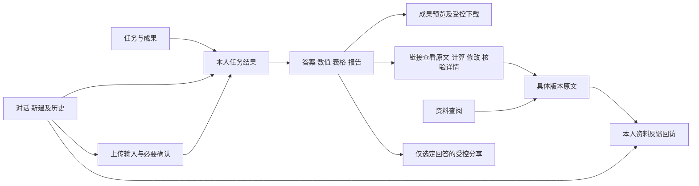

# 普通使用者界面与后端对接方案

> 历史对接资料：本文的导航、页面编排和视觉已由用户批准的[任务工作台全新设计](任务工作台全新设计.md)取代，不作为当前UI基线。保留业务衔接讨论；有效权限/版本/证据规则仍以SPEC/API/数据库文档为准，实际实现与验收只查[STATUS](../planning/STATUS.md)。下文“本轮”指2026-11-17设计阶段。

版本：1.0，2026-11-17。范围：基于20项Agent工具，统一资料查询、数值计算、表格修改和报告生成的页面、交互及后端关系。本轮仅交付设计文档，不编写应用或预览代码；本稿不等于已实现、已批准的导航或完整高保真视觉方案。

结果优先、附加证据链接跳转、持续对话/条件记忆、默认授权范围、资料查阅、单条回答分享和原位反馈回访为已确认要求；本稿的三个主入口、页面组织、控件及连接方式为可评审方案。此前只覆盖查询的结构稿及其侧栏原文示例不再作为完整角色设计依据。

本文件保留2026-11-17的完整功能与交互草案；当前页面设计归上方新版所有，工具输入/输出、权限和验收以 [API14](../api/接口设计.md#14-agent工具统一契约设计基线01) 为准，页面读写投影在 [API15](../api/接口设计.md#15-普通使用者完整工作区对接设计)，持久化补充在 [数据库15](../database/数据库设计.md#15-普通使用者页面关联与输入来源补充)，工具依赖在 [架构6.5](../architecture/前后端技术方案.md#65-工具依赖及设计分工基线01)，实际实现/验证只在 [STATUS](../planning/STATUS.md) 维护。

## 1 入口与工作对象

采用三个主入口：**对话、资料查阅、任务与成果**。四种工作共用自然语言入口；员工不必先选择工具、部门或资料库，也不必掌握后台服务名称。计算/报告不需要设备条件时，不强制填写设备型号。

| 入口 | 员工来这里完成什么 | 内容和去向 |
| --- | --- | --- |
| 对话 | 提出工作、上传输入、补充条件、继续要求修改 | 新建及历史对话；当前消息、必要条件摘要、任务回执与就近结果；可打开对应任务/成果 |
| 资料查阅 | 按型号/文件名找手册，直接打开原件 | 授权目录→具体版本原文；本人资料反馈/答复就近回访；不默认把打开的手册设为当前任务依据 |
| 任务与成果 | 找回较长任务、处理待补项、查看/下载已有成果 | 仅本人任务，按处理中/待补充/已完成等筛选；打开同一任务结果，不复制另一份业务状态 |

账号入口承载当前身份、获准角色切换和退出；角色兼任不改变资料权限。单条共享回答由受控链接进入独立只读视图，不混入办公任务列表。不增加独立统计首页、20个工具菜单、资料反馈主导航或自动业务确认入口。

与“两入口、任务只随消息出现”相比，第三入口为长任务和文件查找提供稳定路径；与“四类任务各一套页面”相比，共用工作对象能保留补充、结果及来源关系。它不要求新增通用工作流平台。

图中的分享分支仅适用于答案，不代表表格、报告或整任务分享。

## 2 页面构成与返回关系

下列是产品路由建议，不是已存在网页。业务标识与访问资格由服务端核验；返回目标只允许应用内已知路由，不能接受任意外部URL。地址不放业务正文、密钥或完整文件内容。

| 页面 | 路由建议 | 默认主要内容 | 返回与关联 |
| --- | --- | --- | --- |
| U00 登录/身份恢复 | `/login` | 登录、可理解的身份失效原因及返回提示 | 登录后重验原资源权限，再回原工作位置；不凭旧页面缓存放行 |
| U01 对话工作区 | `/conversations/:id` | 工作标题、消息、已确认条件摘要、输入区、就近任务/结果 | 保留选中消息、任务和历史；新建对话不继承旧条件/手动范围 |
| U02 任务与成果 | `/work` | 本人任务列表：工作名称、真实状态、待处理项、最近成果及时间 | 点击进入U03；失权条目仅显示允许的安全状态，不泄露标题/文件名 |
| U03 任务结果 | `/tasks/:id` | 结果优先，按答案/数值/表格/报告组织；必要警告及未完成项目 | 关联原对话；保留选定delivery版本，较新成果仅提示，旧成果不被替换 |
| U04 成果预览 | `/tasks/:id/artifacts/:artifact_id` | 对应文件版本的只读表格或文档，必要完成/核验状态 | 返回U03或原消息；选中工作表/页/区域可恢复；不是在线编辑器 |
| U05 输入与确认 | `/tasks/:id/inputs`或指定请求锚点 | 输入文件/已确认条件、项目范围、待补项或覆盖差异 | 在原对话/任务就近操作，长内容可打开此子视图；不是另一份任务 |
| U06 资料目录 | `/manuals` | 型号/文件名搜索、授权资料名称、版本及必要状态 | 进入U07，不影响现有对话条件 |
| U07 手册原文 | `/manuals/:document_id/versions/:version_id` | 原始文件、实际定位、版本/适用/核验状态、本人资料反馈 | 从引用进入时保留返回原消息/成果位置；不自动切换最新版本 |
| U08 核对详情 | `/tasks/:id/details`，带受控subject和kind | 所选答案/数值/文件的来源、计算过程、修改或检查记录之一 | 从结果链接进入，返回保持任务、消息、选中版本和位置；不固定占据主结果侧栏 |
| U09 共享回答 | `/shared-answers/:answer_id` | 指定回答及必要设备条件、版本、出处和当前可读状态 | 无发送者对话、任务输入、其他成果、反馈记录或控制动作 |

反馈回访保留在U01/U07的原来源附近，内容较长时可展开本人详情；不要求员工跳到另一个总工单平台。U03/U04可见本人输入/成果，不代表接收者能通过分享链接进入这些页面。

## 3 对话工作区

### 3.1 结构和提交

左侧承载三个主入口及对话历史；主体按阅读顺序为工作标题/必要条件摘要、对话消息和结果、底部输入区。主区不常驻原文或后台日志侧栏。条件摘要按任务需要出现，例如设备型号、单位或精度；完整来源/历史可由链接查看，当前必需条件和缺项不能藏起来。

输入区允许自然语言及获准文件。员工可提交Excel数据、Word模板或其他已支持资料；附件显示名称、用途、接收/检查状态和移除操作。后台检查实际格式/权限，不能仅凭扩展名放行；未完成上传或必要检查的附件不作为已可用输入。上传失败保留已输入文字，允许核对原回执、重传失败部分或移除附件，不默默发送缺少文件的任务。

不设必经的任务类型下拉框。后台结合请求形成工作范围；只有会影响处理项目、公式、填写位置或成果类型的歧义才请求确认。没有模板时明确需要的新结构；有模板时读取员工指定模板，不自行换用其他模板。

发送后先展示“已接收/处理中”的真实回执和关联任务。对话文字补充不伪装成已执行工具；工作请求、附件引用、消息和新任务关联由服务端持久化。提交结果不明时按原client_message_id/幂等回执核对，不重复生成任务。

### 3.2 连续工作与历史

- 同一对话继续使用仍有效的已确认条件，并保留它们来自哪条用户补充或资料；模型推断保持待确认。检索默认当前全部获准范围，可收窄及恢复，不越过授权。
- 对等待请求的补充走绑定的输入请求，保存后仅使受影响的可执行项目继续，不要求员工再发一次相同工作。确认成功回执表示补充被接受，不表示计算或文件已经完成。
- 修改已执行的输入/公式/范围，或要求对旧成果作新修改时，新建关联的后续任务；保留原任务与产物，明确“基于哪份成果/哪些单元格继续处理”。仅补齐未执行项目按既定execution_revision继续原任务。
- 更正当前对话条件只影响后续任务；正在运行任务仍用其冻结条件。员工可选择安全取消旧任务，系统不暗中修改在途输入。
- 离开/刷新不触发重复计算。返回时读取服务端消息、待补请求、状态与交付；不会以浏览器本地记录作为唯一历史。
- 从旧文件继续工作必须明确选择该文件/成果版本，后台继承并复核来源链；新对话可以显式绑定有权文件，但不自动继承旧对话全部条件。

以上记忆按用户确认的 [四层设计](../architecture/前后端技术方案.md#7-四层产品记忆设计) 实现：界面显示的是当前scope/subject的有效条件，而非模型自述的“记住了”。候选/冲突单列，员工可查看来源、更正或清除当前条件；清除不抹旧结果，也不从旧消息重新填回。多个设备/项目/文件分别列必要条件，单值“当前型号”不覆盖比较任务全部主体。条件更新影响后续，原任务仍显示其冻结条件；详情及历史每次重新鉴权。

刷新/重新登录从服务端L2/L3/L4重建本次L1；没有有效资格时不从浏览器缓存恢复正文。来源已变化/条件需重验时就近显示必要状态，不把它变成新的管理页或“记忆中心”。个人偏好层后置，当前不增加偏好学习或跨对话默认参数设置。

## 4 四类结果及完整处理流程

主结果有两个稳定层次：对话中先显示足够理解和采取下一步的结果；较长文件、多项目或跨版本比较可打开U03/U04。两个位置读取同一ResultManifest/文件版本，不分别缓存出不同结论。附加证据采用明确文字链接，不以小图标或悬停作为唯一入口。

| 任务类型 | 主结果直接呈现 | 就近主要动作 | 链接查看的附加内容 |
| --- | --- | --- | --- |
| 资料查询 | 直接答案、适用型号/必要条件、关键警告、证据不足/冲突状态；简短标明所用版本 | 继续追问、打开原文、分享这条回答、反馈资料问题 | 来源列表、具体原文定位、当时条件/版本详情 |
| 数值计算 | 指标/项目、数值与单位、必要适用条件、显示精度摘要及计算/待复核状态 | 补充参数、继续计算或按任务要求写入表格 | 公式依据、原始输入、单位换算、计算记录和检查结果 |
| 表格修改 | 实际处理结果、可编辑新文件、修改摘要、已完成/待补/失败项目；必要时只读表格预览 | 预览、下载、处理待补项、通过对话继续要求修改 | 实际修改位置/前后内容、输入来源、公式/重算和核验记录 |
| 报告生成 | 内容摘要、可编辑报告、模板/范围摘要、冲突/缺失/待确认事项；可打开文档预览 | 预览、下载、通过对话提出后续修改 | 段落/表格来源、各型号版本、采用计算结果和检查记录 |

数值和单位相邻显示；多项目用有表头的结果表，不逐个嵌套卡片。任务要求文件但没有生成文件，不能以文字“已完成”或空下载按钮代替；纯答案/数值任务不强制生成附件。技术检查通过与业务人员确认可用分开，设备高影响结果保留必要人工复核提醒，不增加一键业务确认/资料发布按钮。

### 4.1 资料查询

员工描述问题 → T01取已确认条件 → T03/T04定位授权且适用的有效资料 → T05按需读定义、警告或原页 → Agent组织答案候选 → T14按任务要求核对来源/状态及必要内容 → T16交付。没有足够证据时直接说明缺什么，不把“检索任务已结束”写成专业问题已解决。

答案主区不铺开长引文。点击“查看依据”进入U08，点击某来源进入U07确切版本/页；返回恢复原消息位置。无权/撤回/解析不可靠的内容不用于正式答案；有权可参考原文时仍显待确认或待核验状态。

### 4.2 数值计算

员工以文字或文件提供输入 → T02/T06按需读入 → T08核定公式、变量、单位、适用条件和精度/舍入 → 缺项用T17就近请求 → T09实际计算 → T14核验 → T16呈现数值。手册规则需要检索时才调用T04/T05，不把每次计算强制变成RAG问答。

补充表单明确变量含义、当前已知值/单位、缺失原因和适用项目；未确认的精度、单位或公式选项不能预选为已批准。数值来自用户、手册常量或计算派生的区别可在详情核对；必要适用条件直接留在结果旁。计算失败/不适用时不给出冒充正式结果的数字。

### 4.3 表格修改

员工提交已有Excel，描述处理项目；或明确新建表格结构 → T02/T06读取原件 → 确定项目/表头/区域/目标单元格映射 → 需要计算时T08/T09 → T10形成修改预检 → 必要T17确认 → T11另存真实新工作簿 → 涉及公式时T12重算 → T14核验 → T15/T16预览及交付。

必要确认直接展示“工作表/单元格、原内容、拟写内容、原因及受影响项目”。有原数值或公式时不能默认同意；员工明确确认或拒绝，保存的是对应计划/基准文件/差异的确认。确认后文件或计划变化则旧确认失效，显示变化并重新判断，不照旧覆盖。

多项目任务可先交付经核验的部分新文件，醒目标明哪些项目本次完成、哪些未处理、未处理区域是否保留原值；不把保留旧数值当作本次计算成果。后续补齐产生新交付版本，已完成项目不重复计算。状态说明放结果页或约定附录，不擅自在业务表里新增状态列/工作表。

本方案以**只读预览、下载可编辑Excel、继续用对话提出修改**为设计基线；网页直接编辑单元格尚未确认，不增加在线编辑/保存/协同冲突处理能力，也不把预览表做成可输入却无法保存的假编辑器。

### 4.4 报告生成

员工描述报告目标、材料及模板 → T02/T07读取模板/输入文档；资料库证据经T03–T05 → Agent组织有来源的章节/对照/冲突计划 → 需数值时用T09结果 → T13生成可编辑Word → T14核验 → T15预览 → T16交付。

有模板保留约定结构和格式，无模板按明确的内容结构编制。来自员工输入文档的内容保留文件/章节/段落/表格定位，不要求先发布进知识库，也不能冒充已发布手册。原模板和输入文件不被改写；要求调整报告时选择现有版本，在新任务/成果中生成修改版。Excel明细仅在任务要求时交付，不默认增加附件。

## 5 任务与成果的状态及恢复

U02用于查找，U03用于完成工作；U03默认“结果”，另有输入/待确认及处理情况的次级入口。处理情况只展示员工判断所需阶段与恢复动作，不展示工具名、向量、Worker、内部租约或模型密钥。进度来自真实项目/步骤，不显示虚构百分比。

| 状态/情形 | 员工直接看到什么 | 可用动作和后端要求 |
| --- | --- | --- |
| 新对话/无任务 | 可直接描述工作并按需附文件，历史为空如实显示 | 不展示伪造的最近成果或推荐数据 |
| 文件接收/检查中 | 对应附件状态，文字输入仍保留 | 按回执查状态；未合格文件不投入处理，失败可核对/移除/重传 |
| 已接收/处理中 | 当前真实阶段、已完成项目及是否可离开 | 状态GET只读；取消依照后端allowed_actions，刷新不启动新执行 |
| 部分项目待补充 | 待补项目/参数/范围；其他已完成或继续中的项目 | T17绑定原任务补充，其他独立项目不受阻；不能把整个任务显示已完成 |
| 等待覆盖确认 | 完整必要差异与影响，不隐藏在来源链接后 | 真实用户确认/拒绝；请求过期或计划变化要刷新重判 |
| 部分成果可用 | 本次完成范围、可用文件与未完成项目及原因 | 仅交付已通过必检的部分；未处理数据不冒充新结果 |
| 检查未通过/未验证 | 哪个成果或项目不可作为完成结果及原因 | 阻断完整交付，允许查看本人有权候选与详情；不能用下载绕过资格 |
| 服务异常/提交结果不明 | 已保留什么、当前是否已接受、下一步是什么 | 先核对原call/任务；只有后端允许时恢复，不换键盲目重发 |
| 权限变化/会话过期 | 安全状态或重新登录入口 | 停止正文/文件/详情读取，清理页面业务缓存；失权所有者仍可安全取消，不泄露资源信息 |
| 来源有新版本 | 旧回答/文件保留原条件及版本，提示真实变化 | 主动按当前条件重查或另生成新成果；未过业务/核验/发布门禁不冒充正式可用，不自动重算/替换旧文件 |
| 已取消/终态失败 | 真实终态及已允许保留的结果/恢复说明 | 取消后旧Worker不能交付；终态失败需重新执行时按后端建立新任务，不把新任务说成原状态恢复 |

所有按钮依据服务端状态、当前能力及allowed_actions生成。没有能力配置时显示“当前暂不支持此处理”或与当前任务有关的限制，不出现永远转圈的任务；没有资料用途授权时保留必要申请说明，不让Agent自动扩权。

## 6 20项工具与页面动作的完整映射

页面只提交业务请求、读取投影及提交真实确认；T01–T20由后端按契约调用。相同结果的对话摘要、任务页和预览共用标识和版本。

| 工具 | 对应可见行为 | 后端连接/结果对象 |
| --- | --- | --- |
| T01 context.read | 打开/继续原对话，显示必要已确认条件 | ConversationWorkspace及当前上下文修订 |
| T02 files.inspect | 附件接收、格式/限制检查、输入状态 | InputFileAccepted/Inspection，绑定FileRef |
| T03 sources.search | U06按型号/文件名查资料 | 授权目录分页与SourceRef |
| T04 evidence.search | 提问或办公任务需要查依据 | 用途受限的证据候选及缺项/冲突 |
| T05 sources.read | 引用链接打开原版原文/图表/脚注 | SourceRef与原文受控读取 |
| T06 workbooks.read | 识别工作表、原始值/单位、填写位置 | 工作簿结构快照及RangeRef |
| T07 documents.read | 识别报告模板及员工输入文档 | 文档结构快照/输入章节定位 |
| T08 calculations.prepare | 公式/参数/单位/精度就绪或待补 | 冻结计算定义或输入请求 |
| T09 calculations.run | 看到真实数值和单位 | 计算运行/输出记录 |
| T10 workbooks.plan_changes | 查看本次拟改位置与差异 | 修改计划及revision/hash |
| T11 workbooks.apply_changes | 经必要确认后获得新工作簿候选 | 实际修改记录及新ArtifactRef |
| T12 workbooks.recalculate | 公式结果更新，或明确不支持/未验证 | 重算记录及新候选版本 |
| T13 documents.compose | 生成可编辑报告候选 | 文档ArtifactRef及来源映射 |
| T14 artifacts.validate | 判断结果/文件是否满足必检 | 与实际输出hash绑定的ValidationReport |
| T15 artifacts.preview | 只读查看表格/报告/数值成果 | 同版本预览及其实际范围/状态 |
| T16 artifacts.deliver | 读取答案、数值、文件及完整/部分完成情况 | 不可变delivery/ResultManifest |
| T17 tasks.request_input | 原对话/任务补参数或确认差异 | InputRequest与可信Resolution，非模型批准 |
| T18 tasks.control | 查进度、安全取消、核对/恢复 | SafeTaskStatus、允许动作及检查点 |
| T19 answers.share | 只分享选定回答，设置期限/撤销 | answer_snapshot及分享集合修订 |
| T20 feedback.track | 原对话/手册反馈、回访答复和更新提示 | 本人DocumentFeedback及派生update_notice |

登录/会话、资料发布、权限配置、支持矩阵和文件留存属于基础服务，不新增为普通员工工具菜单。页面请求与数据投影的具体字段统一见API15；本表不另起一套请求格式。

### 待确认手册的人工参考入口（2026-11-17确认）

U01资料目录/U07原文遵循API17.6：默认隐藏未开放草稿，DM显式开放精确版本后，有当前DR的员工可进入原PDF并持续看到“仅供参考”、待确认/待核验原因、版本及出处。参考入口不产生正式答案、计算依据或模型上下文，不自动选择为本轮证据；下载/导出和分享继续单独鉴权。关闭参考或撤权后停止目录、原文、页图/预览及旧链接读取，返回安全状态并保留允许的反馈入口。已有发布与历史内容按其原规则处理，不把开放参考当作重新发布。

## 7 详情链接与权限

来源、计算过程、修改明细和检查记录均从具体答案/成果链接进入；U08明确正在核对的版本/文件/项目，不默认展示整个任务所有输入。资料库来源跳U07确切版本原文。员工输入docx默认展示T07的实际章节/段落/表格结构片段及原文件入口；支持可靠原件预览定位时再跳相应位置，不能定位时说明限制，不用重排文本冒充原件，不虚构知识库版本或PDF页码。

引用/详情/预览/下载每次都检查当前权限和依赖；URL、文件hash或曾有权缓存不授读取权。有权查阅、正式查询、计算、报告生成和导出分别授权。原文浏览器已获取字节或已下载文件无法由界面撤权追回，不承诺技术上禁止员工保存已获准阅读的内容。

单条分享只读被选答案；不能通过task_id、详情kind、输入/产物ID扩读发送人的办公任务。必要条件/出处仍在该回答投影中，整个计算账本/文件不自动作为附带内容。共享页面不展示发送者反馈；接收者可打开其有权原文并在自己的手册入口反馈。

发送者在所选回答的分享操作中输入接收者的平台账号标识，核对后显示最小身份供确认，再设置可选有效期；查看当前分享集合及撤销就在同一操作区。采用已有平台账号的精确核对，不要求填写数据库UUID，也不在本轮增加全企业模糊人员搜索/通讯录。不存在、停用或不满足分享资格统一显示无法分享，不能用这个入口枚举账号状态或补资料权限。

反馈提交前显示必要附带内容，不默认带全部对话/任务。回访仅显示本人反馈及有权关联资料；知识管理员受理不获得整段对话。答复不等于问题解决，更新不等于资料已发布，重新查询不会改写旧答案。

## 8 视觉与可用性方向

延续用户提出的备忘录式阅读层次，重点是工作内容和成果，而非管理看板。候选方向为浅色中性底、轻分隔、深色正文、单一主交互色；状态颜色仅辅助文字，避免整屏强调、统计卡片和层层套框。左导航可收起，顶部工作标题克制，长答案限制阅读行宽；表格/报告预览可使用更宽区域。

中文优先系统无衬线字体，正文候选16–17px、行高约1.6；密集表格候选14–15px，数字与单位不可拆散，数值按相同规则对齐。字体/间距是待视觉核对的建议，不是已验收token。必要确认用可读差异表，关联参数有字段标签、单位和错误提示，不依赖占位文字或颜色。

电脑网页为本期设备范围；建议以1366×768及较宽电脑窗口检查长内容/预览，窄电脑窗口允许导航收起、表格横向滚动，不能因此宣称手机适配。键盘可达主要动作，详情返回恢复焦点，错误关联原字段；原始表格输入不是默认可编辑控件。

本轮没有新视觉样稿或真实渲染证据，不将本文的文字、Mermaid或旧隔离预览作为完整视觉提案。后续视觉确认应以本稿任务关系重新制作覆盖真实长度内容、数值/文件成果、待补和覆盖确认的完整高保真候选；高保真使用模拟内容时须显式标注，不借用企业正文。

## 9 页面与对接验收

| 编号 | 应验证的完整行为 | 必须取得的证据 |
| --- | --- | --- |
| UI-01 | 同一入口完成四类工作，消息、任务和成果版本可相互找回；不重复提交 | 真实浏览器与API/数据库关联，刷新/离开恢复；不是只检查导航存在 |
| UI-02 | 查询答案为主、依据链接直达原版；返回保持位置，必要警告完整 | 黄金样本逐条核对、链接实际定位及权限变化路径 |
| UI-03 | 计算缺项、单位/公式/精度确认和真实结果完整，数值/单位不丢 | 人工参考、计算记录和原对话补充/后续任务关联 |
| UI-04 | Excel多项目映射、覆盖确认、另存、重算/核验、部分交付和补齐继续 | 实际原件/输出hash、单元格与格式对照、可信确认、浏览器与文件打开检查 |
| UI-05 | 模板/无模板报告可编辑，来源/冲突可核对，预览/下载同版本 | 获准模板、人工内容核对、实际渲染/可编辑文件，输入文档来源定位不伪造 |
| UI-06 | 原位反馈及答复/更新提示、单条分享不扩读 | 本人/接收者/管理角色及撤权、过期、猜ID检查；原任务不暴露 |
| UI-07 | 上传/服务异常、在途结果未知、取消/失权时保留输入且正确恢复 | 对应故障/权限注入与真实记录，不重复上传/计算/追加/交付 |
| UI-08 | 信息层次、长内容、数值/表格、键盘和返回焦点可用 | 实际渲染与交互、人类使用判断；文档检查和构建成功不替代视觉/业务验收 |

以上均为后续实施后的验收条件，当前UNVERIFIED。工具级AC-T01–20及PLAN的E2E-Q/C/R/S/F继续有效，不用本稿降低门槛或扩大首期实现范围；已有/待开发能力仍以上述统一STATUS为准。

## 10 Pi运行接入衔接

2026-11-17用户已选Pi基底，具体[接入设计](../architecture/Pi-Agent接入与改造方案.md)/API18仅为后端实现方案，不增加网页入口或改变待确认导航。网页仍按API15读取真实消息、条件、任务和ResultManifest；Worker推进执行，GET只读。SDK消息先为内部候选，等待补充/核对/partial及正式结果状态由业务服务投影，不能将agent_settled显示为整任务已核验完成。

T17的补充/覆盖确认只来自认证页面，绑定原计划和修订；Pi交互确认或消息队列不替代业务响应。T19仅分享单条答案，T20仅有权反馈投影；员工/接收者不能下载内部Pi会话/上下文清单。会话失权停止后续输出，恢复按当前允许动作回到原任务，不能要求员工为同一未知写入重发请求。当前未接入或验证这些页面行为。
