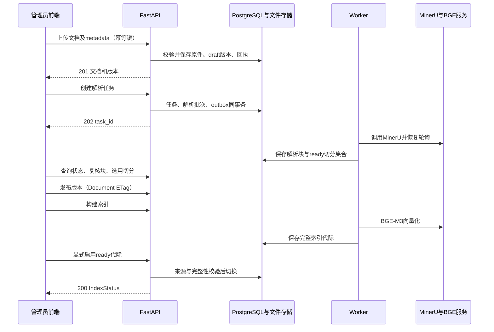

# 前后端 API 接口设计

日期：2026-11-10。状态：基于已确定技术栈与数据库草案形成的接口设计，待审阅；尚未实现端点、生成 OpenAPI 或执行联调。

依据：[数据库设计](数据库设计.md)、[前后端技术方案](architecture/前后端技术方案.md)、[模型与解析方案](architecture/模型与解析方案.md)及 [角色需求](README.md#角色需求)。数据库文档定义存储关系，本文件定义前端可调用的契约；二者不能以直接暴露 ORM 对象代替。

## 1. 范围与设计选择

本轮覆盖身份与授权管理、文档上传和版本管理、解析校验与选用切分、索引构建与启用、知识检索、任务状态与结果获取。业务接口采用 HTTP JSON，上传使用 multipart，下载返回文件流，长任务采用提交后轮询。

- 相比把所有动作塞进通用聊天接口，资源接口让权限、版本和任务状态明确可查。
- 首版采用轮询，不把 WebSocket 或 SSE 设为必需条件；后续事件推送可以补充，不能改变任务状态的持久依据。
- 登录发行方、密码登录、刷新令牌与单点登录流程仍待确定。本文件只要求后端获得可信当前用户，不新增未经确认的认证产品。
- 文件上传先进入本系统，再由 Worker 按授权调用 MinerU；前端不持有供应商凭据、不直接上传企业原件给第三方。
- 计算公式与计算明细数据模型尚未完成，因此本轮不定义可执行任意公式的接口，也不宣称 calculate/export 全部业务能力已经可调用。

## 2. 通用契约

### 2.1 URL、字段与响应

| 项目 | 约定 |
| --- | --- |
| 路径前缀 | `/api/v1`；下文端点均省略前缀；路径参数为 UUID |
| 字段 | JSON 使用 snake_case；未知请求字段拒绝，响应新增可选字段保持向后兼容 |
| 身份 | 由认证适配层提供 users.id；浏览器提交的 user_id/role/permission 不能作为调用者身份；API 测试约定使用经验证的 Bearer 凭据，发行方未选择 |
| 时间与数值 | 时间为 ISO 8601 UTC 字符串；计数是整数；未来正式精确计算采用十进制字符串加单位，不把 JS 浮点值当作精确计算契约 |
| 成功 JSON | `{"data": T, "meta": {"request_id": string}}`；204 和文件流无此包裹 |
| 列表 | data 为 `{"items": T[], "next_cursor": string\|null}`；默认 limit=20、上限100，cursor 不透明并绑定筛选条件；只返回授权对象，不提供全库总数 |
| 默认排序 | 普通实体列表 created_at、id 降序；版本按 version_no 降序；块和步骤按 ordinal/position 升序 |
| 无敏感缓存 | 含业务内容的响应使用 `Cache-Control: private, no-store`；服务端缓存仍受当前权限修订校验 |
| 响应白名单 | 分离管理视图、用户视图和运维视图，禁止直接序列化全部数据库列 |

本轮列表上限、查询长度等为工程默认值，可通过验证调整，不是模型供应商限制。FastAPI 支持文件表单与响应模型；具体实现须显式定义请求、响应模型和过滤字段。[上传文档](https://fastapi.tiangolo.com/tutorial/request-files/)、[响应模型](https://fastapi.tiangolo.com/tutorial/response-model/)

### 2.2 幂等与并发更新

- 所有 POST、PUT、PATCH、DELETE 写接口要求 `Idempotency-Key`（客户端生成 UUID，一次用户操作固定一个）。同一用户所有写接口共用键空间；重发相同方法、路径、规范化请求内容及 If-Match 条件返回同一操作结果；相同键配不同内容返回 `409 IDEMPOTENCY_CONFLICT`。修正参数或刷新并发条件后重新发起操作使用新键。
- 服务端用 `api_idempotency_records` 保存 HTTP 请求回执，结构见 [数据库设计第 8.4 节](数据库设计.md#84-接口设计增补http-请求回执)。任务创建同时写 tasks、步骤、outbox 和回执结果；上传使用文件状态与回执恢复流程，不能只用进程内字典去重。
- multipart 的请求指纹包括规范化 metadata 及实际文件 SHA-256，不包括随机 boundary 或上传进度。处理未完成时重复请求返回 `409 REQUEST_IN_PROGRESS` 及 Retry-After；状态不明时返回 `409 REQUEST_RECONCILIATION_REQUIRED`，由服务端核对，不让前端换键盲目重传。
- 任何幂等重放都先检查当前身份与资源权限。回执仅保存状态码、资源标识和原请求指纹；不缓存可绕过撤权的响应正文或下载地址。
- PATCH、PUT、DELETE，以及发布、撤销、块复核、选用切分、索引启用和任务取消，必须携带 `If-Match`。GET 单资源返回强 ETag，列表项必要时携带该资源的 etag；缺少条件返回428，不匹配返回412。新增资源和创建长任务不要求 If-Match，除非端点表另注。
- ETag 来自当前资源可变字段及相关修订（授权集合包括 acl_revision/authz_revision），比较和写入在同一锁定事务中完成，防止先检查后被并发覆盖。已成功请求的幂等重放在当前权限通过后返回同一结果，不因原 ETag 已变化重复执行。
- 201 表示资源已创建；202 表示任务及派发记录已持久化，不代表 Worker 或外部服务已开始；DELETE 默认为逻辑删除或撤销授权，不永久清除原件。

HTTP 条件请求和状态码遵循 HTTP 语义；上述 Idempotency-Key 的持久化与重放规则是本项目约定。[HTTP 语义](https://www.rfc-editor.org/rfc/rfc9110.html)

### 2.3 错误结构

错误采用 `application/problem+json`，按照 Problem Details 结构补充业务 code、request_id 和字段错误，不回显完整输入、原文、SQL 或供应商凭据。[RFC 9457](https://www.rfc-editor.org/rfc/rfc9457.html)

```json
{
  "type": "about:blank",
  "title": "Conflict",
  "status": 409,
  "detail": "当前版本已变化，请刷新后再发布。",
  "instance": "/api/v1/documents/11111111-1111-4111-8111-111111111111/versions/22222222-2222-4222-8222-222222222222/publish",
  "code": "VERSION_CONFLICT",
  "request_id": "req-example",
  "errors": []
}
```

errors 元素为 `{field: string, code: string, message: string}`，field 使用请求字段路径。状态与 code 对应：

| HTTP 状态 | 业务 code 示例 | 前端处理 |
| --- | --- | --- |
| 400 | `INVALID_CURSOR` | 重置分页或修正请求 |
| 401 | `UNAUTHENTICATED` | 重新认证，不能继续轮询或下载 |
| 403 | `OPERATION_FORBIDDEN`、`ACCESS_CONDITIONS_CHANGED` | 无操作能力，或已知本人/分享任务依赖权限变化；不列出无权资料名称 |
| 404 | `RESOURCE_NOT_FOUND` | 不存在、无资源读取范围或路径父子不匹配统一返回，不暴露存在性 |
| 409 | `VERSION_CONFLICT`、`INVALID_STATE`、`INDEX_NOT_READY`、`INDEX_STALE`、`CAPABILITY_NOT_CONFIGURED`、上述幂等冲突 | 按 code 刷新、补充条件或等待，不能统一自动重试 |
| 412 / 428 | `PRECONDITION_FAILED` / `PRECONDITION_REQUIRED` | 刷新 ETag 后由用户重新判断操作，新的操作使用新幂等键 |
| 413 / 415 | `FILE_TOO_LARGE` / `UNSUPPORTED_MEDIA_TYPE` | 根据能力配置调整文件 |
| 422 | `VALIDATION_ERROR`、`FILE_HASH_MISMATCH` | 显示字段错误，不把缺失参数补成默认业务值 |
| 429 | `RATE_LIMITED` | 按 Retry-After 等待并保持同一幂等键 |
| 503 | `SERVICE_UNAVAILABLE` | 接受任务前拒绝的新请求可稍后重试；已接受任务仍以任务状态为准 |

已提交任务的解析失败通常表现为 GET 任务返回200且 status=failed，不把业务失败伪装成轮询 HTTP 500。未知异常使用500与脱敏 request_id。

## 3. 权限缩写与公共数据结构

### 3.1 权限缩写

| 缩写 | 含义 |
| --- | --- |
| `AUTH` | 当前用户 active 且身份已验证 |
| `DR` | document.read + 数据库设计中的文档有效访问范围 |
| `DM` | document.manage + 目标文档 manage 范围；新建文档使用目标知识库 manage 范围 |
| `KM` | document.manage + 知识库 manage 范围，并可管理该库全部未删除的现行文档，用于完整索引维护 |
| `TR` | task.read + 任务所有者或被分享者 + 当前可读取全部 task_documents，任务未删除 |
| `TO` | 任务所有者；执行取消、重新提交等动作时还校验原任务类型所需能力与范围 |
| `UM/AM/SC/OR` | user.manage / access.manage / system.configure / operations.read |

所有缩写隐含 AUTH。system_admin 不绕过 DR/DM/TR。普通用户默认只看到已有发布版本的文档及 effective/superseded/withdrawn 版本；draft 与解析维护界面要求 DM。这是本轮对草稿可见性的明确默认值，已同步数据库设计。

任务列表可向所有者/接收者返回极简的 `access_limited` 状态项，但无正文、文件名或无权文档名称；任务详情与结果仍执行 TR。身份能力满足但资源范围不满足时优先404，仅对已知任务的依赖变化使用403。

### 3.2 类型约定

以下采用说明性类型记法，不是可执行 TypeScript；`?` 表示字段可省略，`T|null` 表示字段存在但允许未知。所有服务端对象包含 id 和 created_at，明确另述的投影除外。状态枚举以数据库设计为唯一来源。

| 名称 | 数据结构 |
| --- | --- |
| `UserView` | id:UUID, display_name:string, status:active/disabled, created_at:Time, updated_at:Time |
| `CurrentUser` | UserView + role_codes:string[], permissions:string[], authz_revision:integer；不包含身份凭据 |
| `RoleView` | id:UUID, code:string, name:string, permission_codes:string[] |
| `RoleAssignment` | user_id:UUID, role_codes:string[], authz_revision:integer |
| `Grant` | user_id:UUID, access_level:read/manage；写入方 granted_by/granted_at 由后端填充 |
| `AccessPolicy` | resource_type:knowledge_base/document, resource_id:UUID, access_mode?:inherit/restricted, grants:Grant[], acl_revision:integer |
| `AccessTarget` | resource_type, resource_id, knowledge_base_id:UUID\|null, status:string；无标题、原文或内容摘要 |
| `KnowledgeBaseView` | id:UUID, name:string, status:active/archived, search_ready:boolean, created_at:Time；普通用户无全库数量及内部索引配置 |
| `Applicability` | schema_version:"1", scope_status:confirmed/unconfirmed, equipment_models:string[], conditions:string[]；空模型数组不自动等于适用所有设备 |
| `DocumentView` | id:UUID, knowledge_base_id:UUID, title:string, category:string\|null, current_version_id:UUID\|null, access_mode:inherit/restricted, allowed_actions:string[], created_at:Time, updated_at:Time |
| `VersionView` | id:UUID, document_id:UUID, version_no:integer, revision_label:string\|null, status:VersionStatus, applicability:Applicability, source_file:FileSummary, selected_chunk_set_id:UUID\|null, effective_at:Time\|null, published_at:Time\|null, created_at:Time |
| `FileSummary` | byte_size:integer, mime_type:string, sha256:string；不返回存储路径、bucket 或供应商下载地址 |
| `TaskAccepted` | task_id:UUID, status:TaskStatus（首次为pending，重放为当前状态）, resource_type:parse_run/index_generation/task, resource_id:UUID, status_url:string, poll_after_seconds:integer |
| `Locator` | schema_version:"1", kind:pdf/office/unknown, page_number:integer\|null, printed_page:string\|null, section:string\|null, table_id:string\|null, cell:string\|null, bbox:object\|null；bbox 有值时含坐标系和页面尺寸 |

allowed_actions、search_ready 仅帮助前端展示，后端每次操作仍重新校验。revision_label、页码、模型修订等未知信息必须为 null，不能生成看似确定的值。

## 4. 当前用户、用户管理与授权接口

| 方法与路径 | 权限 | 请求 | 成功响应 | 数据关联 |
| --- | --- | --- | --- | --- |
| `GET /me` | AUTH | 无 | 200 CurrentUser | users、user_roles、role_permissions |
| `GET /capabilities` | AUTH | 无 | 200 CapabilityView，见下文 | 已验证部署配置的投影 |
| `GET /admin/users` | UM | cursor, limit, status? | 200 Page<UserView> | users |
| `POST /admin/users` | UM | display_name:string | 201 UserView，默认 disabled | users；只建业务用户，不直接建立登录身份 |
| `GET /admin/users/{user_id}` | UM | 无 | 200 UserView + ETag | users |
| `PATCH /admin/users/{user_id}` | UM | display_name?:string, status?:active/disabled | 200 UserView；至少一个字段 | users、audit_events；停用更新权限修订 |
| `GET /admin/roles` | AM | 无 | 200 Page<RoleView>，固定角色目录 | roles、permissions、role_permissions |
| `GET /admin/users/{user_id}/roles` | AM | 无 | 200 RoleAssignment + ETag | user_roles |
| `PUT /admin/users/{user_id}/roles` | AM | role_codes:string[] | 200 RoleAssignment；全量替换 | user_roles、users.authz_revision、审计 |
| `GET /admin/access-targets` | AM | resource_type, knowledge_base_id?, cursor, limit | 200 Page<AccessTarget> | 最小授权对象标识投影，不返回文档标题 |
| `GET /admin/knowledge-bases/{kb_id}/access` | AM | 无 | 200 AccessPolicy + ETag | knowledge_base_grants |
| `PUT /admin/knowledge-bases/{kb_id}/access` | AM | grants:Grant[] | 200 AccessPolicy；全量替换 | 授权表、acl_revision、审计，同事务 |
| `GET /admin/documents/{document_id}/access` | AM | 无 | 200 AccessPolicy + ETag | document_grants、documents.access_mode |
| `PUT /admin/documents/{document_id}/access` | AM | access_mode:inherit/restricted, grants:Grant[] | 200 AccessPolicy；原子替换 | 文档授权与模式、知识库 acl_revision、审计 |

CapabilityView：`{upload:{allowed_mime_types:string[],max_bytes:integer},query:{enabled:boolean,max_chars:integer,max_top_k:integer,answer_enabled:boolean},parsing:{enabled:boolean},indexing:{enabled:boolean}}`。能力字段按用户角色裁剪，限额来自服务端配置，不暴露密钥。未验证格式不列为支持；生成模型未配置时 answer_enabled=false。

角色兼任、自己授予权限及身份绑定流程受待确认的企业政策约束。身份绑定不通过任意客户端 provider/subject 字段完成；在选定可信发行方前，不开放身份注册/密码接口。权限码首版由服务端种子管理，不提供修改角色内置能力的普通 CRUD。

## 5. 知识库、上传与版本管理

### 5.1 接口

| 方法与路径 | 权限 | 请求 | 成功响应 | 数据关联 |
| --- | --- | --- | --- | --- |
| `GET /knowledge-bases` | AUTH + 至少一个业务读取/管理范围 | cursor, limit | 200 Page<KnowledgeBaseView>，无范围返回空列表 | knowledge_bases、授权表 |
| `POST /admin/knowledge-bases` | SC | name:string | 201 KnowledgeBaseView，无隐式资料授权 | knowledge_bases |
| `GET /admin/knowledge-bases/{kb_id}` | SC | 无 | 200 基础配置 {id,name,status,created_at} + ETag | knowledge_bases，不含文档 |
| `PATCH /admin/knowledge-bases/{kb_id}` | SC | name?:string, status?:active/archived | 200 基础配置；归档使业务读取不可用 | knowledge_bases、修订、审计 |
| `GET /knowledge-bases/{kb_id}/documents` | DR，逐项过滤；DM 可含草稿 | cursor, limit, q?, category? | 200 Page<DocumentView> | documents、versions、授权表 |
| `POST /knowledge-bases/{kb_id}/documents` | DM（知识库范围） | multipart: file + metadata=NewDocumentInput | 201 {document:DocumentView,version:VersionView} | 文件、文档、首版、请求回执 |
| `GET /documents/{document_id}` | DR 或 DM | 无 | 200 DocumentView + ETag | documents |
| `PATCH /documents/{document_id}` | DM | title?:string, category?:string\|null | 200 DocumentView；不接受 ACL、归属或当前版本字段 | documents、审计 |
| `DELETE /documents/{document_id}` | DM | 无 | 204，逻辑删除 | deleted_at、内容/权限修订、审计 |
| `GET /documents/{document_id}/versions` | DR；draft 需 DM | cursor, limit | 200 Page<VersionView> | document_versions |
| `POST /documents/{document_id}/versions` | DM；If-Match 为 Document ETag | multipart: file + metadata=NewVersionInput | 201 VersionView，状态 draft | 文件、新版本、回执 |
| `GET /documents/{document_id}/versions/{version_id}` | DR；draft 需 DM | 无 | 200 VersionView + ETag | document_versions |
| `POST /documents/{document_id}/versions/{version_id}/publish` | DM；If-Match 为 Document ETag | effective_at:Time\|null | 200 {document:DocumentView,version:VersionView} | 当前指针、版本状态、content_revision |
| `POST /documents/{document_id}/versions/{version_id}/withdraw` | DM；If-Match 为 Document ETag | reason:string | 200 {document,version} | 状态 withdrawn，必要时清空当前指针 |
| `GET /documents/{document_id}/versions/{version_id}/file` | DR；draft 需 DM | disposition=inline/attachment | 200/206 文件流 | source_file_id，复核版本归属 |

NewVersionInput：`{revision_label:string|null,applicability:Applicability,expected_sha256:string}`。NewDocumentInput 在其基础上增加 `title:string,category?:string|null`。expected_sha256 必须由实际内容校验，不信任声明值。

metadata 是 multipart 中的 JSON 字符串字段，不是同时发送第二个 application/json 请求体；后端独立校验并拒绝额外字段。标题、分类及文件名不作为存储路径。

### 5.2 上传与发布语义

1. 先验证身份、目标知识库/文档的管理权限和上传限额；文件接收到隔离临时区，流式计算哈希并核对类型及 expected_sha256。
2. 保存 file_objects 与文件状态，确认文件可用后在事务中创建文档/版本并完成请求回执。失败不产生可见的半个版本，遗留临时文件可恢复清理。
3. 新文档默认 access_mode=inherit；它及 draft 版本仅在管理范围内可见，普通用户在首次发布前不可读取。敏感文档应在发布前由授权管理员收紧范围，DM 不能通过上传字段改变 ACL。
4. 上传201只表示资料已保存，不代表已解析、已生效或已建索引。解析由后续接口显式发起。
5. 新版本不自动发布；publish 仅允许 draft，校验文件可用、适用范围已确认及原文版本信息，effective_at 未知可为 null，不能把 published_at 当成手册生效日。未来定时生效不在首版范围。
6. 发布锁文档行并更新旧版与新版状态；用户必须持有最新 Document ETag，防止两名管理员互相覆盖。发布不自动启用未完成的索引。
7. 首版不开放原件/适用条件原位改写接口；需要改动时创建新版本。withdraw 只撤销该版本，不自动恢复历史版；版本回退须重新经过发布设计，不默认开放。

版本撤销、逻辑删除及并发冲突必须保留审计；不可删除版本的接口字段不能靠前端隐藏替代后端拒绝。

## 6. 解析、校验与切分选择

### 6.1 接口

| 方法与路径 | 权限 | 请求 | 成功响应 | 数据关联 |
| --- | --- | --- | --- | --- |
| `POST /documents/{document_id}/versions/{version_id}/parse-runs` | DM | ParseRequest | 202 TaskAccepted，resource_type=parse_run | tasks、steps、parse_runs、task_documents、outbox |
| `GET /documents/{document_id}/versions/{version_id}/parse-runs` | DM | cursor, limit | 200 Page<ParseRunView> | parse_runs |
| `GET /parse-runs/{parse_run_id}` | DM（按所属版本解析） | 无 | 200 ParseRunView + ETag | parse_runs、步骤 |
| `GET /parse-runs/{parse_run_id}/blocks` | DM | cursor, limit, kind?, review_status? | 200 Page<BlockView>，按 ordinal | content_blocks |
| `GET /parse-runs/{parse_run_id}/blocks/{block_id}` | DM | 无 | 200 BlockView + ETag | content_blocks，父子归属校验 |
| `POST /parse-runs/{parse_run_id}/blocks/{block_id}/review` | DM | {review_status:approved/rejected,reason:string} | 200 BlockView | review 字段、审计，拒绝内容递增 content_revision |
| `POST /parse-runs/{parse_run_id}/corrections` | DM | CorrectionRequest | 202 TaskAccepted，新 manual 解析批次 | 新 parse_runs、原文块副本、task_documents、outbox |
| `GET /parse-runs/{parse_run_id}/chunk-sets` | DM | cursor, limit | 200 Page<ChunkSetView> | chunk_sets |
| `GET /parse-runs/{parse_run_id}/artifacts/{artifact_id}/file` | DM | 无 | 200/206 文件流 | parse_artifacts、file_objects |
| `PUT /documents/{document_id}/versions/{version_id}/selected-chunk-set` | DM；If-Match 为 Version ETag | {chunk_set_id:UUID} | 200 VersionView | selected_chunk_set_id、content_revision |

ParseRequest：`{language_hint?:string}`，首版固定 MinerU VLM，启用表格与公式识别。language_hint 只能来自实际供应商支持的白名单；不允许前端指定任意 URL、模型端点或执行代码。

CorrectionRequest：`{reason:string,edits:[{block_id:UUID,text_content?:string,structured_content?:BlockContent}]}`，每项至少修改一种内容，不允许修改原文定位、所属版本或任意父块。表格/公式修改以结构内容为准，服务端重新生成对应文本；纯文本块才允许只修改 text_content。批次冻结后不能原位更改；校正复制到新 manual 批次，记录 parent_run_id，改动块重新置 unreviewed。新增/删除布局块与跨页人工重排留待专项交互设计。

### 6.2 数据与状态

| 名称 | 数据结构 |
| --- | --- |
| `ParseRunView` | id, document_version_id, task_id, origin:provider/manual, parent_run_id:UUID\|null, status:ParseStatus, model_option:string\|null, model_revision:string\|null, error:{code,message}\|null, created_at；无供应商 Token、原始请求地址 |
| `BlockView` | id, parse_run_id, parent_block_id:UUID\|null, ordinal:integer, kind:string, text_content:string\|null, structured_content:object, locator:Locator, review_status:unreviewed/approved/rejected, reviewed_at:Time\|null, etag:string |
| `ChunkSetView` | id, parse_run_id, splitter_version:string, status:building/ready/failed, chunk_count:integer, created_at；不默认发送全部向量 |

BlockContent 是带 schema_version="1" 和 type 的联合结构，以下为归一化契约，不表示任何解析器已通过这些内容的准确率验证：

| type | 内容字段 |
| --- | --- |
| text | text:string；标题、普通正文、警告等通过 BlockView.kind 区分 |
| table | row_count:integer, column_count:integer, cells:[{row:integer,column:integer,row_span:integer,column_span:integer,text:string,is_header:boolean}]；行列从1起，跨度至少1，检查越界和重叠 |
| formula | expression:string, notation:latex/plain, surrounding_definition:string\|null；仅保存识别表达式与上下文，不执行公式 |
| image | artifact_id:UUID, caption:string\|null；必须属于当前解析批次，预览走鉴权文件端点 |
| unknown | summary:string\|null；未支持的原始结构保存到解析原始结果文件，本轮不开放自由字段校正 |

Locator.bbox 有值时为 `{coordinate_space:pixel/normalized,left:number,top:number,right:number,bottom:number,page_width:number,page_height:number}`，检查坐标范围及右下边界；PDF 的 page_number 从1起。不能从缺失坐标推算并伪装成供应商返回值。

解析工作流包含远端提交/轮询、归一化与首版切分，因此不另设“任意切分代码”接口。成功结果与 ready 切分集合落库后供管理员选择；需要调整切分规则时先定义允许配置，再扩展端点。

ParseStatus 复用数据库的 pending/submitted/running/succeeded/failed/needs_review。`parse_run=succeeded` 表示解析产出成功，不等于块已人工 approved，也不等于当前检索索引已启用。等待远端时 task_steps=waiting_external，tasks 可仍为 running。

退回 rejected 块或换选用切分集合后，旧内容立即停止参与检索，不等待重建；确认块恢复 approved 也要遵循当前版本与选用切分规则。网络重试保持同一幂等键和远端任务标识；主动重新解析用新键创建新批次。

## 7. 索引构建与启用

| 方法与路径 | 权限 | 请求 | 成功响应 | 数据关联 |
| --- | --- | --- | --- | --- |
| `GET /knowledge-bases/{kb_id}/index-status` | KM | 无 | 200 IndexStatus + ETag | knowledge_bases、index_generations |
| `GET /knowledge-bases/{kb_id}/embedding-profiles` | KM | cursor, limit | 200 Page<EmbeddingProfileView>，仅可用配置 | embedding_profiles、后端可用性校验 |
| `POST /knowledge-bases/{kb_id}/index-generations` | KM | {embedding_profile_id:UUID} | 202 TaskAccepted，resource_type=index_generation | 索引清单、tasks、steps、依赖、outbox |
| `GET /knowledge-bases/{kb_id}/index-generations` | KM | cursor, limit | 200 Page<IndexGenerationView> | index_generations |
| `GET /knowledge-bases/{kb_id}/index-generations/{generation_id}` | KM | 无 | 200 IndexGenerationView | index_sources、build_report |
| `PUT /knowledge-bases/{kb_id}/active-index` | KM；If-Match 为 IndexStatus ETag | {generation_id:UUID} | 200 IndexStatus | 活动指针、来源与向量完整性校验 |

| 名称 | 数据结构 |
| --- | --- |
| `EmbeddingProfileView` | id, model_name, model_revision:string\|null, dimension:1024, distance_metric:cosine；无密钥与内部服务地址 |
| `IndexStatus` | knowledge_base_id, active_generation_id:UUID\|null, content_revision:integer, active_source_revision:integer\|null, status:missing/ready/stale；status 为派生值，不是新数据库状态 |
| `IndexGenerationView` | id, knowledge_base_id, embedding_profile_id, task_id, status:building/ready/failed/retired, source_revision, expected_chunk_count, actual_chunk_count, exclusions:[{document_version_id,code}], ready_at:Time\|null, created_at |

构建来源由服务端固定为当前版本及选用切分，前端不能注入任意片段或知识库外版本。ready 代际仍需显式启用；过期、缺向量或 retired 返回409，不自动强制激活。

EmbeddingProfileView 只列已经配置并通过基本连通验证的服务配置；创建供应商配置与密钥管理不属于本轮公共 API。尚无可用配置时列表为空、构建被拒绝，不能假装有默认生产平台。

## 8. 知识检索与问答任务

### 8.1 提交与结果接口

| 方法与路径 | 权限 | 请求 | 成功响应 | 数据关联 |
| --- | --- | --- | --- | --- |
| `POST /knowledge/queries` | knowledge.query + task.create + 目标库内 DR | QueryInput | 202 TaskAccepted，resource_type=task | query 类型任务、执行快照、outbox |
| `GET /tasks/{task_id}/result` | TR | 无 | 200 QueryResult；未完成409 RESULT_NOT_READY，非query类型409 UNSUPPORTED_RESULT_KIND | 结构化结果文件、task_evidence、当前资料状态 |
| `GET /tasks/{task_id}/evidence` | TR | cursor, limit | 200 Page<EvidenceView> | task_evidence、task_documents、当前状态 |
| `GET /tasks/{task_id}/evidence/{evidence_id}` | TR | 无 | 200 EvidenceView | 同任务证据及所属原文块 |

QueryInput：

| 字段 | 类型与默认值 | 语义 |
| --- | --- | --- |
| query | string，1–4000字符 | 用户查询，不作为系统指令执行 |
| knowledge_base_ids | UUID[]，1–20项且去重 | 用户明确选取的库；无权限目标返回404，不回显其名称 |
| document_ids | UUID[]，可省略，上限100 | 可选缩小范围，必须全部属于选定知识库且当前可读 |
| equipment_model | string，可省略 | 按已确认适用范围过滤，未确认范围不可推断为匹配 |
| top_k | integer，默认10，1–50 | 目标候选片段数；少于 top_k 不自动代表无相关资料 |
| mode | retrieve/answer，默认retrieve | retrieve 返回证据；answer 还需已配置生成模型，否则409 CAPABILITY_NOT_CONFIGURED |
| allow_partial_index | boolean，默认false | 默认任一库无可用或完整现行索引即409；true 时只查询仍适用且有权的片段，并明确部分覆盖警告 |

首版新检索只面向现行版本；指定历史版的业务问答尚未定义，不开放任意 generation_id 查询参数。不同知识库使用各自活动向量配置，不把一种模型的查询向量用于另一种配置。

检索例子（仅示例，不是真实业务输入）：

```json
{
  "query": "查找设备 A 的维护周期及适用条件",
  "knowledge_base_ids": ["11111111-1111-4111-8111-111111111111"],
  "equipment_model": "设备 A",
  "top_k": 10,
  "mode": "retrieve",
  "allow_partial_index": false
}
```

首次接受任务的响应例子：

```json
{
  "data": {
    "task_id": "33333333-3333-4333-8333-333333333333",
    "status": "pending",
    "resource_type": "task",
    "resource_id": "33333333-3333-4333-8333-333333333333",
    "status_url": "/api/v1/tasks/33333333-3333-4333-8333-333333333333",
    "poll_after_seconds": 2
  },
  "meta": {"request_id": "req-example"}
}
```

TaskAccepted 用于首次创建；幂等重放仍返回同一任务标识，但 status 使用当前 TaskStatus，不能在任务已完成时再次声称 pending。

### 8.2 结果结构与持久化

| 名称 | 数据结构 |
| --- | --- |
| `QueryResult` | task_id, result_status:complete/partial/insufficient_evidence, answer:string\|null, hits:SearchHit[], warnings:Warning[], generated_at:Time |
| `SearchHit` | chunk_id:UUID, document_id:UUID, document_version_id:UUID, title:string, revision_label:string\|null, excerpt:string, evidence_ids:UUID[], review_status:unreviewed/approved；不向普通用户输出向量或调试分数 |
| `EvidenceView` | id, task_id, document_id, document_version_id, block_id, quote_snapshot:string, locator:Locator, review_at_run:string, current_review_status:string, current_version_status:string, is_current_version:boolean |
| `Warning` | code:string, message:string, resource_id?:UUID；只允许包含当前有权资源标识 |

QueryResult 的固定部分保存为 `task_artifacts.kind=query_result_json` 的内部 JSON 文件；hits 顺序、answer 和警告有明确结构版本。检索及送入生成模型的实际证据登记 task_evidence 和 task_documents，结果字段映射由 artifact_sources 指向证据。任务结果读取时附加 EvidenceView 中的当前状态，不改历史快照。

候选命中多个块时分别建证据记录；一个 SearchHit 可引用多个 evidence_id。凡已进入生成上下文的资料都成为任务依赖，即使最终答案没直接引用，也不能漏掉撤权检查。

`result_status=insufficient_evidence` 是正常的业务结果，可对应 tasks=succeeded，表示系统如实完成了检索与缺项说明，不表示专业问题已解决。answer 模式不能在无证据时改用模型记忆补写专业事实。生成模型未选定前，首版 retrieve 仍可独立验证。

默认要求完整覆盖是对调用者可读、符合筛选条件的文档集合而言；不能用无权文档是否已索引来改变响应，泄露其存在性。普通用户看到的覆盖警告不包含全库 build_report。

## 9. 任务状态、分享与文件结果

### 9.1 接口

| 方法与路径 | 权限 | 请求 | 成功响应 | 数据关联 |
| --- | --- | --- | --- | --- |
| `GET /tasks` | task.read | scope=owned/shared，默认owned；kind?,status?,cursor,limit | 200 Page<TaskListItem> | tasks、task_shares、依赖权限 |
| `GET /tasks/{task_id}` | TR | 无 | 200 TaskView + ETag | tasks、步骤的业务投影 |
| `GET /tasks/{task_id}/status` | AUTH + 所有者/接收者 + task.read | 无 | 200 SafeTaskStatus；依赖变化仅返回access_limited，不返回正文 | tasks、分享、当前权限 |
| `POST /tasks/{task_id}/cancel` | TO + TR；If-Match 为 Task ETag | reason:string | 200 TaskView，status=cancelled | task/steps 取消、租约失效与审计 |
| `GET /tasks/{task_id}/shares` | TO + task.share + TR | cursor,limit | 200 Page<{user_id,display_name,granted_at}> + ETag | task_shares |
| `PUT /tasks/{task_id}/shares` | TO + task.share + TR；If-Match 为分享集合 ETag | {user_ids:UUID[]}，去重且最多100项 | 200 同上，原子替换完整分享集合 | task_shares、审计 |
| `GET /tasks/{task_id}/artifacts` | TR | cursor,limit | 200 Page<ArtifactView> | task_artifacts |
| `GET /tasks/{task_id}/artifacts/{artifact_id}/sources` | TR | cursor,limit | 200 Page<{output_locator,evidence_id}> | artifact_sources，检查同任务 |
| `GET /tasks/{task_id}/artifacts/{artifact_id}/file` | TR | disposition=inline/attachment | 200/206 文件流 | file_objects，按任务授权 |
| `GET /tasks/{task_id}/inputs/{input_name}/file` | TR | 无 | 200/206 文件流 | task_input_files，input_name 按路径编码 |
| `GET /admin/operations/tasks` | OR | status?,kind?,cursor,limit | 200 Page<OperationTaskView> | 脱敏运维投影 |

首版查询任务不接收文件附件；task_input_files 下载接口为已有受控业务流程创建的附件服务，不开放“任意 file_id 绑定任务”的通用入口。后续计算/导出输入接口须在相应数据模型补齐后定义。

### 9.2 任务与产物数据

| 名称 | 数据结构 |
| --- | --- |
| `TaskView` | id, kind, status:TaskStatus, owner_user_id, created_at, started_at:Time\|null, finished_at:Time\|null, steps:StepView[], next_action:none/provide_input/review_source/resubmit, error:{code,message}\|null；不包含供应商原始响应 |
| `StepView` | step_key:string, position:integer, kind:string, status:StepStatus, attempt_count:integer, next_run_at:Time\|null；无 lease_token、Worker 名称或凭据 |
| `TaskListItem` | id, kind, created_at, access:full/limited, status:TaskStatus\|null；limited 时 status=null，不展示标题与输入 |
| `SafeTaskStatus` | task_id, access:full/limited, status:TaskStatus\|null, code:string\|null, poll_after_seconds:integer\|null；limited 时 code=ACCESS_CONDITIONS_CHANGED 且停止轮询 |
| `ArtifactView` | id, task_id, kind, byte_size, mime_type, validation_status:pending/passed/failed/not_verified, available:boolean, created_at；无内部存储地址 |
| `OperationTaskView` | id, kind, status, created_at, started_at:Time\|null, finished_at:Time\|null, error_code:string\|null；无 owner 输入、证据、文件名或结果正文 |

TaskStatus 与 StepStatus 完全复用数据库枚举。前端展示状态不能反向作为写入字段；未获得总工作量时不虚构百分比，用步骤状态描述进度。

业务任务的最后成功状态与“专业依据已确认”分开：retrieve 返回候选证据可成功完成，但未复核内容必须标识；parse 成功不代表可以据此执行正式公式计算。waiting_input 的输入已冻结，补充内容应重新提交原业务入口并使用新幂等键，首版不提供随意改写任务输入的 PATCH。

自动重试记录 task_attempts，不创建新业务任务。终态失败后的主动重做通过原创建端点用新键提交；对于外部提交结果未知的任务先完成服务端核对，不鼓励用户反复点击重做。

cancel 是本地业务取消：事务中取消未完成步骤并使租约失效，后续 Worker 不能提交产物；外部解析可能仍在运行或产生费用，不承诺调用第三方取消成功。succeeded/failed 等既有终态取消返回409；同一取消操作重放不重复执行。

分享接收者必须存在且 active，服务端验证其具备 task.read 和当前资料范围。分享不会授予 document.read 或补充资料 ACL；收件人角色与依赖权限后续变化时再次检查。首版通过受控的用户标识输入分享，用户搜索/通讯录范围留待企业身份方案确定。

### 9.3 文件获取

- 所有文件 URL 必须带业务上下文；不开放 `/files/{file_id}` 通用下载，也不返回永久公开地址。解析图片、原件、任务附件和结果分别走对应受控端点。
- 文件流之前检查父子资源关系、文件 available 状态和当前全部依赖；支持 PDF 预览所需 Range 时，每个请求同样鉴权。
- 产物 validation_status=pending/failed 时 available=false，下载返回409；not_verified 可作为明确标识的未验证产物下载，但前端与文件内容均提示未验证，不把任务标记为正式计算验收完成。
- inline 仅允许受支持且安全处理的格式。Markdown/HTML 解析内容按不可信数据处理；不将其脚本、外链或公式渲染指令当作可执行权限。
- 已发送的响应字节或已下载文件无法被后续撤权追回。后续请求必须被阻断；不以长期签名链接绕过当前权限复核。

## 10. 典型调用流程



普通用户流程：GET /me 和 /capabilities → 列出可访问知识库 → POST /knowledge/queries → 轮询任务 → GET result/evidence → 通过带版本的原文接口核对 → 获取获准产物。刷新页面后通过任务列表恢复，不能只依赖前端内存中的结果。

发布与解析不是强制固定顺序，但新版本尚未准备好时不得默默使用旧版回答；上图选择先完成解析复核再发布，以减少检索空窗。

## 11. 数据库对齐与必要增补

| 接口能力 | 持久化依据与增补 |
| --- | --- |
| 用户、角色、资料范围 | 使用既有 users、身份/角色映射、授权表及修订；无权限副本 |
| 上传与版本发布 | 使用 file_objects、documents、document_versions；新增 api_idempotency_records 防止同步写操作重放产生重复版本 |
| 解析与校正 | 使用 parse_runs、parse_artifacts、blocks、chunk_sets；新校正保留父运行，不原位改旧块 |
| 索引构建与切换 | 使用 profiles、generations、sources、embeddings 与知识库指针；接口状态为数据库状态的投影 |
| query 结果 | 使用 tasks、evidence、documents；固定 QueryResult 存为内部 JSON artifact，当前权限和版本状态实时计算 |
| 任务取消、重试与分享 | 使用 task_steps 租约、attempts、outbox、shares；取消不新增虚假的远端取消状态 |
| 访问限制 | 草稿正文仅 DM 可见；原有角色与资料授权规则继续有效，未新增角色 |

请求回执是本轮发现的必要持久化补充，已同步到数据库文档；不将它与 task_outbox 混为一表。返回404、脱敏运维、当前版本动态状态等属于 API 行为，不要求伪造额外业务表。

## 12. 联调验收与未决事项

实现时由 FastAPI 模型生成 OpenAPI，并从同一契约生成或校验 TypeScript 类型；禁止前端手工维护一份与后端不一致的状态枚举。角色响应白名单、下载鉴权和后台动作仍需要集成测试，类型检查无法替代。

验收至少覆盖：

1. 未认证401、无操作能力403、不可见资源404；错误不泄露名称、原文或外部响应。
2. 同键重放上传只产生一个版本；不同内容同键409；过程中断能核对恢复。
3. 过期 ETag 拒绝发布、授权和索引切换，原状态不被部分修改。
4. 普通用户看不到 draft；知识管理员不能修改 ACL；系统管理员不能凭运维角色读正文。
5. 上传201、解析202、解析成功、切分就绪、版本发布和索引启用各自可区分。
6. 错父子资源、跨文档切分或索引代际被拒绝；不向前端暴露向量和存储地址。
7. 无索引、部分索引、无证据和生成模型未配置有明确不同响应。
8. 分享与下载再次校验依赖；用户被撤权后幂等回执、历史结果和文件入口均不能成为旁路。
9. Worker 重试和本地取消不会重复提交产物；远端提交未知不能盲目重做。
10. 在实际 PostgreSQL、消息服务及获准样本上完成联调，离线前端资源和文件预览可用。

尚待确定：身份发行方、共享通讯录政策、接口具体限额、供应商账户、正式计算/导出输入输出契约与生产浏览器范围。当前仅完成文档设计与静态复核，没有可调用的生产 API。
