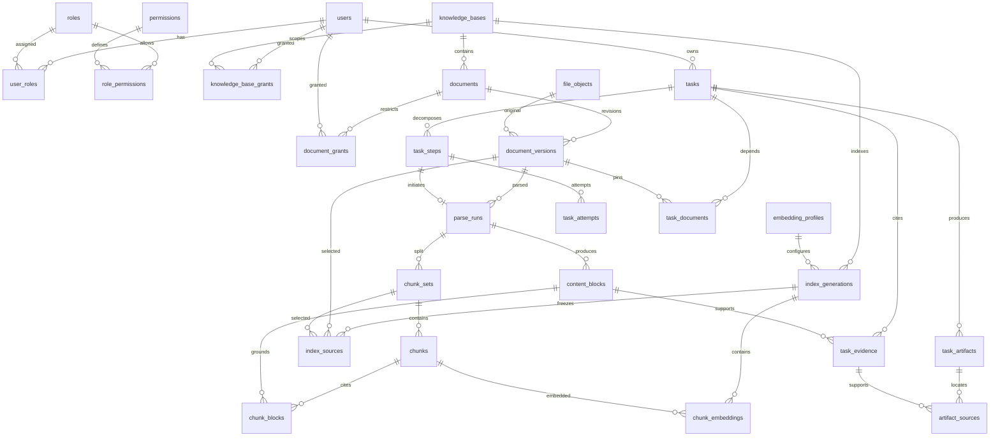

# 数据库设计

日期：2026-11-10。状态：首版逻辑表结构与关系设计草案，待审阅；尚未创建数据库、编写迁移或验证 SQL。

依据：[SPEC](SPEC.md)、[角色需求](README.md#角色需求)、[模型与解析方案](architecture/模型与解析方案.md)、[前后端技术方案](architecture/前后端技术方案.md)。数据库采用 PostgreSQL + pgvector，BGE-M3 首版采用 1024 维稠密向量，应用通过 SQLAlchemy、Psycopg 3 访问，Alembic 管理迁移。

## 1. 范围与设计假设

本文件定义用户权限、文档版本、解析结果、向量索引、任务记录及必要的文件和审计关联。字段是迁移设计的输入，不是已执行的建表 SQL；物理性能参数和具体数据库版本尚未确定。

| 选择 | 原因与边界 |
| --- | --- |
| 关系表保存身份、权限、版本和引用；JSONB 保存可变解析结构 | 保留可校验关联，同时容纳 MinerU 表格、坐标等不同内容；不采用整本手册一个巨大 JSON 的建模方式 |
| 角色能力 + 资料范围授权 | 管理系统配置不自动获得业务正文权限；不采用“管理员全部可读”的隐式规则 |
| 原件版本、解析批次、切分批次、索引代际分别保存 | 重新解析和切换模型不覆盖历史依据；不在原有片段上直接改写内容 |
| 业务任务、步骤、执行尝试分别保存 | 一次用户任务可能含多个步骤，重试不是新业务任务；Celery 消息标识不是业务主键 |

以下是为形成可实施草案提出的默认假设，不等于用户已确定的业务政策：

- 首版面向一家企业，按知识库组织资料；不预设 SaaS 多租户、部门树或用户组。部门授权后续可增加组成员关系，不能把知识库误当成公司租户隔离。
- 数据结构允许一人多个角色；是否向管理员开放角色兼任入口，沿用角色文档中的待确认状态。
- 资料权限按知识库继承，支持单份文档收紧或单独授权；同一文档的历史版本继承当前文档权限。
- 一份逻辑文档表示同一来源、同一适用范围的一条修订序列，最多一个现行版本。并行有效的不同设备或适用范围，分开登记文档，不能强行归为同一修订序列。
- 每个知识库有一个默认启用索引代际；查询多个知识库时分别使用其对应向量配置检索，再合并候选。历史索引用于审计与回退，不默认提供任意历史检索入口。
- 本轮不展开计算公式库、计算明细、计费和系统配置表；任务保存执行与输入快照并预留输出溯源。正式计算功能实施前需补齐公式版本与计算记录设计，不能只用自由 JSON 取代它们。

## 2. 总体关系

图中省略身份绑定、文件附件、任务分享、消息发件箱和审计等辅助边；完整外键以以下表格和第 9 节为准。

## 3. 全局字段与约束约定

- 普通实体表主键为 `id uuid`，由应用产生；连接表使用明确列出的联合主键。表格中的 `?` 表示允许 NULL，其余列必填；`FK → 表` 默认引用该表 `id`。
- 普通实体表统一包含 `created_at timestamptz`；可变记录另有 `updated_at timestamptz`。时间按 UTC 保存、展示时转换。连接表仅在明确列出时记录时间。
- 哈希使用 `text` 存储 SHA-256 十六进制值并校验格式；哈希辅助完整性判断，不充当全库唯一业务标识。外部版本未知时为 NULL，不写入伪造的版本字符串。
- 状态使用 `text + CHECK` 限定允许值。计数、序号和大小为非负或正值；JSONB 必须校验顶层类型和约定的结构版本。精确计算数值不能默认通过浮点 JSON 往返。
- 业务外键默认 `ON DELETE RESTRICT`，业务标识不原位修改。仅角色映射、授权等可再生连接允许按明确清理流程删除；不对文档→任务证据整条链使用级联删除。
- 外键不会自动为引用列建立适用的查询索引；按第 10 节显式创建。跨表规则使用复合外键或约束触发器，不能用只适合行内判断的 CHECK 假装完成跨表校验。[PostgreSQL 约束说明](https://www.postgresql.org/docs/current/ddl-constraints.html)

## 4. 用户、角色与资料权限

### 4.1 表结构

| 表 | 关键字段与类型 | 主键、外键及约束 |
| --- | --- | --- |
| `users` | `id`；`display_name text`；`status text`；`authz_revision bigint DEFAULT 0` | 状态 `active/disabled`；停用保留历史任务归属 |
| `user_identities` | `id`；`user_id uuid`；`provider text`；`subject text` | FK → users；UNIQUE(provider, subject)；身份绑定与业务用户分开，不保存明文密码或会话令牌 |
| `roles` | `id`；`code text`；`name text` | code 唯一；初始角色 `user/knowledge_admin/system_admin` |
| `permissions` | `id`；`code text`；`description text` | code 唯一；权限码由迁移种子维护，首版不提供任意脚本式权限规则 |
| `user_roles` | `user_id uuid`；`role_id uuid`；`granted_by uuid?`；`granted_at timestamptz` | PK(user_id, role_id)；FK → users、roles；granted_by → users，NULL 仅用于初始化并记录审计 |
| `role_permissions` | `role_id uuid`；`permission_id uuid` | PK(role_id, permission_id)；对应外键 |
| `knowledge_bases` | `id`；`name text`；`status text`；`content_revision bigint DEFAULT 0`；`acl_revision bigint DEFAULT 0`；`active_generation_id uuid?` | 状态 `active/archived`；活动索引必须属于本知识库，见第 9 节 |
| `knowledge_base_grants` | `knowledge_base_id uuid`；`user_id uuid`；`access_level text`；`granted_by uuid`；`granted_at timestamptz` | PK(knowledge_base_id, user_id)；外键到 knowledge_bases/users；等级 `read/manage` |
| `document_grants` | `document_id uuid`；`user_id uuid`；`access_level text`；`granted_by uuid`；`granted_at timestamptz` | PK(document_id, user_id)；外键到 documents/users；等级 `read/manage` |

身份提供方、登录会话和本地口令方案仍待选择；`user_identities` 仅定义稳定身份映射，不表示已完成认证设计。

### 4.2 权限的计算方式

角色决定操作能力，授权表决定资料范围，两项必须同时满足。范围等级 `manage` 包含该范围的 `read`，但不能补足角色本身缺少的操作权限。

| 角色 | 初始能力建议 | 不自动授予 |
| --- | --- | --- |
| 普通使用者 | `knowledge.query`、`document.read`、`task.create`、`task.read`、`task.share` | 资料修改、权限分配、系统配置 |
| 知识管理员 | `document.read`、`document.manage`、`task.read`、`task.share`；创建维护任务通过 document.manage 校验 | 普通业务任务创建、未分配资料、全局权限管理 |
| 系统管理员 | `user.manage`、`access.manage`、`system.configure`、`operations.read` | 业务正文与用户任务内容；运维接口只返回必要状态与标识 |

资料读取规则：用户 active、具有 `document.read`、知识库 active、文档未删除，且符合以下范围判断：

- `documents.access_mode=inherit`：匹配知识库授权 **或** 文档直接授权即可；没有授权即拒绝。
- `access_mode=restricted`：仅文档直接授权生效，知识库授权不再继承；无文档授权则拒绝。
- 文档修改再要求 `document.manage` 以及同一规则计算出的 `manage` 范围。创建文档要求所在知识库的 manage 范围。
- 授权与 `access_mode` 的变更仅由 `access.manage` 路径完成；资料编辑接口不能顺带扩大访问范围。系统管理员授权操作留痕，自我授权是否需要审批仍待企业政策确定。
- 文档授予范围会作用于所有版本；首版不支持对同一文档各版本设置不同 ACL。文档不能跨知识库直接修改归属，迁移需显式流程重新评估权限与索引。

知识库列表只显示用户被授予或有可读文档的知识库；单文档授权不能使整个知识库的其他文档标题可见。

授权新增/删除、用户停用、角色变更分别更新相关 `acl_revision/authz_revision` 并记录审计。角色权限变化时递增所有受影响用户的 authz_revision。缓存按这些修订失效；不将构建索引时的权限快照作为当前授权依据。

首版以统一后端授权查询为强制路径，数据库外键不承担访问控制。RLS 可作为后续纵深防护，尚未实现；若启用，须测试连接池身份上下文及所有者、超级用户的绕过行为。[PostgreSQL RLS](https://www.postgresql.org/docs/current/ddl-rowsecurity.html)

## 5. 文件与文档版本

| 表 | 关键字段与类型 | 主键、外键及约束 |
| --- | --- | --- |
| `file_objects` | `id`；`storage_name text`；`object_key text`；`sha256 text`；`byte_size bigint`；`mime_type text`；`status text`；`created_by uuid?` | UNIQUE(storage_name, object_key)；created_by → users；状态 `pending/available/deletion_pending/deleted`；size ≥ 0 |
| `documents` | `id`；`knowledge_base_id uuid`；`title text`；`category text?`；`access_mode text`；`current_version_id uuid?`；`deleted_at timestamptz?`；`created_by uuid` | FK → knowledge_bases/users；模式 `inherit/restricted`；当前版本同文档约束见第 9 节 |
| `document_versions` | `id`；`document_id uuid`；`version_no integer`；`revision_label text?`；`source_file_id uuid`；`selected_chunk_set_id uuid?`；`status text`；`applicability jsonb`；`effective_at timestamptz?`；`published_by uuid?`；`published_at timestamptz?`；`created_by uuid` | FK → documents/file_objects/chunk_sets/users；UNIQUE(document_id, version_no)；UNIQUE(document_id, id)；版本序号 > 0；状态 `draft/effective/superseded/withdrawn` |

- `version_no` 是系统内部修订序号；`revision_label` 是手册原始版本号，可未知。上传时间不代表生效时间。
- 原件文件上传完成、校验通过后变为 available；只有 available 原件能用于解析或发布。发布行为与解析完成独立，业务现行版本可能暂时尚不可检索。
- 原件和版本适用信息冻结后不原位更改；替换原件或改变适用条件创建新版本。标题和分类可修改，但历史任务记录实际使用的文件及版本。
- 用部分唯一索引保证每份文档最多一条 `status=effective`。发布事务锁住 documents 行，旧版本设 superseded、新版本设 effective，更新 current_version_id 和知识库 content_revision；撤销现行版则清空指针并设 withdrawn。
- `current_version_id` 只用于解析“当前版本”；历史引用保存 version_id，不能在读取时偷偷跳到新版本。
- `selected_chunk_set_id` 指向该版本当前选用的 ready 切分集合，允许从空变为可检索或切换到新解析结果；这是派生知识选择，不改原件和适用条件，变更递增知识库 content_revision。历史任务仍使用原先片段。
- 文件内容不进入 PostgreSQL 大字段；完整解析包、原图和产物放文件存储。file_objects 没有独立的通用读取授权，必须通过文档、解析产物或任务上下文检查权限。相同哈希不自动合并不同权限范围的文件，也不向用户暴露全库重复检测结果。

## 6. 解析结果与检索片段

| 表 | 关键字段与类型 | 主键、外键及约束 |
| --- | --- | --- |
| `parse_runs` | `id`；`document_version_id uuid`；`task_step_id uuid`；`origin text`；`parent_run_id uuid?`；`provider text?`；`model_option text?`；`model_revision text?`；`remote_task_id text?`；`request_config jsonb`；`output_schema_version text`；`status text`；`error_code text?` | FK → document_versions/task_steps/parse_runs；UNIQUE(task_step_id)；origin 为 `provider/manual`；状态 `pending/submitted/running/succeeded/failed/needs_review` |
| `parse_artifacts` | `id`；`parse_run_id uuid`；`file_id uuid`；`kind text`；`logical_name text` | FK → parse_runs/file_objects；UNIQUE(parse_run_id, logical_name)；kind 为 `raw_response/structured/markdown/image` |
| `content_blocks` | `id`；`parse_run_id uuid`；`parent_block_id uuid?`；`ordinal integer`；`kind text`；`text_content text?`；`structured_content jsonb`；`locator jsonb`；`review_status text`；`reviewed_by uuid?`；`reviewed_at timestamptz?` | FK → parse_runs/content_blocks/users；UNIQUE(parse_run_id, ordinal)；UNIQUE(parse_run_id, id)；review 为 `unreviewed/approved/rejected`；父块同批次且无循环 |
| `chunk_sets` | `id`；`parse_run_id uuid`；`splitter_version text`；`splitter_config jsonb`；`config_hash text`；`status text` | FK → parse_runs；UNIQUE(parse_run_id, config_hash)；UNIQUE(id, parse_run_id)；状态 `building/ready/failed` |
| `chunks` | `id`；`chunk_set_id uuid`；`ordinal integer`；`content text`；`content_hash text`；`token_count integer?` | FK → chunk_sets；UNIQUE(chunk_set_id, ordinal)；UNIQUE(id, chunk_set_id)；ready 后内容不可变 |
| `chunk_blocks` | `chunk_id uuid`；`chunk_set_id uuid`；`parse_run_id uuid`；`block_id uuid`；`ordinal integer` | PK(chunk_id, block_id)；UNIQUE(chunk_id, ordinal)；复合外键保证片段和块来自同一解析批次，见第 9 节 |

`locator` 使用带 `schema_version` 的 JSON：PDF 文件页序号采用 1 起始整数，印刷页码另存字符串；坐标同时记录坐标系与页面尺寸；Word/Excel 使用实际章节、表格或单元格定位。缺失位置保持缺失，不伪造数值。表格数据保存行列、表头和合并关系，公式与变量定义及脚注通过块关系和 chunk_blocks 关联。

一次 parse_run 表示逻辑解析批次，网络重试复用远端任务标识；主动重新解析创建新批次。`origin=manual` 表示人工校正后的新批次，必须有同文档版本的 parent_run_id；复用原文定位，不将校正伪装成服务原始输出。

成功解析的内容与 ready 切分集合不可原位覆盖；复核状态变化单独审计。拒绝块不能进入正式证据。未复核块可以作为明确标识的候选依据，但关键公式、变量、单位有歧义时暂停正式计算；检索命中不等于业务复核通过。

本轮采用块级审批的保守默认：只要片段关联 rejected 块，该片段就不参与检索；状态变化后实时过滤，不能等重建索引才生效。ready 集合至少有一个片段，每个片段至少关联一个块。

## 7. 向量配置、索引代际与物理索引

### 7.1 表结构

| 表 | 关键字段与类型 | 主键、外键及约束 |
| --- | --- | --- |
| `embedding_profiles` | `id`；`provider text`；`model_name text`；`model_revision text?`；`dimension integer`；`distance_metric text`；`preprocess_config jsonb`；`config_hash text` | config_hash 唯一；首版 CHECK dimension = 1024、distance_metric = cosine；配置创建后不可改写；不保存 API 密钥 |
| `index_generations` | `id`；`knowledge_base_id uuid`；`embedding_profile_id uuid`；`build_step_id uuid`；`source_revision bigint`；`status text`；`expected_chunk_count bigint`；`build_report jsonb`；`ready_at timestamptz?` | FK → knowledge_bases/embedding_profiles/task_steps；UNIQUE(build_step_id)；UNIQUE(knowledge_base_id, id)；状态 `building/ready/failed/retired` |
| `index_sources` | `generation_id uuid`；`document_id uuid`；`document_version_id uuid`；`chunk_set_id uuid` | PK(generation_id, document_id)；UNIQUE(generation_id, chunk_set_id)；FK → index_generations/chunk_sets；复合 FK(document_id, document_version_id) → document_versions(document_id, id) |
| `chunk_embeddings` | `generation_id uuid`；`chunk_set_id uuid`；`chunk_id uuid`；`embedding vector(1024)`；`created_at timestamptz` | PK(generation_id, chunk_id)；复合外键限定代际成员，见第 9 节；向量非 NULL，拒绝非有限值及零范数向量 |

`index_generations` 是业务上可切换的一组索引数据；HNSW 是数据库加速查询的物理索引，两者不是同一个概念。索引代际固定模型配置和来源清单，不能混入另一模型的向量；新模型维度变化需新增表或调整分区设计及迁移，不直接写入首版 vector(1024)。

`index_sources` 每个文档只选择当前版本及其 selected_chunk_set_id 指定的 ready 切分批次；所属知识库、解析批次和文档版本通过第 9 节约束保证。若文档当前尚无合格解析与切分，build_report 中明确列出不可检索版本及原因，不无声退回过期版本。构建任务的 task_documents 也登记这些被检查但未入索引的版本，使报告遵循同样的数据权限。

首版完整知识库索引构建要求发起人有 document.manage 能力、知识库 manage 范围，并可管理该库所有未删除的现行文档（包括尚不可检索项）；范围不足时任务阻断，不能忽略受限文档后把不完整索引切为全库默认。这是待审阅的维护权限默认值，后续若需要专用服务身份构建，应另行设计其授权与审计。

### 7.2 构建、切换与查询

1. 创建 building 代际，记录知识库 content_revision，并在一致快照中固定 index_sources。来源清单冻结后只允许补齐对应向量，不允许悄悄改变来源。
2. 仅为清单中的片段生成向量；相同片段与完全相同配置的旧向量可复制复用，避免重复 API 调用；复用仍保留新代际独立成员记录。
3. 核对清单对应的完整片段集合、实际向量数量、向量有效性和失败记录；不能只比较两个总数而漏掉错配成员。通过后设 ready，数量相符不代表检索质量已通过。
4. 切换事务依次锁住 knowledge_bases 和目标 index_generations 行，确认代际属于本库、状态 ready、来源仍适用、向量成员完整及 source_revision 未过期，然后更新 active_generation_id。content_revision 在发布/撤销版本、删除资料、切换其选用解析切分或否定内容时递增。
5. 查询读取活动代际及其向量配置，并在 SQL 中联查实时用户授权、文档有效状态、当前版本、selected_chunk_set_id 和块拒绝状态；候选送入模型、返回结果及下载前再次检查访问条件。人工校正后已不再被选用的旧切分集合即刻停止参与检索，不等新索引启用。索引没有权限副本。
6. 数据更新导致旧代际部分过期时，旧版本候选被过滤，明确提示当前资料尚未完成索引；补建新代际后切换。不用旧版本填补新版本缺失。
7. 回退执行与首次激活相同的锁定和完整性校验，只切换至仍满足当前来源与权限规则的 ready 代际。若旧代际来源已过时或已 retired，则新建代际重建，不复活已清理代际。向量配置与代际一起切换。

初期可用精确向量查询作为正确性基线；需要近似检索时评估 HNSW + cosine。权限、知识库和代际过滤可能降低近似查询的返回数量，需测试迭代扫描、分区或精确回退，不能将少于 top-k 自动解释为“无相关资料”。[pgvector 索引与过滤说明](https://github.com/pgvector/pgvector#filtering)

## 8. 任务、重试、证据与产物

### 8.1 表结构

| 表 | 关键字段与类型 | 主键、外键及约束 |
| --- | --- | --- |
| `tasks` | `id`；`owner_user_id uuid`；`kind text`；`status text`；`idempotency_key text`；`input_snapshot jsonb`；`input_hash text`；`execution_snapshot jsonb`；`error_code text?`；`started_at timestamptz?`；`finished_at timestamptz?`；`deleted_at timestamptz?` | FK → users；UNIQUE(owner_user_id, idempotency_key)；kind 为 `query/parse/index_build/calculate/export`；状态见 8.2 |
| `task_input_files` | `task_id uuid`；`file_id uuid`；`input_name text` | PK(task_id, input_name)；FK → tasks/file_objects；仅绑定获准使用且 available 的输入文件，文件下载继承任务权限 |
| `task_shares` | `task_id uuid`；`user_id uuid`；`granted_by uuid`；`granted_at timestamptz` | PK(task_id, user_id)；FK → tasks/users；仅赋予查看该任务，不赋予资料访问权；只有具备 task.share 的任务所有者可分享 |
| `task_steps` | `id`；`task_id uuid`；`step_key text`；`position integer`；`kind text`；`status text`；`attempt_count integer DEFAULT 0`；`lease_token uuid?`；`lease_until timestamptz?`；`next_run_at timestamptz?`；`completed_at timestamptz?` | FK → tasks；UNIQUE(task_id, step_key)；UNIQUE(task_id, position)；UNIQUE(task_id, id)；position > 0；状态见 8.2；成功步骤不重复提交业务结果 |
| `task_attempts` | `id`；`step_id uuid`；`attempt_no integer`；`celery_message_id text?`；`worker_name text?`；`status text`；`started_at timestamptz`；`finished_at timestamptz?`；`error_code text?`；`diagnostic jsonb` | FK → task_steps；UNIQUE(step_id, attempt_no)；状态 `running/succeeded/failed/interrupted`；诊断字段脱敏，不存正文或密钥 |
| `task_documents` | `task_id uuid`；`document_version_id uuid`；`purpose text` | PK(task_id, document_version_id)；FK → tasks/document_versions；保存任务明确输入及实际使用的资料依赖，purpose 为 `input/evidence/both` |
| `task_evidence` | `id`；`task_id uuid`；`document_version_id uuid`；`block_id uuid`；`chunk_id uuid?`；`generation_id uuid?`；`quote_snapshot text`；`locator_snapshot jsonb`；`review_snapshot text`；`content_hash text` | FK → content_blocks/chunks/index_generations；复合 FK(task_id, document_version_id) → task_documents；chunk_id 与 generation_id 同时为空或同时有值 |
| `task_artifacts` | `id`；`task_id uuid`；`file_id uuid`；`kind text`；`validation_status text`；`validation_report jsonb` | FK → tasks/file_objects；UNIQUE(task_id, id)；状态 `pending/passed/failed/not_verified`；kind 为已约定格式标识 |
| `artifact_sources` | `artifact_id uuid`；`evidence_id uuid`；`output_locator text` | PK(artifact_id, evidence_id, output_locator)；FK → task_artifacts/task_evidence；同任务约束见第 9 节；定位如 sheet/cell、段落或字段路径 |
| `task_outbox` | `id`；`step_id uuid`；`dispatch_no integer`；`event_type text`；`status text`；`available_at timestamptz`；`published_at timestamptz?`；`publish_attempts integer DEFAULT 0` | FK → task_steps；UNIQUE(step_id, dispatch_no)；状态 `pending/published/failed`；event_type 为 `execute_step`；消息仅包含步骤及派发标识 |
| `audit_events` | `id`；`actor_user_id uuid?`；`actor_kind text`；`action text`；`target_type text`；`target_id uuid`；`request_id text`；`summary jsonb`；`created_at timestamptz` | actor_user_id → users；actor_kind 为 `user/system`；系统事件才可无用户；target 为审计标识，不伪称可跨任意表建立外键；追加写入 |

任务的原始参数、单位和输出要求放入带结构版本的 input_snapshot；input_hash 对规范化后的任务种类、参数及输入文件哈希清单计算。execution_snapshot 保存实际模型配置标识、程序版本及必要设置，不保存密钥。用户上传的业务输入文件通过 task_input_files 建立外键；不得通过绑定他人 file_id 绕过原有资料授权，若附件来自已有文档，必须同时登记 task_documents 依赖。

任务证据至少锚定一个具体内容块；经过检索选出的证据还记录片段和索引代际，直接原文引用则二者均为空。证据不外键引用 chunk_embeddings，避免清理旧向量时破坏历史引用；插入时校验其曾属于对应代际及片段。

产物中的引用通过 artifact_sources 定位到结果字段或单元格，再到 task_evidence、原文块与文档版本。计算产物还需在正式计算设计中追加“输出位置→计算记录→公式版本”的关联；本轮没有虚构已完成的计算数据模型。

### 8.2 状态与可靠执行

- tasks 状态：`pending/running/waiting_input/succeeded/failed/cancelled`；task_steps 状态：`pending/running/waiting_external/waiting_input/retry_wait/succeeded/failed/cancelled`。
- pending 任务被接受执行后进入 running；关键缺项转 waiting_input；最终验证通过才进入 succeeded；失败与取消是终态。用户修改已冻结输入后创建新任务，不能复用旧幂等键提交不同参数。
- 同一任务同一幂等键且 input_hash 一致时返回原任务；不同输入返回冲突，统一规范化与哈希算法。首版步骤按 position 顺序执行，前序未成功时不能开始后序；暂不引入通用 DAG 和并行依赖调度。
- 创建任务/步骤与 outbox 记录在一个数据库事务内完成。派发进程向 RabbitMQ 发布并取得确认后标记 published；发布成功但标记失败会重发，因此 Worker 必须幂等。
- Worker 原子领取步骤并获得新 lease_token，记录 task_attempts。提交结果时必须匹配当前 token，防止租约过期的旧 Worker 覆盖新结果；跨外部服务无法承诺事务级“恰好一次”。
- 等待 MinerU 时记录远端任务标识并进入 waiting_external，后续唤醒复用同一逻辑解析批次。提交是否成功未知时进入待核对流程，不盲目重传。
- 定时扫描 pending/retry_wait、过期租约和未发 outbox，有限重试并恢复；需要周期唤醒机制，但不因此自动决定使用 Celery Beat。自动重试不会修改冻结输入。
- outbox 的 published 只说明消息发布，task_attempts 的 succeeded 只说明一次执行成功，均不代替 tasks 和产物校验的业务完成状态。[Celery 确认与重试说明](https://docs.celeryq.dev/en/stable/userguide/tasks.html)

### 8.3 结果与分享的权限

读取任务正文、输入、证据或产物须同时满足：用户 active、具有 task.read、为所有者或 task_shares 接收者，并且当前仍可读取任务涉及的全部 task_documents。维护任务也不能让知识管理员读取其他人的业务任务。

Worker 以任务所有者的当前能力和数据范围执行：开始步骤、向外部服务提交数据及产物可见前都复核，不能沿用过期授权快照。禁用用户或撤权后停止相关业务内容输出，安全状态接口只返回“访问条件已变化”等必要信息。

首版采用保守的整份产物控制：任一依赖失去权限或被删除，整份产物禁止预览/下载；不承诺自动逐段脱敏。历史版本 superseded 不等于禁止阅读，仍可按当前文档权限查阅并标注历史状态。已下载到用户设备的文件无法通过数据库撤权追回。

## 9. 必须落实的跨表不变量

| 不变量 | 数据库实现要求 |
| --- | --- |
| 文档当前版本属于该文档 | documents 的 (id, current_version_id) 复合 FK → document_versions(document_id, id)，允许空指针；循环建表后追加可延迟约束 |
| 当前指针与 effective 状态一致 | 延迟约束触发器在事务提交检查：有 effective 行时指针指向它；无 effective 行时指针为空；发布同时锁文档行 |
| 选用切分集合属于该版本 | document_versions.selected_chunk_set_id 外键到 chunk_sets；触发器验证其 parse_run 属于该版本且集合 ready |
| 知识库活动索引属于该知识库 | knowledge_bases 的 (id, active_generation_id) 复合 FK → index_generations(knowledge_base_id, id)；触发器检查活动代际 ready |
| 块父子属于同一解析批次 | (parse_run_id, parent_block_id) 复合 FK → content_blocks(parse_run_id, id)；约束触发器阻止自引用与循环 |
| 片段和原文块来自同一批次 | chunk_blocks 的 (chunk_id, chunk_set_id) → chunks(id, chunk_set_id)，(chunk_set_id, parse_run_id) → chunk_sets(id, parse_run_id)，(parse_run_id, block_id) → content_blocks(parse_run_id, id) 三个复合 FK |
| 索引来源一致 | index_sources 的版本属于 document_id，由复合 FK 保证；切分批次归属该版本、文档属于代际知识库，由约束触发器校验 |
| 向量只写入本代际来源片段 | chunk_embeddings 的 (generation_id, chunk_set_id) → index_sources(generation_id, chunk_set_id)，(chunk_id, chunk_set_id) → chunks(id, chunk_set_id) |
| 人工修正不跨文档版本 | parse_runs.parent_run_id 指向的运行与当前运行 document_version_id 相同；manual 必须有父运行，父链无循环，由触发器校验 |
| 解析与构建步骤属于对应任务 | parse_runs 的步骤 kind 为 parse，且 task_documents 包含该版本；index_generations 的步骤 kind 为 index_build，其所有来源版本均记入所属任务的 task_documents，冻结清单时同事务登记 |
| 证据版本、块、片段和代际匹配 | task_evidence 插入时触发器检查块所在版本、chunk_blocks 归属及 chunk_embeddings 当时成员关系；插入后正文、引用和快照冻结 |
| 产物引用不跨任务 | artifact_sources 的证据和产物 task_id 相同，由约束触发器校验 |
| 元数据不会在后续更新中破坏关系 | ready/succeeded 解析与切分来源、索引清单和配置禁止原位变更；documents.knowledge_base_id 固定；受控状态变更与删除执行事务校验 |

上述约束是待实现要求，不是已经生效的数据库保护。触发器须覆盖引用端与被引用端的相关更新，不能只校验首次插入。普通外键之外的触发器须纳入 Alembic、迁移测试及批量导入验证；数据库触发器也不能替代接口权限检查。

## 10. 索引与查询路径

| 查询路径 | 首版索引设计 |
| --- | --- |
| 用户资料范围 | 授权表联合主键 + 反向 (user_id, knowledge_base_id)/(user_id, document_id) 索引；user_roles 增加 role_id 反向索引 |
| 知识库文档与版本 | documents(knowledge_base_id)；document_versions(document_id, version_no) 唯一索引；document_versions(document_id) WHERE status='effective' 唯一索引 |
| 解析与切分追溯 | parse_runs(document_version_id, created_at)；content_blocks(parse_run_id, ordinal)；chunk_sets(parse_run_id)；chunks(chunk_set_id, ordinal)；chunk_blocks(block_id) |
| 索引来源过滤 | index_generations(knowledge_base_id, status)；index_sources(document_version_id)、index_sources(chunk_set_id)；chunk_embeddings(chunk_id) |
| 向量查询 | 基线精确 cosine 查询；按实测增加 HNSW vector_cosine_ops，评估代际/知识库过滤和权限过滤的召回；不预定每代际一个物理索引 |
| 关键词与型号 | 型号、公式编号的结构化筛选优先；中文分词、全文索引和混合排序以样本确定，不默认英文分词适用 |
| 任务列表与恢复 | tasks(owner_user_id, created_at)；task_shares(user_id, task_id)；task_steps(status, next_run_at)、task_steps(status, lease_until)；task_outbox(status, available_at) |
| 依赖失效与审计 | task_documents(document_version_id, task_id)；task_evidence(block_id)；audit_events(target_type, target_id, created_at) |

所有实际使用的外键均按查询与删除校验负载补索引；不为每个 JSONB 字段预建 GIN。性能优化以真实规模和查询计划为依据。

## 11. 更新、删除与历史保留

| 事件 | 必须处理 |
| --- | --- |
| 新手册版本发布 | 更新当前指针及内容修订；创建新的解析、切分与索引成员，历史任务继续指向原版本 |
| 人工校正解析或改变切分规则 | 创建新 parse_run/chunk_set；新旧结果分别保留；选择新批次构建新代际，不改旧证据 |
| 权限撤销或用户停用 | 立即使用当前权限拒绝访问；失效缓存、停止后续外发；历史产物遵循 8.3，不等待向量清理 |
| 逻辑删除文档 | 标记 documents.deleted_at，隐藏标题、原件和派生内容，递增内容与权限修订，禁止相关任务产物下载 |
| 清理历史向量 | 按与激活相同顺序锁知识库及代际，确认非活动、非在建且不需回退后先提交 retired 状态，再批量删除 chunk_embeddings；中断可续清理，retired 不可再激活；保留代际元数据、片段、块与证据 |
| 最终内容清除 | 按已确认留存政策清理原件、解析文件、块/片段正文、证据快照及依赖产物；需保留审计时使用无正文的墓碑记录，不能保留可恢复正文的“审计副本” |
| 用户离职 | 停用身份与用户，保留稳定主键和必要归属；个人信息清理按政策处理，不级联删除全部业务依据 |

首版不设计自动永久删除定时任务；留存期、审批与备份删除窗口尚待企业确定。撤权无法删除已发送至第三方的资料，第三方留存另按服务条款处理。

数据库与文件存储没有共同事务：上传先建 pending 文件记录，确认文件完整后再发布引用；孤立文件通过可恢复清理流程处理。删除先标记 deletion_pending 并禁止读取，文件删除成功后置 deleted。备份必须同时覆盖数据库与其引用文件并验证恢复后哈希和引用完整性。

最终内容清除允许在专用清理路径中打破正文不可变规则，但保留不可复原内容的标识和必要关系；实体不默认物理删除。执行前依据依赖清单枚举所有块、片段、证据及产物，完成后验证不可经缓存或旧下载链接访问。

## 12. 实施与验收边界

迁移建议顺序：身份与角色 → 知识库与文件 → 文档/版本 → 任务/步骤 → 解析/切分 → 向量配置/索引 → 证据/产物/发件箱/审计 → 循环外键、触发器及索引。Alembic 的技术表 `alembic_version` 与业务表分开，不手工修改迁移版本冒充升级完成。

在正式计算功能实施前补齐计算公式与明细扩展的实际需求；生成模型调用配置不在本轮建表范围。具体身份认证、部门授权、共享审批、版本生效裁定、保留期和性能阈值仍需确认。

必须用真实 PostgreSQL + pgvector 验证以下情况，不能仅用 SQLite 或模型自评代替：

1. 系统管理员有配置权限但无业务范围时，读不到原文或任务正文；知识管理员不能扩大自己的资料范围。
2. restricted 文档不会因知识库授权而泄露；直接文档授权仅放开目标文档。
3. 发布新版本不会改变旧任务引用；跨文档当前指针和多个 effective 行被拒绝。
4. 跨解析批次块关系、跨版本切分来源、跨知识库索引来源均被拒绝。
5. 错维度、错代际片段被拒绝；新旧模型切换不会混用查询向量。
6. 构建期间发生发布、删除或拒绝内容时，过期代际不能直接启用；撤权对新旧索引均立即生效。
7. 重复派发、发布后崩溃和 Worker 租约过期不会重复提交业务结果；远端任务结果未知可明确处理。
8. 任务分享不扩大资料权限；依赖被撤权后的整份产物不可下载。
9. 旧向量可以清理而历史原文引用仍可定位；永久内容清除后没有证据快照旁路。
10. 升级、备份恢复与文件完整性检查通过，并记录未覆盖场景。

目前仅完成设计文档与静态一致性复核；以上数据库约束、权限和故障恢复验证均未执行。
