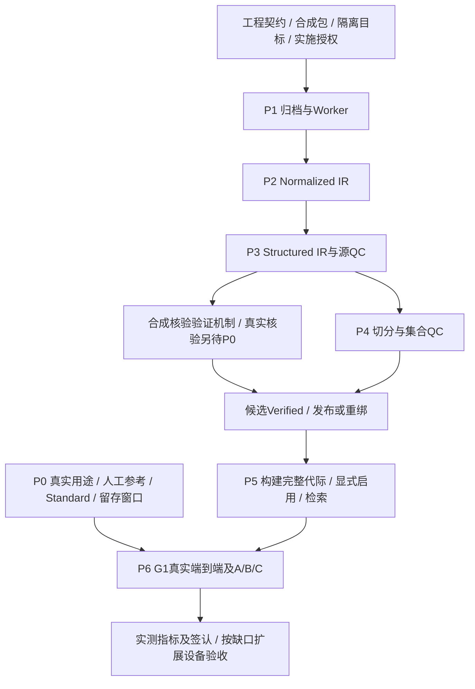

# Implementation Plan: 设备操作维护资料查询

**Feature**: 001-device-operation-maintenance-query  
**Progress**: [Project status](../../doc/planning/STATUS.md); task execution and acceptance are tracked in [tasks.md](tasks.md).
**Source**: `doc/requirements/SPEC.md` and the native feature specification in this directory

## Technical Context

This section defines the selected target stack. It is not an inventory of integrated or verified components; the local reference implementation differs as recorded in project status.

- Frontend: React + TypeScript + Vite + Ant Design; desktop web only.
- Backend: FastAPI + SQLAlchemy + Psycopg 3 + Alembic.
- Data: PostgreSQL + pgvector; file objects and parsed artifacts use controlled storage.
- Background work: Celery + RabbitMQ with persisted tasks, steps, attempts, outbox and idempotency records.
- Agent baseline: user-selected Pi embedded SDK with a controlled Node runner, Python tool bridge and private model egress; [integration design](../../doc/architecture/Pi-Agent接入与改造方案.md). Local synthetic SDK/worker/bridge evidence exists as recorded in STATUS; complete PI acceptance, real provider permissions and enterprise runtime acceptance remain unverified. Business tasks and evidence remain authoritative.
- Models/services: PDF baseline is local MinerU 4.2.3 Standard; existing Basic is a comparison baseline and cloud VLM is an optional separately approved review candidate. BGE-M3 remains the selected embedding family; actual provider/profile and real-data permission must be verified before use. See the PDF implementation plan below.
- Identity: platform-managed accounts, one-time bootstrap, protected browser sessions, CSRF protection, credential reset and revocation.
- Authorization: complete tuples covering capability, scope, operation, file dimensions, validity and business approval.
- First release result: evidence-backed query result with version, locator, status, warning and task history.

## Constitution Check

| Principle | Plan application |
| --- | --- |
| User result first | US1 is the MVP: a user can query a device manual and verify the source. |
| Evidence and honest state | FR/SC IDs require explicit evidence, pending states and no unverified completion claims. |
| Root cause and minimal scope | Shared lifecycle, authorization and provider boundaries are designed before feature expansion. |
| Data and permission boundaries | External transmission, cache invalidation, deletion and access checks are first-class tasks. |
| Traceability and reproducibility | Every query result maps to versioned evidence; task and audit records are retained. |
| Complete task and recovery | Task state, retries, cancel, refresh recovery and service failures are part of the MVP gate. |
| Real acceptance | Golden samples, browser flows, negative cases, metrics and restore/delete drills are required. |

No constitution gate is waived. Missing enterprise values such as retention duration, browser versions, RPO/RTO and service budget remain gates for the activities that consume them, rather than assumed defaults or a blanket stop on authorized isolated preparation. The [preparation baseline](baseline.md) separates local preparation, real-data pilot and release gates; the [traceability map](traceability.md) links all FR/SC to tasks, acceptance assertions and bounded evidence.

## Design Artifacts

- `spec.md`: native feature requirements, user stories, FR/SC IDs and edge cases.
- `research.md`: decisions D00–D09 and alternatives from the existing planning work.
- `data-model.md`: entities, states and invariants.
- `contracts/`: auth/session, authorization, query and UI contracts.
- `quickstart.md`: manual and integration scenarios.

This directory is the maintained first-release feature set. The old `doc/planning/first-release-device-query/` files are compatibility pointers. Project-level requirements, database and API designs retain their own responsibilities.

## Task Coverage Matrix

The IDs below are the execution IDs in `tasks.md`; task descriptions, dependencies and checkboxes are maintained there rather than assigned a second meaning here.

| Tasks | Scope | Requirements | Gate |
| --- | --- | --- | --- |
| T001–T003 | Feature entry, inventory/reference formats, environment and approval fields | FR-001, FR-012, FR-014 | Sources and recording formats are traceable |
| T004–T010 | Persistence, accounts, sessions, authorization, tasks, audit and storage | FR-002, FR-003, FR-005, FR-008, FR-010–FR-012 | Security, durability and side-effect boundaries verified in the candidate environment |
| T011–T016 | Employee query, evidence, sharing and desktop experience | FR-007–FR-009, FR-013 | Permission-filtered query → task → source verification and failure recovery |
| T017–T022 | Upload, document states, parsing, review, publication and knowledge-admin UI | FR-004–FR-007, FR-012, FR-013 | Reviewed and applicable evidence, including complex PDF cases |
| T023–T027 | Account/grant administration, services, invalidation and operational UI | FR-002, FR-003, FR-010–FR-013 | Approved access and lifecycle changes remain enforceable |
| T028 | Pre-implementation inventory, representative golden sample, human reference answers and negative cases | FR-001, FR-014, SC-001, SC-002 | Reviewed source/access/version and answer baseline before implementation that consumes real source material or judges business quality. Other inventory entries may remain pending; isolated synthetic development can proceed. |
| T029–T031 | A–F acceptance, metrics and documentation reconciliation using T028 | FR-001–FR-017, SC-001–SC-007 | Complete first-release evidence with documented limits |
| T032–T033 | Conversation/context/message persistence and permission-scoped manual lookup | FR-007–FR-009, FR-013, FR-015, FR-016 | Multi-turn recovery, scoped query, original lookup and single-answer sharing verified |
| T034 | Employee document feedback from conversations/manuals and scoped knowledge-manager handling | FR-017, SC-002, SC-004, SC-005 | Both origins work without granting conversation access or changing confirmation/review/publication states |

## Delivery Phases

These phases group existing tasks. Direct dependencies and capability slices are maintained only in [tasks Dependencies](tasks.md#dependencies). Formats, scripts, measurement definitions and documentation may be prepared before real signoffs/answers arrive; no real-data or quality gate is thereby passed. Service-revision/purpose-license/business-selection integration is the next independent engineering package, not a code change authorized by this documentation-only round.

1. **Evidence baseline**: prepare inventory/reference/negative-case formats and metric definitions; obtain actual approved samples and human answers before their formal-data and real-acceptance use. Missing real facts remain TODO while independent authorized preparation continues.
2. **Foundational security and persistence**: implement account/session/authorization contracts, database migrations, file objects, task/outbox/idempotency and audit foundations.
3. **Knowledge lifecycle**: implement upload, version states, parse/review/correction, business approval, publication and index generation.
4. **Query and task experience**: implement conversations/messages/confirmed context, permission-filtered default or narrowed retrieval, manual lookup, evidence/result persistence, recovery, single-answer sharing and desktop UI.
5. **Operations and providers**: establish data-flow approvals, quotas/costs, sanitized diagnostics, invalidation, backup/restore and deletion drills; then connect approved external services.
6. **Integrated acceptance**: execute `quickstart.md`, record SC-001–SC-007, and keep unresolved items explicitly unverified.

## Dependencies and Stop Conditions

- The required capability slices of T004–T010 and T023 establish security/persistence prerequisites. An unchecked whole task may include a validated local slice and still lack real or release evidence; do not wait for unrelated real values to prepare independent work, and do not bypass a missing security slice. Real-data access also requires business approvals.
- T007, T014, T025 and T026 block any claim that revocation, deletion or restore behavior is safe.
- T028 is upstream evidence preparation after T002 and before formal first-release data/quality use; it does not depend on user-story completion. T029 scripts, T030 measurement definitions and T031 documentation can be prepared independently. Their real execution/final closure consumes T028 and the relevant stories; T030 actual metrics consume real runs, without making preparation cyclic. T028 and T030 still block ungrounded quality claims; isolated synthetic work is not business acceptance.
- T011–T021, T032–T034 and their prerequisites block the complete employee query; T029/T030 must include the confirmed multi-turn, manual-lookup and single-answer-sharing cases.
- T022, T027 and T029–T031 block a sustained pilot and product-level completion claims.
- Calculation, report and broad-format work cannot start until the first-release gates pass.

## Implementation and Runtime Gates

The gates below are retained from the previous planning entry; an existing local reference implementation does not waive them.

- 未完成资料清单和版本/授权登记时，不发布正式查询结果。
- 未完成会话和服务端授权时，不接入真实企业资料。
- 未有人工参考答案时，不以检索命中或模型自评作为质量结论；黄金样本的实施前准备要求仍见 quickstart。
- 未完成首期查询闭环和失败路径时，不启动计算填表或多资料报告实现。
- 未完成备份恢复、删除/撤权失效和外部调用费用/配额记录时，不接入真实企业资料。

## 2026-11-17 Ordinary-User Discussion Boundary（历史讨论记录）

以下保留当时设计/授权边界；2026-11-18本地能力状态从tasks读取，不据旧句子认定当前全部未实现。完整API13目标、FR-017和真实业务验收仍不能由本地子集证据替代。

Confirmed capabilities are recorded in [project SPEC 1.3.2](../../doc/requirements/SPEC.md#132-普通使用者交互确认2026-11-17). T032/T033 are appended IDs to preserve previous task identity, not permission to postpone them until after acceptance. T011–T016 integrate these additions; no user-story or acceptance checkbox is completed by this documentation update. UI layout/visual preview and detailed failure recovery remain under discussion; API/database section 13 is a candidate mapping, not an implemented contract. Whole-conversation sharing remains out of scope.

FR-017 was subsequently confirmed in the same discussion: employee feedback from conversation/manual pages, handled by knowledge managers, separate from business confirmation and publication. T034 must integrate with T015/T016/T022 and acceptance before pilot completion. Employee progress/replies in the originating conversation/manual page, update/requery notices and old-answer retention are now confirmed. Assignment, exact status labels, notifications and manager UI remain candidate decisions. This update only records requirements and does not authorize application implementation.

## PDF Processing 实施 Plan（2026-11-18，工程复审基线）

### 授权、基线与规划入口

2026-11-18开工前工程复审已修正依赖与交付判据；本节原“待计划审核/交付后停止”描述上一轮文档授权，不是当前调度。当前任务以[STATUS](../../doc/planning/STATUS.md)和[tasks顶部](tasks.md#当前调度与本次审查preflight-001)为准；本次审查不启动业务实现。

本轮使用 `speckit-plan`，将用户已审核的 PDF Processing SPEC 细化为 P0–P6；只更新规划产物，不执行源码、DDL、依赖安装、模型推理或业务验收。**SPEC 审核通过不等于本 Plan 或开发已批准。** SPEC10/数据库22/API24中的“待审核”是上一轮形成时的标签；本轮以用户确认的内容为规划基线，不改变其字段、业务规则和历史记录。

- FEATURE_DIR：`specs/001-device-operation-maintenance-query/`；FEATURE_SPEC：`spec.md`＋[项目SPEC10](../../doc/requirements/SPEC.md#10-pdf-文档处理架构-spec2026-11-18待审核)；IMPL_PLAN：本文件；任务唯一在[tasks专项实施清单](tasks.md#pdf-processing-实施任务p0p6)。
- 代码基线：HEAD `0e2d4611dffebd9b24f933a5cf3e8c602bc9f6dd`＋当前未提交工作树，分支 `main`。不能仅凭HEAD重现；本轮候选身份与文档检查保存到被忽略的 `outputs/pdf-processing-plan/2026-11-18/`。
- `.specify/feature.json`确认现有feature；`.specify/README.md`说明尚未引入命令脚本，Skill指定的 `setup-plan.ps1`不存在，因此手动解析配置、使用已有Plan，不生成脚手架或覆盖旧文档。未发现 `extensions.yml`，无前/后hook。
- 输入：SPEC10.1–10.8、[数据库7.2/22](../../doc/database/数据库设计.md#22-document-ir-数据契约候选01)、[MinerU固定版审计11](../../doc/architecture/模型与解析方案.md#11-mineru-版本能力与输出契约审计)、[API24](../../doc/api/接口设计.md#24-pdf-处理与-ir-衔接候选)、宪章、现有T任务及实际代码。这里的“P5人工参考”指Leybold **P5.1.2.3**，是P0前置，不是索引阶段P5才补参考。

### Technical Context 与真实工程差距

沿用Python>=3.11、FastAPI/SQLAlchemy/Alembic、PostgreSQL/pgvector、Celery/RabbitMQ及既有独立Worker、私有FileObject存储、React/TypeScript/Vite。MinerU继续隔离环境运行，不并入生产Python依赖；本地固定4.2.3/DocVortex Middle 2.0，当前安装记录DocVortex 0.6.25，执行前再次核实实际producer/profile。优先Windows现有ONNX＋llama.cpp候选，硬件、模型包与实测决定其可用性，不承诺生产容量。Pi继续查询编排，不参与原内容改写、QC裁决或业务签认。

| 能力 | 当前代码事实【现有代码验证：静态】 | 本轮后续工程处理 |
| --- | --- | --- |
| 上传、权限与版本 | `services.save_upload`、`document_lifecycle`、会话/完整授权、幂等/ETag已有实现 | 复用；只补产物引用和新门禁，不重建上传/身份系统 |
| 本地解析 | `app.parse_version → services.make_parse_run → LocalPdfProvider → local_pdf → local_mineru`；请求内同步，扫描Basic，TemporaryDirectory销毁原Middle | 改为持久受理/Worker；Standard固定契约、原包归档及阶段恢复 |
| 云解析 | `accept_selected_parse → ParseServiceJob → parse_worker → MinerUAdapter`已有batch恢复、租约、原ZIP隔离 | 复用围栏/存储机制；云只备选，不为首份闭环重做云服务；不扩64KiB合成出口冒充真实准入 |
| 文件与IR | FileObject/ParseRun/ContentBlock已有；无parse_artifacts、Page、关系/两层IR受检投影 | 按数据库22增量落地；不另建Asset/Structure平台或独立文档数据库 |
| 切分 | 只写ready ChunkSet标记，无真实chunks/chunk_blocks | 新增独立类型切分、映射、一层parent-child及集合QC |
| 核验与发布 | BusinessConfirmation/VerificationEvent/ReviewSet/hold/PublicationPreview已有；critical漏参数/单位/条件/步骤；review-set当前只收draft且立即选用 | 扩关键集合/指纹、候选审核、同版source_rebind，不复制旧approved |
| 索引/检索 | `create_index`立即激活ready或ready_partial；向量按Block唯一；`search_blocks`默认关键词并追加全批警告 | 独立child代际构建、完整门禁、显式切换/回滚；按真实关系补上下文 |
| 管理与员工网页 | `src/web/features/knowledge/KnowledgeAdmin.tsx`等及query/App.tsx已有可复用页面 | 扩原页/关系/状态、候选与索引动作，不另建QC应用；旧static页面不作新主入口 |

现有功能不因原T任务未勾选而重做；T019/T020/T021/T024等仍是覆盖更广的父任务。新清单使用其`Txxx-PDF-nn`子任务标识，父任务历史与FR/SC映射保持；完成一个PDF子任务不自动关闭父任务。现有验证仅按原证据范围采信，不将模拟运行升级为业务验收。

### 关键技术决策与交付边界

1. **引擎与输出**【用户确认／官方审计】：Standard为主，Basic只历史对照；完整本地保存包为证据入口，Middle 2.0映射到`dc.document-ir/1.0`。实际档位/模式/producer与请求不符即隔离，不自动降档、上云或混用3.x参数。云VLM版本映射不明确，独立Run/协议及许可后再评估。
2. **四层持久化**【SPEC约束／需实现验证】：PDF、每Run/attempt原始输出、normalized/structured两层IR、ChunkSet成员独立持久。FileObject保存字节，parse_artifacts保存归属/来源，工作区到归档的屏障详数据库22.2。P1先完成PDF/原包，P2/P3完成两层IR，P4完成Chunk；不得提前声称四层已齐备。无原包历史批次标legacy_incomplete，保留原值，不造源坐标/版本。
3. **原文、结构和证明分离**【已审核设计】：恢复只增加容器/顺序/关系，规范化与结构化产物各自冻结；人工纠正文义/关系端点生成派生Run并链接父原包。审核证明独立追加。关系state是有效证明的读取投影，不能成为冻结IR中的第二个可写状态；必要查询索引落在受控投影，不原位改关系正文。
4. **无环门禁**【SPEC10.4.1／数据库22.7】：Parsed→Normalized→Structured→源QC；其后源人工核验与切分/集合QC分别推进，汇合候选Verified→显式Published。切分可在源QC通过而人工尚待核验时产候选，不可正式使用；源Run.succeeded只按源级判据派生。重切分仅重验集合与受影响依据；旧源真实失效先hold，新候选失败不误伤仍有效旧集合。
5. **确定性切分**【已审核／参数需样本验证】：结构→完整证据组→合法边界→长度控制；512–768 tokens目标、1536最大仅初值，取固定tokenizer/API实测token及字节上限更严者。超长原子项保留IR并标oversized，不截断；parent只按需装配，不Embedding或生成摘要。不得为通过索引而排除必需关键内容。
6. **候选与正式分离**【已审核设计】：候选ReviewSet不写selected；effective同版通过显式source_rebind，区分refresh/quality_repair。后者不要求坏旧技术资格恢复，但仍要求原业务版本/适用依据有效，不复活撤回/冲突来源。
7. **代际切换**【数据库7.2】：先冻结全库现行发布来源及expected_child_ids，独立building/持久成员/检查报告→ready→显式CAS启用。激活同事务切唯一活动指针并记录profile/manifest/回执/outbox。源重绑与索引切换为不同事务，期间整库index_stale安全拒绝，不承诺无停机。回滚只恢复当前仍合格的旧代际；源修订不兼容则新建代际，不改旧revision。
8. **检索与模型边界**【已有基础／需真实验收】：新代际内同时提供child关键词正确性基线及BGE-M3/pgvector检索；选择一种明确查询策略并冻结评测配置，不在首轮另引入重排/混合检索框架。按同source关系补必要警告、定义、条件、表头与region，逐项鉴权与预算检查。模型无权补写知识、批准内容或执行文档指令。

### P0–P6阶段、依赖与阶段验收

下表是阶段出口；各具体子任务的直接依赖、文件、交付、验证与停止条件只在tasks维护。所有阶段执行须另获相应授权，尤其依赖安装、数据迁移、真实服务及生产启用。

| 阶段 | 工程范围／子任务 | 必要输入与验收出口 |
| --- | --- | --- |
| P0 实施准备 | T028-PDF-01、T024-PDF-01、T010-PDF-01 | 先固定schema/profile契约、合成包、隔离存储/库及既有安全能力即可开展获准本地工程；G1真实参考/用途/职责、Standard实际原包及真实留存窗口分别作为真实处理与质量断言门槛。不要求云许可或扩样先齐，缺真实条件不阻塞隔离代码/技术验证 |
| P1 持久解析接入 | T019-PDF-01/02、T029-PDF-01 | 复用现有上传/授权/任务围栏；私有原包与失败产物先归档再清理，本地HTTP只受理，Worker可恢复/取消围栏。归档/DB各提交窗口中断不丢证据；候选不自动选用 |
| P2 IR及来源映射 | T020-PDF-01、T029-PDF-02 | 固定已归档原包/页清单；Normalized IR可独立读取，Page/Block/Asset/原节点一一受检；空白/失败页不丢、原页/旋转/裁区映射可回原件；未知协议隔离 |
| P3 结构与分层核验 | T020-PDF-02/03、T022-PDF-01、T029-PDF-03 | 两层IR独立冻结；七类关键内容与五类实际关系可逐项核对，源QC与人工结论分离，状态/失效原因可见。业务核验仍缺可进入P4候选工程，不得通过Verified或正式发布 |
| P4 切分与候选发布 | T020-PDF-04、T021-PDF-01、T029-PDF-04 | 真chunks/mapping/一层父子、Unicode区间与region闭合；重切分不重解析；源核验＋集合QC汇合ReviewSet，候选不改选用，显式publish/rebind及quality_repair通过围栏；失败旧指针不变 |
| P5 完整索引与检索 | T024-PDF-02、T021-PDF-02、T012-PDF-01、T029-PDF-05 | Published的完整source与实际获准embedding profile；成员双向差集/资格/向量/关键可检索覆盖全过才ready，显式原子启用和合格回滚；查询返回精确child来源/必需关联，过期或不完整代际零正式检索 |
| P6 真实验收 | T029-PDF-06、T030-PDF-01、T029-PDF-07、T031-PDF-01 | G1真实链路及同原包A/B/C、逐关键事实/关系/出处对照；实际资源与人工成本；再按缺口扩样并完成设备三角色A–F。G1成功不替代设备手册验收；阈值未签认只报告测量，不声称产线达标 |

### 模块、数据迁移与受控回退

- 在`src/server/parsing/`内新增有明确职责的`artifacts.py`（原包/清单）、`ir.py`（类型/规范化）、`structure.py`（恢复）、`quality.py`（技术检查）、`chunking.py`（切分）即可；这些是待实现目标路径，不宣称存在。不新增框架、知识图谱、调度服务或第二套状态库。
- ORM和Alembic集中沿`models.py`/`migrations/versions/`增量：P1产物与Run身份；P2 Page/Block定位；P3关系；P4 chunks/mapping；P5 embedding profile/代际成员。实施时基于当时最新head分配迁移编号，禁止在本轮预占或写DDL。新投影只以冻结manifest导入，不允许IR文件和DB各自编辑。
- 每批先做安全迁移plan，显式隔离新库及脱敏旧schema演练，检查复合外键/唯一约束、旧历史仍可读取。默认SQLite/任何非空业务库均不得自动迁移；新代码启动仍不DDL/seed。真实升级前须停写窗口、DB＋私有文件一致备份及恢复证据。
- 原Block向量/检索保留在显式legacy代际中；仅当前资格和完整性仍成立时可用。旧ready_partial永不正式启用，缺证据历史不自动补成合格。新旧查询路径整代选择，历史引文不换新ID。代码回退能否读取扩展schema须先验；不能就地downgrade删除新产物，失败优先恢复一致备份或撤销新候选，不回滚真实业务确认/权限。
- 留存期限、最低可用磁盘/归档配额、回退窗口和RPO/RTO由实际责任人落实；未知时禁止自动清理，不承诺永久留存。磁盘不足拒绝新处理并保留既有证据，不拿删旧原包换处理成功。

### 验证预算、执行入口与停止规则

代码交付、验证执行和文档收敛分开任务；业务代码任务先到IMPLEMENTED，只有对应验证观察通过才到VERIFIED。验证任务的合成技术片段可供下游本地工程消费；真实断言未完成则整项不勾选，不能误写真实已通过。验证失败返回所属工程任务修复，不新增重复“修复任务”或反复跑全量。下游只消费验证过的相关能力片段，不要求父任务全部关闭。

现有定向入口：`test_local_pdf.py`、`test_parse_service_use.py`、`test_governance.py`、`test_embedding_service_use.py`、`test_migration_safety.py`；仅对对应变更选择节点运行。新增IR/关系/切分风险在相应子任务验证文件中覆盖，不在每层重复同一断言。真实产物及标注只写被忽略受控目录；脱敏schema/断言可以入Git。运行命令和G1步骤见[quickstart PDF](quickstart.md#pdf-processing-g1-实施后验证指南)。

有限验收集的强制门槛沿SPEC10.7：关键项零静默丢失／零无依据放行，正式事实逐项有正确出处，错版本/型号/越权零放行；未决显式待核验。普通文字误差、检索阈值、人工成本/吞吐预算必须实际测量后签认，不虚设100%或生产p95。所有阶段只围绕已见风险和本次改动补证，不扩任意对抗测试。

### NEEDS CLARIFICATION 处置与宪章复核

没有阻止形成Plan的未解设计分支；下列是**EXTERNAL_PENDING运行门禁**，不是被编造为已知值：G1实际参考/核验人及适用依据（T028-PDF-01）、Standard权重完整性/目标硬件与容量（T024-PDF-01）、留存/回退/运维责任（T010-PDF-01）、所用embedding/生成服务真实准入（P5/P6前）、质量与人工预算签认（T030-PDF-01）。本地独立准备不等待云VLM准入；若Standard失败留下原包/诊断和固定失败集，再提交方案复评，不自行更换已定路线。

宪章前检与设计后复检：七项原则均有对应门禁，无豁免；证据/追溯由P0/P1/P2，权限与恢复由P1/P4/P5，最小职责由P2–P4，真实用户验收由P6承担。此结论仅为文档审查，不是产品运行通过。未发现需要推翻原SPEC的冲突；状态投影、显式候选审核和整库index_stale均按既有规则细化。本轮到Plan/Tasks及一致性检查交付停止，等待计划审核，不运行P0任务。

## Pi Agent 剩余实施 Plan（2026-11-18，六项核查整改工程复审基线）

本轮用户批准把PI-R01–06核查项补入既有Plan/tasks，仅修改文档，不批准源码、依赖、DDL、服务配置、真实外发或运行验收。既定SDK/受控Worker/业务权威路线不变；[项目PLAN的PI-00–07及PI-AC01–12](../../doc/planning/PLAN.md#pi接入实施顺序与验收)仍是阶段和验收定义，本节维护具体技术落点，[tasks的Pi子任务](tasks.md#pi-agent-核查整改实施任务)唯一维护直接依赖/状态/退出条件。不另建Pi feature或任务台账。

### 基线、复用与确实剩余的工程

基于HEAD `0e2d4611dffebd9b24f933a5cf3e8c602bc9f6dd`＋当前未提交工作树，分支main。源码/文档前态及本轮检查在被忽略的`outputs/pi-plan-revision/2026-11-18/`；静态核对不是本轮运行通过。

| 已有能力【现有代码验证：静态】 | 复用，不重复创建 | 剩余交付 |
| --- | --- | --- |
| SDK1.5.2、Node宿主、工具白名单、关闭自动重试/压缩 | `src/agent_runtime/src/`、锁文件、PI-00探针 | 实际制品/bridge/settings/profile一致性、正式服务适配及独立辅助用途 |
| Python受理/outbox、双租约、stdio调用、缺型号响应恢复 | `worker.py`、`execution.py`、`runtime_models.py/execution_models.py`及队列 | 不重建Worker或第二调度系统；补新来源依赖、日志恢复/升级与副作用未知窗口 |
| 八项查询别名及T14/T16强制交付 | context/sources/evidence/read/validate/deliver/input/control | 仍只启用查询子集；其余12项不因本次Plan自动启用；T18工具只读状态，取消恢复沿业务入口 |
| 模型投影/一次许可、固定服务修订、双调用账本与预算 | `runtime_gate.py/runtime_api.py`、`service_use.py` | 当前仍强制synthetic/loopback及固定协议形状；正式模型不是填账号即可使用 |
| Block级查询及原文摘录快照 | `execution._current_evidence`、T14就绪判断、T16拼接摘录 | 与新Chunk/region/关系/QC/代际来源适配；摘录不等于已验证生成答案 |

现有Python模块在`src/server/`根下，不为追随早期建议新建`src/server/agent/`或搬目录。新迁移如确需，仍集中现有Alembic目录、显式隔离验证；不预占版本号或改默认SQLite。历史测试/Chrome/本地SDK证据按原候选采信；PI-01–03局部已实现不等于全批通过。

### 六项整改决定及技术边界

- **PI-R01 可执行任务**：细化14项父T子任务，代码、验证、真实准入、文档收敛分别验收；不把旧8项工具和真实SDK接入重复规划。PI-04–06仍是后续计算/Excel/报告能力，待首期门槛和另行范围授权，不在这14项中偷启。
- **PI-R02 PDF→Pi来源契约**：`T012-PDF-01`负责child检索/关联组和Evidence事实；`T012-PI-01`负责消费这些受检结果进入工具返回、模型投影及T14/T16，不重新检索/拼整Block或重做解析。`runtime_gate._assemble`必须移除ready_partial准入，读取当前完整代际/不可变profile，并核对精确Version/Run/IR/ChunkSet/child/spans/region/关系、源/集合QC、ReviewSet/发布资格。必要标题、条件、单位、表头、警告按支持组闭合；缺项/预算不足安全拒绝，不让模型补造。所选模型无获准图能力时图仅供受控人工查看或返回不完整，不能替换为模型猜测。
- **PI-R03 摘要/压缩**：继续默认关闭自动压缩。业务宿主在安全空闲点显式选择answer/summary/compaction；不能只把`operation`改名或打开SDK开关。受控provider忽略任意SDK旧上下文这一边界保留，但须由后端分别构造“摘要/压缩所需的获准输入与任务指令”，再让SDK机制消费，并把生成候选作为独立受检派生产物回到L1，而非confirmed事实。来源全量依赖、覆盖范围及关键条件保全过检查后才复用；依赖不明或预算不够拒绝，不静默截断。
- **PI-R04 正式模型出口**：Node仍只访问私有网关、不拿供应商凭据。服务端绑定获准service revision、原生adapter/API family、model/capabilities/context/output/tokenizer限制、请求/响应形状、用量与费用未知语义、超时/无隐式重试及真实网络/TLS白名单；模型字段不由员工/文档/自由JSON决定。目标provider不兼容已锁定adapter就明确unsupported，另评审适配；不删除synthetic断言后直接外发。正式出口/OS限制的验证前置于真实企业调用，不推到PI-07末尾。
- **PI-R05 会话与生命周期**：按[数据库18.1](../../doc/database/数据库设计.md#181-pi核查整改的来源与生命周期契约)扩当前RuntimeJournal.version_ids为受检来源绑定及整份依赖manifest，含实际进入上下文而未被最终引用的来源。恢复需当前权限/用途、原件/Run/Chunk/关系/审核/代际与runtime_profile兼容；同Version重解析或重切分不自动复用旧分支。坏旧分支隔离，从有效L2/L3重建，不回放工具。治理覆盖working JSONL、内部快照、摘要、模型响应正文（当前`ModelCallAdmission.response_body`）和恢复副本；到期清理与审核失效隔离不同，不因过期便删除审计/原始PDF。
- **PI-R06 首期交付口径**【2026-11-18用户已确认】：首期增加有证据约束的组织答案，`T013-PI-01`按API18.5的answer-plan/1实现受限候选与逐声明核验，不开放自由文字formal或新增答案人工签批API。当前摘录能力可复用作证据展示，不可当新目标已完成；生成候选与原PDF/IR/Chunk分层存储。每条实质声明必须绑定精确来源范围、完整支持组和当前资格，关键数值/单位/公式、动作顺序/条件/警告采用已核验结构与固定renderer或有源原句，模型只组织不补值。普通改写的语义支持不能仅由引用存在/字面相似/第二模型一致证明，无法确定则该声明待核验、拒答或送人工；不能把候选当完整正式答案。T14扩为结构/来源/关键内容/支持覆盖检查，T16只交付通过的新AnswerSnapshot，业务复核仍独立；详SPEC的新增首期口径与API18.5。

### 阶段与可独立推进范围

| 工作包（沿原PI批次） | 对应子任务 | 完成出口与限制 |
| --- | --- | --- |
| 组织答案与声明核验（PI-03） | T013-PI-01 | 用户已选择首期有证据约束组织答案；候选/声明/完整支持组核验成立，摘录只作有标记的原文查看，不冒充该目标完成 |
| 制品与正式出口（PI-00/01剩余） | T024-PI-01/02、T029-PI-01、T024-PI-03 | 先完成隔离技术验证，再在真实逐服务许可内证明正式协议/能力；真实准入不由合成自检替代 |
| PDF→Pi与历史恢复（PI-02/03） | T012-PI-01、T025-PI-01、T029-PI-02 | 固定受检支持组/模型投影，不完整索引拒用；同版新来源和旧日志兼容性验证。契约开发可与PDF并行，真实跨模块验证消费PDF P5 |
| 受控辅助用途（PI-02） | T032-PI-01、T029-PI-03 | 实际业务宿主完成purpose/投影/摘要生命周期，关键条件保护及独立许可成立才开启；探针不计此验收 |
| 留存/升级/恢复（PI-07基础前置） | T010-PI-01、T029-PI-04 | 私有正文和日志治理可核对，升级/回退不恢复失效来源、许可或旧副作用；真实试点前完成适用门禁 |
| 首期联合验收与移交（PI-03/07适用部分） | T029-PI-05、T031-PI-01 | 复用G1及设备A–F同一实际运行包，不重复全量测试；只声明实际通过范围，后续办公工具仍DEFERRED |

依赖不是“PDF全部完工后重做Pi”：profile/正式出口与契约准备可先并行；来源代码消费PDF IR/Chunk/代际的对应接口，跨模块验证消费`T029-PDF-05`；最终Pi验收与`T029-PDF-06/07`共享运行/记录，G1的PDF结构验收不反向依赖Pi最终验收；设备整体A–F消费Pi技术门禁与所用生成服务准入，Pi最终汇总再消费该设备记录，不能让两个最终验收互等。真实签认、Standard、服务准入各阻断其消费活动。

### 验收、状态及宪章复核

PI-AC01–12的任务映射集中在tasks，表中的映射只表示覆盖责任，不表示通过。已有SDK/本地HTTP/合成模型测试可复用；新增断言只覆盖profile变化、child/region错误来源、同版重绑、summary/compaction真实宿主、未知派发、私有正文清理/恢复等实际风险。定向入口为`src/agent_runtime/test/pi00.test.mjs`、`test_runtime_gate.py/test_worker.py/test_pi_service_use.py/test_execution.py/test_local_queue.py`；按变更选节点，不每个包全量重跑，不把合成岗位/答案/上游作为业务验收。

前/后设计复核沿宪章：业务事实/权限仍权威，模型不能批准事实；新增生产出口、迁移、清理和真实运行均待对应授权；代码/验证/文档分离，失效证明不沿用。未改变首期设备查询目标、Pi主路线或PDF门禁，无宪章豁免。首期组织答案口径已确认；未知模型/费用/留存实际值作为任务外部前置，不用默认值补齐。本轮到文档检查交付停止；上述14项均待执行，不从本次用户同意推导开发或真实外发授权。

### 第一版试点运行接线（2026-11-19）

用户已明确批准持续本地实施，先百炼qwen3.8-flash＋本地BGE-M3完整查询，后每日备份与完整应用恢复。当前任务/验证状态只在tasks顶部，不把本节技术落点当作已通过。

- 复用现有服务修订/自检/选用/用途pin/调用账本。百炼固定主机、北京兼容路径、明确非思考参数、环境密钥引用、可信CA及公网IP pin共同进入不可变绑定，真实SDK仍只访问私有网关；未知派发不自动重发。
- 现存BGE-M3权重/tokenizer/runtime身份与本地CPU表示固定；实际向量批次复用持久lease、exact input证明、float32完整性与完整代际，显式activate。查询向量由服务端冻结问题产生，实际PGvector运算及输入/向量摘要可追溯，不能只落向量后仍用关键词假装语义检索。
- 持久试点只初始化明确标识的三角色模拟资料/审批/来源见证，固定非敏感手册manifest及allowlist；绝不从浏览器字符串自证数据来源。初始化记录阶段，配置不包含密钥/DB密码，账号初始凭据由当前Windows用户DPAPI保护。网页、后台Worker、向量及备份共用唯一显式试点配置。
- 备份覆盖当前完整schema、原件/原包/IR/任务证据/快照及实际私有日志依赖，使用一致数据库快照和文件身份清单。恢复至保留命名空间/标记的新隔离目标，正常app/worker不能直接接入；验证真实应用结果/权限/原件且不得复活备份截止点之后的治理/付费状态。缺少独立当前治理证明时拒绝陈旧披露，不把备份成功声称灾难切换完成。
- Windows每日任务仅指向本试点的明确配置/备份目录，实际触发并读取完整回执。至少保留7份，不自动purge。按当前用户登录上下文运行、StartWhenAvailable，电脑/Docker关闭时不宣称RPO持续达标；独立故障域备份按实际可用性说明。

工程模块为service_admission/runtime_gate/受控provider、local_bge/embedding_jobs/chunk_retrieval、pilot/pilot_sample、backup/backup_schedule；源规范所有权不变，API/数据库实现映射随最终实际结果更新。原G1歧义/真实岗位签认和设备A–F门槛不被模拟试点覆盖。
